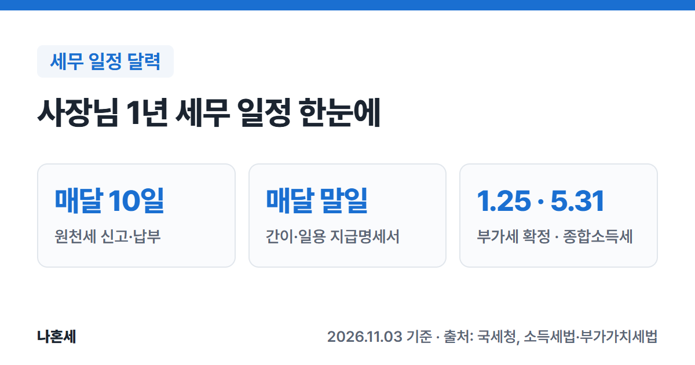

직원이나 프리랜서를 쓰는 개인사업자 사장님은 매달 챙길 신고와 1년에 한두 번 돌아오는 신고가 따로 있어요. 이 글은 그 일정을 한 장의 달력으로 정리한 **총정리 글**이에요. 신고마다 홈택스로 직접 하는 방법은 따로 글을 써서 이 달력에 차례로 연결할게요.

{: .summary-card}

> 💡 **핵심 요약**
> - **매달 10일**: 지난달 직원·프리랜서에게 준 돈에서 뗀 세금(원천세)을 신고·납부해요 [1][7]
> - **매달 말일**: 지난달 프리랜서(사업소득)·일용직에게 준 돈의 지급명세서를 내요 [2][8]
> - **1월 25일** 부가세 확정신고(일반과세자 2기·간이과세자 1년분) [3][10], **5월 31일** 종합소득세 신고 [4][11]

목차

* 목차
{:toc}

## 한눈에 보기

| 항목 | 내용 |
|---|---|
| 대상 | 개인사업자 사장님 (직원·알바·프리랜서를 쓰는 경우 매달 신고가 추가돼요) |
| 매달 | **10일** 원천세 신고·납부, **말일** 간이지급명세서·일용근로소득 지급명세서 제출 |
| 매년 | **1월 25일** 부가세, **2월 10일** 사업장현황신고, **3월 10일** 지급명세서, **5월 31일** 종합소득세, **11월 30일** 중간예납 |
| 어디서 | 홈택스(PC)·손택스(모바일 홈택스)로 전자신고 [2][4] |

날짜는 모두 법에 적힌 **원래 기한**이에요. 기한 날이 토요일·일요일·공휴일·노동절이면 그다음 날이 기한이 돼요 [12]. 그해 실제 날짜는 아래 "다가오는 마감일"과 국세청 세무일정에서 확인하세요 [6].

## 매달 챙기는 신고

직원이나 프리랜서에게 돈을 줄 때 세금을 떼고(원천징수) 주는 사장님은 매달 아래 신고를 해요. 혼자 일하는 사장님이라면 이 부분은 해당이 없을 수 있어요.

| 기한 | 할 일 |
|---|---|
| 매달 10일 | **원천세 신고·납부**: 지난달 떼어 둔 세금을 원천징수이행상황신고서로 신고하고 내요 [1][7] |
| 매달 말일 | **간이지급명세서**: 지난달 프리랜서에게 준 사업소득, 강연료 같은 인적용역 기타소득 [2][8] |
| 매달 말일 | **일용근로소득 지급명세서**: 지난달 일용직(하루 단위 알바 등)에게 준 급여 [1][8] |

### 원천세를 반년에 한 번 내는 경우 (반기납부)

직전 연도 상시고용인원이 **20명 이하**인 사업자(금융·보험업 제외)는 세무서 승인을 받으면 원천세를 반년에 한 번 낼 수 있어요 [7]. 이때 기한은 1~6월분이 **7월 10일**, 7~12월분이 **1월 10일**이에요 [1].

승인 신청은 반기납부를 시작하려는 반기의 **바로 전 달**(1월부터 하려면 12월, 7월부터 하려면 6월)에 해요 [7].

### 직원 급여 간이지급명세서는 2027년부터 매달

일용직이 아닌 직원 급여(근로소득)의 간이지급명세서는 지금은 **반기마다** 내요. 2026년 7~12월 지급분은 **2027년 1월 말**(2027년은 1월 31일이 일요일이라 2월 1일)까지 내요 [6][8].

**2027년 1월 1일 이후 지급하는 급여**부터는 사업소득처럼 매달, 지급한 달의 다음 달 말일까지 내도록 바뀌어요 [8]. 다만 2027년 지급분은 반기 기한까지 내면 가산세를 물리지 않아요. 원천세 반기납부 사업자는 2028년 지급분까지 같아요 [9].

## 1년 세무 달력

개인사업자 기준으로, 매달 하는 신고(위 표)를 빼고 정리했어요.

| 달 | 할 일 |
|---|---|
| 1월 | **10일** 원천세 반기납부자 7~12월분 [1] · **25일** 부가세 일반과세자 2기 확정신고, 간이과세자 1년분 신고 [3][10] · **말일** 직원 급여 간이지급명세서(하반기분, 아래 ※) [8][9] |
| 2월 | **10일** 면세사업자 사업장현황신고 [5][11] · 2월분 급여 줄 때 직원 연말정산 [13] · **말일** 이자·배당·기타소득 지급명세서 [1] |
| 3월 | **10일** 근로·퇴직·사업소득 지급명세서 [1][8] |
| 4월 | **25일** 부가세 1기 예정고지분 납부 (고지서가 온 개인 일반과세자) [3][10] |
| 5월 | **31일** 종합소득세 신고·납부 [4][11] |
| 6월 | **30일** 성실신고확인대상 사업자 종합소득세 신고 [11] |
| 7월 | **10일** 원천세 반기납부자 1~6월분 [1] · **25일** 부가세 일반과세자 1기 확정신고 [3] · **25일** 간이과세자 예정부과 고지분 납부 [3][10] · **말일** 직원 급여 간이지급명세서(상반기분, 아래 ※) [8][9] |
| 10월 | **25일** 부가세 2기 예정고지분 납부 (고지서가 온 개인 일반과세자) [3][10] |
| 11월 | **30일** 종합소득세 중간예납 (11월 1~15일에 고지서 발송) [11] |

- **※ 직원 급여 간이지급명세서**: 2026년 지급분까지는 1월·7월 말일이 원래 기한이에요. 2027년 지급분부터는 매달 내는 게 원칙이고, 1월·7월 말일은 가산세를 물리지 않는 특례 기한이에요(2027년 지급분까지, 원천세 반기납부자는 2028년 지급분까지) [8][9].
- **부가세 예정고지**: 개인 일반과세자는 4월·10월에 직전 과세기간 납부세액의 50%를 고지서로 내요. 신고는 하지 않아도 돼요. 고지할 금액이 **50만원 미만**이거나 간이과세자에서 일반과세자로 바뀐 경우에는 고지하지 않아요 [3][10]. 사업 부진이나 조기환급을 받으려는 경우에는 예정신고를 할 수도 있어요 [3][10].
- **간이과세자 7월**: 상반기에 세금계산서를 발급한 간이과세자는 7월 25일까지 직접 신고·납부해야 해요 [3][10].
- **2월 사업장현황신고**: 부가세가 면제되는 사업자(병·의원, 학원 등)가 대상이에요. 부가세를 신고한 과세사업자는 따로 하지 않아도 돼요 [5][11].

## 다가오는 마감일 (실제 날짜)

국세청 세무일정에 올라온 날짜만 적었어요(2026년 11월 3일 확인) [6].

| 날짜 | 할 일 |
|---|---|
| 2026.11.10 (화) | 원천세 신고·납부 (10월분) |
| 2026.11.30 (월) | 종합소득세 중간예납 (2026년 1~6월분), 간이지급명세서(사업·기타소득)·일용근로소득 지급명세서 (10월 지급분) |
| 2026.12.10 (목) | 원천세 신고·납부 (11월분) |
| 2026.12.31 (목) | 간이지급명세서(사업·기타소득)·일용근로소득 지급명세서 (11월 지급분) |
| 2027.1.25 (월) | 2026년 2기 부가세 확정신고·납부 (7~12월분) |
| 2027.2.1 (월) | 간이지급명세서(근로소득, 2026년 7~12월 지급분), 간이지급명세서(사업·기타소득)·일용근로소득 지급명세서 (12월 지급분) |

2027년 일정은 국세청이 차례로 올리고 있어요. 이 표는 새 일정이 올라오면 고칠게요.

## 홈택스로 직접 하려면

이 블로그는 세무대리인 없이 **홈택스로 직접 신고하는 방법**을 다뤄요. 아래 경로는 국세청 안내에 적힌 메뉴예요(2026년 11월 국세청 안내 기준) [2][4].

1. **지급명세서·간이지급명세서**: 홈택스 > 신청/제출 > (근로·사업 등) 지급명세서 > 해당 지급명세서 선택 [2]
2. **종합소득세**: 홈택스 > 로그인 > 세금신고 > 종합소득세 신고 > 신고서 선택 [4]
3. **세금 납부**: 홈택스 > 로그인 > 납부·고지·환급 > 세금납부 > 납부할세액 조회/납부 [4]

홈택스 메뉴 이름은 해마다 바뀔 수 있어요. 원천세·부가세·사업장현황신고 화면은 신고별 글에서 직접 확인한 화면으로 따로 안내할게요.

## 자주 하는 실수와 가산세

- **간이지급명세서를 늦게 낸 경우**: 내지 않은 지급금액의 **0.25%**가 가산세예요. 사업·기타소득분은 기한이 지나고 **1개월** 안에 내면 **0.125%**예요 [9]. 2026년에 준 직원 급여(근로소득)분은 **3개월** 안에 내면 0.125%예요 [2][9].
- **일용근로소득 지급명세서**: 가산세율이 간이지급명세서와 같아요(0.25%, 1개월 안 0.125%) [9].
- **연 1회 지급명세서(근로소득 등)**: 내지 않은 지급금액의 **1%**, 기한이 지나고 3개월 안에 내면 **0.5%**예요 [9].
- **가산세는 세금이 없어도 붙어요**: 지급명세서 가산세는 종합소득산출세액이 없는 경우에도 적용돼요 [9].
- **기한 착각**: 원래 기한이 주말·공휴일이면 다음 날로 미뤄져요 [12]. 마감 날에 몰아서 하기보다 며칠 앞서 내 두면 실수를 고칠 시간이 생겨요.

사업소득(연말정산 사업소득 제외)·인적용역 기타소득 간이지급명세서를 매달 모두 냈다면 그 소득에 대한 연 1회 지급명세서는 따로 내지 않아도 돼요 [2][8].

## 직접 신고가 어려울 수 있는 경우

- **성실신고확인대상 사업자**: 수입금액이 업종별 기준 이상이면 장부로 계산한 소득을 **세무사 등이 확인한 확인서**를 함께 내야 해요. 이 경우 신고 기한이 6월 30일이에요 [11].
- **외부조정 대상 복식부기의무자**: 일부 복식부기의무자는 조정계산서를 세무사 등(조정반 소속)이 작성해야 해요 [11].
- **공제·감면이 복잡한 경우**: 여러 사업장, 감면 적용, 직원 연말정산에서 공제가 복잡한 경우에는 틀리게 신고하면 가산세로 이어질 수 있어요.

업종별 기준 금액은 시행령에 정해져 있어요. 내 사업이 해당하는지는 국세상담센터(**126**)나 홈택스 상담으로 확인하시고, 필요하면 세무대리인의 도움을 받으세요.

## 자주 묻는 질문

**Q. 직원이 없으면 매달 할 일이 없나요?**
직원·알바·프리랜서에게 돈을 주지 않았다면 원천세와 지급명세서는 해당이 없을 수 있어요. 부가세·종합소득세 같은 1년 일정은 그대로 챙겨야 해요.

**Q. 11월에 중간예납 고지서가 안 왔어요.**
중간예납 고지서는 11월 1일부터 15일 사이에 발송돼요 [11]. 그해 새로 사업을 시작한 사업자 등은 중간예납 대상에서 빠져요 [11]. 내 경우가 궁금하면 홈택스의 고지 내역이나 126에서 확인하세요.

**Q. 간이과세자도 4월·10월에 부가세를 내나요?**
4월·10월 예정고지는 일반과세자 일정이에요. 간이과세자는 1년에 한 번(다음 해 1월 25일) 신고해요. 7월에는 예정부과 고지서가 오면 7월 25일까지 내요(고지할 금액이 50만원 미만이면 고지하지 않아요). 상반기에 세금계산서를 발급했다면 7월 25일까지 직접 신고해야 해요 [3][10].

**Q. 기한이 일요일이면 언제까지인가요?**
토요일·일요일·공휴일(대체공휴일 포함)·노동절이 아닌 그다음 날까지예요 [12]. 정확한 날짜는 국세청 세무일정에서 확인하세요 [6].

## 출처

1. [국세청 - 원천세 신고납부기한](https://www.nts.go.kr/nts/cm/cntnts/cntntsView.do?mi=2290&cntntsId=7702) (확인일: 2026-11-03)
2. [국세청 - 지급명세서 제출](https://www.nts.go.kr/nts/cm/cntnts/cntntsView.do?mi=12242&cntntsId=8631) (확인일: 2026-11-03)
3. [국세청 - 부가가치세 신고납부기한](https://www.nts.go.kr/nts/cm/cntnts/cntntsView.do?mi=2273&cntntsId=7694) (확인일: 2026-11-03)
4. [국세청 - 종합소득세 신고·납부방법](https://www.nts.go.kr/nts/cm/cntnts/cntntsView.do?mi=40296&cntntsId=238910) (확인일: 2026-11-03)
5. [국세청 - 사업장현황신고 개요](https://www.nts.go.kr/nts/cm/cntnts/cntntsView.do?mi=2283&cntntsId=7699) (확인일: 2026-11-03)
6. [국세청 - 세무일정](https://www.nts.go.kr/nts/ad/taxSchdul/selectList.do?mi=135747) (2026년 11월~2027년 2월 일정, 확인일: 2026-11-03)
7. 법령: 소득세법 제128조, 소득세법 시행령 제186조 (각 2026.7.1., 2026.10.1. 시행) — [국가법령정보센터](https://www.law.go.kr/법령/소득세법)
8. 법령: 소득세법 제164조·제164조의3 (2026.7.1. 시행), 소득세법 부칙(법률 제19196호, 2022.12.31.) 제6조② — 근로소득 간이지급명세서 매월 제출은 2027.1.1. 이후 지급분부터 적용, 2026년 지급분은 종전 규정(반기 제출, 종전 제164조의3①1호)
9. 법령: 소득세법 제81조의11 (2026.7.1. 시행)
10. 법령: 부가가치세법 제5조·제48조·제49조·제66조·제67조 (2026.1.2. 시행) — [국가법령정보센터](https://www.law.go.kr/법령/부가가치세법)
11. 법령: 소득세법 제65조·제70조·제70조의2·제78조 (2026.7.1. 시행)
12. 법령: 국세기본법 제5조 (2026.10.2. 시행) — [국가법령정보센터](https://www.law.go.kr/법령/국세기본법)
13. 법령: 소득세법 제137조 (2026.7.1. 시행)

> 이 글은 2026년 11월 3일 기준의 일반적인 안내입니다. 세법과 홈택스 화면은 바뀔 수 있으니 신고 전 국세청 안내를 꼭 확인하세요. 개별 상황은 국세상담센터(126)에 문의하세요.
