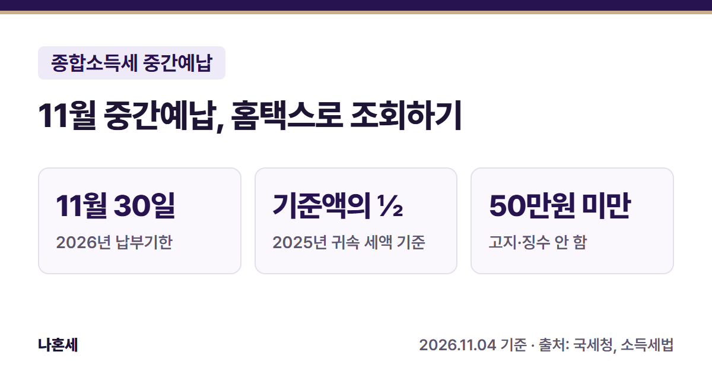
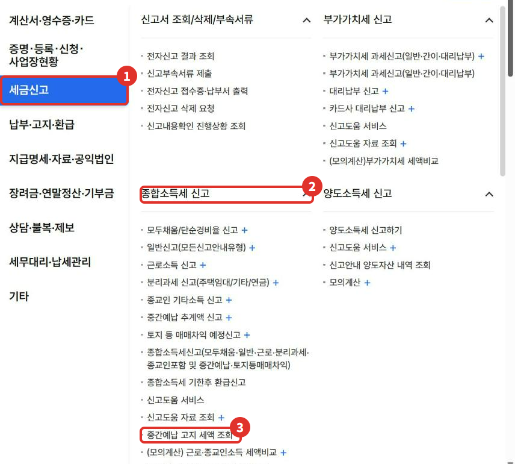
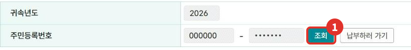
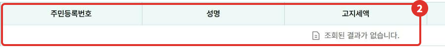
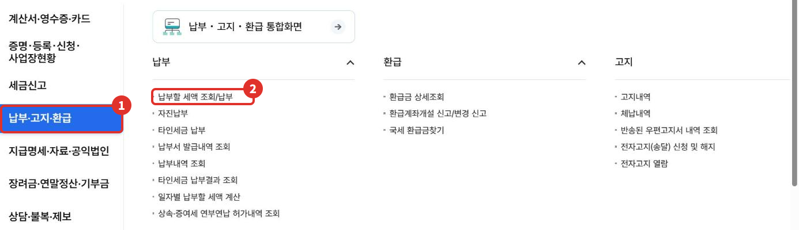

11월은 개인사업자가 종합소득세를 미리 나눠 내는 **중간예납** 달이에요. 세무서가 금액을 정해 고지서를 보내니, 사장님은 홈택스에서 **얼마가 고지됐는지 조회하고 11월 30일까지 내면** 돼요. 이 글은 홈택스에서 고지 세액을 조회하는 순서를 실제 화면으로 정리했어요.

{: .summary-card}

> 💡 **핵심 요약**
> - **2026년 중간예납 납부기한은 11월 30일(월)이에요**{: .red} [1][5]
> - 금액은 **직전 연도(2025년 귀속) 종합소득세 기준액의 절반**이에요 [1]
> - 중간예납세액이 **50만원 미만**이면 징수하지 않아요 [3]

목차

* 목차
{:toc}

## 한눈에 보기

| 항목 | 내용 |
|---|---|
| 누가 | 종합소득이 있는 개인(주로 사업소득이 있는 개인사업자) |
| 무엇을 | 2026년 1~6월분 종합소득세를 미리 납부 |
| 고지 | 11월 1일~15일 사이에 납부고지서 발급 [1] |
| 기한 | 2026년 11월 30일(월) [1][5] |
| 조회 | 세금신고 > 종합소득세 신고 > 중간예납 고지 세액 조회 |
| 납부 | 납부·고지·환급 > 납부 > 납부할 세액 조회/납부 |

## 중간예납이 뭐예요?

종합소득세는 1년 소득을 다음 해 5월에 한 번에 신고해요. 중간예납은 그중 **상반기(1월 1일~6월 30일)분을 11월에 미리 내는 제도**예요 [1].

세무서가 직전 연도 세금을 기준으로 금액을 정해 **고지서**를 보내요. 그래서 사장님이 따로 신고서를 낼 필요 없이, 고지된 금액만 내면 돼요 [1].

## 누가 내나요?

- **내는 사람**: 종합소득이 있는 거주자예요 [1]. 실제로는 사업소득이 있는 개인사업자가 대부분이에요.
- **빠지는 사람**: 아래 소득**만** 있는 사람이에요. 여러 개가 섞여 있어도 아래 목록 안의 소득만 있으면 빠져요 [1][2][9].
  - 이자·배당·근로·연금·기타소득(직장인 등)
  - 사업소득 중 속기·타자 같은 사무지원 서비스업 소득, 수시부과 소득
  - 분리과세 주택임대소득
  - 저술가·화가·배우·가수 같은 자영 예술가, 직업선수·코치·심판, 보험모집인처럼 실적에 따라 수당을 받는 사람 등의 사업소득
- **2026년에 새로 사업을 시작**한 사람(2026년 1월 1일 현재 사업자가 아니었던 사람)도 빠져요 [1].
- **금액이 작으면 고지하지 않아요**: 중간예납세액이 50만원 미만이면 징수하지 않아요 [3]. 이 경우 홈택스에서 조회해도 금액이 나오지 않아요 [6].

> 내가 대상인지 헷갈리면 아래 순서대로 홈택스에서 직접 조회해 보세요. 고지 대상이 아니면 결과 표가 비어 있어요.

## 얼마를 내나요?

**중간예납세액 = 중간예납기준액 × 1/2** (1천원 미만은 버려요) [1]

중간예납기준액은 **직전 연도(2025년 귀속) 종합소득세로 중간예납·확정신고 때 낸 세액**이에요. 정확히는 아래를 더하고 환급받은 세액을 뺀 금액이에요 [1].

| 더하는 것 | 내용 |
|---|---|
| 중간예납세액 | 2025년 11월에 낸 중간예납 |
| 확정신고 세액 | 2026년 5월 종합소득세 신고 때 낸 세액 |
| 추가 납부 | 결정·경정, 기한후신고 등으로 더 낸 세액 |

### 금액을 넣어 계산해 보면

> 아래 숫자는 이해를 돕기 위한 **가상의 예시**예요. 실제 금액은 홈택스 조회나 고지서로 확인하세요.

**예시 1. 고지되는 경우**

| 항목 | 금액 |
|---|---|
| ① 2025년 11월에 낸 중간예납 | 1,200,000원 |
| ② 2026년 5월 확정신고 때 낸 세액 | 1,850,500원 |
| ③ 추가 납부 · 환급 | 없음 |
| 중간예납기준액 (①+②) | 3,050,500원 |
| × 1/2 | 1,525,250원 |
| **중간예납세액** (1천원 미만 버림) | **1,525,000원** |

①과 ②를 더하면 2025년 귀속 종합소득세로 **중간예납과 5월 신고 때 직접 낸 세금**이에요. 그 절반을 11월에 미리 내는 거예요. **원천징수로 미리 떼인 3.3% 같은 세금은 여기에 들어가지 않아요**{: .red} [1][8].

**예시 2. 고지되지 않는 경우**

중간예납기준액(①+②)이 900,000원이면, 절반은 450,000원이에요. **50만원 미만**이라 징수하지 않아서 고지서가 나오지 않아요 [3].

**예시 3. 나눠 낼 수 있는 경우** (아래 "나눠 낼 수 있나요?" 기준)

| 고지세액 | 11월 30일까지 | 2027년 2월 1일까지 |
|---|---|---|
| 15,000,000원 | 10,000,000원 | 5,000,000원 |
| 30,000,000원 | 15,000,000원 | 15,000,000원 |

3천만원은 2천만원을 넘어서 절반(50%)까지 나중에 낼 수 있어요. 나중에 내는 금액은 그 이하로 정해도 돼요 [5][10].

부동산매매업자는 상반기에 낸 토지 등 매매차익 예정신고 세액을 이 금액에서 빼요 [1]. 홈택스 조회 화면 아래에도 같은 계산식이 적혀 있어요 [6].

## 홈택스로 조회하는 순서

> 📅 **2026년 11월 기준 화면**이에요. 메뉴 이름은 바뀔 수 있어요.

1. 홈택스에 로그인해요. 사업자가 아닌 **개인으로 로그인해도** 이 화면은 열려요(2026년 11월 확인).
2. 오른쪽 위 **전체메뉴**에서 ① **세금신고** → ② **종합소득세 신고** → ③ **중간예납 고지 세액 조회**를 눌러요.

   

3. 귀속년도가 **2026**인지 확인하고 ① **조회**를 눌러요.

   

4. ② 아래 표에 **고지세액, 분납가능세액, 납부할세액**이 나와요. 고지 대상이 아니거나 50만원 미만이면 "조회된 결과가 없습니다"로 표가 비어 있어요 [6]. 운영자가 고지 대상이 아닌 계정으로 조회했을 때는 "중간예납 고지 대상자가 아닙니다"라는 알림창도 함께 떴어요(2026년 11월).

   

화면 안내에 따르면, 여기 고지세액은 **전자고지 세액공제가 빠지기 전 금액**이라 실제 "납부할 세액"과 1천원 차이가 날 수 있어요 [6].

## 홈택스로 납부하는 순서

1. **전체메뉴** → ① **납부·고지·환급** → ② **납부 > 납부할 세액 조회/납부**를 눌러요(2026년 11월 화면 기준, 국세청 안내에는 "세금납부"로 적혀 있어요) [5].
2. 중간예납 고지분을 골라 납부해요 [5].

   

조회 화면의 **납부하러 가기** 버튼으로도 같은 납부 화면으로 갈 수 있어요.

## 나눠 낼 수 있나요? (분납)

중간예납세액이 **1천만원을 넘으면** 일부를 나중에 낼 수 있어요 [4].

| 고지세액 | 나중에 낼 수 있는 금액 |
|---|---|
| 1천만원 초과 ~ 2천만원 이하 | 1천만원을 넘는 금액 [5][10] |
| 2천만원 초과 | 세액의 50% 이하 [5][10] |

11월에는 나중에 낼 금액을 뺀 나머지만 내면 돼요 [5]. 나중에 낼 금액은 2027년 1월 초에 고지서가 따로 나오고 [1][5], 기한은 **납부기한이 지난 뒤 2개월 이내**예요 [4]. 2026년분은 **2027년 2월 1일(월)**까지예요 [5].

## 상반기 매출이 많이 줄었다면 (추계액 신고)

상반기 실적으로 계산한 세액(중간예납추계액)이 기준액의 **30%에 못 미치면**, 고지 금액 대신 그 세액으로 **11월 1일~30일에 직접 신고**할 수 있어요 [1]. 신고하면 고지된 금액은 없었던 것으로 봐요 [1].

- **복식부기의무자가 직전 연도 기준액이 없는데 상반기 사업소득이 있으면, 고지가 없어도 이 신고를 해야 해요**{: .red} [1].
- 메뉴는 **세금신고 > 종합소득세 신고 > 중간예납 추계액 신고**예요(위 메뉴 화면 참고). 상반기 장부를 바탕으로 계산해야 해서, 이 글에서는 조회·납부만 다뤄요.

## 자주 하는 실수

| 실수 | 이렇게 하세요 |
|---|---|
| 고지서를 못 받아 모르고 지나감 | 11월 중순 이후 홈택스에서 직접 조회 |
| 직장인 소득만 있는데 걱정 | 근로소득만 있으면 중간예납 대상이 아니에요 [2] |
| 고지 금액과 납부할 세액이 1천원 달라 당황 | 전자고지 세액공제 차이예요 [6] |

**기한을 넘기면 내지 않은 세액에 납부지연가산세가 붙을 수 있어요**{: .red} [7]. 확실하지 않으면 **국세상담센터(126)**에 먼저 확인하세요.

## 직접 하기 어려울 수 있는 경우

- **추계액 신고**를 하려는 경우: 상반기 소득금액과 공제를 직접 계산해야 해요.
- 직전 연도 세액이 **경정·수정신고**로 바뀌어 기준액이 헷갈리는 경우
- 이런 경우에는 126 상담이나 세무대리인에게 먼저 확인하는 게 안전해요.

## 자주 묻는 질문

**Q. 고지서가 안 왔어요. 안 내도 되나요?**
A. 중간예납 대상이 아니거나 [1][2] 50만원 미만이면 [3] 고지되지 않아요. 홈택스에서 조회해서 결과가 없으면 고지된 중간예납이 없는 거예요. **단, 직전 연도에 낸 세액이 없는 복식부기의무자가 올해 상반기 사업소득이 있으면, 고지가 없어도 11월 30일까지 추계액을 신고·납부해야 해요**{: .red} [1].

**Q. 중간예납으로 낸 돈은 어떻게 되나요?**
A. 다음 해 5월 종합소득세를 신고할 때 이미 낸 세금으로 빼서 계산해요 [8].

## 함께 보면 좋은 글

- [사장님 세무 일정 달력: 매달·매년 홈택스로 직접 챙길 신고 한눈에]()

## 출처

1. 법령: 소득세법 제65조 ①~⑤⑦⑩ (2026.7.1. 시행)
2. 법령: 소득세법 시행령 제123조 (2026.10.1. 시행)
3. 법령: 소득세법 제86조 제4호 (2026.7.1. 시행)
4. 법령: 소득세법 제77조 (2026.7.1. 시행)
5. [국세청 - 중간예납세액의 고지](https://www.nts.go.kr/nts/cm/cntnts/cntntsView.do?mi=2237&cntntsId=7674) (납부기한·분납 기한·납부 경로, 확인일: 2026-11-04)
6. 홈택스 - 종합소득세 중간예납 고지세액 조회 화면 안내 문구 (2026년 11월 화면, 확인일: 2026-11-04)
7. 법령: 국세기본법 제47조의4 (2026.10.2. 시행)
8. 법령: 소득세법 제76조 ③ (2026.7.1. 시행)
9. 법령: 소득세법 시행규칙 제64조 (중간예납에서 제외되는 소득)
10. 법령: 소득세법 시행령 제140조 (2026.10.1. 시행)

> 이 글은 2026년 11월 4일 기준의 일반적인 안내입니다. 세법과 홈택스 화면은 바뀔 수 있으니 납부 전 국세청 안내를 꼭 확인하세요. 개별 상황은 국세상담센터(126)에 문의하세요.
