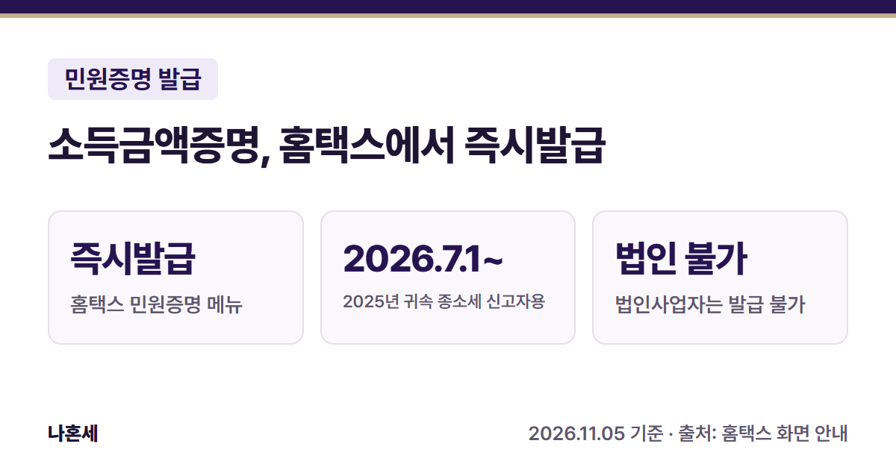
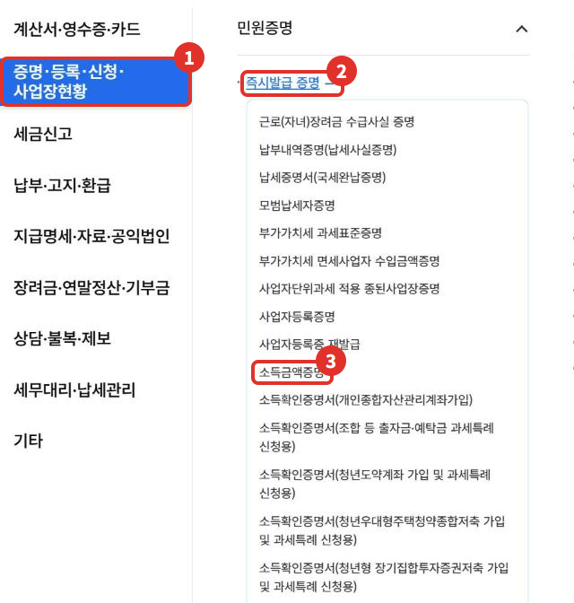
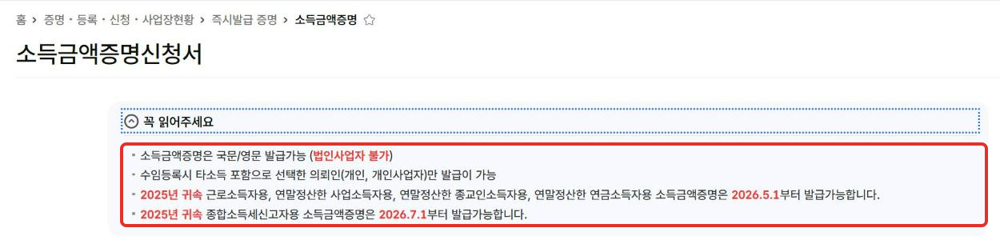
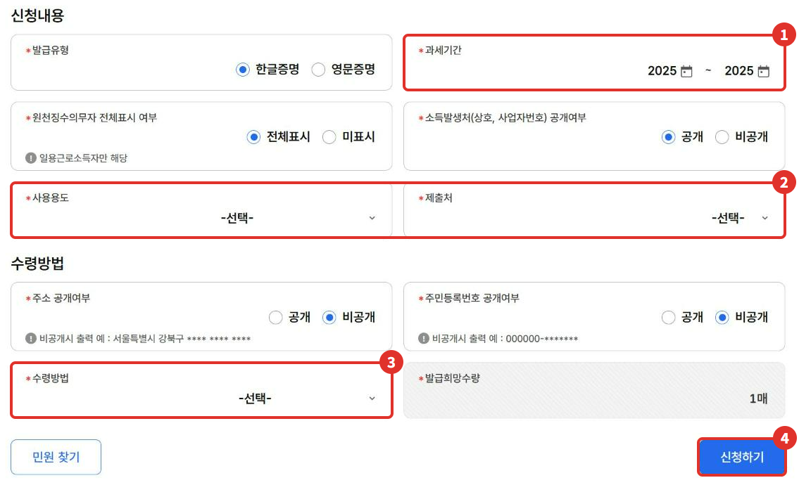

대출이나 입찰, 관공서 제출용으로 **소득금액증명**을 내라는 말을 들으면 세무서에 가지 않아도 돼요. 홈택스 **즉시발급 증명** 메뉴에 있는 증명이라 집에서 신청할 수 있어요 [1]. 이 글은 개인으로 로그인해서 소득금액증명을 신청하는 순서를 실제 화면으로 정리했어요.

{: .summary-card}

> 💡 **핵심 요약**
> - 메뉴: 홈택스 > 증명·등록·신청·사업장현황 > 민원증명 > **즉시발급 증명 > 소득금액증명** (2026년 11월 기준 화면) [1]
> - **2025년 귀속 종합소득세 신고자용은 2026년 7월 1일부터 발급돼요**{: .red} [2]
> - 국문·영문으로 발급되고, **법인사업자는 발급할 수 없어요** [2]

목차

* 목차
{:toc}

## 한눈에 보기

| 항목 | 내용 |
|---|---|
| 누가 | 소득이 있는 개인(법인사업자는 발급 불가) [2] |
| 언제 | 화면 안내의 발급 시작일 이후(아래 표) [2] |
| 무엇을 | 과세기간, 사용용도·제출처, 수령방법을 골라 신청 [3] |
| 메뉴 | 증명·등록·신청·사업장현황 > 민원증명 > 즉시발급 증명 > 소득금액증명 [1] |
| 받는 방법 | 프린터 출력, 화면 열람, 전자문서지갑 중 선택 [3] |

## 소득금액증명이 뭐예요?

**소득금액증명**은 국세청에 신고된 내 소득 금액을 증명하는 서류예요. 홈택스 신청서의 사용용도 목록에 입찰·계약용, 대출용, 관공서제출용, 금융기관제출용 등이 있어서, 이런 곳에 낼 때 쓰는 서류라는 걸 알 수 있어요 [3].

## 언제부터 발급되나요?

그해 소득금액증명은 바로 나오지 않고, 홈택스 화면 안내에 발급 시작일이 따로 적혀 있어요. 2025년 귀속(2025년에 번 소득)분은 아래와 같아요 [2].

| 소득 종류 | 2025년 귀속분 발급 시작 |
|---|---|
| 근로소득자용, 연말정산한 사업·종교인·연금소득자용 | 2026년 5월 1일 |
| 종합소득세 신고자용 | **2026년 7월 1일** |

**5월에 종합소득세를 신고했더라도 신고자용 증명은 7월 1일부터 나와요**{: .red} [2]. 그 전에 급하게 필요하면 제출처에 직전 연도 증명으로 되는지 먼저 물어보세요.

## 홈택스로 발급하는 순서

> 📅 **2026년 11월 기준 화면**이에요. 메뉴 이름은 바뀔 수 있어요.

1. 홈택스에 로그인해요. 사업자가 아닌 **개인으로 로그인해도** 신청 화면이 열려요(2026년 11월 운영자 확인).
2. **전체메뉴**에서 ① **증명·등록·신청·사업장현황** → ② **즉시발급 증명** → ③ **소득금액증명**을 눌러요 [1].

   

3. 신청서 맨 위 **꼭 읽어주세요**를 펼치면 발급 가능 시기와 대상이 적혀 있어요. 주민등록번호·이름은 로그인 정보로 자동으로 채워져요.

   

4. 신청내용을 골라요.
   - ① **과세기간**: 증명이 필요한 연도(예: 2025 ~ 2025)
   - ② **사용용도·제출처**: 대출용·금융기관처럼 실제 낼 곳에 맞게 골라요
   - ③ **수령방법**: 인터넷발급(프린터출력), 인터넷열람(화면조회), 인터넷발급(전자문서지갑) 중 하나 [3]
   - ④ 모두 고른 뒤 **신청하기**를 누르면 고른 수령방법에 따라 발급이 진행돼요(발급 후 화면은 이 글에 없어요)

   

> 이 글의 캡처는 **신청하기를 누르기 전**까지만 찍었어요. 실제 발급 후 화면은 담지 않았어요.

## 신청서에서 헷갈리는 항목

| 항목 | 화면에 있는 선택지 |
|---|---|
| 발급유형 | 한글증명, 영문증명 [3] |
| 원천징수의무자 전체표시 | 전체표시·미표시 중 선택(이 항목은 일용근로소득자만 해당) [3] |
| 소득발생처 공개 | 상호·사업자번호를 증명서에 보일지 선택 [3] |
| 주소 공개 | 비공개면 시·구 아래 주소가 \*\*\*\*로 나와요 [3] |
| 주민번호 공개 | 비공개면 뒷자리가 \*로 나와요 [3] |
| 발급 수량 | 1~9매 [3] |

**주소·주민번호 공개 여부는 제출처가 요구하는 대로 고르세요**{: .red}. 헷갈리면 제출할 곳에 먼저 물어보는 게 안전해요.

## 같은 메뉴에서 뗄 수 있는 다른 증명

**즉시발급 증명** 메뉴에는 소득금액증명 말고도 아래 증명이 있어요(2026년 11월 화면) [1].

- 납세증명서(국세완납증명), 납부내역증명(납세사실증명)
- 사업자등록증명, 사업자등록증 재발급, 휴업사실증명, 폐업사실증명
- 부가가치세 과세표준증명, 부가가치세 면세사업자 수입금액증명
- 표준재무제표증명, 연금보험료등 소득·세액 공제확인서, 근로(자녀)장려금 수급사실 증명 등

## 직접 발급이 어려울 수 있는 경우

- **법인사업자**는 소득금액증명을 발급할 수 없어요 [2].
- 소득 신고·정산이 끝나기 전이면 그해 증명이 나오지 않아요(위 발급 시작일 표 참고) [2].
- 즉시발급 목록에 없는 증명은 **사실확인 후 발급 증명**·**기타 민원 증명** 메뉴에 따로 있어요 [1].
- 내 소득이 증명서에 다르게 나온다면 신고 내용 자체를 확인해야 해요. **국세상담센터(126)**에 먼저 문의하세요.

## 자주 묻는 질문

**Q. 개인으로 로그인해도 되나요?**
A. 네, 개인으로 로그인해도 소득금액증명 신청 화면이 열려요(2026년 11월 운영자 확인). 법인사업자는 발급할 수 없어요 [2].

**Q. 열람(화면조회)과 발급(프린터출력)은 뭐가 달라요?**
A. 수령방법에서 고르는 선택지예요 [3]. 제출처에 종이나 전자문서로 내야 한다면 프린터출력이나 전자문서지갑을 고르세요.

**Q. 제출받은 곳에서 진짜인지 확인할 수 있나요?**
A. 같은 메뉴에 **민원증명 원본 확인(수요처 조회)** 메뉴가 있어요 [1].

## 함께 보면 좋은 글

- [종합소득세 중간예납 홈택스 조회 방법: 11월 고지서, 내가 낼 금액 확인하기]()

## 출처

1. 홈택스 - 전체메뉴 > 증명·등록·신청·사업장현황 > 민원증명 메뉴 구성 (2026년 11월 화면, 캡처와 화면 메뉴 목록 전체를 운영자가 확인, 확인일: 2026-11-05)
2. 홈택스 - 소득금액증명신청서 "꼭 읽어주세요" 안내 문구 (2026년 11월 화면, 확인일: 2026-11-05)
3. 홈택스 - 소득금액증명신청서 신청내용·수령방법 선택 항목과 선택 목록(사용용도·수령방법·발급수량) (2026년 11월 화면, 운영자 확인, 확인일: 2026-11-05)

> 이 글은 2026년 11월 5일 기준의 일반적인 안내입니다. 홈택스 화면과 발급 기준은 바뀔 수 있으니 신청 전 홈택스 안내를 꼭 확인하세요. 개별 상황은 국세상담센터(126)에 문의하세요.
