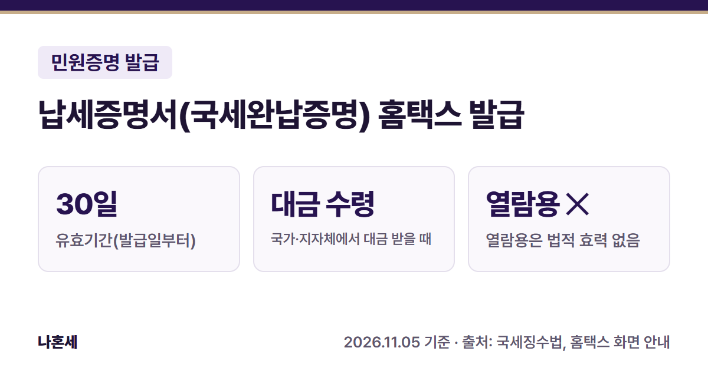
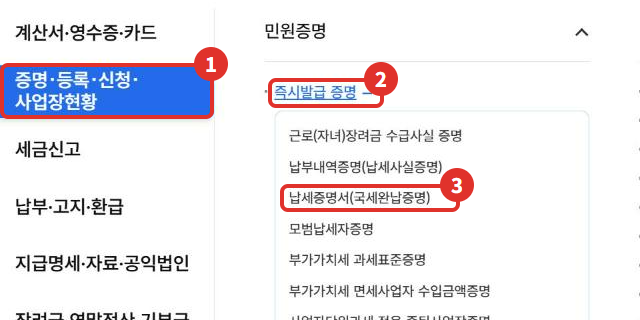
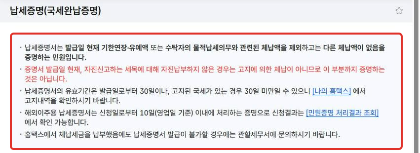
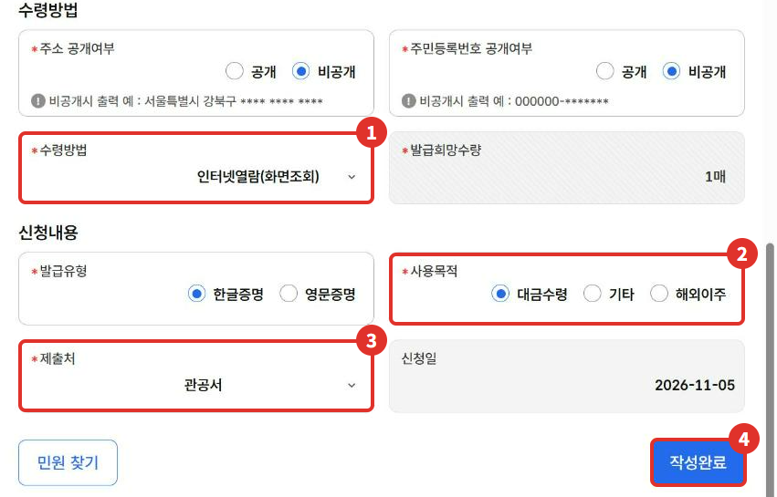
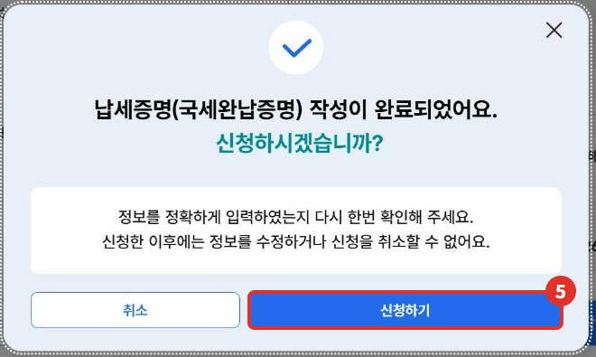
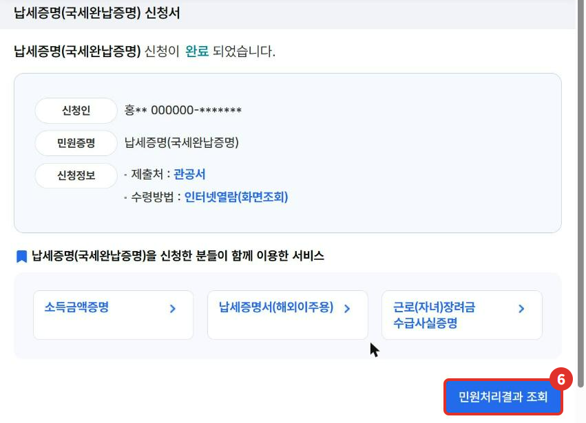
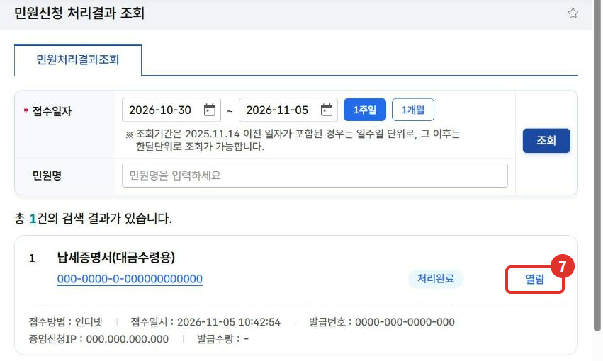
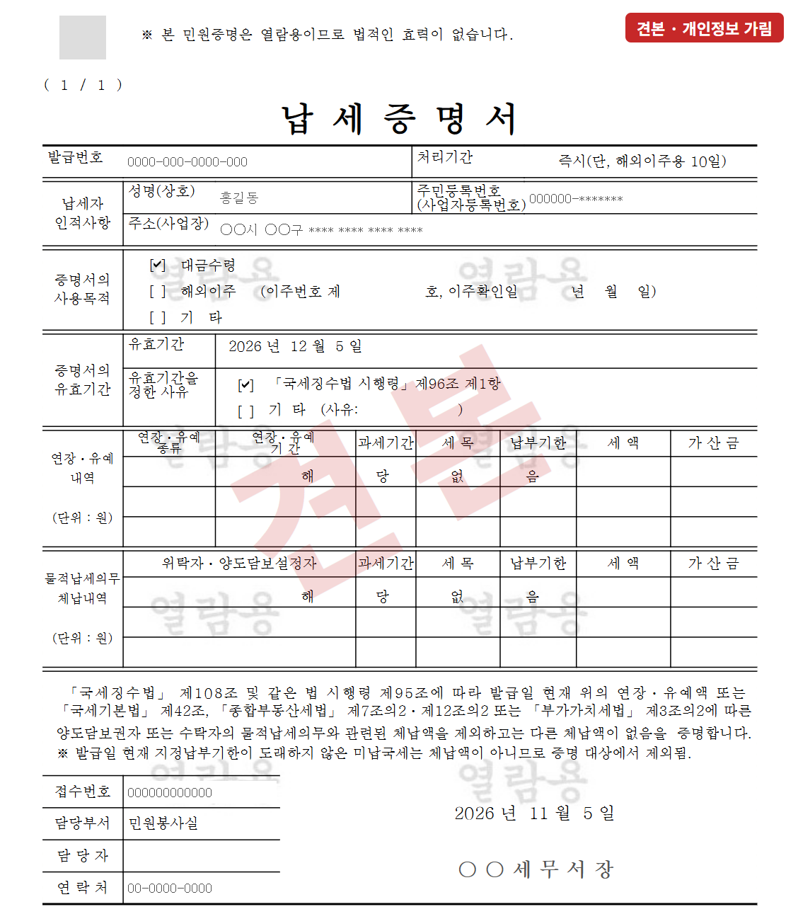

국가·지방자치단체 같은 곳에서 공사·용역 대금을 받으려면 **납세증명서**를 내야 하는 경우가 있어요 [1]. 흔히 "국세완납증명서"라고 부르는 서류예요. 이 글은 홈택스에서 신청하는 순서부터 **실제로 발급된 증명서 화면**까지 정리했어요.

{: .summary-card}

> 💡 **핵심 요약**
> - 메뉴: 홈택스 > 증명·등록·신청·사업장현황 > 즉시발급 증명 > **납세증명서(국세완납증명)** (2026년 11월 기준 화면)
> - **유효기간은 발급일부터 30일**이에요. 고지된 국세가 있으면 더 짧을 수 있어요 [3][5]
> - **수령방법 "인터넷열람"으로 연 증명서에는 "법적인 효력이 없습니다"라고 적혀 있어요**{: .red} [6]

목차

* 목차
{:toc}

## 한눈에 보기

| 항목 | 내용 |
|---|---|
| 뭘 증명 | 발급일 현재 체납액이 없다는 사실 [1][5] |
| 언제 내나 | 국가·지자체 등에서 대금을 받을 때, 해외이주 신고 때 등 [1] |
| 유효기간 | 발급일부터 30일(고지된 국세가 있으면 그 지정납부기한까지로 할 수 있음) [3] |
| 메뉴 | 증명·등록·신청·사업장현황 > 즉시발급 증명 > 납세증명서(국세완납증명) |
| 결과 확인 | 증명·등록·신청·사업장현황 > 민원증명 > 민원신청 처리결과 조회(2026년 11월 운영자 확인) |

## 납세증명서가 뭐예요?

**납세증명서**는 발급일 현재 국세 체납액이 없다는 것을 증명하는 서류예요 [1]. 기한 연장이나 압류·매각 유예를 받은 금액처럼 법에서 정한 금액은 체납액에서 빼고 봐요 [1].

홈택스 화면 안내에 따르면, **스스로 신고하는 세금을 신고만 하고 아직 내지 않은 부분은 "고지에 의한 체납"이 아니라서 이 증명이 다루는 범위가 아니에요** [5].

## 언제 내야 하나요?

국세징수법에서 납세증명서를 내라고 정한 경우는 아래와 같아요 [1].

| 경우 | 내용 |
|---|---|
| 대금 수령 | 국가, 지방자치단체, 정부 관리기관에서 대금을 받을 때 |
| 외국인 체류 | 등록 외국인 등이 체류기간 연장 등 허가를 신청할 때 |
| 해외이주 | 해외이주 신고를 할 때 |

**대금을 받는 경우라도** 일부 수의계약, 대금으로 체납세액을 모두 내는 경우 등은 내지 않아도 돼요 [4]. 내 계약이 해당하는지는 발주기관에 먼저 확인하세요.

## 유효기간은 얼마나 되나요?

**발급일부터 30일**이에요 [3]. 다만 발급일에 이미 납부고지된 국세가 있으면 유효기간을 그 국세의 납부기한까지로 정할 수 있어요 [3]. 그래서 홈택스는 고지 내역을 먼저 확인하라고 안내해요 [5].

> 예) 2026년 11월 5일에 발급받은 증명서의 유효기간은 **2026년 12월 5일**로 적혀 있었어요(아래 견본).

## 홈택스로 발급하는 순서

> 📅 **2026년 11월 기준 화면**이에요. 이 글은 개인으로 로그인해서 실제로 신청했어요.

1. 홈택스에 로그인하고 **전체메뉴**에서 ① **증명·등록·신청·사업장현황** → ② **즉시발급 증명** → ③ **납세증명서(국세완납증명)**를 눌러요.

   

2. 신청서 맨 위 안내를 먼저 읽어요. 증명 범위, 유효기간, 해외이주용 처리기간이 적혀 있어요 [5].

   

3. 신청서를 채워요.
   - ① **수령방법**: 인터넷발급(프린터출력), 인터넷열람(화면조회), 인터넷발급(전자문서지갑) 중 선택(선택 목록, 2026년 11월 운영자 확인)
   - ② **사용목적**: 대금수령, 기타, 해외이주 중 선택
   - ③ **제출처**: 금융기관, 관공서, 거래처 등에서 선택(선택 목록, 2026년 11월 운영자 확인)
   - ④ 다 채우면 **작성완료**를 눌러요
   - 주소·주민등록번호는 공개·비공개를 고를 수 있어요. 처음 열었을 때는 **비공개**가 선택돼 있었어요(2026년 11월 운영자 확인). 제출처가 요구하면 공개로 바꾸세요.

   

4. ⑤ "신청하시겠습니까?" 창에서 **신청하기**를 눌러요. **신청한 뒤에는 정보를 고치거나 취소할 수 없어요**{: .red} [5].

   

5. 신청 완료 화면이 나와요. ⑥ **민원처리결과 조회**를 누르면 발급된 증명서를 볼 수 있는 화면으로 가요.

   

6. 처리결과 목록에서 **처리완료**를 확인하고 ⑦ **열람**을 누르면 증명서가 새 창으로 열려요.

   

## 발급된 증명서는 이렇게 생겼어요

아래는 이 글을 쓰며 실제로 발급받은 증명서를 **인터넷열람(화면조회)**으로 연 화면이에요. 이름, 주민등록번호, 주소, 발급번호, 접수번호, QR코드, 세무서 이름·연락처는 모두 가렸어요.

- **사용목적**: 신청서에서 고른 "대금수령"에 표시돼요.
- **유효기간**: 증명서에는 2026년 12월 5일로 적혀 있었고, 근거로 「국세징수법 시행령」 제96조 제1항이 표시돼 있어요 [3].
- **연장·유예 내역, 물적납세의무 체납내역**: 없으면 "해당 없음"으로 나와요.
- 맨 위에 "본 민원증명은 열람용이므로 법적인 효력이 없습니다"라고 적혀 있어요 [6]. **제출용으로는 수령방법을 인터넷발급(프린터출력)이나 인터넷발급(전자문서지갑)으로 골라 발급받고, 어떤 형식으로 받는지는 제출처에 확인하세요**{: .red}.

## 직접 발급이 어려울 수 있는 경우

- 납세증명서는 체납액이 없다는 사실을 확인한 뒤 발급하는 증명이라 [1][7], **체납액이 있으면** 발급받기 어려워요. 홈택스에서 체납 세금을 냈는데도 발급이 안 되면 관할 세무서에 문의하라고 안내해요 [5].
- **해외이주용** 납세증명서는 즉시발급이 아니라 신청일부터 10일(영업일 기준) 안에 처리되고, 결과는 처리결과 조회에서 확인해요 [5].
- 대금을 받을 사람이 원래 계약자가 아닌 경우(채권양도 등)는 양도인·양수인의 증명서가 모두 필요할 수 있어요 [2].
- 확실하지 않으면 **국세상담센터(126)**나 관할 세무서에 먼저 확인하세요.

## 자주 묻는 질문

**Q. 개인도 발급받을 수 있나요?**
A. 네. 이 글은 사업자가 아닌 개인으로 로그인해서 실제로 발급받았어요(2026년 11월).

**Q. 유효기간이 지나면요?**
A. 새로 발급받아야 해요. 유효기간은 발급일부터 30일이에요 [3].

**Q. 발급한 증명서를 다시 볼 수 있나요?**
A. **민원신청 처리결과 조회**에서 접수일자로 조회한 뒤 열람할 수 있어요(2026년 11월 화면).

## 함께 보면 좋은 글

- [홈택스 소득금액증명 발급 방법: 대출·입찰 서류, 집에서 즉시발급하기]()

## 출처

1. 법령: 국세징수법 제107조 ①② (2026.10.2. 시행)
2. 법령: 국세징수법 시행령 제90조 (2026.10.1. 시행)
3. 법령: 국세징수법 시행령 제96조 ① (2026.10.1. 시행)
4. 법령: 국세징수법 시행령 제91조 (2026.10.1. 시행)
5. 홈택스 - 납세증명(국세완납증명) 신청서 안내 문구·선택 항목·확인 창 (2026년 11월 화면, 확인일: 2026-11-05)
6. 홈택스 - 인터넷열람으로 연 납세증명서 상단 문구 (2026년 11월 발급분, 확인일: 2026-11-05)
7. 법령: 국세징수법 제108조 (2026.10.2. 시행)

> 이 글은 2026년 11월 5일 기준의 일반적인 안내입니다. 세법과 홈택스 화면은 바뀔 수 있으니 신청 전 홈택스 안내를 꼭 확인하세요. 개별 상황은 국세상담센터(126)에 문의하세요.
