사업을 시작하면 **사업 개시일부터 20일 이내**에 사업자등록을 신청해야 해요 [1]. 세무서에 가지 않아도 홈택스에서 신청할 수 있어요. 이 글은 운영자가 2026년 11월에 직접 개인사업자 등록을 신청하고 등록증을 받기까지의 화면을 순서대로 정리했어요.

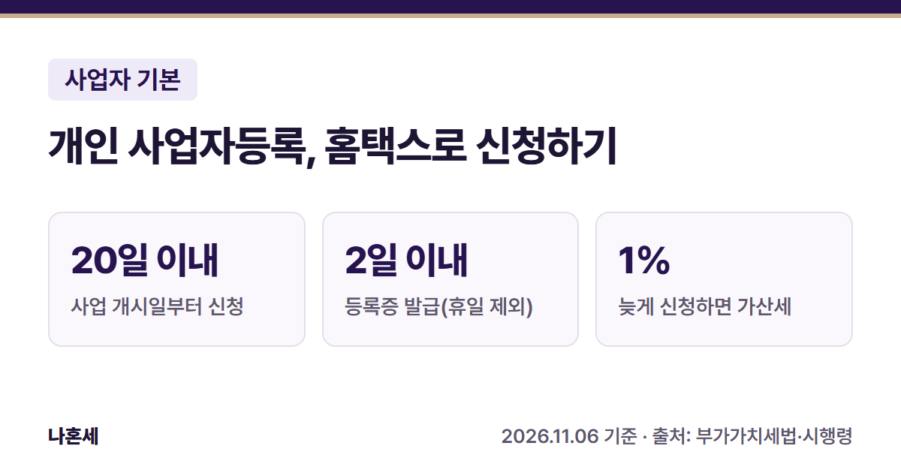{: .summary-card}

> 💡 **핵심 요약**
> - 메뉴: 홈택스 > 증명·등록·신청·사업장현황 > 사업자등록 신청·정정·휴폐업 > **개인 사업자등록 신청** (2026년 11월 기준 화면)
> - **사업 개시일부터 20일 이내 신청**{: .red}, 개업 전에도 신청할 수 있어요 [1]
> - 등록증은 신청일부터 **2일 이내** 발급이 원칙이에요(토요일·공휴일 등 제외, 현장 확인이 필요하면 연장) [2]

목차

* 목차
{:toc}

## 한눈에 보기

| 항목 | 내용 |
|---|---|
| 누가 | 새로 사업을 시작하는 개인(사업장마다 신청) [1] |
| 언제 | 사업 개시일부터 20일 이내, 개업 전 신청도 가능 [1] |
| 무엇을 | 인적사항, 상호·개업일·사업장 주소, 업종, 사업자 유형(일반·간이) |
| 메뉴 | 증명·등록·신청·사업장현황 > 사업자등록 신청·정정·휴폐업 > 개인 사업자등록 신청 |
| 발급 | 신청일부터 2일 이내(휴일 제외, 연장될 수 있음) [2] |

## 누가 언제 신청하나요?

사업자는 **사업장마다** 사업 개시일부터 20일 이내에 사업자등록을 신청해야 해요 [1]. 새로 사업을 시작하려는 사람은 사업 개시일 **전에도** 신청할 수 있어요 [1].

기한을 넘기면 가산세가 붙어요. **사업 개시일부터 등록을 신청한 날의 전날까지 공급가액 합계의 1%**예요 [3].

| 가상의 예시 | 계산 |
|---|---|
| 기한을 넘겨 늦게 신청, 그 사이 공급가액 | 3,000,000원 |
| 미등록 가산세(1%) | 3,000,000원 × 1% = **30,000원** |
| 20일 이내에 신청한 경우 | 0원(이 가산세 없음) |

**다른 사람 이름으로 등록하거나 남의 등록을 빌려 사업하면 가산세가 2%예요**{: .red}(배우자 명의 등 일부는 법령상 제외) [3]. 홈택스 최종확인 화면에도 명의를 빌려주면 체납·건강보험료 같은 불이익이 생길 수 있다는 안내가 나와요.

## 등록 전에 산 물건의 부가세는?

사업자등록을 **신청하기 전**에 받은 매입세액은 원칙적으로 공제되지 않아요 [4]. 다만 물건을 산 날(공급시기)이 속한 과세기간이 끝난 뒤 **20일 이내**에 등록을 신청하면, 그 과세기간 첫날 이후에 산 것은 공제받을 수 있어요 [4].

개인 일반과세자의 과세기간은 1기 1월 1일~6월 30일, 2기 7월 1일~12월 31일이에요 [5]. 예를 들어 2026년 9월에 산 장비라면 **2027년 1월 20일까지 등록을 신청해야**{: .red} 그 부가세를 공제받을 수 있어요 [4][5]. 등록 전에 산 것을 공제받으려면 세금계산서를 어떻게 받아야 하는지는 126에 미리 확인하세요.

이건 매입세액 공제 기준이에요. 사업을 이미 시작했다면 **등록 기한(개시일부터 20일)과 미등록 가산세는 따로 적용**돼요 [1][3].

## 일반과세자와 간이과세자, 무엇을 고르나요?

신청서 마지막에 **사업자 유형**을 골라요. 개인사업자의 직전 연도 공급대가(부가세 포함 매출)가 **1억 400만원 미만**이면 간이과세자가 될 수 있어요 [6]. 새로 시작하는 사람은 올해 매출이 이 금액에 못 미칠 것 같으면 등록할 때 간이과세를 함께 신고해요. 간이과세가 안 되는 업종이 아니고 일반과세 사업장을 따로 갖고 있지 않으면, 첫 과세기간은 간이과세자가 돼요 [6].

| 구분 | 내용 |
|---|---|
| 간이과세 안 되는 경우 | 광업, 제조업(일부 제외), 도매업·상품중개업, 부동산매매업, 건설업(일부 제외), 전문·과학·기술서비스업(일부 제외), 변호사·세무사 등 전문직 사업, 국세청이 정한 지역·규모 기준(간이과세 배제기준)에 해당하는 경우 등 [6] |
| 세금계산서 | 간이과세자 중 ① 직전 연도 공급대가 4,800만원 미만이거나 ② **신규 개인사업자로 첫 과세기간 중**이면, 세금계산서 대신 영수증을 발급 [7] |

신청서의 사업자 유형 옆에 있는 **간이과세 사전검토** 버튼으로 간이과세가 되는지 미리 볼 수 있어요.

**거래처가 세금계산서를 요구하는 사업인데 신규 간이과세자로 등록하면 첫 과세기간에는 세금계산서를 발급할 수 없어요**{: .red} [7]. 어느 유형이 맞는지는 매출 규모와 거래처에 따라 달라서, 확실하지 않으면 국세상담센터(126)에 먼저 물어보세요.

> 운영자는 이 블로그에서 세금계산서 발급 화면을 직접 보여 드리려고 일반과세자로 신청했어요. 개인 사정에 따른 선택이라 그대로 따라 할 필요는 없어요.

## 홈택스로 신청하는 순서

> 📅 **2026년 11월 기준 화면**이에요(운영자가 직접 신청). 메뉴 이름은 바뀔 수 있어요.

1. 홈택스에 로그인해요. 운영자는 아직 사업자가 아니어서 **개인으로 로그인**해 신청했어요.
2. 위쪽 메뉴에서 ① **증명·등록·신청·사업장현황** → ② **사업자등록 신청·정정·휴폐업** → ③ **개인 사업자등록 신청** → ④ **개인 사업자등록 신청**을 눌러요.

   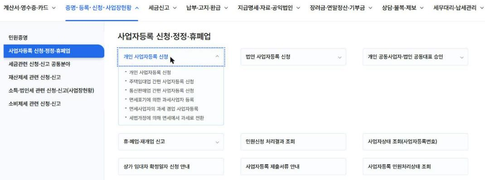

3. **인적사항**(휴대전화·이메일)을 넣고, **사업특성 질문 8개**에 예·아니오로 답한 뒤 **다음**을 눌러요. 공동사업인지, 사업장이 남의 소유인지(임차), 주소가 주민등록 주소와 같은지 등을 물어요. 답에 따라 다음 화면이 달라져요.

   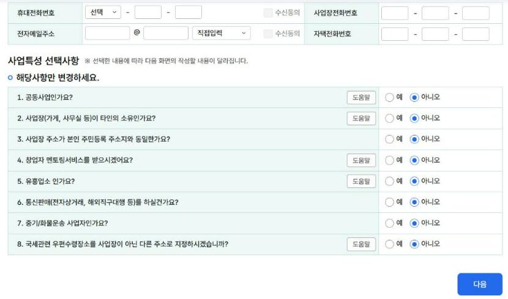

4. **사업장 정보**에서 상호명, 개업일자, 사업장 주소를 넣어요. 주소가 주민등록 주소와 같다고 답했으면 주소가 미리 채워져 있어요.

   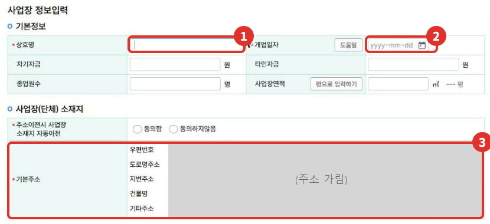

5. **업종 선택**에서 **업종 입력/수정**을 누르고, 키워드(예: 콘텐츠)로 검색해 업종코드를 골라요. 목록 오른쪽 **적용범위 및 기준**을 꼭 읽어 보세요.

   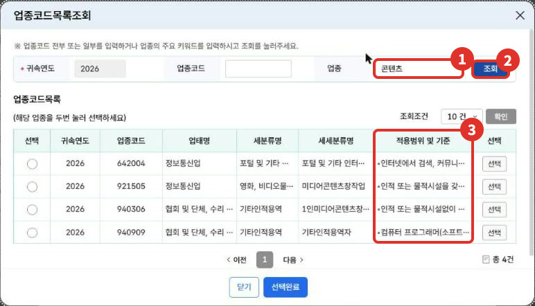

6. 업종을 고르면 **적용범위 및 기준**이 보여요. 운영자가 고른 921505(미디어콘텐츠창작업)는 "인적 또는 물적시설 없는 1인 미디어콘텐츠창작자는 940306 적용"이라고 적혀 있었어요.

   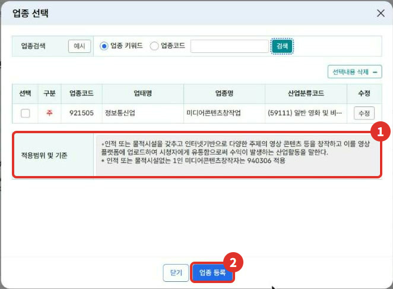

7. 업종이 사업 내용을 다 담지 못하면 **업종 추가설명**에 실제 하는 일을 적어요. **사업자 유형**(일반·간이 등)을 고르고 **저장 후 다음 이동**을 눌러요.

   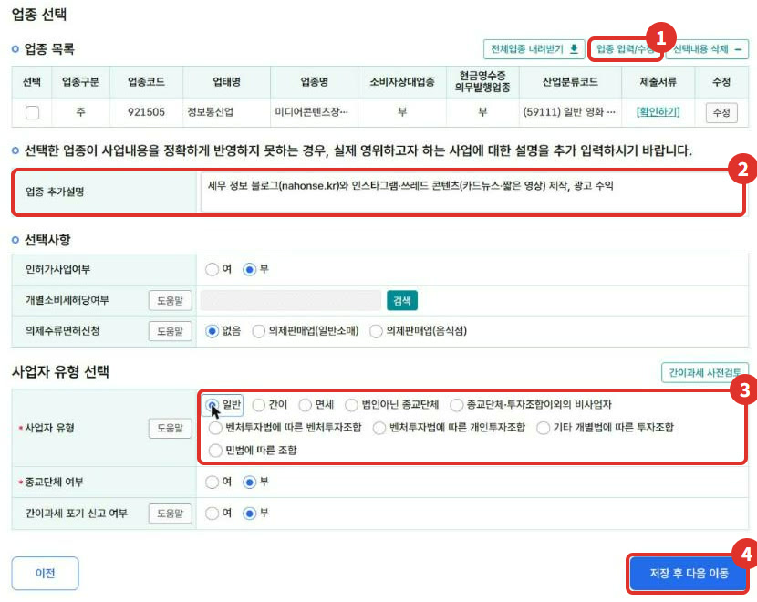

8. **제출서류 선택** 창이 **새 창(팝업)**으로 떠요. 임대차계약서 같은 서류가 있으면 **파일찾기**로 PDF나 이미지를 붙이고 **다음**을 눌러요.

   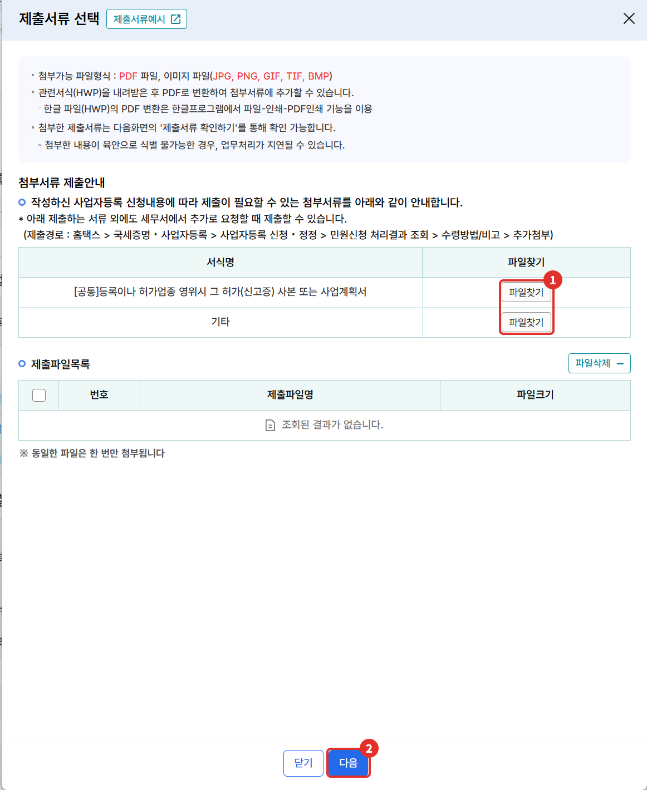

9. 붙인 서류가 없으면 **증빙서류 첨부 안내** 창이 한 번 더 떠요. 해당 서류가 없으면 **다음**을 눌러요.

   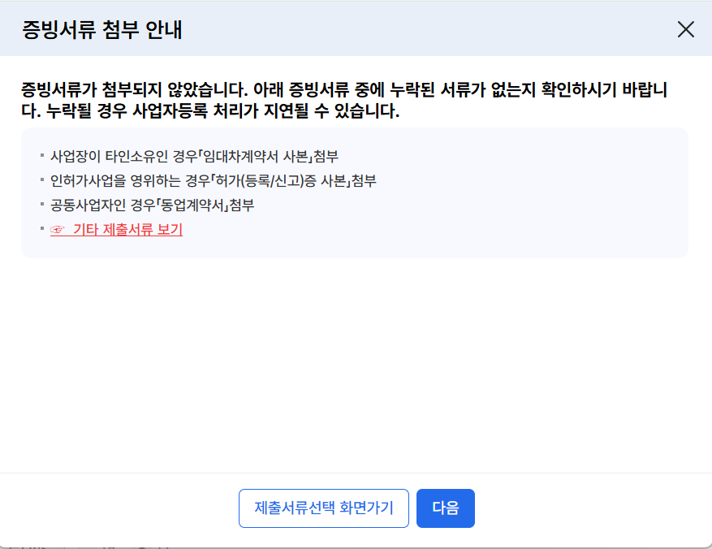

10. **최종확인** 창에서 유의사항을 읽고 **확인하였습니다**에 체크해요. **제출서류 확인하기**를 먼저 눌러야 **신청서 제출하기**가 눌려요.

    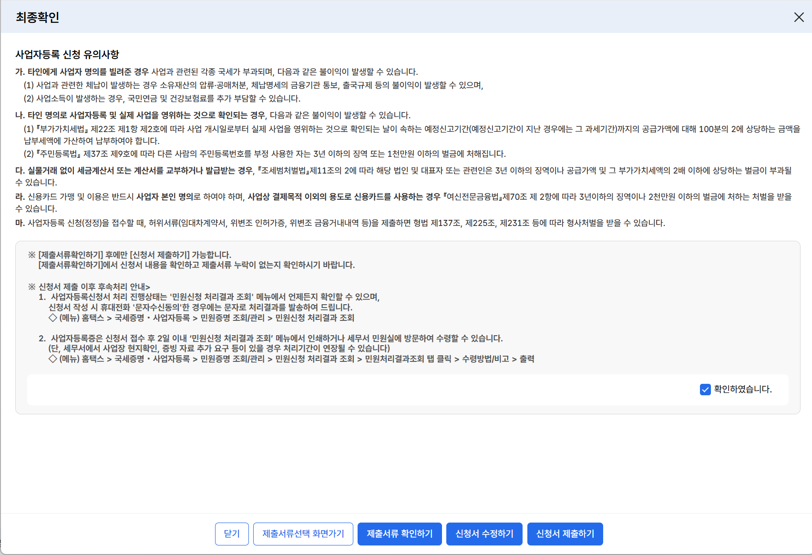

11. 제출하면 **민원신청 처리결과 조회**에 "접수완료"로 떠요. 처리가 끝나면 같은 메뉴에서 등록증을 출력해요.

    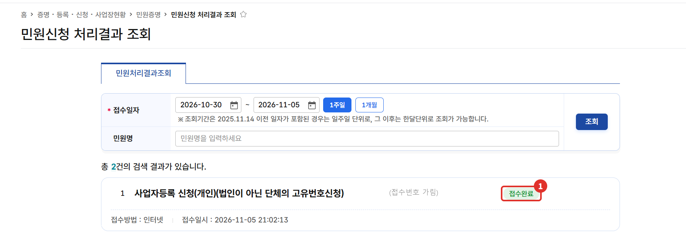

운영자는 저녁 9시쯤 신청했고, 다음 날 저녁 등록증이 나온 것을 확인했어요. 처리 기간은 사람마다 다를 수 있어요.

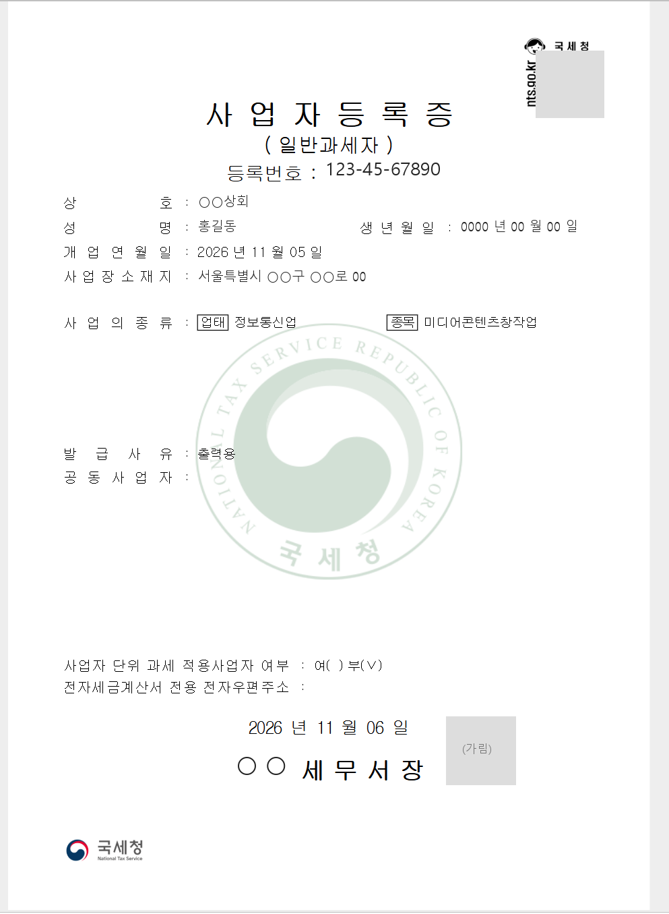

## 신청하면서 막히기 쉬운 곳

- **처리결과가 안 보일 때**: 운영자는 개인으로 로그인해 신청했는데, 등록증이 나온 뒤 사업자로 로그인해 처리결과 조회를 하니 0건이었어요(2026년 11월 운영자 확인). 신청할 때와 같은 방식으로 로그인해서 찾아보세요.
- **등록증을 다시 뽑을 때**: 홈택스 > 증명·등록·신청·사업장현황 > 즉시발급 증명 > **사업자등록증 재발급**에서 사유(예: 출력용)를 적고 신청하면, 처리결과 조회에서 바로 출력할 수 있었어요(2026년 11월 운영자 확인).
- **보정 요청**: 세무서가 신청 내용을 고쳐야 한다고 보면 10일 이내의 기간을 정해 보정을 요구할 수 있어요. 이 기간은 발급 기한에 넣지 않아요 [2].

## 업종코드가 헷갈릴 때

업종코드는 과세·면세 구분과 연결돼 있어요. 다만 실제로 면세인지는 시설·고용 같은 사실관계로 정해져요. 예를 들어 같은 "콘텐츠" 검색 결과라도, 운영자가 본 화면에서는 이렇게 나뉘었어요.

| 코드 | 화면에 나온 분류 |
|---|---|
| 921505 | 정보통신업 > 미디어콘텐츠창작업. 인적 또는 물적시설을 갖춘 경우 |
| 940306 | 기타인적용역 > 1인미디어콘텐츠창작자. 인적·물적시설 없는 경우 |

개인이 물적 시설 없이, 근로자를 고용하거나 주된 일을 남에게 맡기지 않고 독립된 자격으로 제공하는 일부 인적 용역은 부가가치세가 면제돼요 [8]. 여기서 물적 시설은 계속·반복해서 사업에만 쓰는 건물·기계장치 같은 설비(임차 포함)를 말해요 [8]. **내 사업이 어느 코드에 맞는지는 실제 시설·고용 여부로 정해지니, 화면의 적용범위를 읽고 애매하면 126에 확인하세요**{: .red}.

## 직접 신청이 어려울 수 있는 경우

- 공동사업(홈택스 안내상 동업계약서 첨부) [10], 인허가가 필요한 업종처럼 붙여야 할 서류가 많을 때 [9]
- 업종이 여러 개이거나, 과세·면세 사업을 함께 할 때
- 간이과세가 안 되는 업종인지 헷갈릴 때 [6]

확실하지 않으면 **국세상담센터(126)**나 가까운 세무서 민원실에 먼저 물어보세요. 신청 내용이 복잡하면 세무대리인의 도움을 받는 것도 방법이에요.

## 자주 묻는 질문

**Q. 개업하기 전에 신청해도 되나요?**
A. 네. 새로 사업을 시작하려는 사람은 사업 개시일 전에도 신청할 수 있어요 [1].

**Q. 등록증은 언제 나오나요?**
A. 신청일부터 2일 이내가 원칙이에요(토요일·공휴일 등 제외). 세무서가 사업장 시설이나 현황을 확인해야 하면 5일 이내에서 연장될 수 있어요 [2].

**Q. 사업장을 빌렸으면 무엇을 내나요?**
A. 임대차계약서 사본을 붙여요. 허가·등록이 필요한 사업은 허가증 등의 사본을 붙여요 [9].

## 함께 보면 좋은 글

- [사장님 세무 일정 달력: 등록 뒤 챙길 신고 기한]()
- [홈택스 소득금액증명 발급 방법]()

## 출처

1. 법령: 부가가치세법 제8조 ① (2026.1.2. 시행)
2. 법령: 부가가치세법 시행령 제11조 ⑤·⑬ (2026.4.1. 시행)
3. 법령: 부가가치세법 제60조 ① 1호·2호 (2026.1.2. 시행), 시행령 제108조 ① (2026.4.1. 시행)
4. 법령: 부가가치세법 제39조 ① 8호 (2026.1.2. 시행)
5. 법령: 부가가치세법 제5조 ① (2026.1.2. 시행)
6. 법령: 부가가치세법 제61조 ①·③·④, 시행령 제109조 ①·② (2026.4.1. 시행)
7. 법령: 부가가치세법 제36조 ① 2호 (2026.1.2. 시행)
8. 법령: 부가가치세법 제26조 ① 15호, 시행령 제42조 1호, 시행규칙 제29조 (2026.4.1. 시행)
9. 법령: 부가가치세법 시행령 제11조 ③ (2026.4.1. 시행)
10. 홈택스 사업자 등록신청(개인)·업종코드목록조회·최종확인 화면, 사업자등록증 재발급 화면 (운영자 직접 확인: 2026-11-05~06)

> 이 글은 2026년 11월 6일 기준의 일반적인 안내입니다. 세법과 홈택스 화면은 바뀔 수 있으니 신고 전 국세청 안내를 꼭 확인하세요. 개별 상황은 국세상담센터(126)에 문의하세요.
