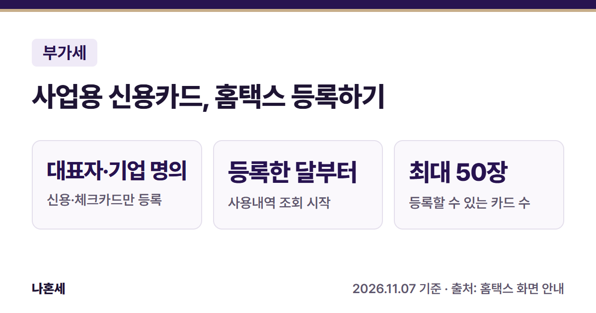
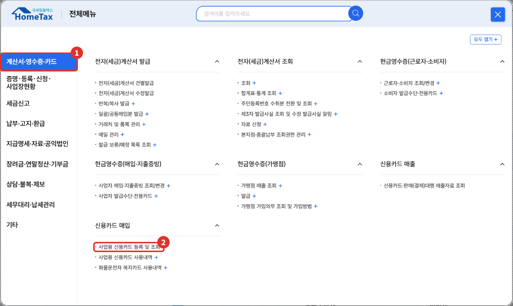
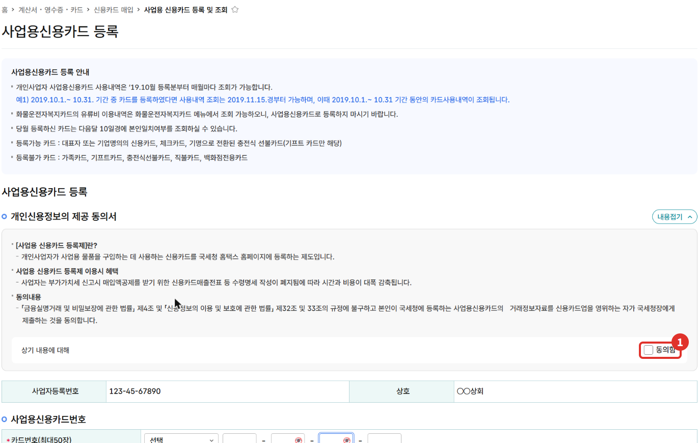
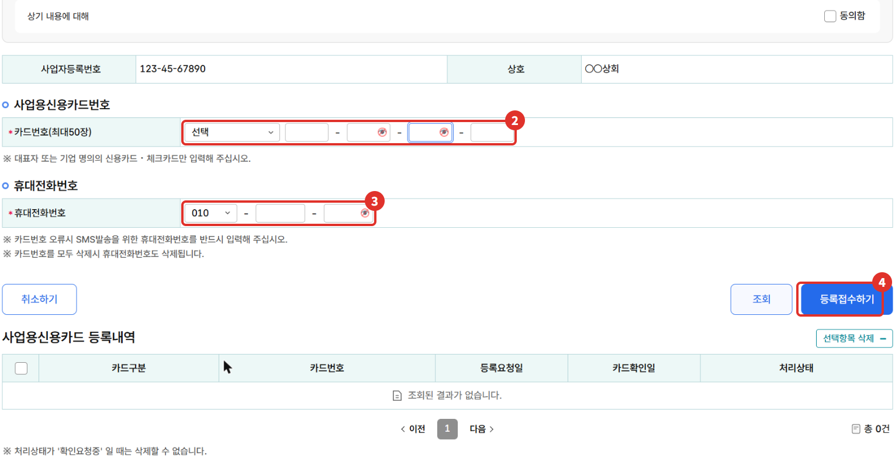
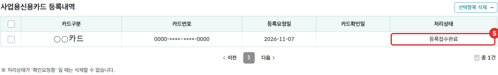
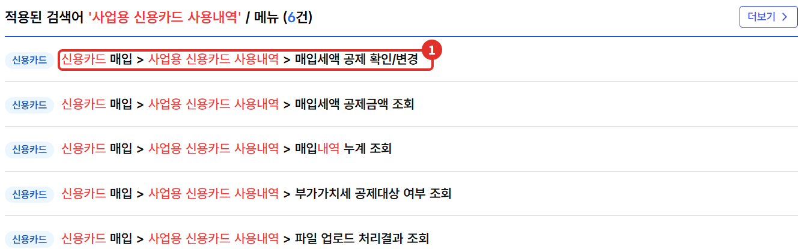
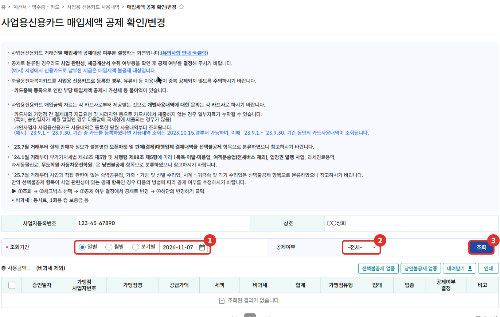

사업에 쓰는 카드를 홈택스에 **사업용 신용카드**로 등록해 두면, 부가가치세 신고 때 그 카드로 결제한 내역을 홈택스에서 불러와 확인할 수 있어요. 이 글은 운영자가 2026년 11월에 본인 사업자 계정으로 카드를 등록한 순서와, 등록 뒤 공제 여부를 확인하는 화면을 정리했어요.

{: .summary-card}

> 💡 **핵심 요약**
> - 메뉴: 홈택스 > 계산서·영수증·카드 > 신용카드 매입 > **사업용 신용카드 등록 및 조회** (2026년 11월 기준 화면)
> - 등록할 수 있는 카드는 **대표자 또는 기업 명의의 신용카드·체크카드**예요. 가족카드·기프트카드·직불카드는 안 돼요 [1]
> - **등록한 달의 사용분부터 조회돼요. 카드를 쓰기 전에 미리 등록해 두세요**{: .red} [1]

목차

* 목차
{:toc}

## 한눈에 보기

| 항목 | 내용 |
|---|---|
| 누가 | 개인사업자(사업자로 로그인) [1] |
| 무엇을 | 사업에 쓰는 대표자·기업 명의 카드, 최대 50장 [1] |
| 메뉴 | 계산서·영수증·카드 > 신용카드 매입 > 사업용 신용카드 등록 및 조회 |
| 조회 | 등록한 달 사용분부터, 보통 다음 달 중순쯤 [1][2] |
| 공제 | 요건을 갖춘 매입분만 매입세액 공제 [3][4] |

## 왜 등록하나요?

일반과세자는 사업을 위해 산 물건이나 서비스의 부가세(매입세액)를 매출세액에서 뺄 수 있어요. 카드로 결제한 것도 공제 대상 업종·사업자에게서 사업용으로 사고, **부가세가 따로 적힌 카드전표**를 받고, 수령명세서를 내고, 전표를 보관하면 공제할 수 있는 매입세액으로 봐요 [3][4][6].

홈택스 등록 화면에는 사업용 카드를 등록하면 신고 때 **신용카드매출전표 등 수령명세 작성 부담이 줄어** 시간과 비용이 감축된다고 안내돼 있어요 [1]. 카드사가 사용내역을 국세청에 보내 주기 때문이에요(등록할 때 이 제공에 동의해요) [1]. 다만 법(제46조③)에는 수령명세서 제출 요건이 그대로 있어요 [3].

## 어떤 카드를 등록할 수 있나요?

| 구분 | 카드 |
|---|---|
| 등록 가능 | 대표자 또는 기업 명의의 신용카드, 체크카드, 기명으로 바꾼 충전식 선불카드(기프트카드만 해당) [1] |
| 등록 불가 | 가족카드, 기프트카드, 충전식 선불카드, 직불카드, 백화점 전용카드 [1] |
| 따로 볼 것 | 화물운전자복지카드는 사업용 카드로 등록하지 말고 전용 메뉴에서 조회해요 [1] |

## 홈택스로 등록하는 순서

> 📅 **2026년 11월 기준 화면**이에요(운영자 본인 사업자 계정). 메뉴 이름은 바뀔 수 있어요.

1. 홈택스에 **사업자로 로그인**해요.
2. **전체메뉴**에서 ① **계산서·영수증·카드** → 신용카드 매입의 ② **사업용 신용카드 등록 및 조회**를 눌러요.

   

3. 위쪽 **사업용신용카드 등록 안내**를 읽고, **개인신용정보의 제공 동의서**에서 ① **동의함**에 체크해요.

   

4. ② **카드사**를 고르고 **카드번호**를 넣어요. 카드번호 오류 때 문자를 받을 ③ **휴대전화번호**도 꼭 넣어요 [1].
5. ④ **등록접수하기**를 눌러요.

   

6. 아래 **사업용신용카드 등록내역**의 ⑤ 처리상태에 "등록접수완료"로 나오면 접수가 끝난 거예요. 카드확인일은 비어 있다가, 당월 등록한 카드는 **다음 달 10일경** 본인 일치 여부를 확인할 수 있어요 [1].

   

## 등록한 뒤 사용내역 확인하기

등록한 카드의 사용내역은 **계산서·영수증·카드 > 신용카드 매입 > 사업용 신용카드 사용내역** 아래 메뉴에서 봐요. 아래는 홈택스 검색으로 찾은 주요 메뉴예요(2026년 11월 기준).

- 사용내역은 **등록한 달 사용분부터** 조회돼요. 화면 예시로는 9월 중 등록하면 10월 15일경부터 9월 사용분이 보인다고 안내돼 있어요 [2].
- 카드사와 가맹점 사이 처리 지연 등으로 **일부 자료가 빠질 수 있고**, 특히 매월 말일 승인분은 다음 달에 들어오는 경우가 많다고 해요 [2].

① **매입세액 공제 확인/변경** 화면에서는 거래 건마다 공제할지 말지를 정해요. ① 조회기간(일별·월별·분기별)과 ② 공제여부를 고르고 ③ **조회**를 눌러요.

| 화면 분류 | 뜻(화면 안내) |
|---|---|
| 당연불공제 | 목욕·이발·미용업, 여객운송업(전세버스 제외), 입장권 발행 사업 등은 처음부터 불공제로 분류돼요 [2][4] |
| 선택불공제 | 판매자가 불분명한 오픈마켓 결제, 숙박공유업 등은 불공제로 분류되지만, 사업 관련이면 공제로 바꿀 수 있어요 [2] |
| 공제 | 공제로 분류돼도 **사업 관련성과 세금계산서 수취 여부를 확인한 뒤** 정하라고 안내돼요 [2] |

선택불공제 항목을 공제로 바꾸는 순서는 화면 안내대로 **조회 → 체크박스 선택 → 공제여부 결정에서 공제로 변경 → 아래 변경하기**예요 [2].

## 얼마나 공제되나요? (가상 예시)

아래는 **산 사람이 일반과세자**일 때, 사업에 쓰는 소모품을 일반과세자 가게에서 카드로 산 가상의 예시예요 [3]. 간이과세자는 매입세액 대신 공급대가(부가세 포함 금액)의 0.5%를 납부세액에서 빼요. 같은 110,000원이면 550원이에요 [7].

| 가상의 예시 | 금액 |
|---|---|
| 카드 결제 금액(부가세 포함) | 110,000원 |
| 공급가액 | 100,000원 |
| 부가세(매입세액) | **10,000원** → 요건을 갖추면 공제 대상 |
| 같은 금액을 **영수증만 발급해야 하는 간이과세자**(직전 연도 공급대가 4,800만원 미만, 신규 간이과세자 등) 가게에서 결제 | 공제 대상 아님 [4][5] |

## 공제 안 되는 경우와 자주 하는 실수

- **사업과 관계없는 지출, 기업업무추진비(접대비), 비영업용 승용차 구입·유지비**의 매입세액은 공제되지 않아요 [6].
- 목욕·이발·미용업 등 시행령에 정한 업종에서 받은 카드전표, 영수증 발급 대상 간이과세자에게 받은 카드전표는 공제 대상이 아니에요 [4][5].
- **화물운전자복지카드를 사업용 카드로도 등록하면 유류비가 중복 공제될 수 있어요. 카드 중복 등록으로 부당하게 공제받으면 가산세 등 불이익이 있어요**{: .red} [2].
- 개인 용도로 쓴 결제는 사업 관련성이 없으니 공제 확인/변경 화면에서 불공제로 정해야 해요 [2][6]. 사업용과 개인용 카드를 나눠 쓰면 정리가 쉬워요.

## 직접 하기 어려울 수 있는 경우

- 카드 사용 건수가 많아 공제·불공제를 하나씩 판단하기 어려울 때
- 업무용 차량 비용, 접대비처럼 공제 여부가 헷갈리는 지출이 많을 때
- 이미 신고한 기간의 공제를 고쳐야 할 때

확실하지 않으면 **국세상담센터(126)**나 홈택스 상담으로 먼저 확인하세요.

## 자주 묻는 질문

**Q. 등록하지 않은 카드는 공제를 못 받나요?**
A. 법에서 정한 요건(부가세가 구분된 카드전표, 수령명세서 제출, 전표 보관, 공제 가능한 업종·사업자에게서 산 사업 관련 매입)을 갖추면 등록 여부와 관계없이 공제할 수 있어요 [3][4][6]. 다만 홈택스 사업용 카드 사용내역에는 등록한 카드만 나오니, 등록하지 않은 카드는 내역을 직접 정리해야 해요.

**Q. 오늘 등록하면 지난달 사용분도 보이나요?**
A. 아니요. 등록한 달의 사용분부터 조회돼요 [1][2].

**Q. 체크카드도 되나요?**
A. 네. 대표자 또는 기업 명의의 체크카드는 등록할 수 있어요 [1].

## 함께 보면 좋은 글

- [홈택스 전자세금계산서 발급 방법: 건별발급 순서]()
- [홈택스 사업자등록 신청 방법: 개인사업자 혼자 해 본 순서]()

부가세가 대략 얼마쯤 나올지는 [부가세 예상 세액 계산기](/calculators/vat/)로 볼 수 있어요. 참고용 계산이며 실제 신고 세액과 다를 수 있어요.

## 출처

1. 홈택스 사업용신용카드 등록 화면 안내·개인신용정보 제공 동의서 문구 (운영자 직접 확인: 2026-11-07)
2. 홈택스 사업용신용카드 매입세액 공제 확인/변경 화면 안내 문구 (운영자 직접 확인: 2026-11-07)
3. 법령: 부가가치세법 제46조 ③ (2026.1.2. 시행)
4. 법령: 부가가치세법 시행령 제88조 ⑤ (2026.4.1. 시행)
5. 법령: 부가가치세법 제36조 ① 2호 (2026.1.2. 시행)
6. 법령: 부가가치세법 제39조 ① 4호~6호 (2026.1.2. 시행)
7. 법령: 부가가치세법 제63조 ③ 1호 (2026.1.2. 시행)

> 이 글은 2026년 11월 7일 기준의 일반적인 안내입니다. 세법과 홈택스 화면은 바뀔 수 있으니 신고 전 국세청 안내를 꼭 확인하세요. 개별 상황은 국세상담센터(126)에 문의하세요.
