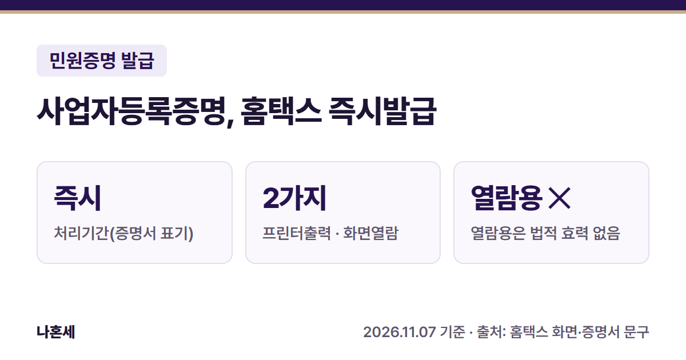
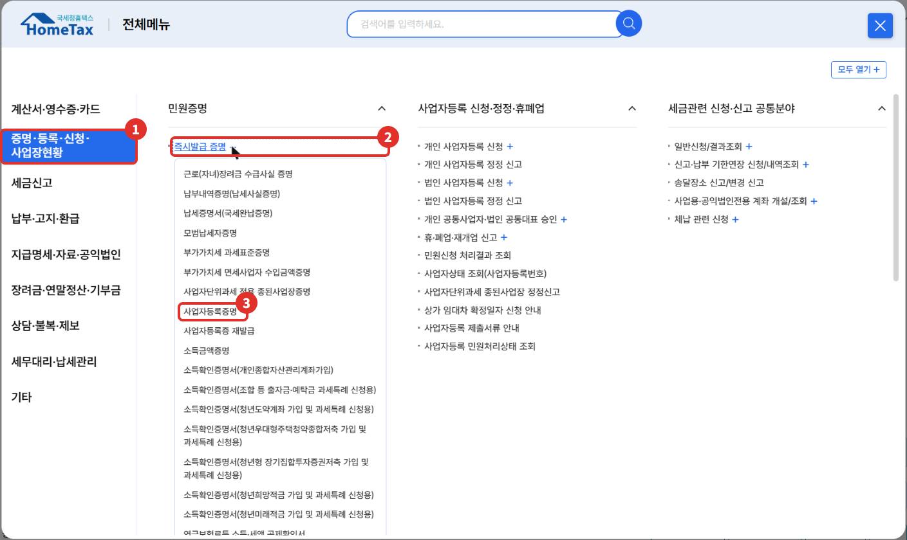
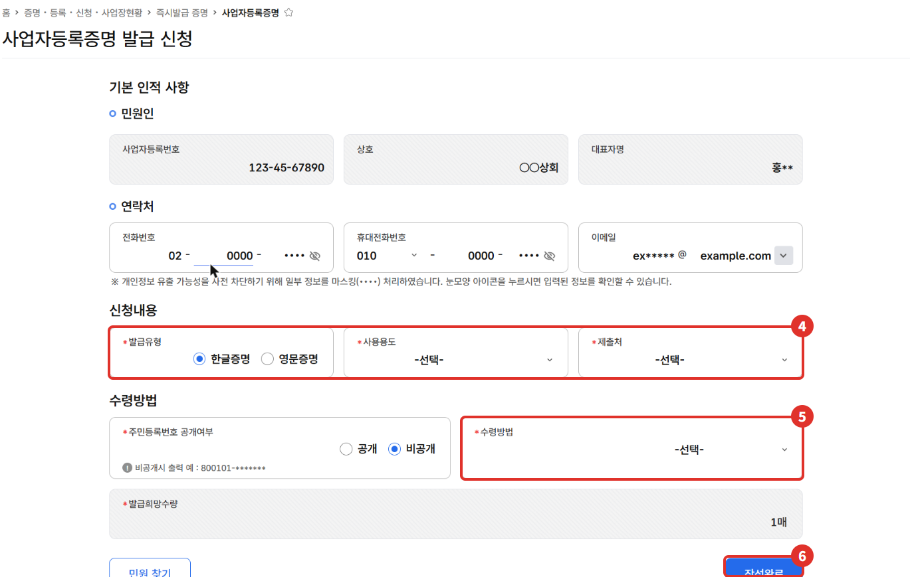
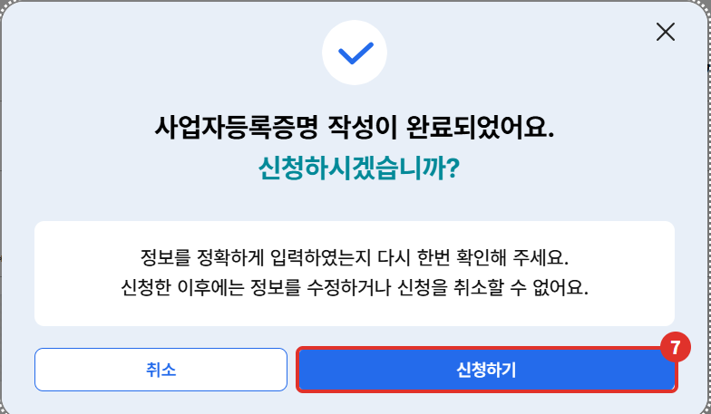
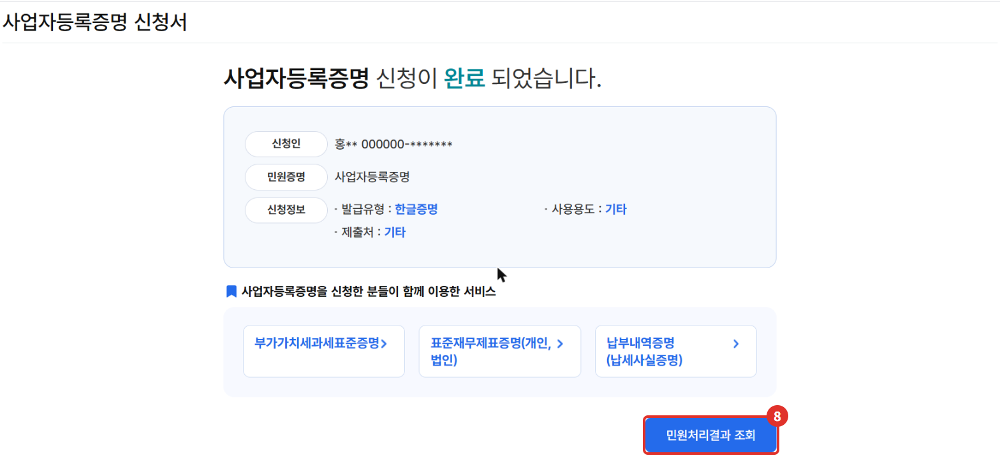
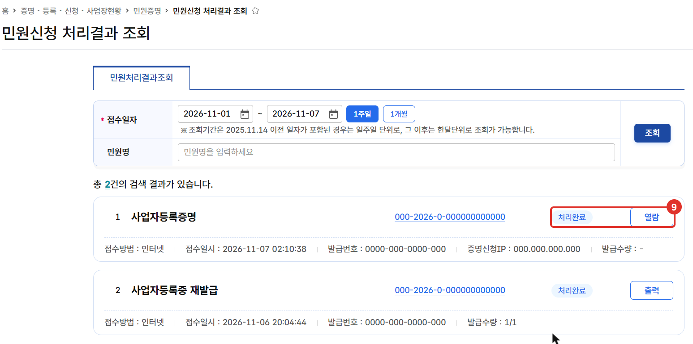
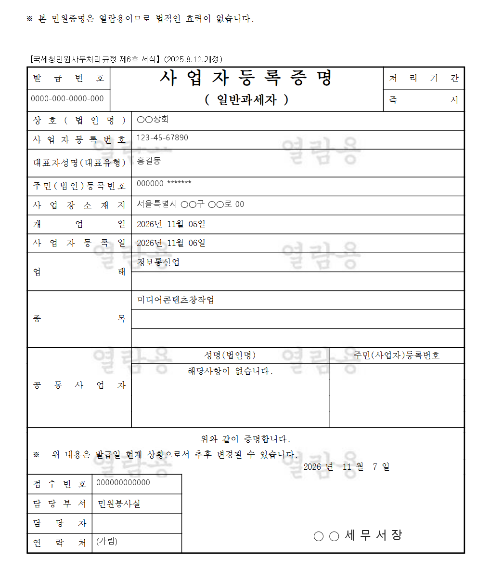

거래처나 은행에서 **사업자등록증명**을 내 달라고 하면, 세무서에 가지 않고 홈택스에서 바로 발급할 수 있어요. 이 글은 운영자가 2026년 11월에 본인 사업자 계정으로 사업자등록증명을 신청하고 증명서를 열어 보기까지의 화면을 정리했어요.

{: .summary-card}

> 💡 **핵심 요약**
> - 메뉴: 홈택스 > 증명·등록·신청·사업장현황 > 민원증명 > 즉시발급 증명 > **사업자등록증명** (2026년 11월 기준 화면)
> - 증명서에 적힌 처리기간은 **즉시**예요 [1]
> - **수령방법을 "인터넷열람"으로 열면 "열람용이므로 법적인 효력이 없습니다"라고 찍혀요. 제출할 서류라면 어떤 형식으로 내야 하는지 제출처에 먼저 확인하세요**{: .red} [1]

목차

* 목차
{:toc}

## 한눈에 보기

| 항목 | 내용 |
|---|---|
| 누가 | 사업자등록증명이 필요한 사업자(운영자는 본인 사업자로 로그인해 신청) |
| 무엇을 | 발급유형, 사용용도, 제출처, 주민번호 공개 여부, 수령방법, 발급희망수량 [2] |
| 메뉴 | 증명·등록·신청·사업장현황 > 즉시발급 증명 > 사업자등록증명 |
| 처리 | 즉시(증명서 표기) [1] |
| 받는 방법 | 인터넷발급(프린터출력) 또는 인터넷열람(화면조회) [2] |

## 사업자등록증명이 뭐예요?

사업자등록증명은 발급일 현재를 기준으로 사업자의 상호, 등록번호, 사업장 소재지, 개업일, 업태·종목 등을 증명하는 서류예요 [1]. 증명서 아래에는 "위 내용은 발급일 현재 상황으로서 추후 변경될 수 있습니다"라고 적혀 있어요 [1].

**사업자등록증 재발급**과는 다른 서류예요. 등록증 자체를 다시 뽑으려면 같은 메뉴의 **사업자등록증 재발급**을 써요([사업자등록 신청 글]() 참고).

## 홈택스로 발급하는 순서

> 📅 **2026년 11월 기준 화면**이에요(운영자 본인 사업자 계정). 메뉴 이름은 바뀔 수 있어요.

1. 홈택스에 로그인해요. 운영자는 **사업자로 로그인**해서 신청했어요.
2. **전체메뉴**에서 ① **증명·등록·신청·사업장현황** → 민원증명의 ② **즉시발급 증명 +**를 눌러 펼치고 ③ **사업자등록증명**을 눌러요.

   

3. **사업자등록증명 발급 신청** 화면이 열려요. 민원인 정보(사업자등록번호·상호·대표자명)와 연락처는 미리 채워져 있어요.
4. ④ **신청내용**과 ⑤ **수령방법**을 골라요(아래 표).

   

5. ⑥ **작성완료**를 누르면 확인 창이 떠요. 신청한 뒤에는 정보를 고치거나 신청을 취소할 수 없다고 안내되니, 한 번 더 보고 ⑦ **신청하기**를 눌러요.

   

6. "정상적으로 접수되었습니다" 알림 뒤에 **신청이 완료되었습니다** 화면이 나와요. ⑧ **민원처리결과 조회**를 눌러요.

   

7. 처리결과 목록에 ⑨ **처리완료**로 나오면 오른쪽 **열람** 버튼을 눌러 증명서를 열어요(운영자는 인터넷열람으로 신청했어요. 인터넷발급으로 신청하면 버튼 이름이 다를 수 있어요). 증명서는 **새 창**으로 떠요.

   

운영자가 열람으로 받은 증명서는 아래처럼 나왔어요. 맨 위에 **열람용이라 법적 효력이 없다**는 문구가 찍혀 있어요 [1].

## 신청서에서 고르는 항목

| 항목 | 고를 수 있는 것(2026년 11월 화면) |
|---|---|
| 발급유형 | 한글증명, 영문증명 [2] |
| 사용용도 | 입찰·계약용, 수금용, 관공서제출용, 대출용, 여권또는비자신청용, 건강보험·국민연금공단제출용, 금융기관제출용, 신용카드발급용, 기타 [2] |
| 제출처 | 금융기관, 관공서, 조합/협회, 거래처, 학교, 외교부/재외공관/재외동포청, 기타 [2] |
| 주민번호 공개 | 공개, 비공개(비공개면 뒷자리가 *로 나와요) [2] |
| 수령방법 | 인터넷발급(프린터출력), 인터넷열람(화면조회) — 이 증명서 화면에서는 두 가지였어요 [2] |
| 발급희망수량 | 1~9매 [2] |

열람으로 연 증명서에는 **"법적인 효력이 없습니다"**라고 적혀 있어요 [1]. **제출할 서류라면 인터넷발급(프린터출력)으로 받고, 어떤 형식으로 내야 하는지는 제출처에 확인하세요**{: .red}. 주민번호 공개 여부도 제출처가 요구하는 대로 고르세요.

## 직접 발급이 어려울 수 있는 경우

- 제출처가 영문 증명이나 특정 양식을 따로 요구할 때(영문증명은 발급유형에서 고를 수 있어요 [2])
- 사업장 정보가 바뀌었는데 아직 정정 신고를 하지 않았을 때(증명서는 발급일 현재 등록 내용으로 나와요 [1])

헷갈리면 **국세상담센터(126)**나 가까운 세무서 민원실에 먼저 물어보세요.

## 자주 묻는 질문

**Q. 사업자등록증 사본을 내면 안 되나요?**
A. 제출처마다 요구하는 서류가 달라요. "사업자등록증명"이라고 했다면 이 증명서를 내는 게 맞으니, 헷갈리면 제출처에 먼저 물어보세요.

**Q. 증명서 창이 안 떠요.**
A. 증명서는 새 창으로 열려요(운영자 확인). 브라우저 설정에서 홈택스 새 창이 막혀 있지 않은지 보고, 그래도 안 되면 잠시 뒤 다시 시도하거나 126에 문의하세요.

**Q. 영문으로도 되나요?**
A. 네. 신청서의 발급유형에서 **영문증명**을 고를 수 있어요 [2].

## 함께 보면 좋은 글

- [홈택스 소득금액증명 발급 방법]()
- [홈택스 납세증명서(국세완납증명) 발급 방법]()

## 출처

1. [홈택스](https://hometax.go.kr)에서 열람한 사업자등록증명(국세청민원사무처리규정 제6호 서식, 2025.8.12. 개정) 문구 (운영자 직접 확인: 2026-11-07)
2. [홈택스](https://hometax.go.kr) > 증명·등록·신청·사업장현황 > 즉시발급 증명 > 사업자등록증명 발급 신청 화면의 선택 목록·확인 창 문구 (운영자 직접 확인: 2026-11-07)

> 이 글은 2026년 11월 7일 기준의 일반적인 안내입니다. 홈택스 화면은 바뀔 수 있으니 발급 전 국세청 안내를 꼭 확인하세요. 개별 상황은 국세상담센터(126)에 문의하세요.
