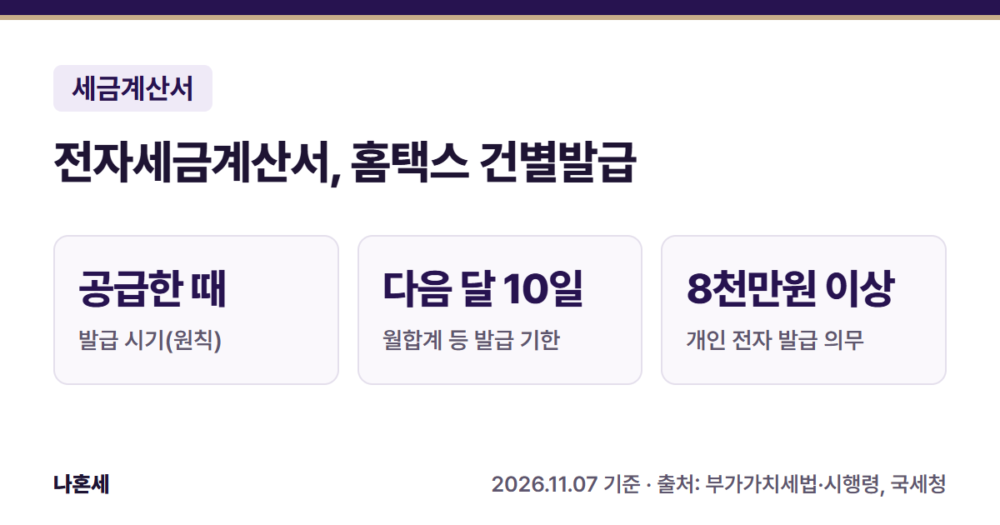
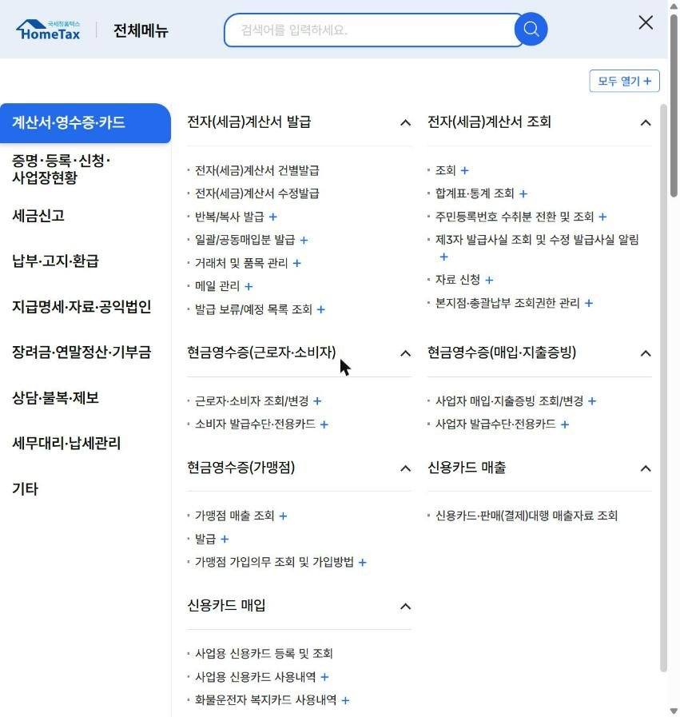
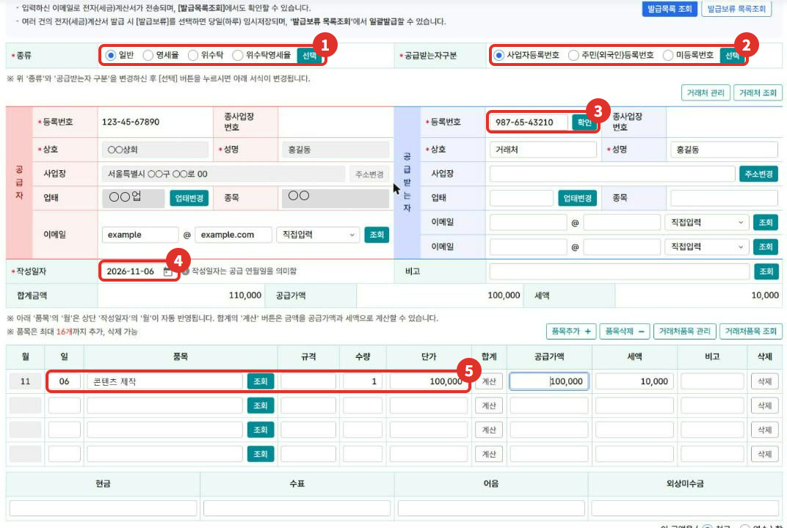
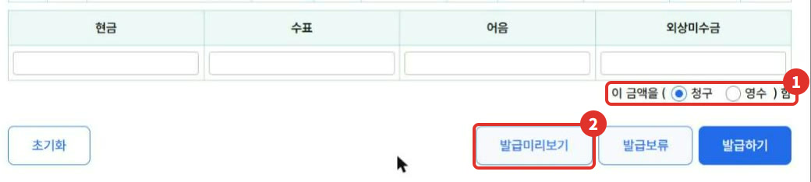
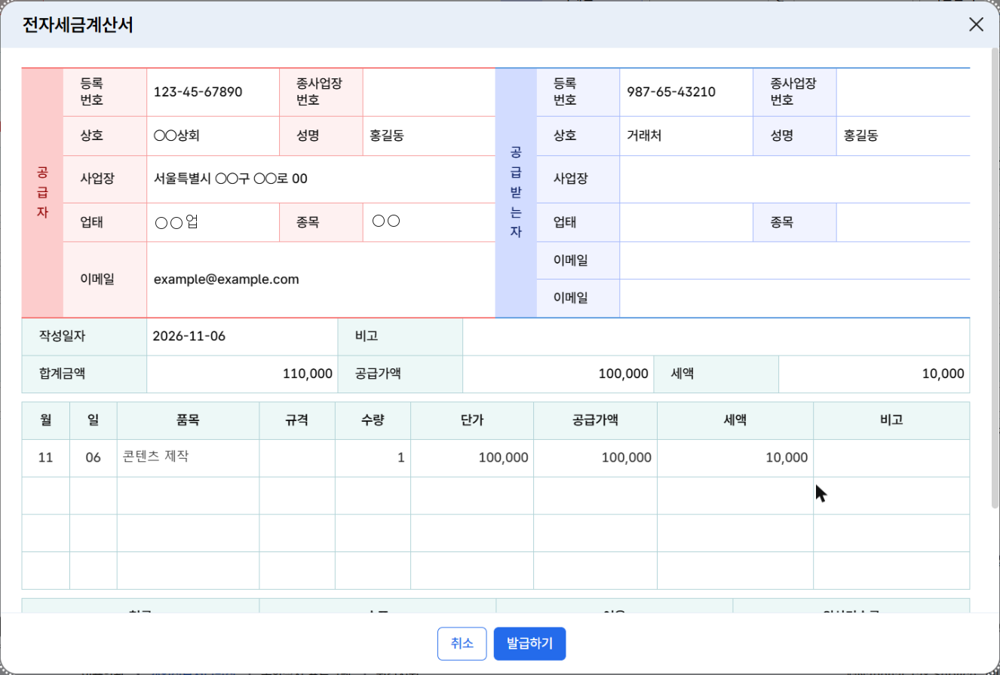

거래처에서 "세금계산서 끊어 주세요"라는 말을 들으면, 홈택스에서 직접 발급할 수 있어요. 이 글은 운영자가 2026년 11월에 본인 사업자 계정으로 **전자세금계산서 건별발급** 화면을 열고 발급 직전까지 따라 간 순서를 정리했어요.

{: .summary-card}

> 💡 **핵심 요약**
> - 메뉴: 홈택스 > 계산서·영수증·카드 > 전자(세금)계산서 발급 > **전자(세금)계산서 건별발급** (2026년 11월 기준 화면)
> - 발급은 공급한 때에. **한 달 거래를 모아 발급하면 다음 달 10일까지**{: .red} [1]
> - 공급가액(면세 포함) **8천만원 이상**인 해의 다음 해 7월 1일부터 개인사업자도 전자 발급이 의무예요 [2]

목차

* 목차
{:toc}

## 한눈에 보기

| 항목 | 내용 |
|---|---|
| 누가 | 세금계산서를 발급하는 사업자(의무 대상이 아니어도 전자 발급 가능) [2][3] |
| 언제 | 공급한 때. 월합계 등은 다음 달 10일까지 [1] |
| 무엇을 | 필수: 거래처 등록번호, 작성일자, 공급가액·세액 [4] / 그 밖에 품목 등 [11] |
| 메뉴 | 계산서·영수증·카드 > 전자(세금)계산서 발급 > 전자(세금)계산서 건별발급 |
| 인증 | 공동인증서, 간편인증, 생체(지문 등)인증, 보안카드 중 하나로 전자서명 [5] |

## 누가 발급하나요?

- **꼭 전자로 발급해야 하는 개인사업자**: 어느 해의 사업장별 공급가액(면세 포함) 합계가 **8천만원 이상**이면, 그다음 해 **7월 1일**(제2기 시작일)부터 전자세금계산서를 발급해야 해요 [2]. 세무서가 시작 1개월 전까지 알려 줘요 [2]. **한 번 의무자가 되면 이후 공급가액이 8천만원 아래로 내려가도 의무가 남아요**{: .red} [2]. 법인사업자는 금액과 관계없이 의무예요 [2].
- **의무가 아닌 사업자**도 전자세금계산서를 발급할 수 있어요 [3].
- **간이과세자** 중 직전 연도 공급대가가 4,800만원 미만이거나, 새로 시작해 첫 과세기간 중인 사람은 세금계산서 대신 영수증을 발급해요 [6].
- 부가가치세가 면제되는 공급은 세금계산서 발급 대상이 아니에요 [4].

## 언제까지 하나요?

| 구분 | 기한 |
|---|---|
| 기본 | 재화·용역을 공급한 때 [1] |
| 월합계 등 | 공급한 달의 **다음 달 10일**(공휴일·토요일이면 다음 영업일) [1] |
| 국세청 전송 | 발급일 **다음 날**까지 [7]. 홈택스에서 발급하면 발급 즉시 자동 전송돼요 [5] |

월합계는 거래처별로 한 달 공급가액을 합해 그달 말일을 작성일자로 적는 방식이에요 [1].

## 홈택스로 발급하는 순서

> 📅 **2026년 11월 기준 화면**이에요(운영자 본인 사업자 계정). 메뉴 이름은 바뀔 수 있어요.

1. 홈택스에 **사업자로 로그인**해요. 운영자는 사업자 인증서로 로그인했어요.
2. 오른쪽 위 **전체메뉴**를 열고 **계산서·영수증·카드 > 전자(세금)계산서 발급 > 전자(세금)계산서 건별발급**을 눌러요.

   

3. 위쪽에서 **종류**(보통은 일반)와 **공급받는자 구분**(사업자등록번호)을 골라요. 공급자(내 정보)는 미리 채워져 있어요.
4. 오른쪽 **공급받는 자 등록번호**를 넣고 **확인**을 누른 뒤, 상호·성명 등 빈칸을 채워요.
5. **작성일자**와 품목 줄의 **일·품목·수량·단가**를 넣어요. 수량과 단가를 넣으면 공급가액과 세액이 자동으로 채워졌어요(2026년 11월 운영자 확인).

   

6. 아래에서 **이 금액을 청구/영수 함**을 고르고 **발급미리보기**로 내용을 확인해요.

   

   

7. 내용이 맞으면 **발급하기**를 누르고 전자서명을 해요. 홈택스에서는 공동인증서, 간편인증, 생체(지문 등)인증, 보안카드로 전자서명할 수 있어요 [5]. 운영자는 실제 거래가 아니어서 이 단계는 누르지 않았어요.
8. 발급하면 매입자에게 이메일이 가고 국세청에도 바로 전송돼요 [5]. 발급한 내역은 화면 위 **발급목록 조회** 버튼이나 **전자(세금)계산서 조회 > 조회** 메뉴에서 볼 수 있어요.

## 세액은 어떻게 나오나요?

부가가치세율은 **10%**예요 [8]. 품목 줄에 수량과 단가를 넣으면 공급가액에 10%를 곱한 세액이 채워져요.

| 가상의 예시 | 금액 |
|---|---|
| 수량 × 단가 | 1 × 100,000원 |
| 공급가액 | 100,000원 |
| 세액(10%) | 100,000원 × 10% = **10,000원** |
| 합계금액 | 110,000원 |

품목 줄의 **합계** 칸에는 **계산** 버튼이 있어요. 화면 안내에는 "합계의 계산 버튼은 금액을 공급가액과 세액으로 계산할 수 있습니다"라고 나와 있어요. 원 단위 끝수가 생기면 발급 전에 미리보기에서 금액을 꼭 확인하세요.

## 자주 하는 실수와 가산세

| 실수 | 가산세 |
|---|---|
| 발급 시기를 넘겨, 확정신고 기한 안에 늦게 발급 | 공급가액의 **1%** [9] |
| 확정신고 기한까지 발급하지 않음 | 공급가액의 **2%** [9] |
| 의무자가 발급 시기에 전자 대신 종이로 발급 | 공급가액의 **1%** [9] |
| 전송 기한을 넘겨, 확정신고 기한 안에 전송 | 공급가액의 **0.3%** [9] |
| 확정신고 기한까지 전송하지 않음 | 공급가액의 **0.5%** [9] |
| 등록번호·공급가액 등 필요적 기재사항을 잘못 적음 | 공급가액의 **1%**(거래사실이 확인되면 제외) [9] |

**월합계로 모아 발급할 때도 다음 달 10일을 넘기면 늦은 발급이 돼요**{: .red} [1][9]. 홈택스에서 발급하면 국세청 전송은 자동으로 돼요 [5].

금액이나 거래처를 잘못 적었다면 같은 메뉴의 **전자(세금)계산서 수정발급**을 써요. 수정 사유별 방법은 따로 정리할 예정이에요.

## 직접 발급이 어려울 수 있는 경우

- 거래가 많아 매달 수십 건을 발급해야 할 때(반복/복사 발급, 일괄 발급 메뉴나 발급대행 시스템을 검토)
- 수정 사유가 복잡하거나, 이미 신고한 기간의 세금계산서를 고쳐야 할 때
- 인터넷 사용이 어렵다면 세무서에서 보안카드를 받은 뒤 전화 ARS(126-1-2-1)로 발급(1회 1천만원·1일 3천만원 한도)하거나, 세무서에 대리발급을 신청할 수 있어요 [5]

확실하지 않으면 **국세상담센터(126)**나 홈택스 도움말로 먼저 확인하세요.

## 자주 묻는 질문

**Q. 사업자가 아니어도 홈택스에서 발급할 수 있나요?**
A. 세금계산서는 사업자가 발급해요 [4]. 운영자가 확인했을 때 건별발급 화면은 사업자로 로그인해야 열렸어요.

**Q. 의무 대상이 아닌데 전자로 발급해도 되나요?**
A. 네. 의무 대상이 아닌 사업자도 전자세금계산서를 발급할 수 있어요 [3].

**Q. 발급하면 국세청에 따로 전송해야 하나요?**
A. 홈택스에서 발급하면 발급 즉시 자동으로 전송돼서 따로 할 일이 없어요 [5].

## 함께 보면 좋은 글

- [홈택스 사업자등록 신청 방법: 일반과세자와 간이과세자 차이]()
- [사장님 세무 일정 달력: 부가세 신고 기한 확인]()

## 출처

1. 법령: 부가가치세법 제34조 ①·③ (2026.1.2. 시행)
2. 법령: 부가가치세법 제32조 ②, 시행령 제68조 ①~③ (2026.4.1. 시행)
3. 법령: 부가가치세법 제32조 ⑤, 시행령 제68조 ⑩ (2026.4.1. 시행)
4. 법령: 부가가치세법 제32조 ① (2026.1.2. 시행)
5. [국세청 - 전자(세금)계산서 발급방법 및 발급절차](https://t.nts.go.kr/nts/cm/cntnts/cntntsView.do?mi=2462&cntntsId=7788) (확인일: 2026-11-07)
6. 법령: 부가가치세법 제36조 ① 2호 (2026.1.2. 시행)
7. 법령: 부가가치세법 시행령 제68조 ⑦ (2026.4.1. 시행)
8. 법령: 부가가치세법 제30조 (2026.1.2. 시행)
9. 법령: 부가가치세법 제60조 ② (2026.1.2. 시행)
10. 홈택스 전체메뉴·전자세금계산서 건별발급·발급미리보기 화면 (운영자 직접 확인: 2026-11-06)
11. 법령: 부가가치세법 시행령 제67조 ② (2026.4.1. 시행)

> 이 글은 2026년 11월 7일 기준의 일반적인 안내입니다. 세법과 홈택스 화면은 바뀔 수 있으니 발급 전 국세청 안내를 꼭 확인하세요. 개별 상황은 국세상담센터(126)에 문의하세요.
