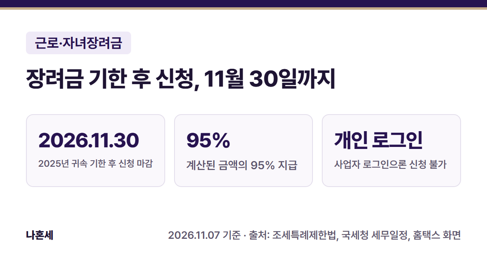
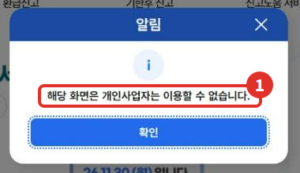
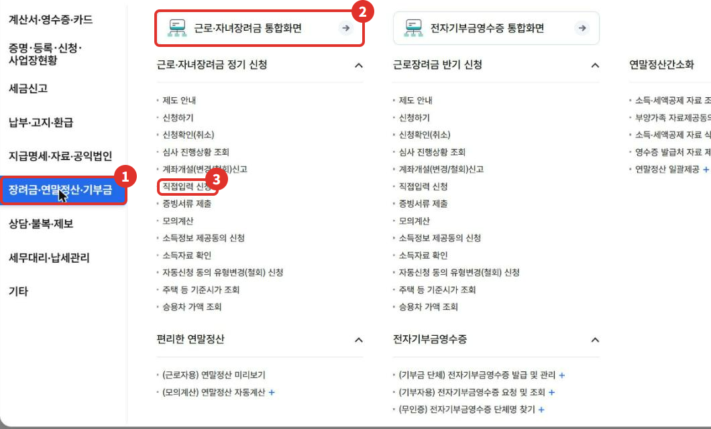
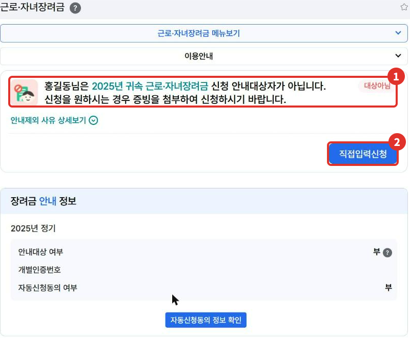
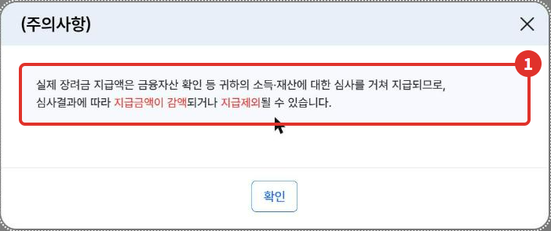
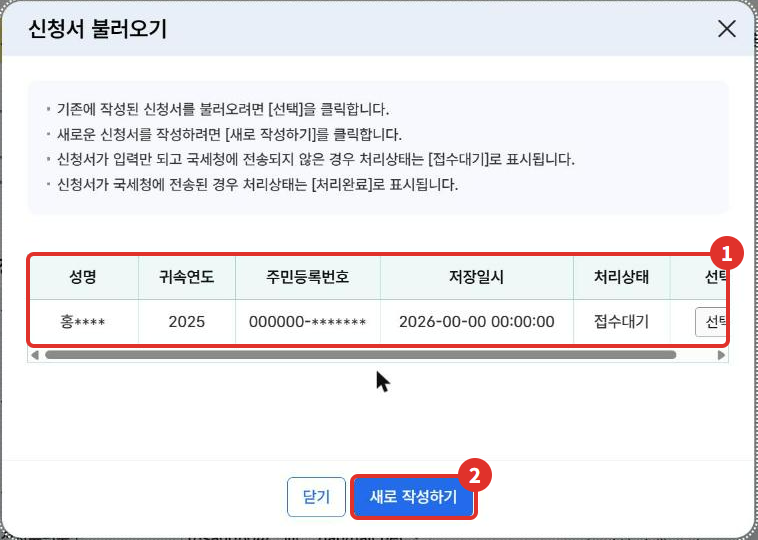
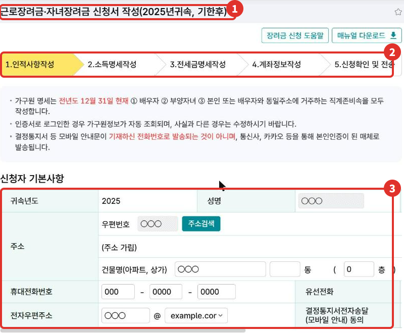
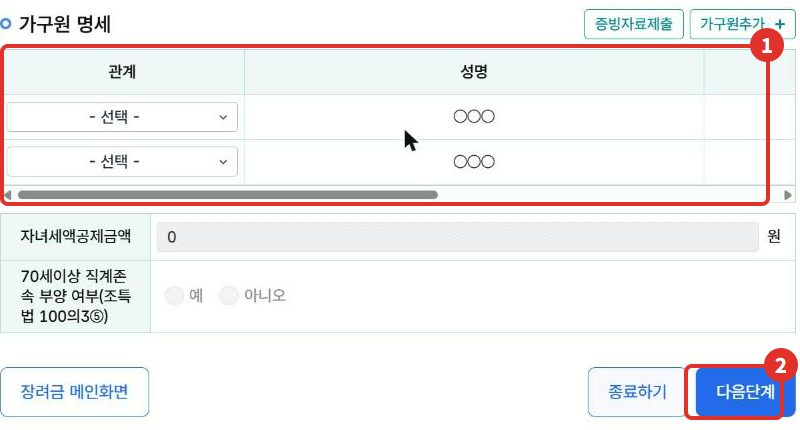

5월 정기 신청 때 근로장려금·자녀장려금을 신청하지 못했어도, **2025년 귀속(2025년에 번 소득) 장려금은 2026년 11월 30일까지 기한 후 신청**을 할 수 있어요 [1][2]. 대신 받는 금액은 계산된 금액의 **95%**예요 [3][4]. 이 글은 요건과 금액 기준, 홈택스 신청 화면 순서를 정리했어요.

{: .summary-card}

> 💡 **핵심 요약**
> - **2025년 귀속 기한 후 신청 마감은 2026년 11월 30일(월)이에요**{: .red} [1][2]
> - 기한 후에 신청하면 계산된 금액의 **95%**를 받아요(근로·자녀장려금 모두) [3][4]
> - 사업자로 로그인하면 신청 화면이 열리지 않아요. **개인으로 로그인**해서 신청해요(2026년 11월 화면)

목차

* 목차
{:toc}

## 한눈에 보기

| 항목 | 내용 |
|---|---|
| 대상 | 2025년에 근로·사업·종교인소득이 있고 요건을 갖춘 가구 [5][7] |
| 기한 | 2026년 11월 30일까지(정기 신청기간 끝난 다음 날부터 6개월) [1][2] |
| 금액 | 계산된 금액의 95% [3][4] |
| 지급 | 신청일부터 4개월 안(국세청 안내) [12] |
| 메뉴 | 장려금·연말정산·기부금 > 근로·자녀장려금 통합화면 |

## 누가 신청할 수 있나요?

2025년에 **근로소득, 사업소득, 종교인소득** 중 하나가 있는 거주자가 아래 요건을 모두 갖추면 신청할 수 있어요 [5][7]. 개인사업자도 사업소득이 있으면 대상이 될 수 있어요.

**근로장려금** — 가구 유형별 연간 총소득(배우자 포함 합계) 기준 [5]

| 가구 유형 | 총소득 기준 | 최대 금액 |
|---|---|---|
| 단독 | 2,200만원 미만 | 165만원 [6] |
| 홑벌이 | 3,200만원 미만 | 285만원 [6] |
| 맞벌이 | 4,400만원 미만 | 330만원 [6] |

**자녀장려금** — 18세 미만 부양자녀가 있고, 연간 총소득이 **7,000만원 미만** [7][9]. 자녀 1명당 최대 **100만원**이에요 [8].

**재산** — 2025년 6월 1일 기준 가구원 재산 합계가 **2억 4천만원 미만**이어야 해요. **1억 7천만원 이상이면 계산된 금액의 50%만 받아요** [5][6][7][14].

- **가구 유형**: 단독은 배우자·부양자녀·70세 이상 부양 직계존속이 없는 가구, 맞벌이는 본인과 배우자가 각각 근로·사업소득 등이 300만원 이상인 가구예요. 나머지는 홑벌이예요 [5].
- **자녀세액공제와 중복 불가**: 같은 자녀로 자녀세액공제를 받았다면 그 공제액만큼 자녀장려금이 줄어요 [10][15]. 신청서 화면에도 "자녀세액공제금액" 칸이 있어요.
- 맞벌이 총소득 기준 4,400만원은 2024년 말 법 개정으로 3,800만원에서 오른 금액이고, 2025년 이후 신청분부터 적용돼요 [11].

## 언제까지, 얼마를 받나요?

정기 신청기간(종합소득세 확정신고 기간)에 신청하지 못한 사람은 **그 기간이 끝난 다음 날부터 6개월 안에** 신청할 수 있어요 [1]. 2025년 귀속은 **2026년 11월 30일**이 마감이에요 [2][16].

> ⚠️ 국세청 "신청기간 및 방법" 안내 페이지에는 기한 후 신청기간이 "2026.6.2.~12.1."로 적혀 있어요 [17]. 국세청 세무일정과 국세상담센터 안내는 11월 30일이라 [2][16], **11월 30일(월) 안에 신청하는 게 안전해요**{: .red}.

기한 후 신청분은 계산된 금액의 **100분의 95**로 결정돼요 [3]. 자녀장려금에도 같은 규정이 적용돼요 [4]. 국세청은 기한 후 신청분을 **신청일부터 4개월 안에** 지급한다고 안내해요 [12]. 법 조문은 신청한 달 말일부터 3개월 안에 결정(사유가 있으면 2개월 연장)하게 하고 있어서 [3], 심사 상황에 따라 늦어질 수 있어요.

### 가상 예시로 계산해 보면

> **가상의 예시**예요. 실제 금액은 시행령의 산정표(소득 구간별 표)로 정해져서 몇천 원 차이가 날 수 있어요 [6].

홑벌이 가구, 18세 미만 자녀 1명, 2025년 총급여액 등 2,000만원, 재산 1억원(1억 7천만원 미만), 기한 후 신청.

| 항목 | 금액 |
|---|---|
| 근로장려금 | 1,900,000원 |
| 자녀장려금 | 1,000,000원 |
| 기한 후 95% | **2,755,000원** |

- 근로장려금: 285만원 − (2,000만원 − 1,400만원) × 285/1,800 = 1,900,000원 [6]
- 자녀장려금: 총급여액 등이 2,100만원 미만이라 1명 × 100만원 [8]
- 기한 후: (1,900,000 + 1,000,000) × 95% = 2,755,000원 [3][4]

**경계 예시**: 단독가구의 연간 총소득이 **2,200만원 이상**이면 근로장려금 대상이 아니에요 [5]. 재산 합계가 2억 4천만원 이상이어도 대상이 아니에요 [5][7].

## 홈택스로 신청하는 순서

> 📅 **2026년 11월 기준 화면**이에요. 운영자 본인 계정으로 신청서 화면까지 들어가 보고, **실제로 제출하지는 않았어요.** 이름·주소·연락처는 가상값으로 바꾸거나 가렸어요.

1. 홈택스에 **개인으로 로그인**해요. 사업자로 로그인한 상태에서 장려금 메뉴를 누르면 ① "해당 화면은 개인사업자는 이용할 수 없습니다" 창이 떠요(2026년 11월 운영자 확인).

   

2. **전체메뉴**에서 ① **장려금·연말정산·기부금** → ② **근로·자녀장려금 통합화면**을 눌러요. 정기 신청 아래 ③ **직접입력 신청**을 바로 눌러도 돼요.

   

3. 통합화면 맨 위에 ① **안내대상자인지**가 나와요. 운영자 계정은 "안내대상자가 아닙니다. 신청을 원하시는 경우 증빙을 첨부하여 신청하시기 바랍니다"라고 떴고, ② **직접입력신청**을 눌렀어요. 안내대상자는 화면 안내를 따르면 돼요(운영자는 이 경로를 확인하지 못했어요).

   

4. ① **주의사항** 창을 읽고 확인을 눌러요. 실제 지급액은 소득·재산 심사를 거쳐 줄거나 지급되지 않을 수 있다는 안내예요.

   

5. **신청서 불러오기** 창이 떠요. ① 전에 써 둔 신청서가 있으면 목록에서 선택하고, 처음이면 ② **새로 작성하기**를 눌러요. 입력만 하고 보내지 않은 신청서는 처리상태가 "접수대기"로 표시돼요(화면 안내).

   

6. ① 화면 제목에 **"2025년귀속, 기한후"**가 붙은 신청서가 열려요. ② 신청은 **인적사항 → 소득명세 → 전세금명세 → 계좌정보 → 신청확인 및 전송** 5단계예요. ③ 신청자 기본사항(주소·연락처)을 확인해요.

   

7. 아래 ① **가구원 명세**에 2025년 12월 31일 현재 배우자, 부양자녀, 본인이나 배우자와 같은 주소에 사는 직계존비속(부모·자녀 등)을 모두 적어요(화면 안내). 인증서로 로그인하면 가구원 정보가 자동으로 조회되고, 사실과 다르면 고치라고 안내돼요. 다 확인했으면 ② **다음단계**를 눌러요.

   

8. 소득명세, 전세금명세, 계좌정보를 차례로 채우고 **신청확인 및 전송**에서 보내요. 운영자는 실제로 신청하지 않아서 2단계부터는 화면을 찍지 않았어요. 보낸 뒤에는 같은 메뉴의 **심사 진행상황 조회**에서 진행 상황을 볼 수 있어요(2026년 11월 전체메뉴 화면).

## 자주 하는 실수

- **사업자 로그인으로 들어가 "이용할 수 없습니다"에서 멈추기** → 개인으로 다시 로그인해요
- 마감 직전까지 미루기 → **2025년 귀속은 11월 30일 안에 끝내세요**{: .red} [1][2]
- 같은 자녀로 자녀세액공제를 받았는데 자녀장려금을 다 받을 거라고 생각하기 → 공제액만큼 줄어요 [10][15]
- 가구원 명세에서 배우자나 부양자녀를 빼먹기 → 가구 유형과 금액이 달라져요 [5]
- 계산된 금액을 그대로 받을 거라고 생각하기 → 기한 후 95%, 재산 1억 7천만원 이상이면 50%, 심사 결과에 따라 줄 수 있어요 [3][6]

## 직접 신청이 어려울 수 있는 경우

- 이혼·재혼 등으로 자녀를 누구의 부양자녀로 할지 헷갈릴 때(한 자녀는 한 사람의 부양자녀로만 봐요) [9]
- 사업소득이 있어 총급여액 등 계산이 복잡할 때
- 재산(주택·전세보증금·예금 등) 합계가 1억 7천만원이나 2억 4천만원 근처일 때

확실하지 않으면 **국세상담센터(126)**나 관할 세무서에 먼저 확인하세요. 홈택스 같은 메뉴의 **모의계산**으로 대략 금액을 볼 수도 있어요(2026년 11월 전체메뉴 화면).

## 자주 묻는 질문

**Q. 5월에 종합소득세 신고를 안 했어도 장려금을 신청할 수 있나요?**
A. 종합소득세 신고 의무가 있는 사람은 종합소득세 신고도 해야 장려금 신청이 인정돼요(일정 요건의 사업자 등은 장려금 신청만으로 신고한 것으로 봐요) [1]. 신고를 안 했다면 장려금 결정일까지 종합소득세 기한 후 신고를 하면 신고한 것으로 봐요 [1]. 내 경우에 해당하는지는 126에 확인하세요.

**Q. 5월(정기 신청기간)에 이미 신청했는데 또 해야 하나요?**
A. 아니요. 기한 후 신청은 정기 신청기간에 **신청하지 않은 사람**이 하는 거예요 [1]. 이미 신청했다면 **심사 진행상황 조회**에서 확인하세요.

**Q. 2026년에 번 소득은요?**
A. 2026년 귀속분은 2027년 5월 정기 신청 때 신청해요 [1]. 기한은 그때 국세청 공지로 다시 확인하세요.

## 함께 보면 좋은 글

- [홈택스 소득금액증명 발급 방법]()
- [사장님 세무 일정 달력]()

## 출처

1. 법령: 조세특례제한법 제100조의6 ①·⑤·⑥·⑧(정기 신청기간, 종합소득세 신고와의 관계, 신청기간 종료일 다음 날부터 6개월 이내 기한 후 신청) (2026.9.18. 시행)
2. [국세청 - 세무일정](https://www.nts.go.kr/nts/ad/taxSchdul/selectList.do?mi=135747) "2025년 귀속 정기분 근로·자녀장려금 기한 후 신청기한 2026-11-30" (확인일: 2026-11-07)
3. 법령: 조세특례제한법 제100조의7 ①1호·②(기한 후 신청분 결정 시기, 산정액의 100분의 95) (2026.9.18. 시행)
4. 법령: 조세특례제한법 제100조의31 ①(자녀장려금에 근로장려금 신청·결정 규정 준용) (2026.9.18. 시행), 부칙 <제19936호, 2023.12.31.> 제18조 ①(95% 개정규정은 자녀장려금 준용 포함)
5. 법령: 조세특례제한법 제100조의3 ①·②·⑤(근로장려금 신청자격, 총소득기준금액, 재산 2억4천만원 미만, 가구 유형) (2026.9.18. 시행)
6. 법령: 조세특례제한법 제100조의5 ①·④·⑤(근로장려금 산정, 재산 1억7천만원 이상 50%, 산정표) (2026.9.18. 시행)
7. 법령: 조세특례제한법 제100조의28 ①(자녀장려금 신청자격, 총소득 7천만원 미만, 재산 2억4천만원 미만) (2026.9.18. 시행)
8. 법령: 조세특례제한법 제100조의29 ①(자녀장려금 산정, 자녀 1명당 최대 100만원) (2026.9.18. 시행)
9. 법령: 조세특례제한법 제100조의4 ①·⑤(부양자녀 요건: 18세 미만, 연간 소득금액 100만원 이하 등) (2026.9.18. 시행)
10. 법령: 조세특례제한법 제100조의30 ②(자녀장려금과 자녀세액공제 중복 적용 불가) (2026.9.18. 시행)
11. 법령: 조세특례제한법 부칙 <제20617호, 2024.12.31.> 제17조(근로장려금에 관한 적용례, 2025.1.1. 이후 신청분부터)
12. [국세청 - 근로·자녀장려금 > 심사 및 지급](https://www.nts.go.kr/nts/cm/cntnts/cntntsView.do?mi=2453&cntntsId=7784) "(기한 후 신청분) 신청일로부터 4개월 이내 지급" (확인일: 2026-11-07)
13. 홈택스 - 근로·자녀장려금 통합화면, 주의사항 창, 신청서 불러오기, 신청서 작성(2025년귀속, 기한후) 화면 (운영자 직접 확인: 2026-11-07)
14. 법령: 조세특례제한법 시행령 제100조의4 ④(재산 소유기준일: 과세기간 종료일이 속하는 연도의 6월 1일)
15. [국세청 해석 서면-2019-소득지원-1857](https://taxlaw.nts.go.kr) (2019.6.20., 자녀세액공제액은 자녀장려금 산정 시 차감하여 지급)
16. [국세상담센터 - 근로·자녀장려금 기한 후 신청 Q&A](https://call.nts.go.kr/call/qna/selectQnaInfo.do?ctgId=CTG12127&mi=13043) (확인일: 2026-11-07)
17. [국세청 - 근로·자녀장려금 > 신청기간 및 방법](https://www.nts.go.kr/nts/cm/cntnts/cntntsView.do?mi=40397&cntntsId=238977) "기한 후 신청 기간은 26.6.2.~12.1." (확인일: 2026-11-07)

> 이 글은 2026년 11월 7일 기준의 일반적인 안내입니다. 세법과 홈택스 화면은 바뀔 수 있으니 신청 전 국세청 안내를 꼭 확인하세요. 개별 상황은 국세상담센터(126)에 문의하세요.
