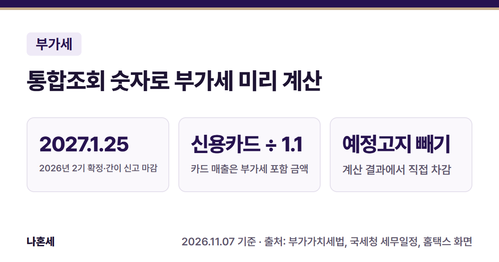
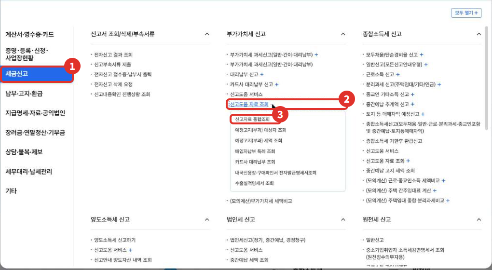
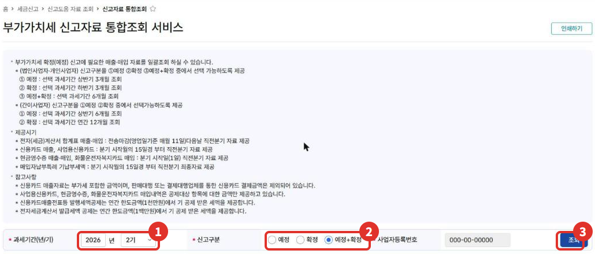
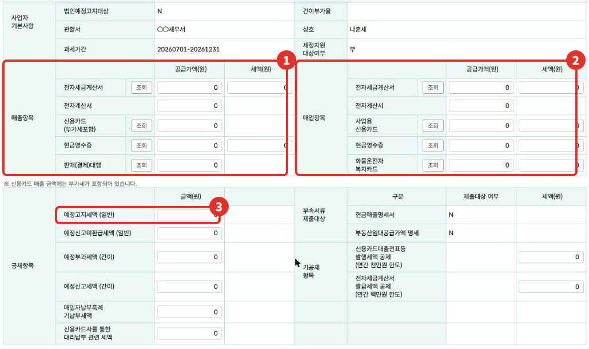
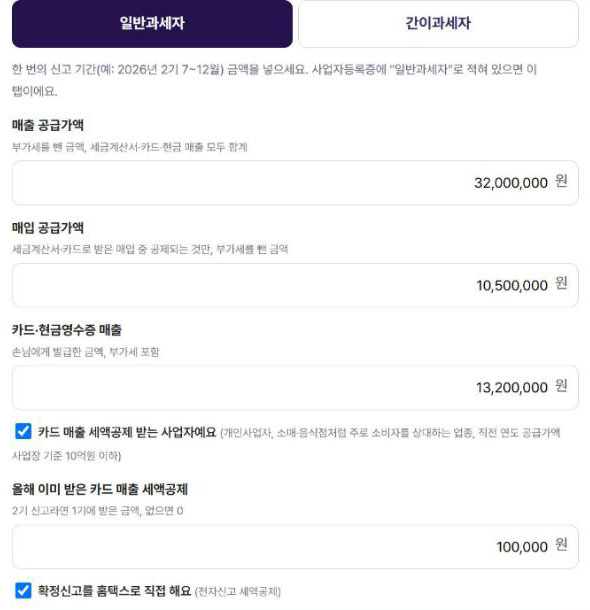
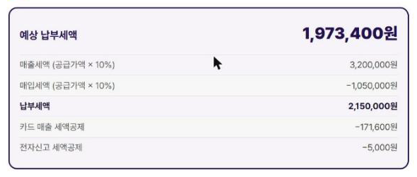

**2026년 2기(7~12월) 부가가치세 확정신고**와 **2026년 간이과세자 신고**는 2027년 1월 25일까지예요 [1][2][3]. 신고서를 쓰기 전에 홈택스 **신고자료 통합조회**에서 국세청이 모아 둔 매출·매입 숫자를 보고, [부가세 예상 세액 계산기](/calculators/vat/)에 옮겨 넣으면 대략 얼마를 낼지 미리 볼 수 있어요.

{: .summary-card}

> 💡 **핵심 요약**
> - 마감: 2026년 2기 확정·2026년 간이 신고 모두 **2027년 1월 25일** [1][2][3]
> - 메뉴: 홈택스 > 세금신고 > 부가가치세 신고 > 신고도움 자료 조회 > **신고자료 통합조회** (2026년 11월 기준 화면)
> - 통합조회의 **신용카드 매출은 부가세가 포함된 금액**이에요 [4]. 계산기 "매출 공급가액"에 넣을 때는 1.1로 나눠요.
> - **통합조회에 없는 매출(현금영수증을 안 끊은 현금매출, 종이 세금계산서 등)은 직접 더해야 해요. 빠뜨리면 실제보다 적게 나와요**{: .red}
> - 계산기에는 예정고지 칸이 없어요. **예정고지세액은 계산 결과에서 직접 빼요** [5]

목차

* 목차
{:toc}

## 한눈에 보기

| 항목 | 내용 |
|---|---|
| 누가 | 부가세를 직접 신고하려는 개인사업자(일반·간이) |
| 기한 | 2026년 2기 확정·2026년 간이 신고: **2027년 1월 25일** [1][2][3] |
| 볼 곳 | 홈택스 신고자료 통합조회 [4] |
| 넣을 곳 | [부가세 예상 세액 계산기](/calculators/vat/)(참고용, 입력값 저장 안 함) |
| 따로 할 것 | 통합조회에 없는 자료 더하기, 예정고지세액 빼기 |

## 신고자료 통합조회가 뭐예요?

부가세 신고에 필요한 매출·매입 자료를 한 화면에서 모아 보는 홈택스 메뉴예요 [4]. 전자세금계산서, 카드 매출, 현금영수증, 사업용 신용카드 매입 등이 칸별로 나와요.

자료가 들어오는 때가 항목마다 달라요 [4].

| 자료 | 홈택스 안내(2026년 11월 화면) |
|---|---|
| 전자(세금)계산서 | 전송마감(영업일 기준 매월 11일) 다음 날, 직전 분기 자료 |
| 신용카드 매출·사업용 카드 | 분기 시작 달 15일경부터 직전 분기 자료 |
| 현금영수증·화물운전자 복지카드 | 분기 시작일(1일)에 직전 분기 자료 |

그래서 **10~12월 카드 자료는 2027년 1월 15일경부터** 보인다고 생각하면 돼요(위 안내 기준). 1월 초에 조회하면 숫자가 덜 들어와 있을 수 있어요.

## 홈택스에서 조회하는 순서

> 📅 **2026년 11월 기준 화면**이에요(운영자 본인 사업자 계정, 개업 직후라 금액은 모두 0원). 메뉴 이름은 바뀔 수 있어요.

1. 홈택스에 **사업자로 로그인**해요.
2. **전체메뉴**에서 ① **세금신고** → 부가가치세 신고의 ② **신고도움 자료 조회 +**를 펼치고 ③ **신고자료 통합조회**를 눌러요.

   

3. ① 과세기간(년/기)과 ② **신고구분**을 고르고 ③ **조회**를 눌러요.
   - 개인 일반과세자: **예정+확정**(6개월), **확정**(하반기 3개월), **예정**(상반기 3개월) 중에서 골라요 [4].
   - 간이과세자: **확정**을 고르면 1년(12개월)이 조회돼요 [4].

   

4. 아래로 내리면 ① **매출항목** ② **매입항목** 표와 공제항목이 나와요. ③ **예정고지세액(일반)**은 공제항목에 있어요. 칸 옆 **조회** 버튼을 누르면 상세 내역을 볼 수 있어요.

   

> 개인 일반과세자가 예정신고를 하지 않았다면(예정고지를 받았거나, 50만원 미만이라 고지가 없었던 경우) 확정신고 때 6개월을 한꺼번에 신고해요. 그래서 **예정+확정**으로 조회하는 게 맞아요. 예정신고를 직접 했다면 이미 신고한 부분은 확정신고에서 빼요 [5].

## 통합조회 칸 → 계산기 칸 옮기는 법 (일반과세자)

| 계산기 칸 | 통합조회에서 가져올 숫자 |
|---|---|
| 매출 공급가액 | 전자세금계산서 공급가액 + **신용카드 ÷ 1.1** + 현금영수증 공급가액 + 판매(결제)대행 + 통합조회에 없는 매출 |
| 매입 공급가액 | 전자세금계산서 + 사업용 신용카드 + 현금영수증 + 화물운전자 복지카드 공급가액 − 공제 안 되는 것 |
| 카드·현금영수증 매출 | 신용카드 금액 + 현금영수증 공급가액·세액 합계(모두 부가세 포함) |
| 올해 이미 받은 공제 | 기공제 항목의 **신용카드매출전표등 발행세액 공제** |

판매(결제)대행으로 받은 카드 결제분도 카드 매출 세액공제 대상인지는 이 글에서 확인하지 못했어요. 홈택스 도움말이나 126에서 확인하세요.

헷갈리는 칸만 짚어 볼게요.

- **신용카드 매출**: 통합조회 안내에 "부가세 포함한 금액"이라고 적혀 있어요 [4]. 공급가액 칸에 넣을 때는 1.1로 나눠요.
- **판매(결제)대행**: 판매대행·결제대행업체를 거친 신용카드 결제금액은 신용카드 매출에서 **빠져 있어요** [4]. 판매(결제)대행 칸에 따로 나오니 매출에 더해요. 이 금액에 부가세가 들어 있는지는 **조회** 버튼으로 내역을 열어 확인하세요.
- **전자계산서**: 면세 거래에 쓰는 계산서예요. 매입 쪽 전자계산서는 부가세가 없어서 매입 공급가액에 넣지 않아요.
- **카드·현금영수증 매입**: 홈택스는 "공제대상 항목"만 보여 준다고 안내해요 [4]. 그래도 사업과 관계없는 지출은 직접 빼야 해요([사업용 신용카드 등록 글]() 참고).

### 통합조회에 없어서 따로 더해야 하는 것

- 현금영수증을 끊지 않은 **현금매출**
- **종이 세금계산서**로 주고받은 거래
- 사업용으로 등록하지 않은 **개인 명의 카드**로 산 사업용 매입(요건을 갖춰야 공제돼요)

## 가상 예시: 일반과세자 2026년 2기

> 아래는 **가상의 예시**예요. 소매업을 하는 개인 일반과세자이고, 카드 매출 세액공제 요건을 갖췄다고 가정했어요.

**① 통합조회에 나온 숫자(예정+확정, 6개월)**

| 칸 | 금액 |
|---|---|
| 매출 전자세금계산서 | 공급가액 20,000,000원 |
| 매출 신용카드(부가세 포함) | 11,000,000원 |
| 매출 현금영수증 | 공급가액 2,000,000원, 세액 200,000원 |
| 매입 전자세금계산서 | 공급가액 8,000,000원 |
| 매입 사업용 신용카드 | 공급가액 2,000,000원 |
| 매입 현금영수증 | 공급가액 500,000원 |
| 매입 전자계산서(면세) | 1,000,000원 → 넣지 않음 |
| 기공제 카드 발행세액공제 | 100,000원(1기에 받은 금액) |
| 예정고지세액(일반) | 800,000원 |

**② 계산기에 넣는 숫자**

| 계산기 칸 | 계산 | 넣는 값 |
|---|---|---|
| 매출 공급가액 | 20,000,000 + 11,000,000 ÷ 1.1 + 2,000,000 | **32,000,000원** |
| 매입 공급가액 | 8,000,000 + 2,000,000 + 500,000 | **10,500,000원** |
| 카드·현금영수증 매출 | 11,000,000 + 2,200,000 | **13,200,000원** |
| 올해 이미 받은 공제 | 기공제 그대로 | **100,000원** |

**③ 계산기 결과**

| 단계 | 금액 |
|---|---|
| 매출세액(32,000,000 × 10%) | 3,200,000원 |
| 매입세액(10,500,000 × 10%) | −1,050,000원 |
| 납부세액 | 2,150,000원 |
| 카드 매출 세액공제(13,200,000 × 1.3% = 171,600, 연 한도 1,000만원 − 이미 받은 100,000원 안) | −171,600원 [6] |
| 전자신고 세액공제 | −5,000원 [7] |
| **계산기 예상 납부세액** | **1,973,400원** |

**④ 예정고지세액 빼기(계산기 밖에서 직접)**

계산기에는 예정고지 칸이 아직 없어요. 확정신고 때는 예정고지로 낸 세액을 빼고 내요 [5].

| 단계 | 금액 |
|---|---|
| 계산기 예상 납부세액 | 1,973,400원 |
| 예정고지세액(통합조회) | −800,000원 |
| **확정신고 때 낼 예상 금액** | **1,173,400원** |

**예정고지 금액을 아직 안 냈다면, 확정신고에서 빼더라도 그 고지서 금액은 따로 내야 해요. 실제로 냈는지 홈택스 "납부내역"에서 확인하세요**{: .red}

## 간이과세자는 이렇게

간이과세자는 1년(2026년 1~12월)을 한 번에 신고해요 [3][9]. 통합조회에서 신고구분 **확정**(12개월)으로 조회하고, 계산기 **간이과세자** 탭에 넣어요.

- 계산기 간이 탭은 모두 **부가세 포함 금액(공급대가)**으로 넣어요. 통합조회 금액이 공급가액·세액으로 나뉘어 있으면 둘을 더해요.
- 예정부과(7월)나 예정신고 때 **실제로 낸** 세액은 계산 결과에서 직접 빼요 [3]. 일반과세자는 고지된 금액을, 간이과세자는 낸 금액을 빼는 점이 달라요.

**가상의 예시(경계)**: 1년 공급대가 합계가 **4,800만원 미만**이면 납부의무가 면제돼요 [8]. 47,000,000원이면 계산기 결과가 0원으로 나오고 "납부의무 면제" 안내가 떠요. **그래도 신고는 해야 해요**{: .red} [3].

## 자주 하는 실수

- 신용카드 매출을 **1.1로 나누지 않고** 공급가액 칸에 그대로 넣기
- 판매(결제)대행·현금매출을 빼먹기
- 매입에 **전자계산서(면세)**를 넣기
- 예정고지세액을 빼 놓고 고지서는 안 내고 넘어가기
- 10~12월 카드 자료가 들어오기 전(1월 15일경 전)에 조회하고 끝내기

## 직접 신고가 어려울 수 있는 경우

이 계산기는 아래를 계산하지 않아요. 해당하면 결과가 크게 다를 수 있어요.

- 면세 사업을 함께 해서 공통매입세액을 나눠야 할 때
- 의제매입세액공제(음식점 농산물 매입 등), 대손세액공제가 있을 때
- 간이과세자가 두 업종 이상을 하거나, 한 해 중간에 사업을 시작·폐업했을 때

헷갈리면 **국세상담센터(126)**나 홈택스 상담, 세무대리인에게 확인하세요.

## 자주 묻는 질문

**Q. 계산기 결과대로 신고하면 되나요?**
A. 아니에요. 계산기는 **참고용**이고, 실제 세액은 홈택스 신고서에서 정해져요. 신고서 작성 방법은 2027년 1월 신고 기간에 실제 화면으로 따로 정리할게요.

**Q. 홈택스에도 모의계산이 있던데요?**
A. 네. 같은 메뉴 묶음에 **(모의계산)부가가치세 세액비교**가 있어요(2026년 11월 전체메뉴 화면). 두 결과를 비교해 보는 것도 방법이에요.

**Q. 입력한 숫자가 어디 저장되나요?**
A. 아니요. 나혼세 계산기는 브라우저 안에서만 계산하고 입력값을 저장하거나 보내지 않아요.

## 함께 보면 좋은 글

- [홈택스 사업용 신용카드 등록 방법]()
- [홈택스 전자세금계산서 발급 방법]()
- [사장님 세무 일정 달력]()

## 출처

1. [국세청 - 세무일정](https://www.nts.go.kr/nts/ad/taxSchdul/selectList.do?mi=135747) "2026.2기 부가가치세 확정신고 납부 2027-01-25(2026.7~12월분)" (확인일: 2026-11-07)
2. 법령: 부가가치세법 제49조①(확정신고, 과세기간이 끝난 후 25일 이내) (2026.1.2. 시행)
3. 법령: 부가가치세법 제67조①②(간이과세자 신고·납부, 예정부과·예정신고 세액 공제) (2026.1.2. 시행)
4. [홈택스](https://hometax.go.kr) > 세금신고 > 신고도움 자료 조회 > 신고자료 통합조회 화면 안내문 (운영자 직접 확인: 2026-11-07)
5. 법령: 부가가치세법 제49조①단서·②2호(예정신고분 제외, 예정고지 징수 금액 차감), 제48조③(개인사업자 예정고지, 50만원 미만 미징수) (2026.1.2. 시행)
6. 법령: 부가가치세법 제46조①(신용카드매출전표등 발행세액공제 1.3%, 연 1,000만원 한도는 2026년 12월 31일까지) (2026.1.2. 시행)
7. 법령: 조세특례제한법 제104조의8②, 같은 법 시행령 제104조의5④(전자신고 세액공제 5천원)
8. 법령: 부가가치세법 제69조①(간이과세자 공급대가 4,800만원 미만 납부의무 면제) (2026.1.2. 시행)
9. 법령: 부가가치세법 제5조①(과세기간, 간이과세자는 1월 1일부터 12월 31일까지) (2026.1.2. 시행)

> 이 글은 2026년 11월 7일 기준의 일반적인 안내입니다. 세법과 홈택스 화면은 바뀔 수 있으니 신고 전 국세청 안내를 꼭 확인하세요. 개별 상황은 국세상담센터(126)에 문의하세요.
