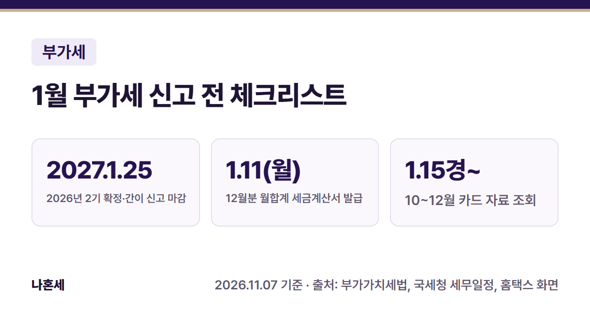
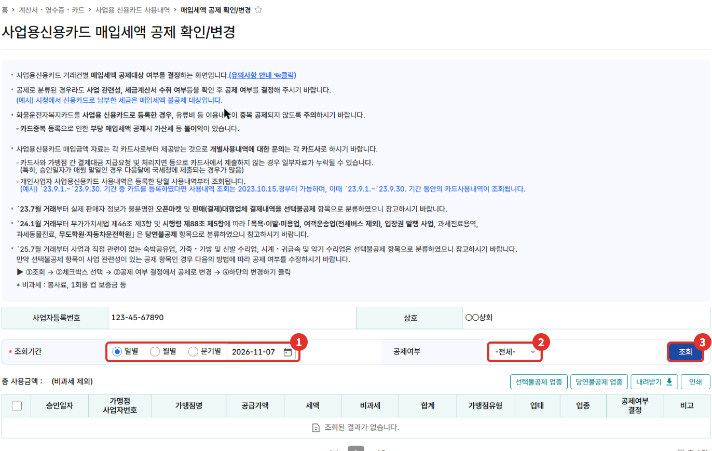
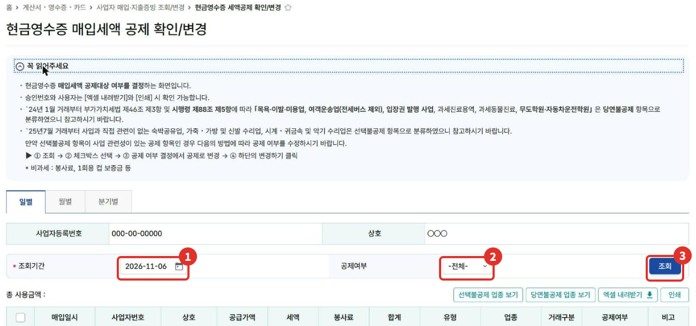
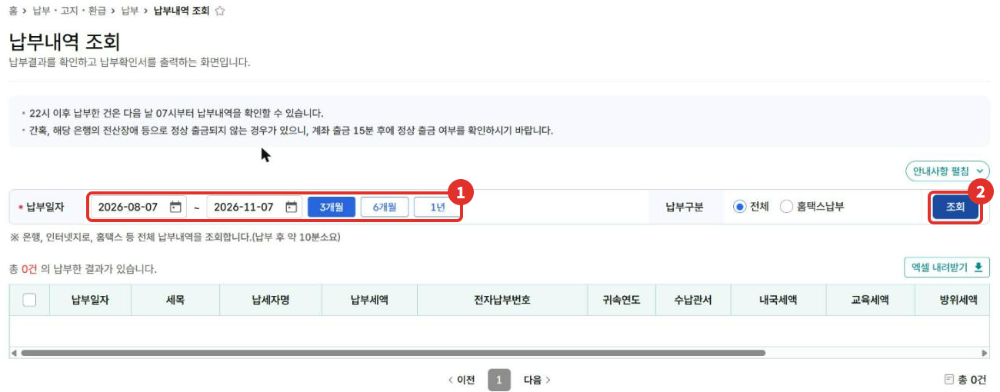

**2026년 2기(7~12월) 부가가치세 확정신고**(국세청 세무일정 [1])와 **2026년 간이과세자 신고**는 모두 2027년 1월 25일까지예요 [2][3]. 신고서를 여는 날 한꺼번에 하려면 자료가 빠졌거나 공제를 놓친 걸 늦게 알게 돼요. 이 글은 12월부터 1월 신고 전까지 홈택스에서 미리 해 두면 좋은 일을 날짜 순서로 모았어요.

{: .summary-card}

> 💡 **핵심 요약**
> - 마감: 2026년 2기 확정 [1][2]·2026년 간이 신고 [3] 모두 **2027년 1월 25일(월)**
> - 12월분을 월합계로 모아 발급하는 세금계산서는 **2027년 1월 11일(월)**까지예요. 1월 10일이 일요일이라 다음 영업일로 넘어가요 [4]
> - **10~12월 사업용 카드 자료는 1월 15일경부터 보여요(현금영수증은 1월 1일부터). 공제 확인은 카드 자료가 들어온 뒤에 한 번에 하세요**{: .red} [10]

목차

* 목차
{:toc}

## 한눈에 보기

| 언제 | 할 일 |
|---|---|
| 12월 중 | ① 사업용 카드 등록 확인 |
| ~1.11 | ② 12월분 세금계산서 발급 마무리 |
| 1.15경~ | ③ 카드·현금영수증 매입 공제 확인 |
| 1월 중순 | ④ 신고자료 통합조회로 예상 세액 계산 |
| 1월 중순 | ⑤ 예정고지 낸 것 확인 |
| ~1.25 | ⑥ 신고·납부 |

> 📅 날짜는 2026년 2기 확정신고(2027년 1월) 기준이에요. 홈택스 화면은 **2026년 11월 기준**으로 운영자가 본인 사업자 계정에서 확인했어요.

## 누가 챙기면 좋나요?

- **일반과세자**: 2026년 7~12월분을 1월에 확정신고해요 [2]. 7월 예정신고를 하지 않았다면(예정고지를 받았거나, 50만원 미만이라 고지가 없었던 경우) 6개월을 한 번에 신고해요 [11].
- **간이과세자**: 2026년 1~12월을 1월에 한 번에 신고해요 [3][14].

## ① 12월 중: 사업용 카드 등록 확인

사업에 쓰는 카드를 홈택스에 **사업용 신용카드**로 등록해 두면, 그 카드로 결제한 내역을 신고 때 홈택스에서 불러와요. **등록한 달의 사용분부터 조회되니, 아직 안 했다면 12월 안에 등록하세요**{: .red} [6].

- 메뉴: 계산서·영수증·카드 > 신용카드 매입 > 사업용 신용카드 등록 및 조회 (2026년 11월 화면)
- 등록하지 않은 카드로 결제한 사업 경비도, 요건을 갖추면 신고 때 **신용카드매출전표등 수령명세서**를 내고 공제받을 수 있어요. 다만 홈택스가 자동으로 모아 주지 않으니 카드 명세서를 보고 직접 정리해야 해요 [7].
- 등록 방법은 [사업용 신용카드 등록 글]()에 화면 순서대로 정리했어요.

## ② 1월 11일까지: 12월분 세금계산서 발급 마무리

세금계산서는 원래 공급한 때 발급해요. 한 달 거래를 거래처별로 모아 **월합계**로 발급할 때는 공급한 달의 다음 달 10일까지예요. 그날이 토요일이나 공휴일이면 다음 영업일까지예요 [4].

> 2027년 1월 10일은 **일요일**이라, 12월분 월합계 세금계산서는 **2027년 1월 11일(월)**까지 발급하면 돼요 [4].

**기한을 넘겨 확정신고 기한(1월 25일)까지 발급하면 공급가액의 1%, 그때까지도 발급하지 않으면 2% 가산세가 붙어요**{: .red} [5]. 발급 순서는 [전자세금계산서 발급 글]()을 보세요.

## ③ 1월 15일경 이후: 카드·현금영수증 매입 공제 확인

카드와 현금영수증으로 산 것 가운데 부가세가 따로 적힌 매입은, 사업과 관련이 있고 요건을 갖추면 매입세액으로 공제받을 수 있어요 [7]. (일반과세자 기준이에요. 간이과세자는 매입세액 대신 매입 공급대가의 일정 비율을 세액공제받아요 [16].) 홈택스는 업종에 따라 **공제·불공제를 미리 나눠** 보여 주니, 신고 전에 맞게 분류됐는지 확인해요 [8][9].

**사업용 신용카드**: 계산서·영수증·카드 > 신용카드 매입 > 사업용 신용카드 사용내역 > **매입세액 공제 확인/변경**

① 조회기간과 ② 공제여부를 고르고 ③ **조회**를 누르면 거래 건별 분류가 나와요 [9].

**현금영수증**: 계산서·영수증·카드 > 사업자 매입·지출증빙 조회/변경 > **현금영수증 세액공제 확인/변경** (화면 제목은 "현금영수증 매입세액 공제 확인/변경")

1. 일별·월별·**분기별** 탭 중 하나를 골라 ① 조회기간을 정해요. 10~12월을 한 번에 보려면 분기별 탭이 편해요.
2. ② 공제여부를 고르고 ③ **조회**를 눌러요.
3. **선택불공제**로 분류된 건이 사업과 관련 있으면 체크한 뒤 공제로 바꾸고 아래 **변경하기**를 눌러요(화면 안내 순서) [8].

| 화면 분류 | 뜻(화면 안내) |
|---|---|
| 당연불공제 | 목욕·이발·미용업, 여객운송업(전세버스 제외), 입장권 발행 사업, 과세진료용역, 과세동물진료, 무도학원·자동차운전학원 [7][8] |
| 선택불공제 | 2025년 7월 거래부터 숙박공유업, 가죽·가방·신발 수리업, 시계·귀금속·악기 수리업. 사업 관련이면 공제로 바꿀 수 있어요 [8] |

- 통합조회 안내 기준으로 10~12월 **현금영수증** 자료는 1월 1일(분기 시작일)부터, **사업용 카드** 자료는 1월 15일경부터 들어와요 [10]. 카드 자료가 들어오기 전에 확인하면 덜 들어와 있을 수 있어요.
- 개인적으로 쓴 결제, 접대비처럼 공제되지 않는 매입은 공제로 분류돼 있어도 **불공제로 바꿔야 해요** [9][15].

## ④ 1월 중순: 통합조회로 예상 세액 계산

카드 자료까지 들어왔으면 **세금신고 > 부가가치세 신고 > 신고도움 자료 조회 > 신고자료 통합조회**에서 매출·매입 숫자를 한 화면에 모아 볼 수 있어요 [10]. 이 숫자를 [부가세 예상 세액 계산기](/calculators/vat/)에 옮기면 대략 얼마를 낼지 미리 볼 수 있어요.

- 통합조회의 신용카드 매출은 **부가세가 포함된 금액**이라, 계산기 공급가액 칸에 넣을 때는 1.1로 나눠요.
- 현금매출, 종이 세금계산서처럼 통합조회에 안 나오는 자료는 직접 더해요.
- 칸별로 옮기는 법과 가상 예시는 [통합조회 → 계산기 옮겨 넣는 법]()에 있어요.

## ⑤ 1월 중순: 예정고지 낸 것 확인

개인 일반과세자는 보통 7월 예정신고 대신 직전 기 납부세액의 절반을 **예정고지**로 받아요(50만원 미만이면 고지하지 않음) [11]. 확정신고 때는 **고지된 예정고지세액을 빼고** 내요 [11].

**예정고지 금액을 아직 안 냈다면, 확정신고에서 빼더라도 그 고지서 금액은 따로 내야 해요**{: .red} [11]. 냈는지는 **납부·고지·환급 > 납부 > 납부내역 조회**에서 ① 납부일자(3개월·6개월·1년)를 고르고 ② 조회를 눌러 확인해요 [12].

- 은행·인터넷지로·홈택스 등에서 낸 내역이 모두 조회되고, 22시 이후에 낸 건은 다음 날 07시부터 보여요(화면 안내) [12].
- 간이과세자는 7월 예정부과나 예정신고 때 **실제로 낸** 세액만 빼요 [3]. 일반과세자와 빼는 기준이 달라요.

## ⑥ 1월 25일까지: 신고·납부

2027년 1월 25일(월)까지 신고하고, 낼 세액이 있으면 같은 날까지 내요(일반 [1][2], 간이 [3]).

- **간이과세자는 1년 공급대가가 4,800만원 미만이면 납부의무가 면제되지만, 신고는 해야 해요**{: .red} [3][13]. 그해 새로 사업을 시작했다면 12개월로 환산한 금액으로 따져요 [13].
- 신고서 작성 화면은 2027년 1월 신고 기간에 실제 화면으로 따로 정리할 예정이에요.

## 자주 하는 실수

- 사업용 카드를 1월에 등록하고 지난 카드 내역이 자동으로 들어오길 기다리기 → 등록한 달 사용분부터 조회돼요 [6]
- 1월 초에 공제 확인을 끝내 버리기 → 10~12월 카드 자료는 1월 15일경부터 들어와요 [10]
- 12월분 월합계 세금계산서를 1월 11일 뒤에 발급하기 [4][5]
- 예정고지세액을 빼 놓고 고지서는 안 내고 넘어가기 [11]
- 간이과세자가 납부면제라 신고까지 안 해도 된다고 생각하기 [3][13]

## 직접 신고가 어려울 수 있는 경우

- 면세 사업을 함께 해서 공통매입세액을 나눠야 할 때
- 의제매입세액공제(음식점 농산물 매입 등), 대손세액공제가 있을 때
- 카드·현금영수증 매입 건수가 많아 공제 여부를 하나씩 판단하기 어려울 때
- 한 해 중간에 과세 유형이 바뀌었거나 사업을 시작·폐업했을 때

헷갈리면 **국세상담센터(126)**나 홈택스 상담, 세무대리인에게 확인하세요.

## 자주 묻는 질문

**Q. 11월에 사업을 시작했는데 1월에 신고해야 하나요?**
A. 일반과세자는 사업 개시일부터 그 과세기간 끝(12월 31일)까지가 첫 과세기간이라, 2026년 2기 확정신고를 1월에 해요 [2][14]. 매출이 없어도 신고는 해요. 내 경우가 헷갈리면 126에 확인하세요.

**Q. 카드 공제 확인/변경을 안 하면 어떻게 되나요?**
A. 홈택스가 미리 나눈 분류대로 신고서에 반영돼요. 그런데 공제 분류라도 사업 관련성을 확인하라고 안내하고 있어요 [9]. 개인 지출이 섞였다면 불공제로 바꾸는 게 맞아요.

**Q. 현금영수증을 사업자번호로 안 받았어요.**
A. 이 화면은 사업자 지출증빙으로 발급된 현금영수증이 조회되는 곳이에요(화면 메뉴 이름 기준). 다른 방식으로 받은 건 홈택스 안내나 126에 처리 방법을 확인하세요.

## 함께 보면 좋은 글

- [통합조회 숫자로 부가세 미리 계산하기]()
- [홈택스 사업용 신용카드 등록 방법]()
- [홈택스 전자세금계산서 발급 방법]()
- [사장님 세무 일정 달력]()

## 출처

1. [국세청 - 세무일정](https://www.nts.go.kr/nts/ad/taxSchdul/selectList.do?mi=135747) "2026.2기 부가가치세 확정신고 납부 2027-01-25(2026.7~12월분)" (확인일: 2026-11-07)
2. 법령: 부가가치세법 제49조①(확정신고, 과세기간이 끝난 후 25일 이내), 제5조(과세기간·신규사업자 최초 과세기간) (2026.1.2. 시행)
3. 법령: 부가가치세법 제67조①②(간이과세자 신고·납부, 예정부과·예정신고 세액 공제) (2026.1.2. 시행)
4. 법령: 부가가치세법 제34조③(월합계 등 다음 달 10일, 그날이 공휴일·토요일이면 다음 영업일) (2026.1.2. 시행)
5. 법령: 부가가치세법 제60조②(세금계산서 지연발급 1%, 미발급 2% 가산세) (2026.1.2. 시행)
6. 홈택스 사업용신용카드 등록 화면 안내 (운영자 직접 확인: 2026-11-07)
7. 법령: 부가가치세법 제46조③, 시행령 제88조⑤(신용카드매출전표등 매입세액 공제 요건·공제 제외 업종) (2026.1.2./2026.4.1. 시행)
8. 홈택스 - 현금영수증 매입세액 공제 확인/변경 화면 "꼭 읽어주세요" 안내 (운영자 직접 확인: 2026-11-07)
9. 홈택스 - 사업용신용카드 매입세액 공제 확인/변경 화면 안내 (운영자 직접 확인: 2026-11-07)
10. 홈택스 - 신고자료 통합조회 화면 안내문(자료 제공 시기) (운영자 직접 확인: 2026-11-07)
11. 법령: 부가가치세법 제49조①단서·②2호(예정신고분 제외, 예정고지 징수 금액 차감), 제48조③(개인사업자 예정고지, 50만원 미만 미징수) (2026.1.2. 시행)
12. 홈택스 - 납부내역 조회 화면 안내 (운영자 직접 확인: 2026-11-07)
13. 법령: 부가가치세법 제69조①③(간이과세자 공급대가 4,800만원 미만 납부의무 면제, 신규 사업자는 12개월 환산) (2026.1.2. 시행)
14. 법령: 부가가치세법 제5조①②(과세기간, 간이과세자는 1월 1일~12월 31일, 신규사업자는 사업 개시일부터) (2026.1.2. 시행)
15. 법령: 부가가치세법 제39조①4호~6호(사업과 직접 관련 없는 지출, 비영업용 승용차, 기업업무추진비 관련 매입세액 불공제) (2026.1.2. 시행)
16. 법령: 부가가치세법 제63조③(간이과세자 매입 공급대가 기준 세액공제) (2026.1.2. 시행)

> 이 글은 2026년 11월 7일 기준의 일반적인 안내입니다. 세법과 홈택스 화면은 바뀔 수 있으니 신고 전 국세청 안내를 꼭 확인하세요. 개별 상황은 국세상담센터(126)에 문의하세요.
