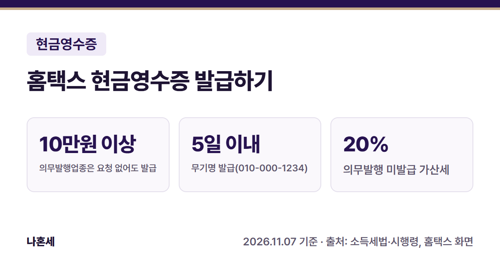
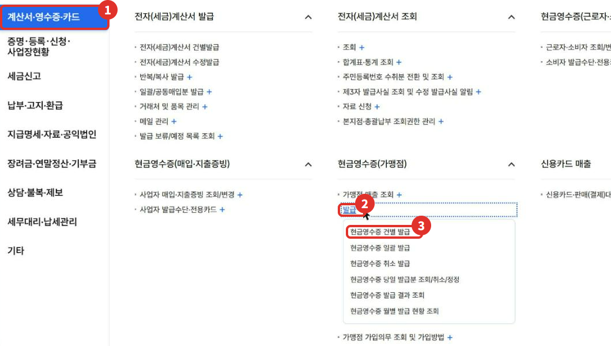
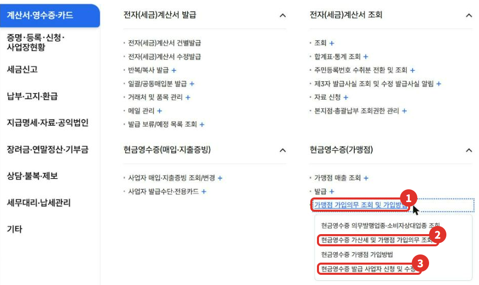
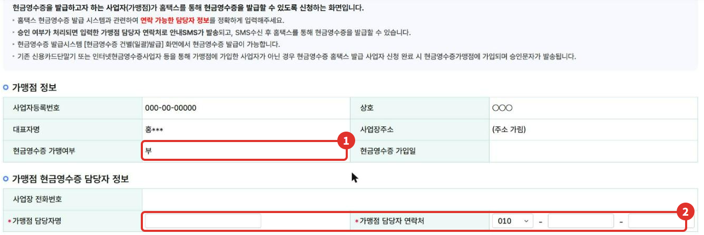
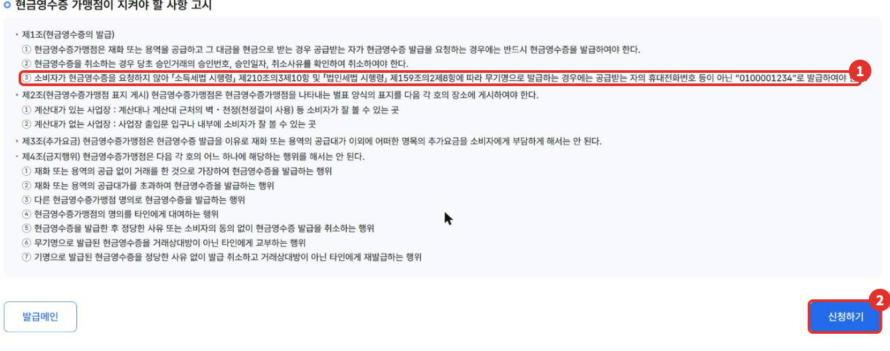
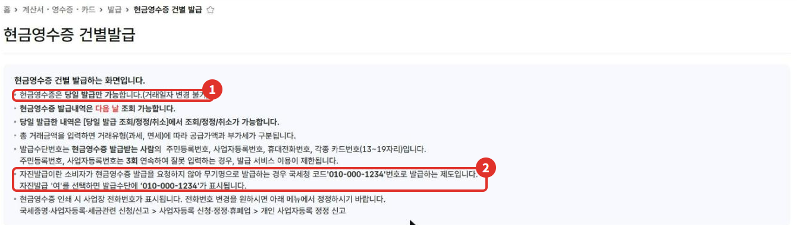
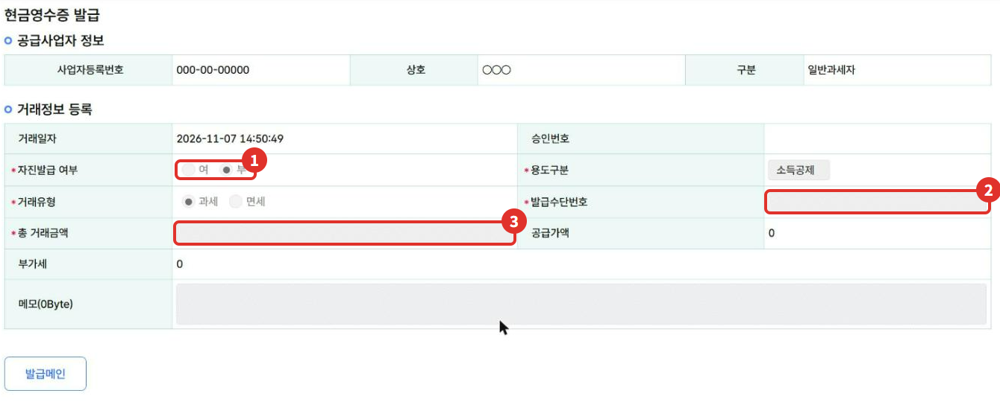
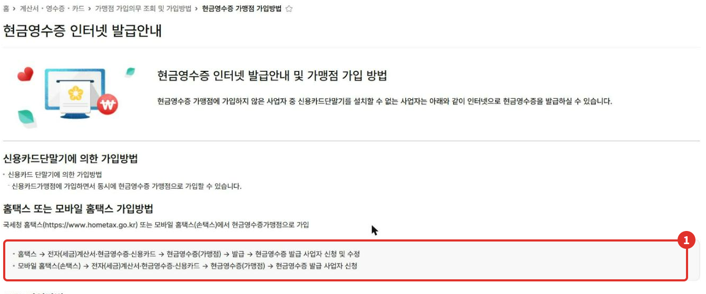
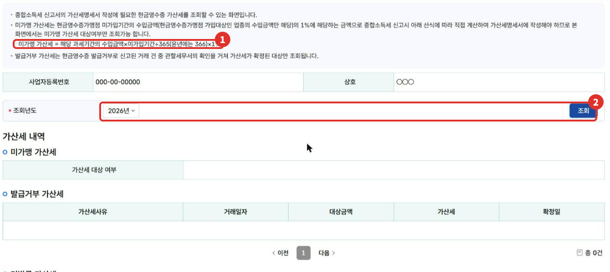

손님이 현금으로 내고 현금영수증을 달라고 하면, 카드 단말기가 없어도 **홈택스에서 현금영수증을 발급**할 수 있어요. 다만 홈택스로 발급하려면 먼저 "현금영수증 발급 사업자"로 신청해서 승인을 받아야 해요(2026년 11월 화면). 이 글은 신청부터 발급 화면, 꼭 알아야 할 의무와 가산세까지 정리했어요.

{: .summary-card}

> 💡 **핵심 요약**
> - 홈택스 발급은 **현금영수증 발급 사업자 신청 → 승인 문자 → 건별 발급** 순서예요(2026년 11월 화면) [5]
> - **의무발행업종은 건당 10만원 이상(부가세 포함)을 현금으로 받으면, 손님이 요청하지 않아도 발급해야 해요**{: .red} [1]
> - 손님 정보 없이 발급할 때는 국세청 코드 **010-000-1234**로, 현금을 받은 날부터 5일 안에 발급할 수 있어요 [2][4]

목차

* 목차
{:toc}

## 한눈에 보기

| 항목 | 내용 |
|---|---|
| 누가 | 현금영수증가맹점(가입 의무자 + 스스로 가입한 사업자) [1] |
| 언제 | 손님이 요청할 때, 의무발행업종은 10만원 이상이면 요청 없어도 [1] |
| 신청 | 가맹점 가입의무 조회 및 가입방법 > 현금영수증 발급 사업자 신청 및 수정 |
| 발급 | 현금영수증(가맹점) > 발급 > 현금영수증 건별 발급 |
| 가산세 | 의무발행 미발급 20%, 발급 거부 5% 등 [3] |

## 누가 발급해야 하나요?

**현금영수증가맹점**으로 가입한 사업자는 손님이 현금으로 내고 현금영수증을 요청하면 **발급을 거부하거나 사실과 다르게 발급하면 안 돼요** [1]. 발급 대상 금액은 건당 1원 이상이에요 [2].

주로 소비자를 상대하는 업종(소비자상대업종) 중 아래에 해당하면 **가맹점 가입 의무**가 있어요 [1][2].

| 구분 | 내용 |
|---|---|
| 수입금액 | 직전 과세기간 수입금액이 2,400만원 이상 [2] |
| 의무발행업종 | 시행령 별표 3의3에 정한 업종 [2] |
| 그 밖에 | 시행령 제210조의3 ①에 정한 일부 사업자 [2] |

- **가입 기한은 요건에 해당한 날부터 60일 이내예요. 수입금액 요건으로 가입 의무가 생긴 경우는 그해 3월 31일까지 가입해요**{: .red} [1][2].
- 내 업종이 대상인지는 홈택스 **현금영수증 의무발행업종·소비자상대업종 조회** 메뉴에서 볼 수 있어요(2026년 11월 화면).
- 가입 의무가 없어도 스스로 가맹점에 가입해 발급할 수 있어요 [5][6].

## 의무발행업종의 10만원 규칙

의무발행업종 사업자는 **건당 거래금액(부가세 포함)이 10만원 이상**인 재화·용역을 공급하고 현금을 받으면, **손님이 요청하지 않아도** 현금영수증을 발급해야 해요 [1]. 사업자에게 공급하고 세금계산서나 계산서를 발급했다면 현금영수증을 따로 발급하지 않아도 돼요 [1].

손님이 현금영수증을 원하지 않거나 정보를 주지 않으면, **현금을 받은 날부터 5일 안에 무기명**으로 발급할 수 있어요 [2]. 이때는 손님 휴대폰 번호 대신 국세청 코드 **010-000-1234**로 발급해요 [4][7][10].

### 가상 예시로 보는 가산세

> **가상의 예시**예요.

의무발행업종 사업자가 33만원을 현금으로 받고 현금영수증을 발급하지 않은 경우예요.

| 경우 | 가산세 |
|---|---|
| 미발급 | 330,000원 × 20% = **66,000원** [3] |
| 10일 내 자진발급 | 330,000원 × 10% = 33,000원 [3] |

10%는 착오나 누락으로 빠뜨렸다가 대금을 받은 날부터 10일 안에 자진 신고하거나 발급한 경우예요 [3].

**경계 예시**: 같은 업종이라도 거래금액이 **99,000원**이면 10만원 미만이라 "요청 없어도 발급" 의무는 없어요 [1]. 하지만 가맹점이면 손님이 요청할 때 발급해야 해요 [1].

## 홈택스로 발급하는 순서

> 📅 **2026년 11월 기준 화면**이에요(운영자 본인 사업자 계정). 운영자 사업자는 아직 현금영수증가맹점이 아니어서 **신청 버튼과 발급은 누르지 않았어요.** 사업자 정보는 가렸어요.

1. 홈택스에 **사업자로 로그인**하고 **전체메뉴**에서 ① **계산서·영수증·카드** → 현금영수증(가맹점)의 ② **발급 +** → ③ **현금영수증 건별 발급** 위치를 확인해요.

   

2. 아직 홈택스 발급 신청을 안 했다면, 같은 묶음의 ① **가맹점 가입의무 조회 및 가입방법 +**를 펼쳐요. ② **현금영수증 가산세 및 가맹점 가입의무 조회**에서 내 가입 의무를 확인하고, ③ **현금영수증 발급 사업자 신청 및 수정**으로 들어가요.

   

3. 신청 화면에서 ① 현금영수증 가맹 여부를 확인하고, ② **가맹점 담당자명과 연락처**를 넣어요. 승인되면 이 연락처로 안내 문자가 오고, 그 뒤부터 홈택스에서 발급할 수 있어요. 가맹점이 아니었던 사업자는 이 신청이 끝나면 가맹점으로 가입돼요(화면 안내) [5].

   

4. 아래 **현금영수증 가맹점이 지켜야 할 사항** 고시를 읽고 ② **신청하기**를 눌러요. ① 무기명 발급은 "0100001234"로 한다는 내용도 여기에 있어요 [7].

   

5. 승인 문자를 받은 뒤 **현금영수증 건별 발급** 화면에서 발급해요. 화면 안내는 이래요 [4].
   - ① 현금영수증은 **당일 발급만** 가능해요(거래일자 변경 불가).
   - 발급 내역은 다음 날 조회되고, 당일 발급분은 "당일 발급분 조회/취소/정정"에서 고쳐요.
   - ② 손님이 요청하지 않아 무기명으로 발급하면 **자진발급 "여"**를 고르고, 발급수단에 010-000-1234가 표시돼요.

   

6. 거래정보에서 ① 자진발급 여부, 거래유형(과세·면세), 용도구분(소득공제·지출증빙)을 고르고 ② **발급수단번호**(손님의 휴대폰·주민등록·사업자등록·카드번호), ③ **총 거래금액**을 넣어요. 총 거래금액을 넣으면 공급가액과 부가세가 나뉘어 나와요(화면 안내) [4].

   

   > 운영자 계정은 가맹점이 아니어서 이 화면이 열리긴 했지만 **입력칸이 잠겨 있고 발급 버튼이 없었어요**(2026년 11월). 신청·승인 뒤에 입력할 수 있어요.

**주민등록번호나 사업자등록번호를 3번 연속 잘못 넣으면 발급 서비스 이용이 제한된다**{: .red}고 안내돼요 [4]. 손님에게 번호를 다시 확인하고 넣으세요.

### 다른 가입 방법

홈택스 말고도 **카드 단말기**(신용카드가맹점 가입 때 함께), **손택스**, **국세상담센터 126 자동응답(ARS)**으로 가입할 수 있다고 안내돼요(아래 그림은 위쪽 일부) [6].

## 자주 하는 실수와 가산세

| 구분 | 가산세 |
|---|---|
| 의무 미발급 | 의무발행업종이 10만원 이상 현금거래에 발급하지 않으면 미발급 금액의 **20%**(착오·누락으로 받은 날부터 10일 안에 자진 신고·발급하면 10%) [3] |
| 발급 거부 | 거부하거나 다르게 발급한 금액의 **5%**. 건별 가산세가 5천원보다 적으면 5천원(거래금액 5천원 이상 건, 손님 신고로 세무서가 통보한 경우) [3] |
| 미가입 | 그해 가입대상 업종 수입금액 × 미가입일수 ÷ 365(윤년 366) × **1%**(세금계산서·계산서 발급분 등은 빼요) [3] |

- **발급 거부·미발급은 손님이 국세청에 신고할 수 있어요** [1]. 신고된 건은 세무서 확인을 거쳐 가산세가 정해져요(화면 안내) [8].
- 지난 가산세 내역은 **현금영수증 가산세 및 가맹점 가입의무 조회**에서 볼 수 있어요. 미가맹 가산세는 이 화면에서 대상 여부만 보여 주고, 금액은 종합소득세 신고 때 직접 계산한다고 안내돼요 [8].

## 직접 하기 어려울 수 있는 경우

- 내 업종이 의무발행업종인지 헷갈릴 때(업종 코드가 여러 개이거나 겸업할 때)
- 현금 거래가 많아 건마다 발급하기 어려울 때(카드 단말기·현금영수증사업자 이용을 고민할 때)
- 이미 지난 거래를 발급하지 못했을 때

확실하지 않으면 **국세상담센터(126)**나 관할 세무서에 먼저 확인하세요.

## 자주 묻는 질문

**Q. 계좌이체로 받은 것도 현금인가요?**
A. 국세청은 대가를 계좌이체로 받은 경우도 현금영수증을 발급할 수 있는 현금으로 본 해석이 있어요 [9]. 다만 의무발행업종의 10만원 "의무" 기준에 계좌이체가 들어가는지는 이 글에서 국세청 원문을 확인하지 못했으니 126에 확인하세요.

**Q. 어제 거래인데 오늘 발급할 수 있나요?**
A. 홈택스 건별 발급은 **당일 발급만** 된다고 안내돼요 [4]. 의무발행업종의 무기명 발급은 받은 날부터 5일 안에 할 수 있다는 규정이 있으니 [2], 지난 거래는 126에 처리 방법을 확인하세요.

**Q. 발급한 걸 취소할 수 있나요?**
A. 같은 메뉴의 **현금영수증 취소 발급**이 있어요(2026년 11월 전체메뉴 화면). 정당한 사유나 손님 동의 없이 취소하면 안 된다고 고시에 적혀 있어요 [7].

## 함께 보면 좋은 글

- [홈택스 전자세금계산서 발급 방법]()
- [1월 부가세 신고 전 체크리스트]()

## 출처

1. 법령: 소득세법 제162조의3 ①·③·④·⑤·⑦(현금영수증가맹점 가입 기한, 발급 거부 금지, 의무발행업종 10만원 이상, 신고, 자진발급) (2026.7.1. 시행)
2. 법령: 소득세법 시행령 제210조의3 ①·④·⑥·⑬(가입 대상, 3월 31일까지 가입, 1원 이상, 5일 이내 무기명 발급) (2026.10.1. 시행)
3. 법령: 소득세법 제81조의9 ②(미가입 1%, 발급 거부 5%, 의무발행 미발급 20%·10일 내 자진 10%) (2026.7.1. 시행)
4. 홈택스 - 현금영수증 건별발급 화면 안내 문구 (운영자 직접 확인: 2026-11-07)
5. 홈택스 - 현금영수증 홈택스 발급 사업자 신청 및 정보 수정 화면 안내 (운영자 직접 확인: 2026-11-07)
6. 홈택스 - 현금영수증 인터넷 발급안내 및 가맹점 가입 방법 화면 (운영자 직접 확인: 2026-11-07)
7. 국세청 고시 「현금영수증 가맹점이 지켜야 할 사항」(홈택스 신청 화면에 실린 문구, 확인일: 2026-11-07)
8. 홈택스 - 현금영수증 가산세 및 가맹점 가입의무 현황 조회 화면 안내 (운영자 직접 확인: 2026-11-07)
9. [국세청 해석 서면인터넷방문상담3팀-2366](https://taxlaw.nts.go.kr/qt/USEQTA002P.do?ntstDcmId=010000000000031021) (2006.10.9., 대가를 현금(계좌이체 포함)으로 받으면 현금영수증 발급 가능)
10. [국세청 해석 서면-2019-법령해석소득-4522](https://taxlaw.nts.go.kr/qt/USEQTA002P.do?ntstDcmId=010000000000435050) (2020.7.15., 요청하지 않으면 국세청 지정 코드 010-000-1234로 발급)

> 이 글은 2026년 11월 7일 기준의 일반적인 안내입니다. 세법과 홈택스 화면은 바뀔 수 있으니 발급 전 국세청 안내를 꼭 확인하세요. 개별 상황은 국세상담센터(126)에 문의하세요.
