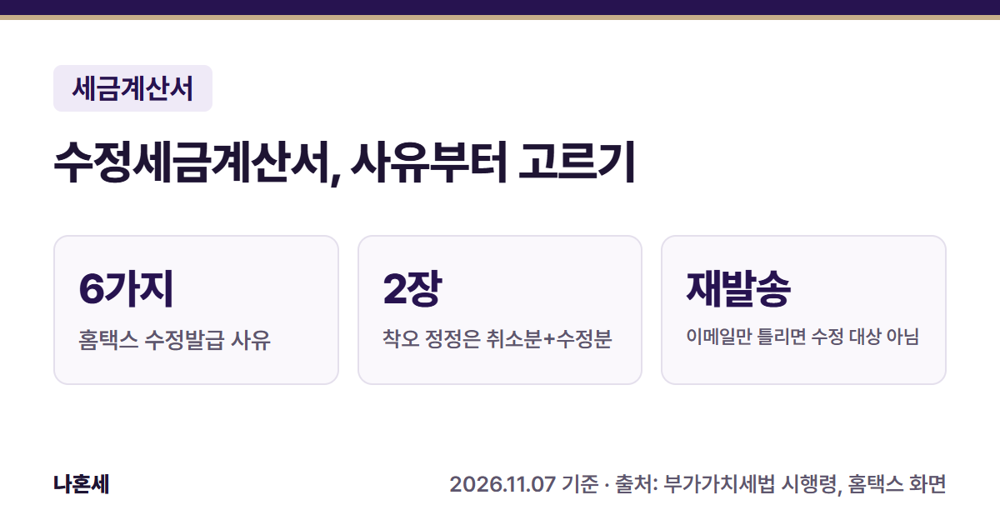
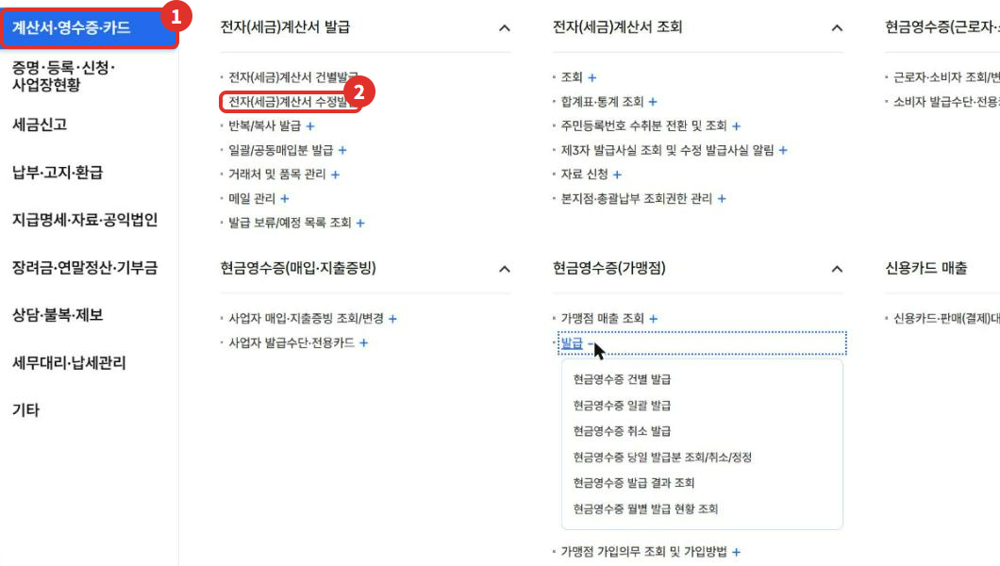
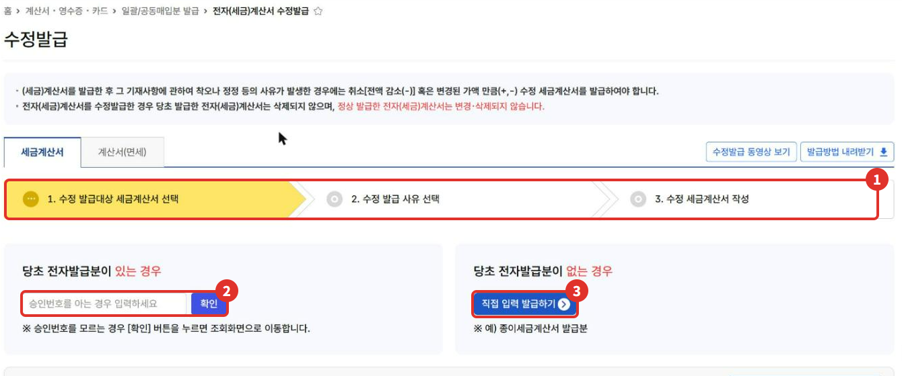
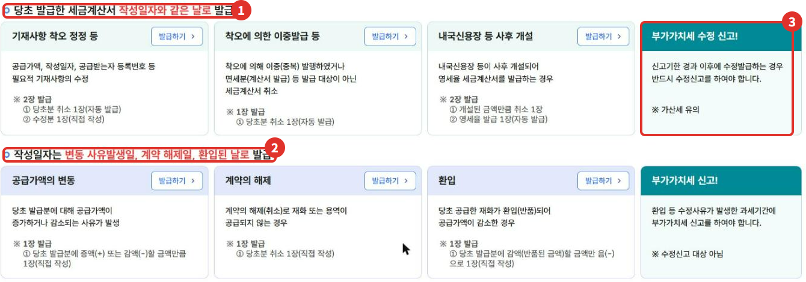

전자세금계산서를 발급한 뒤 금액이나 거래처를 잘못 적었거나, 계약이 취소되거나 반품이 생기면 **수정세금계산서**를 발급해요 [2]. 처음 발급한 세금계산서는 지워지지 않고, 취소분(−)이나 변경분(+, −)을 새로 발급하는 방식이에요(홈택스 화면 안내). 사유에 따라 **작성일자가 달라서** 사유를 먼저 정확히 고르는 게 중요해요.

{: .summary-card}

> 💡 **핵심 요약**
> - 메뉴: 홈택스 > 계산서·영수증·카드 > 전자(세금)계산서 발급 > **전자(세금)계산서 수정발급** (2026년 11월 화면)
> - **환입·계약 해제·공급가액 변동은 그 일이 생긴 날로 적어요**{: .red} [1]. 착오 정정은 처음 작성일자와 같은 날로 발급해요(화면 안내) [3]
> - 이메일 주소만 잘못 적었다면 수정발급 대상이 아니에요. **메일 재발송**으로 해결해요(화면 안내) [3]

목차

* 목차
{:toc}

## 한눈에 보기

| 항목 | 내용 |
|---|---|
| 누가 | 세금계산서를 발급한 사업자 |
| 언제 | 착오·정정, 환입, 계약 해제, 공급가액 변동 등이 생겼을 때 [1] |
| 메뉴 | 계산서·영수증·카드 > 전자(세금)계산서 발급 > 전자(세금)계산서 수정발급 |
| 단계 | 대상 선택 → 사유 선택 → 수정분 작성 (2026년 11월 화면) [3] |
| 주의 | 신고기한이 지난 뒤 착오를 고치면 부가세 수정신고 [3] |

## 수정 사유와 작성일자

홈택스 화면은 사유 버튼 6개를 두 묶음으로 나눠요(2026년 11월 화면) [3].

**처음 작성일자와 같은 날로 발급**

| 사유 | 발급 방법(화면 안내) |
|---|---|
| 착오 정정 | 공급가액·작성일자·등록번호 등 필요적 기재사항 수정. 당초분 취소 1장(자동) + 수정분 1장(직접 작성) [1][3] |
| 이중발급 등 | 착오로 두 번 발급했거나 면세 거래 등 발급 대상이 아닌 경우. 당초분 취소 1장(자동) [1][3] |
| 내국신용장 사후 개설 | 과세기간이 끝난 뒤 25일 안에 내국신용장·구매확인서가 나와 영세율로 바꿀 때. 취소 1장 + 영세율 1장 [1][3] |

**사유가 생긴 날로 발급**

| 사유 | 작성일자 | 발급 방법(화면 안내) |
|---|---|---|
| 공급가액 변동 | 증감 사유가 생긴 날 [1] | 늘거나 줄어든 금액만큼 1장 [3] |
| 계약 해제 | 계약 해제일 [1] | 당초분 취소 1장 [3] |
| 환입(반품) | 환입된 날 [1] | 반품된 금액만 음(−)으로 1장 [3] |

- **착오 정정은 세무조사 통지를 받았거나 과세자료 해명 안내를 받는 등, 세무서가 고칠 것을 미리 알고 있는 경우에는 할 수 없어요**{: .red} [1].
- **착오가 아닌 사유로 필요적 기재사항을 잘못 적은 경우는, 공급일이 속한 과세기간의 확정신고기한 다음 날부터 1년 안에 수정발급해요**{: .red} [1].
- 시행령에는 세율을 잘못 적용한 경우와 착오가 아닌 사유로 잘못 적은 경우도 따로 있어요 [1]. 이때 화면에서 어느 버튼을 고를지는 화면에 적혀 있지 않으니 126에 확인하세요.
- 일반↔간이로 과세유형이 바뀐 뒤 바뀌기 전 거래에 반품·계약 해제·금액 변동이 생기면, 처음 작성일자로 적고 비고란에 사유 발생일을 적어요 [1].

## 홈택스로 수정발급하는 순서

> 📅 **2026년 11월 기준 화면**이에요(운영자 본인 사업자 계정). 운영자는 수정할 실제 세금계산서가 없어서 **사유 선택 화면까지만 보고 발급은 하지 않았어요.**

1. 사업자로 로그인하고 **전체메뉴**에서 ① **계산서·영수증·카드** → 전자(세금)계산서 발급의 ② **전자(세금)계산서 수정발급**을 눌러요.

   

2. ① **수정 발급대상 세금계산서 선택** 단계예요. 처음 세금계산서를 전자로 발급했다면 ② 승인번호를 넣고 **확인**을 눌러요(승인번호를 모르면 확인을 누르면 조회 화면으로 가요). 종이로 발급했던 것처럼 전자 발급분이 없으면 ③ **직접 입력 발급하기**를 눌러요.

   

3. **수정발급 사유 선택** 화면에서 위 표를 보고 사유를 골라 **발급하기**를 눌러요. ① 처음 작성일자로 발급하는 사유와 ② 사유가 생긴 날로 발급하는 사유가 나뉘어 있어요. ③ 신고기한이 지난 뒤 수정발급하면 **부가세 수정신고**를 해야 한다는 안내도 함께 있어요.

   

4. 사유에 맞는 수정 세금계산서를 작성해 발급해요. 발급 방법은 [전자세금계산서 발급 글]()의 작성 화면과 같아요.

## 신고는 어떻게 하나요?

| 구분 | 신고(화면 안내) |
|---|---|
| 착오 정정 등 | 신고기한이 지난 뒤 발급하면 **반드시 수정신고**, 가산세 유의 [3] |
| 환입 등 | 사유가 생긴 과세기간에 신고(수정신고 대상 아님) [3] |

## 자주 하는 실수

- 반품(환입)인데 처음 작성일자로 발급하기 → 환입된 날로 적어요 [1]
- 이메일 주소만 틀렸는데 수정세금계산서를 발급하기 → **메일발송목록 조회 및 재발송**에서 주소를 고쳐 다시 보내요 [3]
- 신고기한이 지난 뒤 착오를 고치고 수정신고를 빠뜨리기 [3]
- 처음 세금계산서를 지우려고 하기 → 정상 발급한 전자세금계산서는 바꾸거나 지울 수 없어요(화면 안내) [3]

## 직접 하기 어려울 수 있는 경우

- 이미 지난 과세기간의 세금계산서를 고쳐야 하고 수정신고까지 해야 할 때
- 사유가 여러 개 겹치거나(예: 일부 반품 + 단가 변경) 어느 사유인지 헷갈릴 때
- 세무서에서 해명 안내를 받은 뒤라 착오 정정이 되는지 판단이 필요할 때

확실하지 않으면 **국세상담센터(126)**나 관할 세무서에 먼저 확인하세요.

## 자주 묻는 질문

**Q. 처음 세금계산서는 어떻게 되나요?**
A. 지워지지 않아요. 취소분(−)이나 변경분이 새로 발급돼서 합계가 맞춰지는 방식이에요(화면 안내) [3].

**Q. 종이로 발급했던 세금계산서도 홈택스에서 수정할 수 있나요?**
A. 1단계에서 **직접 입력 발급하기**를 누르면 돼요. 화면에 "예) 종이세금계산서 발급분"이라고 안내돼요 [3].

**Q. 사유별 작성 화면은 어떻게 생겼나요?**
A. 운영자는 실제로 수정할 세금계산서가 없어 3단계 작성 화면은 찍지 않았어요. 홈택스 같은 화면의 **수정발급 동영상 보기**, **발급방법 내려받기**에서 사유별 예시를 볼 수 있어요(2026년 11월 화면).

## 함께 보면 좋은 글

- [홈택스 전자세금계산서 발급 방법]()
- [1월 부가세 신고 전 체크리스트]()

## 출처

1. 법령: 부가가치세법 시행령 제70조 ①·②·③(수정세금계산서 발급사유와 작성일·절차, 과세유형 전환 때 작성일) (2026.4.1. 시행)
2. 법령: 부가가치세법 제32조 ⑦(수정세금계산서 발급) (2026.1.2. 시행)
3. 홈택스 - 전자(세금)계산서 수정발급 1단계·수정발급 사유 선택 화면 안내 (운영자 직접 확인: 2026-11-07)

> 이 글은 2026년 11월 7일 기준의 일반적인 안내입니다. 세법과 홈택스 화면은 바뀔 수 있으니 발급 전 국세청 안내를 꼭 확인하세요. 개별 상황은 국세상담센터(126)에 문의하세요.
