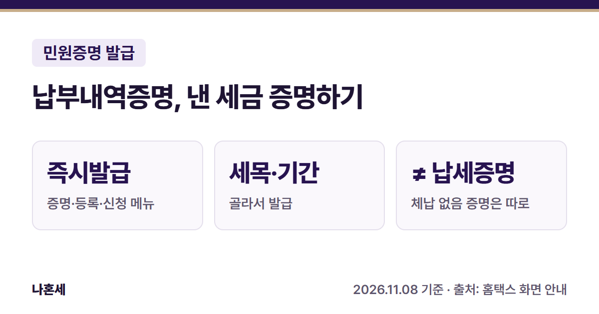
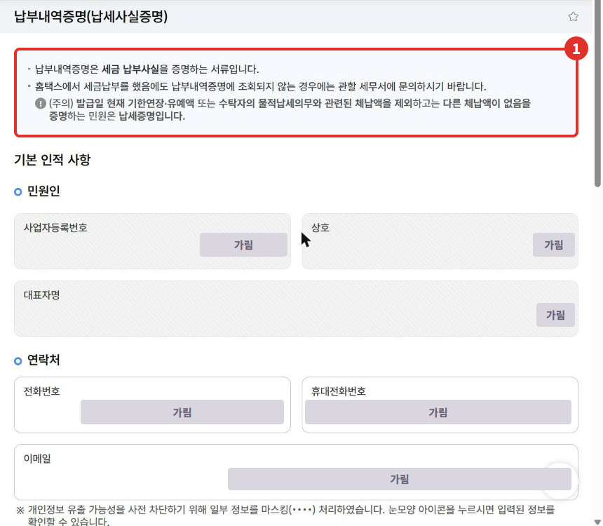
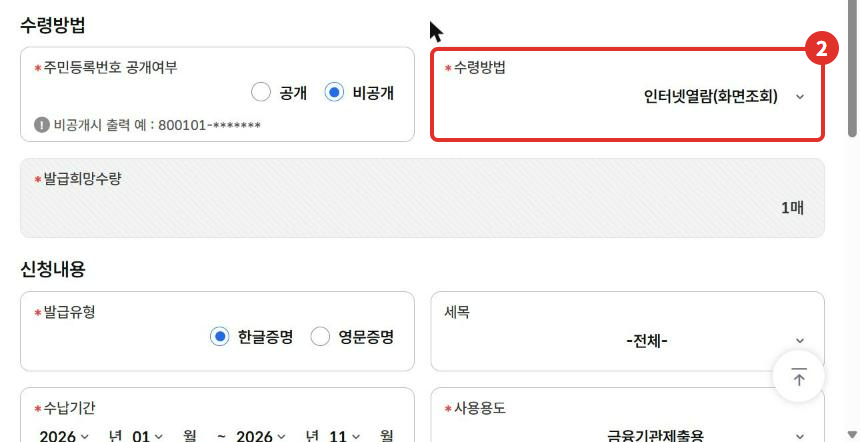
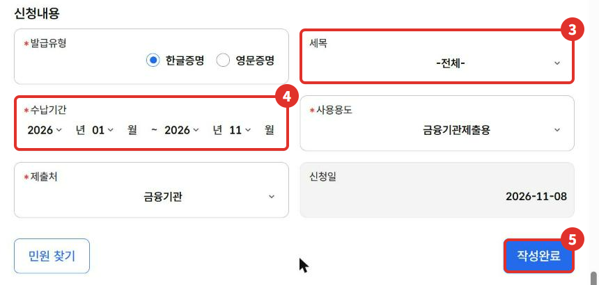

"세금을 냈다는 증명서를 내 주세요"라는 말을 들으면 **납부내역증명(납세사실증명)**을 떼면 돼요. 이름이 비슷한 **납세증명서**는 "체납이 없다"를 증명하는 다른 서류라서, 헷갈리면 엉뚱한 서류를 낼 수 있어요. 이 글은 운영자가 2026년 11월에 본인 사업자 계정으로 신청 화면을 확인한 내용을 정리했어요.

{: .summary-card}

> 💡 **핵심 요약**
> - 메뉴: 홈택스 > 증명·등록·신청·사업장현황 > 즉시발급 증명 > **납부내역증명(납세사실증명)** (2026년 11월 기준 화면) [1]
> - 납부내역증명은 **세금 납부 사실**을 증명해요. **체납이 없다는 증명은 납세증명이라 서류가 달라요**{: .red} [1]
> - 세목(전체 또는 하나)과 **수납기간(연·월)**을 골라 발급해요 [1]

목차

* 목차
{:toc}

## 한눈에 보기

| 항목 | 내용 |
|---|---|
| 누가 | 세금 낸 사실을 증명해야 하는 사람(사업자·개인) |
| 무엇을 | 고른 기간에 낸 세금의 납부 내역 |
| 메뉴 | 증명·등록·신청·사업장현황 > 즉시발급 증명 > 납부내역증명(납세사실증명) [1] |
| 고를 것 | 수령방법, 수량, 발급유형, 세목, 수납기간, 사용용도, 제출처 [1] |
| 받는 방법 | 인터넷발급(프린터출력) 또는 인터넷열람(화면조회) [1] |

## 납부내역증명과 납세증명서, 뭐가 달라요?

| 서류 | 증명하는 것 |
|---|---|
| 납부내역증명(납세사실증명) | 세금을 **낸 사실**(언제, 어떤 세금을 냈는지) [1] |
| 납세증명서 | 발급일 현재 **체납액이 없다는 것**(기한연장·유예액 등은 제외) [1] |

화면 맨 위에도 "발급일 현재 … 다른 체납액이 없음을 증명하는 민원은 납세증명입니다"라고 따로 안내돼요 [1]. 제출처가 "완납증명", "국세 체납 없음"을 말하면 [납세증명서 글]()을 보세요.

## 환급금이 세금에 충당된 경우

환급금이 있는데 체납된 세금이 있으면, 세무서가 환급금을 그 세금에 먼저 **충당**(돌려줄 돈으로 낼 세금을 대신 메우는 것)해요. 고지서로 낼 세금이나 스스로 신고해서 낼 세금은 납세자가 동의할 때만 충당해요 [2]. 법에서는 체납 세금에 충당되면 그만큼 세금이 소멸한 것으로 보고, 납세자가 충당을 청구한 세액은 청구한 날에 **납부한 것으로 봐요** [2]. 충당하면 세무서가 그 내용을 적은 문서로 통지해요 [3].
<!-- 확인 대기(2026-11-08): "충당분도 납부내역증명에 나온다"를 국세청 원문·실제 증명서로 확인하면 아래 문장을 빨간 강조로 바꿔 넣는다.
**환급금이 미납 세금에 충당된 경우에도 납부내역증명에 그 세금이 나와요**{: .red} -->

충당된 세금이 증명서에 어떻게 찍히는지 궁금하면 관할 세무서나 126에 확인하세요.

## 홈택스로 신청하는 순서

> 📅 **2026년 11월 기준 화면**이에요(운영자 본인 사업자 계정). 개인정보는 가렸어요.

1. 홈택스에 로그인해요. 운영자는 **사업자로 로그인**했어요. 전체메뉴 > 증명·등록·신청·사업장현황 > 즉시발급 증명 > **납부내역증명(납세사실증명)**을 눌러요.
2. 화면 위 ① 안내 상자를 먼저 읽어요. 홈택스로 세금을 냈는데 납부내역증명에 안 나오면 관할 세무서에 문의하라고 적혀 있어요 [1].

   

3. ② **수령방법**을 골라요. 인터넷발급(프린터출력)과 인터넷열람(화면조회) 두 가지예요 [1]. 주민등록번호 공개 여부와 발급희망수량도 여기서 골라요.

   

4. 신청내용에서 ③ **세목**과 ④ **수납기간**을 골라요. 세목은 전체로 두거나 부가가치세·종합소득세처럼 하나만 고를 수 있어요. 수납기간은 시작 연·월과 끝 연·월을 골라요 [1]. 사용용도와 제출처도 골라요.
5. ⑤ **작성완료**를 눌러 신청해요. 같은 즉시발급 증명인 [사업자등록증명]()은 신청 뒤 민원신청 처리결과 조회에서 열람·출력했어요. 이 증명은 운영자가 신청 버튼까지 누르지 않았으니, 신청 뒤 화면 안내를 따르세요.

   

## 신청서에서 고르는 항목

| 항목 | 고를 수 있는 것(2026년 11월 화면) |
|---|---|
| 수령방법 | 인터넷발급(프린터출력), 인터넷열람(화면조회) [1] |
| 발급희망수량 | 1~9매 [1] |
| 발급유형 | 한글증명, 영문증명 [1] |
| 세목 | 전체, 또는 종합소득세·부가가치세·근로소득세(갑) 등 하나 [1] |
| 수납기간 | 시작 연·월 ~ 끝 연·월 [1] |
| 사용용도 | 입찰·계약용, 수금용, 관공서제출용, 대출용, 여권또는비자신청용, 건강보험·국민연금공단제출용, 금융기관제출용, 신용카드발급용, 기타 [1] |
| 제출처 | 금융기관, 관공서, 조합/협회, 거래처, 학교, 외교부/재외공관/재외동포청, 기타 [1] |

열람(화면조회)으로 받은 증명은 제출용으로 인정되지 않을 수 있어요. 제출할 서류라면 어떤 형식으로 내야 하는지 제출처에 먼저 확인하세요.

## 직접 발급이 어려울 수 있는 경우

- 홈택스로 냈는데 납부내역증명에 안 나올 때(화면 안내대로 관할 세무서 문의 [1])
- 제출처가 "납세증명"인지 "납부내역증명"인지 분명하지 않을 때(두 서류는 증명하는 내용이 달라요 [1])

헷갈리면 **국세상담센터(126)**나 가까운 세무서 민원실에 먼저 물어보세요.

## 자주 묻는 질문

**Q. 개인 로그인으로도 되나요?**
A. 운영자는 사업자 로그인으로만 화면을 확인했어요. 필요한 세목이 안 보이면 개인 로그인으로도 확인해 보세요.

**Q. 어떤 세금을 냈는지만 따로 뗄 수 있나요?**
A. 네. 세목에서 하나를 고르면 돼요 [1].

**Q. 납부확인서랑은 다른가요?**
A. 납부확인서는 납부·고지·환급 > 납부 > 납부내역 조회에서 조회·출력해요 [4]. 제출처가 "납부내역증명(납세사실증명)"이라고 했다면 이 증명서를 내세요.

## 함께 보면 좋은 글

- [홈택스 납세증명서(국세완납증명) 발급 방법]()
- [홈택스 사업자등록증명 발급 방법]()
- [홈택스 소득금액증명 발급 방법]()

## 출처

1. [홈택스](https://hometax.go.kr) > 증명·등록·신청·사업장현황 > 즉시발급 증명 > 납부내역증명(납세사실증명) 화면의 안내·선택 목록 (운영자 직접 확인: 2026-11-08), [손택스 납부내역증명 안내](https://mob.tbht.hometax.go.kr/jsonAction.do?actionId=UTBRDAAA08F001)
2. 법령: 국세기본법 제51조(국세환급금의 충당과 환급) ②·③·④ (2026.10.2. 시행본) (확인일: 2026-11-08)
3. 법령: 국세기본법 시행령 제31조① (확인일: 2026-11-08)
4. [국세상담센터 - 자주묻는 Q&A(납부)](https://call.nts.go.kr/call/qna/selectHomeQnaInfo.do?mi=3555&ctgId=CTG11981) (확인일: 2026-11-08)

> 이 글은 2026년 11월 8일 기준의 일반적인 안내입니다. 홈택스 화면은 바뀔 수 있으니 발급 전 국세청 안내를 꼭 확인하세요. 개별 상황은 국세상담센터(126)에 문의하세요.
