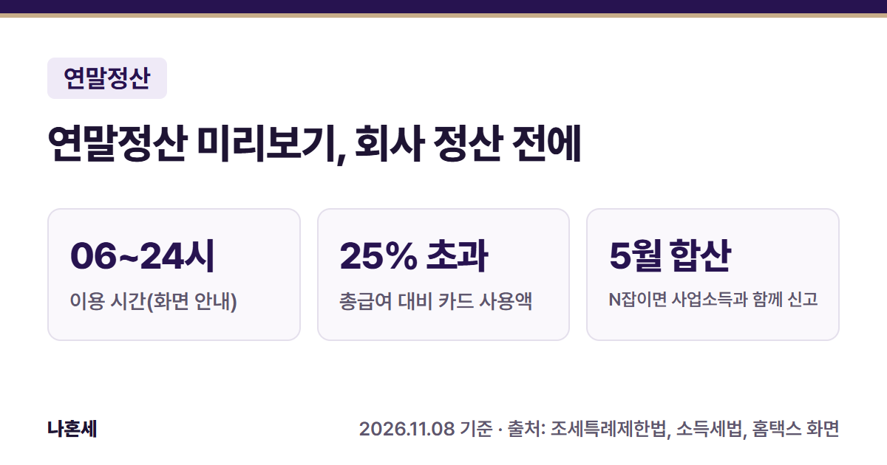
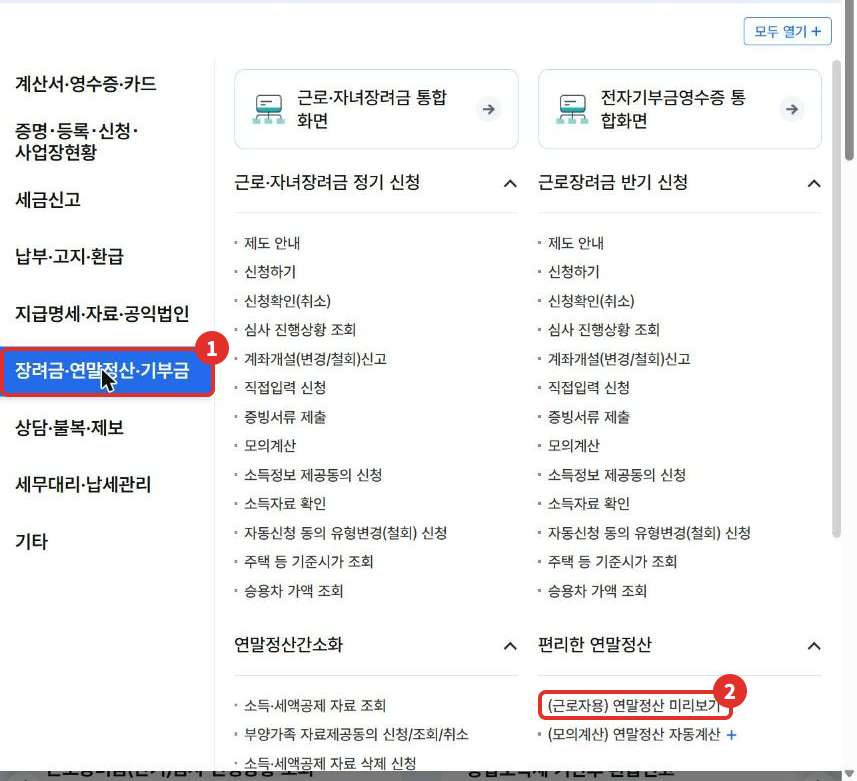
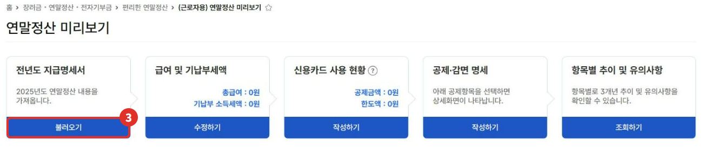
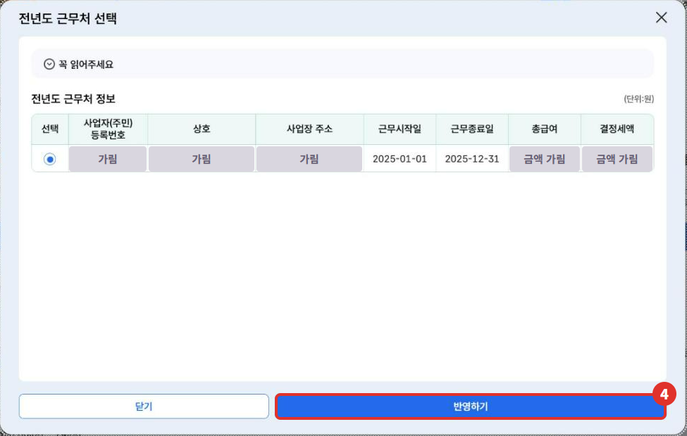
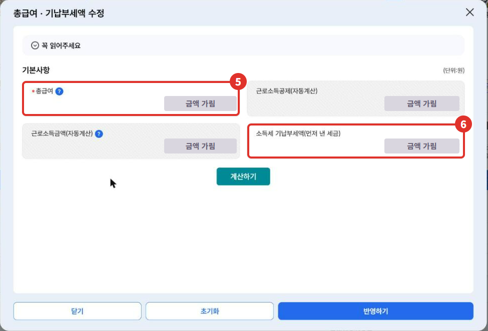
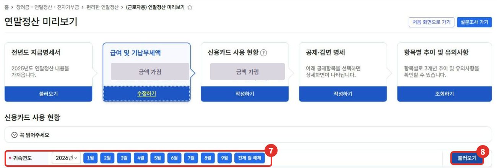
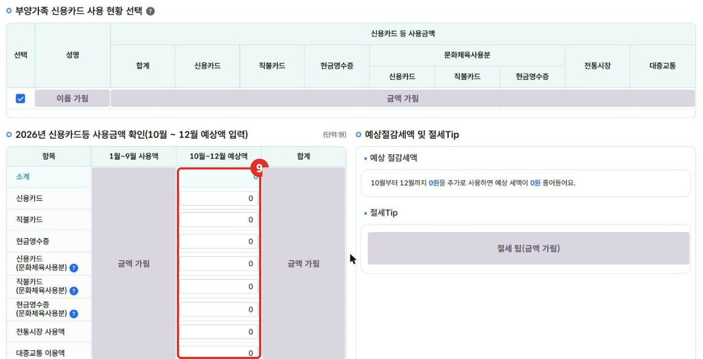
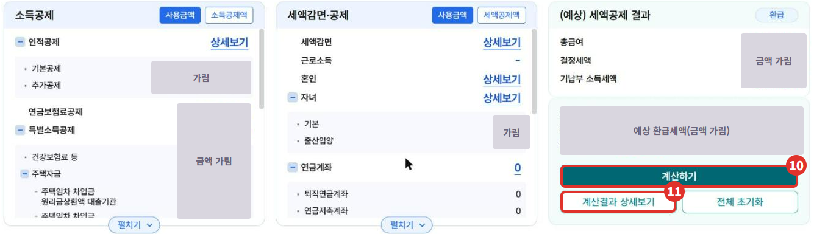
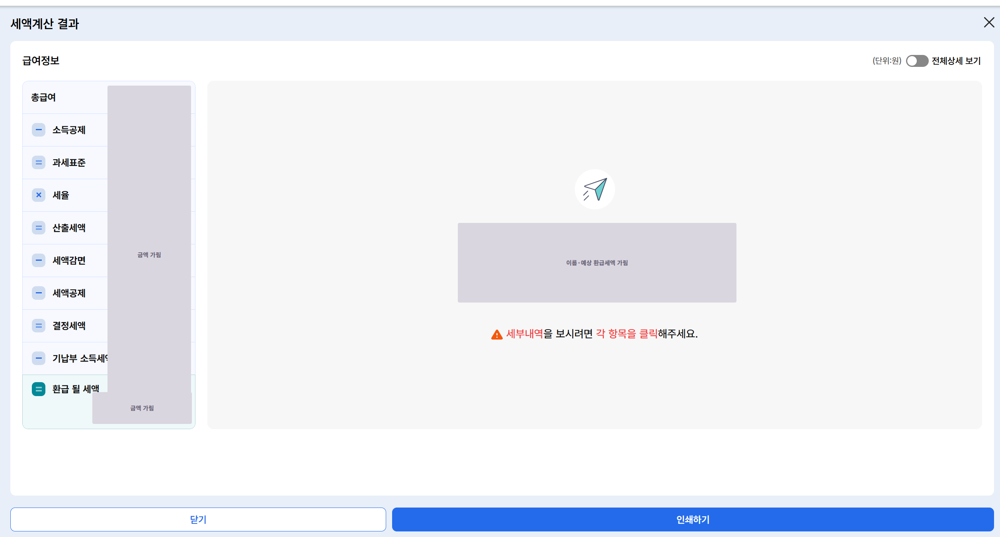
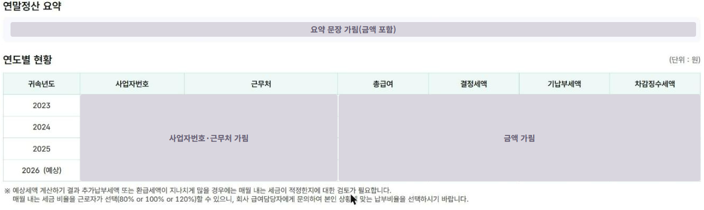

회사에 다니면서 사업자도 낸 **N잡 사장님**이라면, 월급은 회사가 하는 **연말정산**으로, 사업 소득은 **5월 종합소득세**로 챙겨야 해요. 홈택스의 **연말정산 미리보기**를 쓰면 회사 연말정산 전에 올해 예상 세액을 미리 계산해 볼 수 있어요. 이 글은 운영자가 2026년 11월에 본인 개인 계정으로 미리보기를 끝까지 따라가 본 화면을 정리했어요.

{: .summary-card}

> 💡 **핵심 요약**
> - 메뉴: 홈택스 > 장려금·연말정산·기부금 > 편리한 연말정산 > **(근로자용) 연말정산 미리보기** (2026년 11월 기준 화면), 이용 시간 **06:00~24:00** [3]
> - 카드 공제는 카드 등 사용액이 **총급여의 25%를 넘은 부분**부터 계산해요 [1]. 미리보기는 9월까지 수집된 카드 자료에 10~12월 예상액을 더해 계산해요 [3]
> - **회사에서 연말정산한 근로소득도, 사업소득이 있으면 다음 해 5월 종합소득세 때 합쳐서 신고해요**{: .red} [2]

목차

* 목차
{:toc}

## 한눈에 보기

| 항목 | 내용 |
|---|---|
| 누가 | 근로소득이 있는 사람(회사 다니는 N잡 사장님 포함) |
| 무엇을 | 올해(2026년) 예상 연말정산 세액을 미리 계산 |
| 메뉴 | 장려금·연말정산·기부금 > 편리한 연말정산 > (근로자용) 연말정산 미리보기 [3] |
| 로그인 | **개인**으로 로그인(운영자 확인) |
| 이용 시간 | 06:00~24:00, 새벽에는 서비스 중지 화면이 떠요 [3] |

## 연말정산 미리보기가 뭐예요?

홈택스 화면 안내를 그대로 옮기면, 국세청이 수집한 **올해 9월까지의 신용카드 사용금액**과 **지난해 연말정산 내용**을 바탕으로, 근로자가 총급여와 공제 항목을 올해 예상액으로 고쳐 미리 계산해 보는 서비스예요 [3]. 실제 연말정산 결과와는 차이가 날 수 있고, 계산은 그해 10월 현재 세법 기준이라 이후 세법이 바뀌면 달라질 수 있다고 안내돼요 [3].

**미리보기는 미리 계산해 보는 서비스예요** [3]. 실제 연말정산은 회사(원천징수의무자)를 통해 따로 해요. 운영자가 써 보니 미리보기에서 계산한 내용이 회사로 넘어가는 단계는 없었어요.

## N잡 사장님이 알아 둘 것

- 월급(근로소득)만 있고 회사에서 연말정산을 마쳤다면 보통 5월 신고를 안 해도 돼요(근무처가 2곳 이상인데 합산하지 않은 경우 등 예외가 있어요) [2]. 하지만 **사업소득이 같이 있으면 이 예외에 해당하지 않아요**. 2026년 소득이라면 2027년 5월에 근로소득과 사업소득을 합쳐 종합소득세를 신고해요 [2].
- **사업에 쓴 카드 사용액(사업소득 관련 비용)은 연말정산 카드 공제 대상에서 빠져요**{: .red} [1]. 사업용 카드로 등록해 쓴 금액이 개인 공제에 섞이지 않게 나눠 쓰는 게 좋아요([사업용 신용카드 등록 글]() 참고).

## 홈택스에서 미리보기 하는 순서

> 📅 **2026년 11월 기준 화면**이에요(운영자 본인 개인 계정). 금액·이름·근무처는 모두 가렸어요.

1. 홈택스에 **개인**으로 로그인해요. **전체메뉴**에서 ① **장려금·연말정산·기부금**을 누르고, 편리한 연말정산의 ② **(근로자용) 연말정산 미리보기**를 눌러요.

   

2. 미리보기 화면 위에 다섯 단계가 나와요. 전년도 지급명세서 → 급여 및 기납부세액 → 신용카드 사용 현황 → 공제·감면 명세 → 항목별 추이 순서예요. ③ 첫 칸의 **불러오기**를 눌러요.

   

3. **전년도 근무처 선택** 창에 지난해(2025년) 근무처가 나와요. 근무처가 여러 곳으로 나오면 주된 근무처 한 곳을 고르라고 안내돼요 [3]. 고른 뒤 ④ **반영하기**를 누르고 확인 창에서 **예**를 눌러요.

   

4. "반영되었습니다. 신용카드 사용 현황 화면에서 신용카드 등 사용액을 입력해주세요" 알림이 떠요 [3]. 두 번째 칸 **수정하기**를 누르면 ⑤ **총급여**와 ⑥ **소득세 기납부세액(먼저 낸 세금)**을 올해 예상액으로 고칠 수 있어요. 처음에는 지난해 값이 들어 있어요(운영자 확인).

   

   화면 안내에 따르면 총급여는 의료비·신용카드 공제를 계산할 때 쓰이고, 기납부세액은 매달 월급에서 미리 낸 소득세로 **지방소득세는 빼고** 넣어요 [3].

5. 아래 **신용카드 사용 현황**에서 ⑦ 귀속연도(2026년)와 월을 확인하고 ⑧ **불러오기**를 눌러요. "연말정산간소화 신용카드 등 자료를 불러오시겠습니까?"에 **예**를 누르면 1~9월 자료가 들어와요 [3].

   

   불러온 뒤 "직계비속 인원수에 따라 공제한도가 변경됩니다"라며 인적공제 화면으로 갈지 묻는 창이 떠요 [3]. 자녀가 있으면 인적공제에서 인원수를 고쳐요.

6. 표의 ⑨ **10월~12월 예상액** 칸에 남은 석 달 동안 쓸 금액을 넣고 **계산하기**를 눌러요. 오른쪽에 **예상 절감세액**과 **절세Tip**(25%를 얼마나 넘었는지, 어떤 결제수단을 더 쓰면 공제가 늘어나는지)이 나와요 [3].

   

7. 네 번째 칸 **공제·감면 명세**의 **작성하기**를 누르면 소득공제·세액공제 항목과 오른쪽에 **(예상) 세액공제 결과**가 나와요. ⑩ **계산하기**를 누르고 ⑪ **계산결과 상세보기**를 누르면 **세액계산 결과** 창이 따로 떠요.

   

   

8. 마지막 칸 **조회하기**를 누르면 **3개년 추이**가 나와요. 연도별 총급여·결정세액·기납부세액·차감징수세액을 표와 그래프로 비교할 수 있어요 [3].

   

### "저장하시겠습니까?"가 뜨면

카드 예상액을 넣고 반영하거나 다른 칸으로 넘어갈 때 "저장하시겠습니까?" 창이 떠요. 운영자는 **아니오**를 눌렀는데, 다시 열어 보니 입력한 카드 예상액이 0원으로 돌아가 있었어요(운영자 확인). 나중에 이어서 보고 싶으면 저장하세요.

## 화면에 나오는 숫자 읽는 법

| 항목 | 뜻 |
|---|---|
| 총급여 | 비과세를 뺀 1년 월급·상여 합계(미리보기에서 올해 예상액으로 고칠 수 있어요) |
| 기납부세액 | 매달 월급에서 미리 낸 소득세(지방소득세 제외) [3] |
| 결정세액 | 공제를 모두 반영해 최종으로 낼 세금 |
| 환급 될 세액 | 기납부세액이 결정세액보다 많으면 돌려받을 금액 |

카드 공제는 카드 등 사용액이 **총급여의 25%**를 넘을 때 그 넘은 부분부터 계산해요 [1]. 넘은 부분 중 신용카드분은 15%, 체크카드·현금영수증분은 30%를 공제율로 써요(전통시장·대중교통 등은 따로) [1]. 공제액에는 연간 한도가 있고, 자녀 수에 따라 한도가 달라져요 [1].

3개년 추이 화면에는 **환급이나 추가 납부가 너무 크면 매달 떼는 세금 비율(80%·100%·120%)을 고를 수 있으니 회사 급여 담당자에게 문의하라**는 안내가 있어요 [3].

## 직접 계산이 어려울 수 있는 경우

- 중간에 회사를 옮겼거나 근무처가 여러 곳일 때(미리보기는 주된 근무처 한 곳 기준이라 합산 결과와 다를 수 있어요 [3])
- 주택자금·의료비처럼 공제 요건이 까다로운 항목이 클 때
- 사업소득이 있어 5월에 합산 신고해야 할 때(사업 장부·경비 정리가 필요해요)

헷갈리면 **국세상담센터(126)**나 회사 급여 담당자에게 먼저 물어보세요. 미리보기 화면의 문의 번호는 연말정산 관련 상담 126 → 1 → 5예요 [3].

## 자주 묻는 질문

**Q. 미리보기에서 계산하면 회사에 자동으로 넘어가나요?**
A. 미리보기는 미리 계산해 보는 서비스예요 [3]. 운영자가 써 보니 회사로 넘기는 단계는 없었어요. 실제 연말정산은 회사를 통해 따로 해요.

**Q. 새벽에 들어가니 안 열려요.**
A. 이용 시간이 06:00~24:00이에요 [3]. 운영자도 새벽에 들어갔다가 서비스 중지 화면을 봤어요.

**Q. 사업자 로그인으로도 되나요?**
A. 운영자는 **개인 로그인**으로 이용했어요.

**Q. 사업용 카드로 쓴 것도 카드 공제에 들어가나요?**
A. 사업소득 관련 비용은 카드 공제 대상에서 빠져요 [1].

## 함께 보면 좋은 글

- [홈택스 사업용 신용카드 등록 방법]()
- [사장님 세무 일정 달력]()

## 출처

1. 법령: 조세특례제한법 제126조의2(신용카드 등 사용금액에 대한 소득공제) ①·②·④·⑩ (2026.9.18. 시행본). 부칙 <제21223호> 제47조 경과조치: 2025년 이전 사용분은 종전 규정, 2026년 사용분은 ②·⑩·⑪ 개정규정 적용 (확인일: 2026-11-08)
2. 법령: 소득세법 제70조(종합소득과세표준 확정신고) ①, 제73조(과세표준확정신고의 예외) ① (2026.7.1. 시행본) (확인일: 2026-11-08)
3. [홈택스](https://hometax.go.kr) > 장려금·연말정산·기부금 > 편리한 연말정산 > (근로자용) 연말정산 미리보기 화면의 도움말·안내 문구 (운영자 직접 확인: 2026-11-08)

> 이 글은 2026년 11월 8일 기준의 일반적인 안내입니다. 세법과 홈택스 화면은 바뀔 수 있으니 국세청 안내를 꼭 확인하세요. 개별 상황은 국세상담센터(126)에 문의하세요.
