부가세를 신고하고 나서 매출을 빠뜨린 걸 알았거나, 반대로 공제를 놓쳐 세금을 더 냈다는 걸 알게 될 때가 있어요. 세금을 **덜 냈으면 수정신고**, **더 냈으면 경정청구**, 기한까지 **아예 못 냈으면 기한 후 신고**로 바로잡아요. 이 글은 2026년 11월에 운영자 가족의 일반과세자 계정으로 홈택스 화면을 끝까지 따라가 본 순서를 정리했어요(제출 버튼은 누르지 않았어요).

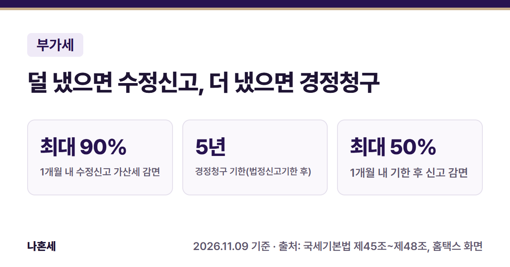{: .summary-card}

> 💡 **핵심 요약**
> - 덜 냈으면 **수정신고**: 법정신고기한 후 1개월 이내면 과소신고 가산세의 **90%**, 3개월 이내 75%, 6개월 이내 50%를 깎아 줘요 [1][4]
> - 더 냈으면 **경정청구**: 법정신고기한이 지난 후 **5년 이내**, 세무서는 2개월 안에 결과를 알려 줘요 [2]
> - 못 냈으면 **기한 후 신고**: 1개월 이내면 무신고 가산세의 **50%**를 깎아 줘요 [3][4]. **납부지연 가산세는 하루하루 늘어나니 빨리 할수록 좋아요**{: .red} [5]

목차

* 목차
{:toc}

## 한눈에 보기

| 구분 | 언제 쓰나 | 언제까지 | 가산세 |
|---|---|---|---|
| 수정신고 | 세금을 **적게** 신고(환급은 많게) | 세무서가 경정하기 전까지 [1] | 과소신고 10%, 일찍 하면 감면 [4][6] |
| 경정청구 | 세금을 **많이** 신고(공제·환급은 적게) | 법정신고기한 후 **5년** [2] | 없음(돌려받는 쪽) |
| 기한 후 신고 | 기한까지 신고를 **안 함** | 세무서가 결정하기 전까지 [3] | 무신고 20%, 일찍 하면 감면 [4][7] |

- 메뉴(셋 다 같은 곳): 홈택스 > 세금신고 > 부가가치세 신고 > **부가가치세 과세신고(일반·간이·대리납부)** (2026년 11월 기준 화면)
- 가산세율은 일반적인 경우예요. 부정행위로 덜 냈거나 신고하지 않은 경우는 더 높아요 [6][7].

## 셋 중 무엇을 해야 하나요?

기준은 **처음 낸 신고서와 실제로 맞는 금액의 차이**예요.

- 처음 신고한 세금이 **적었다** → 수정신고. 덜 낸 세금과 가산세를 더 내요 [1][10].
- 처음 신고한 세금이 **많았다** → 경정청구. 세무서가 확인한 뒤 더 낸 세금을 돌려줘요 [2].
- **기한까지 신고서를 내지 않았다** → 기한 후 신고. 수정신고·경정청구는 처음 신고서가 있어야 할 수 있어요 [1][2][3].

이미 신고한 기간으로 기한 후 신고를 열면 홈택스가 막아요. 운영자가 2026년 1기 확정으로 열어 보니 이런 알림이 떴어요.

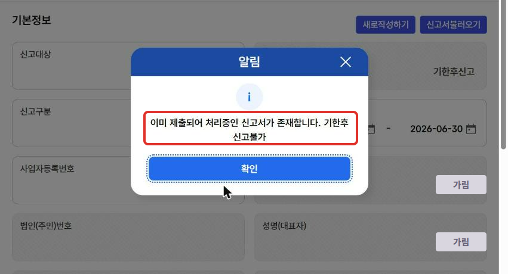

## 언제까지 하나요?

- **수정신고**: 세무서가 과세표준과 세액을 경정해서 통지하기 전까지, 부과제척기간(세금을 매길 수 있는 기간)이 끝나기 전까지 할 수 있어요 [1]. 다만 감면은 기한 안에 처음 신고한 사람이 법정신고기한 후 **2년 이내**에 수정신고한 경우만 받아요 [4].
- **경정청구**: 법정신고기한이 지난 후 **5년 이내**예요. 세무서는 청구를 받은 날부터 2개월 이내에 결과를 알려 줘야 해요 [2].
- **기한 후 신고**: 세무서가 결정해서 통지하기 전까지 할 수 있어요. 세무서는 신고일부터 3개월 이내에 결정해서 알려 줘야 해요(조사가 길어지는 등 부득이하면 그 사유를 알려 줘요) [3]. 감면은 법정신고기한 후 **6개월 이내**까지만 있어요 [4].

법정신고기한은 부가세 확정신고 기한(1기는 7월 25일, 2기는 다음 해 1월 25일)이에요 [8]. 말일이 토요일·일요일·공휴일(대체공휴일·노동절 포함)이면 그다음 날로 미뤄지고, 그날도 쉬는 날이면 또 미뤄져요 [9]. 2026년 1기 확정은 7월 25일이 토요일이라, 운영자가 본 화면에도 신고납부기한이 **2026-07-27**(월)로 나왔어요.

## 홈택스로 수정신고하는 순서

> 📅 **2026년 11월 기준 화면**이에요(운영자 가족의 일반과세자 계정, 2026년 1기 확정). 개인정보와 실제 금액은 가렸어요.

1. 홈택스에 로그인해요. 운영자는 개인 인증서로 로그인한 뒤 사업자 화면으로 바꿔 들어갔어요. 전체메뉴 > 세금신고 > 부가가치세 신고 > **부가가치세 과세신고(일반·간이·대리납부)**를 누르면 신고 종류 칸이 나와요. ① 기한 후 신고, ② 수정신고, ③ 경정청구 중 **② 수정신고**를 눌러요.

   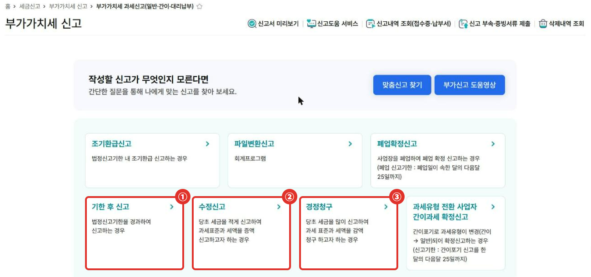

2. **기본정보** 화면에서 신고구분(예: 2026년 1기 확정)을 고칠 기간으로 바꾸고, 사업자등록번호 옆 **[확인]**을 눌러요. "마감된 신고서가 존재합니다. 수정신고 하시겠습니까?" 알림이 뜨면 ① **확인**을 눌러요.

   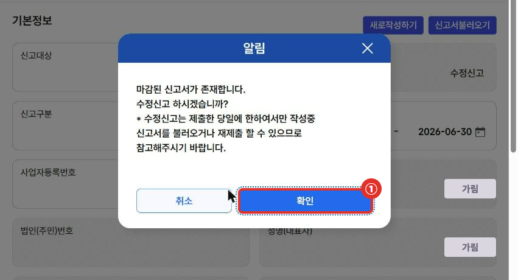

   **알림에 적힌 대로, 수정신고는 제출한 당일에만 작성 중 신고서를 불러오거나 다시 제출할 수 있어요**{: .red}. 제출 전에 금액을 꼼꼼히 확인하세요.

3. 사업자 정보가 채워지면 아래쪽 **[저장하기]** → "저장 후 다음 화면으로 이동하시겠습니까?"에서 **예**를 눌러요. 그러면 처음 신고한 금액이 칸마다 불러와진 작성 화면이 열려요. 고칠 줄의 **[입력/수정]**을 눌러 금액을 바로잡아요(예: 매출을 빠뜨렸으면 매출세액 칸의 해당 줄). 아래 화면의 ① 신고서 미리보기는 7단계, ② 이대로 신고하기는 8단계에서 써요.

   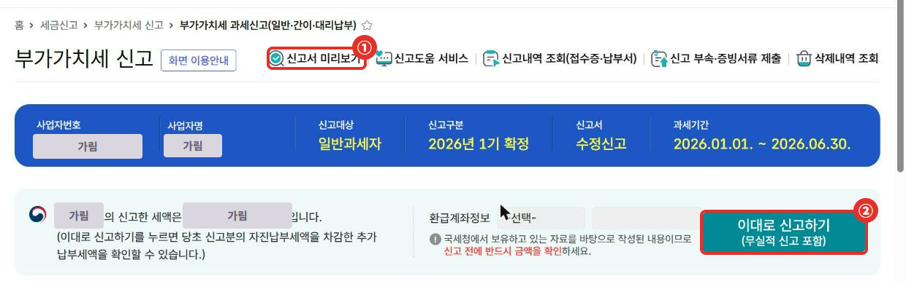

   화면에는 "이대로 신고하기를 누르면 당초 신고분의 자진납부세액을 차감한 추가 납부세액을 확인할 수 있습니다"라고 나와요.

4. 가산세는 공제·감면·가산세액 칸의 **[펼치기]** → 작성하지 않은 서식 **가산세 [입력하기]**에서 넣어요. 가산세액 명세에는 ① **(신고 불성실) 과소·초과환급신고(일반)**과 ② **납부지연** 옆에 **[계산기]**가 있어요.

   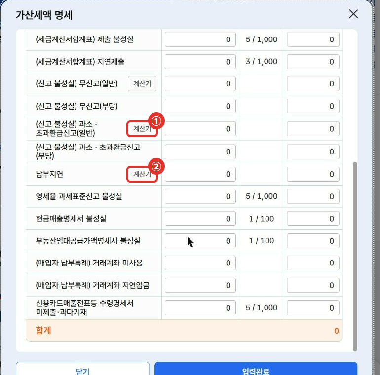

5. 과소신고 계산기에 ① **미납세액**(더 내야 할 세금)을 넣으면 ② 신고납부기한·신고일·경과개월수·세율·가산세액이 계산돼요. 화면 위쪽에 감면 6단계도 안내돼요 [4].

   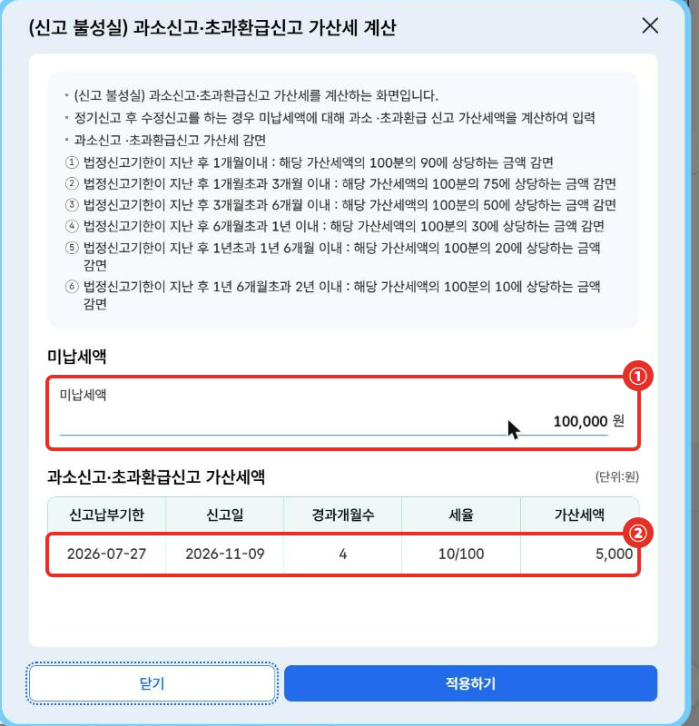

6. 납부지연 계산기도 ① 미납세액을 넣으면 ② 경과일수와 하루 22/100,000 세율로 계산해 줘요 [5].

   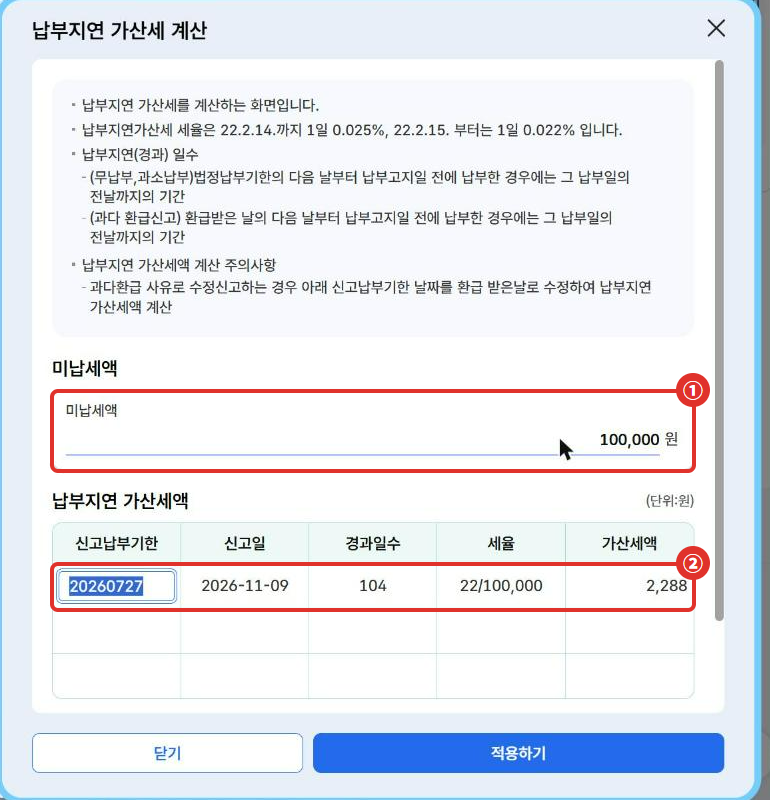

   계산기 창의 **[적용하기]**를 누르면 값이 가산세액 명세에 들어가고, **[입력완료]**로 작성 화면에 반영돼요. 운영자는 가상 금액만 넣어 봤기 때문에 [닫기]로 나왔어요.

7. 다 고쳤으면 화면 위쪽 **[신고서 미리보기]**로 실제로 제출될 신고서를 확인해요. "부가가치세 신고서 보기" 창이 따로 열리고, 왼쪽 ① **신고서 목록**에 이번에 함께 내는 서식이 체크돼 있어요.

   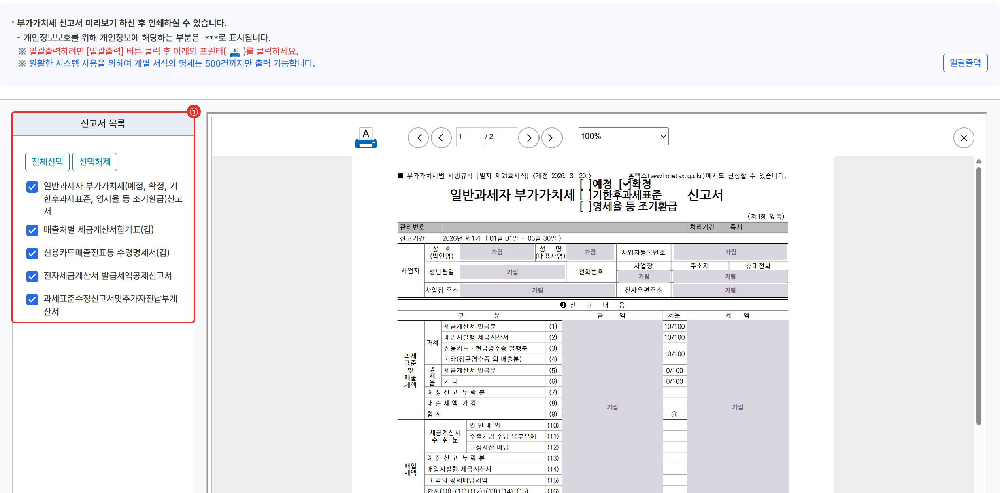

8. 작성 화면의 **[이대로 신고하기]**를 누르면 납부할 세액이 나오고, 확인 문구 아래 ① **이에 동의합니다**에 체크한 뒤 ② **[신고서 제출하기]**를 누르면 제출돼요. **[신고서 제출하기]를 누르면 바로 접수되니, 그 전에 금액을 다시 확인하세요**{: .red}.

   **신고서를 제출한 뒤 더 낼 세금은 따로 납부해야 해요. 납부지연 가산세는 낸 날 전날까지 붙으니 제출한 날 바로 내는 게 좋아요**{: .red} [5][10]. 홈택스 계산기는 신고일까지로 계산하니, 늦게 내면 그만큼 늘어나요.

   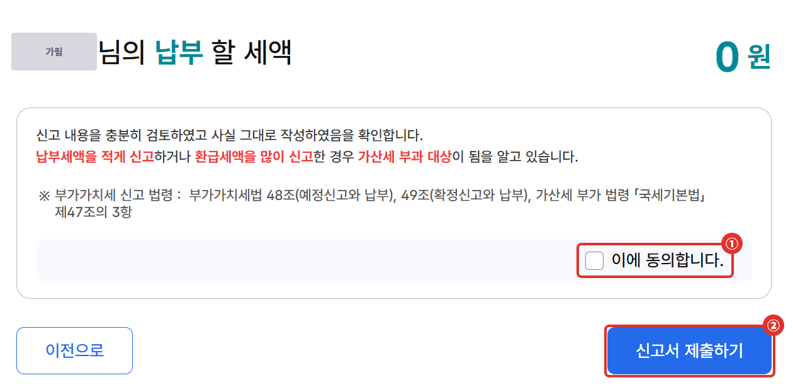

## 경정청구는 무엇이 다른가요?

순서는 수정신고와 거의 같아요. 신고 종류 칸에서 **③ 경정청구**를 누르고, 기본정보에서 기간을 고른 뒤 [확인] → "마감된 신고서가 존재합니다. 경정청구 하시겠습니까?" → 확인 → 저장하기 순서예요.

작성 화면도 수정신고와 거의 같고, 안내 문구가 "최종 환급세액을 확인할 수 있습니다"로 바뀌어요. 돌려받을 계좌는 ① **환급계좌정보**에서 고르고, 고칠 줄을 [입력/수정]으로 바로잡은 뒤 ② **[이대로 신고하기]**로 넘어가요.

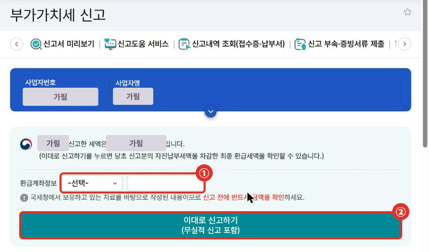

경정청구는 신고와 달리 **세무서가 확인한 뒤** 결과를 알려 줘요. 청구를 받은 날부터 2개월 이내에 결정·경정하거나, 그럴 이유가 없다는 뜻을 통지해요 [2]. 돌려받을 근거(빠뜨린 세금계산서 등)를 미리 챙겨 두는 게 좋아요.

## 가산세는 얼마나 붙나요? (가상의 예시)

> 아래는 **가상의 예시**예요. 2026년 1기 확정분(신고납부기한 2026-07-27)에서 부가세 10만원을 덜 신고했고, 2026년 11월 9일에 수정신고하며 바로 낸다고 가정했어요. 운영자가 홈택스 계산기에 같은 값을 넣어 본 결과와 같아요.

| 단계 | 계산 | 금액 |
|---|---|---|
| 덜 낸 세금 | 가정 | 100,000원 |
| 과소신고 가산세 | 100,000 × 10% [6] | 10,000원 |
| 감면 | 기한 후 3개월 초과 6개월 이내 → 50% 감면 [4] | −5,000원 |
| 과소신고 가산세(감면 후) | | **5,000원** |
| 납부지연 가산세 | 100,000 × 22/100,000 × 104일 [5] | **2,288원** |
| 더 낼 금액 합계 | 100,000 + 5,000 + 2,288 | **107,288원** |

- 경과일수 104일은 기한 다음 날(7월 28일)부터 낸 날 전날(11월 8일)까지예요 [5]. 이 예시는 원 미만 끝수가 생기지 않아요.
- 누락 사유에 따라 세금계산서·합계표 관련 가산세(부가가치세법 제60조)가 더 붙을 수 있어요 [12]. 이 예시는 과소신고·납부지연 가산세만 넣었어요.
- **기준 비교**: 같은 10만원을 기한 후 1개월 이내(예: 8월 20일)에 수정신고했다면 감면이 90%라 과소신고 가산세는 1,000원이에요(10,000 × 10%) [4]. 납부지연 가산세는 날짜만큼 줄어요.
- 수정신고·기한 후 신고로 받는 감면은 **납부지연 가산세에는 적용되지 않아요**. 국세기본법 제48조②1호·2호의 감면은 과소신고·무신고 가산세에만 적용돼요 [4].

## 자주 하는 실수

- **덜 낸 걸 알고도 미루기**: 수정신고 감면율은 1개월 → 3개월 → 6개월 단위로 줄고, 납부지연 가산세는 매일 늘어요 [4][5].
- **세무조사·해명 통지를 받은 뒤 수정신고**: 세무조사가 시작된 걸 알고 내거나, 세무서에서 과세자료 해명 통지를 받고 낸 수정신고는 감면에서 빠져요 [4][11].
- **경정청구 근거 없이 청구**: 세무서가 확인할 자료가 없으면 경정할 이유가 없다는 통지를 받을 수 있어요 [2].
- **이미 신고한 기간에 기한 후 신고 시도**: 홈택스가 "기한후 신고불가"로 막아요. 이때는 수정신고나 경정청구예요.

## 직접 신고가 어려울 수 있는 경우

- **고칠 내용이 많거나 여러 과세기간에 걸친 경우**: 세금계산서 합계표·수령명세서 등 부속서류를 함께 고쳐야 할 수 있어요.
- **영세율·공통매입세액 안분 등 계산이 복잡한 경우**: 잘못 고치면 다시 과소신고 가산세가 붙을 수 있어요.
- **세무서에서 이미 안내문·연락을 받은 경우**: 감면이 안 될 수 있으니 안내문에 적힌 담당자에게 먼저 확인하세요 [4][11].

확실하지 않으면 **국세상담센터(126)**나 세무대리인에게 확인한 뒤 진행하세요.

## 자주 묻는 질문

**Q. 수정신고서를 저장만 하고 제출하지 않으면 어떻게 되나요?**
제출 전에는 신고가 된 게 아니에요. 같은 기간을 다시 열면 "작성중인 신고서가 존재합니다." 알림이 떠서 이어서 작성할 수 있었어요(2026년 11월 화면).

**Q. 세금을 더 낸 걸 알았는데, 수정신고로 줄일 수 있나요?**
아니요. 세금을 줄이는 쪽은 경정청구예요 [1][2].

**Q. 간이과세자도 같은 메뉴인가요?**
같은 부가가치세 신고 메뉴에서 신고대상을 간이과세자로 골라요. 이 글은 일반과세자 화면만 확인했어요.

## 함께 보면 좋은 글

- [1월 부가세 신고 전 체크리스트]()
- [홈택스 신고자료 통합조회로 부가세 미리 계산하기]()
- [사장님 세무 일정 달력]()

## 출처

1. 법령: 국세기본법 제45조(수정신고) (2026.10.2. 시행)
2. 법령: 국세기본법 제45조의2(경정 등의 청구) ①·③ (2026.10.2. 시행)
3. 법령: 국세기본법 제45조의3(기한 후 신고) ①·③ (2026.10.2. 시행)
4. 법령: 국세기본법 제48조(가산세 감면 등) ②1호·2호 (2026.10.2. 시행)
5. 법령: 국세기본법 제47조의4(납부지연가산세) ①1호, 국세기본법 시행령 제27조의4 ①(하루 10만분의 22, 2026.7.1. 시행)
6. 법령: 국세기본법 제47조의3(과소신고·초과환급신고가산세) ①
7. 법령: 국세기본법 제47조의2(무신고가산세) ①
8. 법령: 부가가치세법 제49조(확정신고와 납부) ①
9. 법령: 국세기본법 제5조(기한의 특례) ①
10. 법령: 국세기본법 제46조(추가자진납부) ①
11. 법령: 국세기본법 시행령 제29조(가산세 감면 제외 사유)
12. 법령: 부가가치세법 제60조(가산세) ②·⑥
- [국세청 홈택스 - 부가가치세 신고(수정신고·경정청구·기한후신고 화면)](https://hometax.go.kr) (2026년 11월 9일 직접 확인한 화면)

> 이 글은 2026년 11월 9일 기준의 일반적인 안내입니다. 세법과 홈택스 화면은 바뀔 수 있으니 신고 전 국세청 안내를 꼭 확인하세요. 개별 상황은 국세상담센터(126)에 문의하세요.
