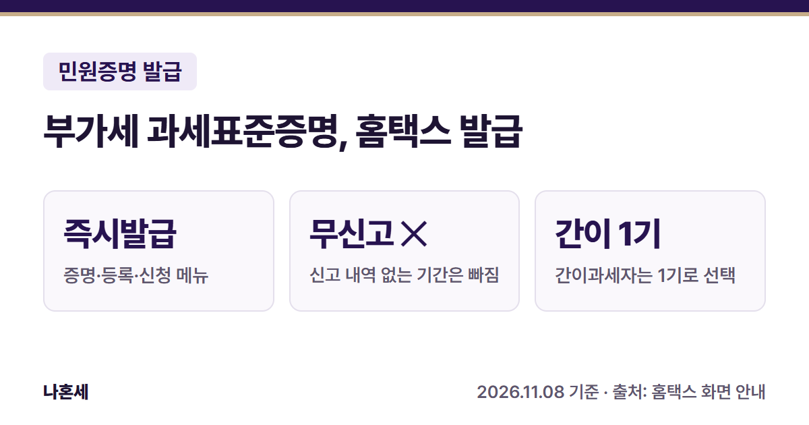
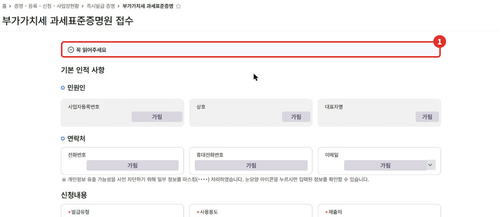
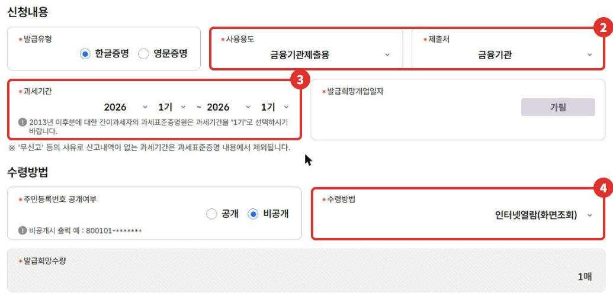
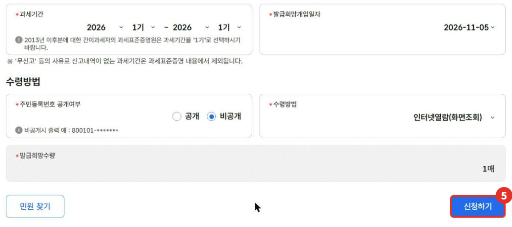

은행 대출이나 입찰, 거래처 등록 때 **부가세 과세표준증명**을 내 달라는 경우가 있어요. 부가세 신고 때 적은 과세표준(매출 규모)을 증명하는 서류라서, 홈택스에서 바로 신청할 수 있어요. 이 글은 운영자가 2026년 11월에 본인 사업자 계정으로 신청 화면을 확인한 내용을 정리했어요.

{: .summary-card}

> 💡 **핵심 요약**
> - 메뉴: 홈택스 > 증명·등록·신청·사업장현황 > 즉시발급 증명 > **부가가치세 과세표준증명** (2026년 11월 기준 화면) [1]
> - **'무신고' 등으로 신고 내역이 없는 과세기간은 증명 내용에서 빠져요**{: .red} [1]
> - 세무서 담당자의 결정이 끝나지 않은 **기한후신고서는 반영되지 않아요**(2018.6.15. 이후 출력분부터) [1]

목차

* 목차
{:toc}

## 한눈에 보기

| 항목 | 내용 |
|---|---|
| 누가 | 부가세를 신고한 사업자(일반·간이) |
| 무엇을 | 과세기간별 부가세 신고 과세표준 증명 |
| 메뉴 | 증명·등록·신청·사업장현황 > 즉시발급 증명 > 부가가치세 과세표준증명 [1] |
| 고를 것 | 발급유형, 사용용도, 제출처, 과세기간, 개업일자, 주민번호 공개 여부, 수령방법, 수량 [1] |
| 받는 방법 | 인터넷발급(프린터출력) 또는 인터넷열람(화면조회) [1] |

## 부가세 과세표준증명이 뭐예요?

부가세를 신고하면 과세기간마다 **과세표준**(부가세를 매기는 기준 금액. 일반과세자는 부가세를 뺀 공급가액, 간이과세자는 부가세를 포함한 공급대가 합계) [2]이 남아요. 이 증명은 그 신고 내용을 기간별로 보여 줘서, 은행·관공서가 사업 매출 규모를 확인할 때 많이 써요.

그래서 **신고한 적이 있어야 내용이 나와요.** 화면에도 신고 내역이 없는 과세기간은 증명 내용에서 빠진다고 안내돼요 [1]. 운영자는 2026년 11월에 개업해서 아직 부가세를 신고한 적이 없어서, 이 글에는 발급된 증명서 견본 대신 신청 화면만 실었어요.

## 홈택스로 신청하는 순서

> 📅 **2026년 11월 기준 화면**이에요(운영자 본인 사업자 계정). 개인정보는 가렸어요.

1. 홈택스에 로그인해요. 운영자는 **사업자로 로그인**했어요. 전체메뉴 > 증명·등록·신청·사업장현황 > 즉시발급 증명 > **부가가치세 과세표준증명**을 눌러요.
2. **부가가치세 과세표준증명원 접수** 화면이 열려요. 사업자등록번호·상호·대표자명과 연락처는 미리 채워져 있어요. ① **꼭 읽어주세요**를 펼쳐 안내를 먼저 봐요.

   

   꼭 읽어주세요에는 이렇게 적혀 있어요 [1].
   - 2018.6.15.부터 출력되는 증명원은 관할 세무서 담당자의 결정이 완료되지 않은 **기한후신고서를 반영하지 않아요**.
   - 과표와 세액에 차이가 있으면 관할 세무서 담당자에게 문의하라고 해요.

3. ② **사용용도·제출처**, ③ **과세기간**을 골라요. 과세기간은 시작 연도·기수와 끝 연도·기수를 골라요(일반과세자는 1기 = 1~6월, 2기 = 7~12월이고, 간이과세자는 1~12월이 한 과세기간이에요 [2]). **간이과세자는 2013년 이후분은 과세기간을 "1기"로 고르라고 안내돼요**{: .red} [1]. 개업일자는 목록에서 골라요.
4. ④ **수령방법**을 골라요. 이 화면에서는 인터넷발급(프린터출력)과 인터넷열람(화면조회) 두 가지였어요 [1].

   

5. 다 골랐으면 ⑤ **신청하기**를 눌러요. 같은 즉시발급 증명인 [사업자등록증명]()은 신청 뒤 민원신청 처리결과 조회에서 열람·출력했어요. 이 증명은 운영자가 신청 버튼까지 누르지 않았으니, 신청 뒤 화면 안내를 따르세요.

   

## 신청서에서 고르는 항목

| 항목 | 고를 수 있는 것(2026년 11월 화면) |
|---|---|
| 발급유형 | 한글증명, 영문증명 [1] |
| 사용용도 | 입찰·계약용, 수금용, 관공서제출용, 대출용, 여권또는비자신청용, 건강보험·국민연금공단제출용, 금융기관제출용, 신용카드발급용, 기타 [1] |
| 제출처 | 금융기관, 관공서, 조합/협회, 거래처, 학교, 외교부/재외공관/재외동포청, 기타 [1] |
| 과세기간 | 연도와 1기·2기(간이과세자는 1기) [1] |
| 주민번호 공개 | 공개, 비공개(비공개면 뒷자리가 *로 나와요) [1] |
| 수령방법 | 인터넷발급(프린터출력), 인터넷열람(화면조회) [1] |
| 발급희망수량 | 1~9매 [1] |

열람(화면조회)으로 받은 증명은 제출용으로 인정되지 않을 수 있어요. 같은 메뉴의 사업자등록증명은 열람용에 "법적인 효력이 없습니다"라고 찍혀 나왔어요([사업자등록증명 글]()). 제출할 서류라면 어떤 형식으로 내야 하는지 제출처에 먼저 확인하세요.

## 자주 하는 실수

- **기한 후에 신고한 기간이 안 나와요**: 세무서 결정이 끝나기 전 기한후신고는 반영되지 않아요 [1]. 관할 세무서에 처리 상황을 물어보세요.
- **간이과세자인데 2기를 골랐어요**: 간이과세자는 1기로 고르라고 안내돼요 [1].
- **신고를 안 한 기간을 넣었어요**: 무신고 기간은 증명 내용에서 빠져요 [1].

## 직접 발급이 어려울 수 있는 경우

- 과표·세액이 실제 신고와 다르게 나올 때(화면 안내대로 관할 세무서 담당자에게 문의 [1])
- 제출처가 영문이나 특정 기간 형식을 따로 요구할 때

헷갈리면 **국세상담센터(126)**나 가까운 세무서 민원실에 먼저 물어보세요.

## 자주 묻는 질문

**Q. 개업한 지 얼마 안 됐는데 발급되나요?**
A. 신청은 할 수 있지만, 신고 내역이 없는 과세기간은 증명 내용에서 빠져요 [1]. 첫 부가세 신고를 한 뒤에 발급하는 게 맞아요.

**Q. 매출을 증명하는 다른 서류는 없나요?**
A. 종합소득세 신고 소득을 증명하려면 [소득금액증명]()을 써요. 제출처가 어떤 서류를 원하는지 먼저 확인하세요.

**Q. 영문으로도 되나요?**
A. 네. 발급유형에서 **영문증명**을 고를 수 있어요 [1].

## 함께 보면 좋은 글

- [홈택스 사업자등록증명 발급 방법]()
- [홈택스 소득금액증명 발급 방법]()
- [1월 부가세 신고 전 체크리스트]()

## 출처

1. [홈택스](https://hometax.go.kr) > 증명·등록·신청·사업장현황 > 즉시발급 증명 > 부가가치세 과세표준증명원 접수 화면의 안내·선택 목록 (운영자 직접 확인: 2026-11-08)
2. 법령: 부가가치세법 제5조①(과세기간), 제29조(과세표준), 제63조①(간이과세자 과세표준) (확인일: 2026-11-08)

> 이 글은 2026년 11월 8일 기준의 일반적인 안내입니다. 홈택스 화면은 바뀔 수 있으니 발급 전 국세청 안내를 꼭 확인하세요. 개별 상황은 국세상담센터(126)에 문의하세요.
