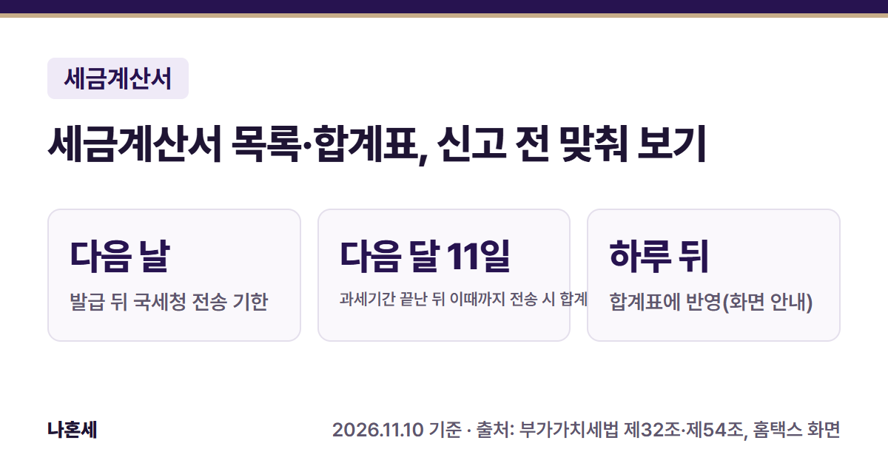
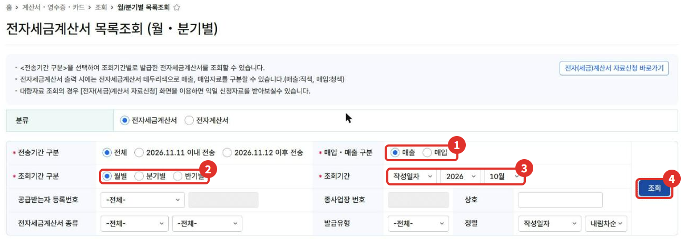
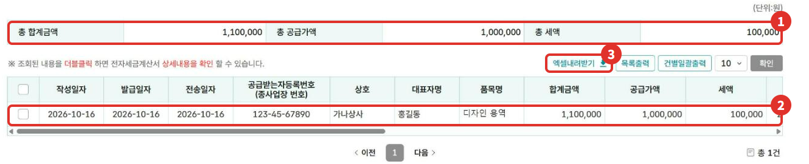
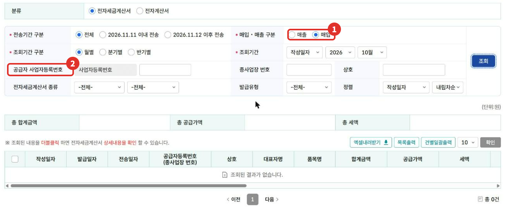
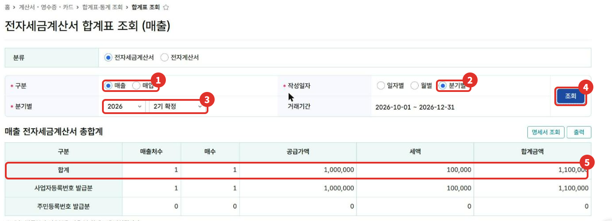

부가세 신고 전에는 내가 발급한 세금계산서(매출)와 받은 세금계산서(매입)가 빠짐없이 들어왔는지 먼저 확인해야 해요. 이 글은 홈택스 **전자세금계산서 목록조회**와 **합계표 조회**에서 건별 목록과 분기 합계를 보는 순서를 2026년 11월 화면으로 정리했어요.

{: .summary-card}

> 💡 **핵심 요약**
> - 건별 목록: 홈택스 > 계산서·영수증·카드 > 조회 > **월/분기별 목록조회**, 분기 합계: 합계표·통계 조회 > **합계표 조회** (2026년 11월 기준 화면)
> - 전자세금계산서는 **발급일 다음 날까지** 국세청에 전송해야 해요 [3][4]. 이 글의 계정 화면에서는 홈택스로 발급한 건의 발급일자와 전송일자가 같은 날로 표시됐어요
> - **오늘 발급·전송한 건은 다음 날 합계표에 반영돼요. 신고 직전에 발급했다면 하루 뒤 다시 확인하세요**{: .red} [2]

목차

* 목차
{:toc}

## 한눈에 보기

| 항목 | 내용 |
|---|---|
| 누가 | 전자세금계산서를 발급했거나 받은 사업자 |
| 언제 | 부가세 신고 전, 거래처와 금액을 맞춰 볼 때 |
| 건별 목록 | 계산서·영수증·카드 > 조회 > 월/분기별 목록조회 |
| 분기 합계 | 계산서·영수증·카드 > 합계표·통계 조회 > 합계표 조회 |

## 왜 신고 전에 확인하나요?

부가세 신고 때는 세금계산서로 오간 매출·매입을 합계해서 적어요. 원래는 신고서와 함께 **매출·매입처별 세금계산서합계표**를 내야 해요 [5].

다만 전자세금계산서를 발급하거나 받고, 그 발급명세가 **과세기간(예정신고는 예정신고기간) 마지막 날의 다음 달 11일까지** 국세청에 전송됐다면 합계표를 따로 내지 않을 수 있어요 [5]. 그래서 신고 전에는 "홈택스에 다 들어와 있나"를 목록과 합계표로 확인하는 게 중요해요.

## 1단계: 월/분기별 목록조회로 건별 확인

> 📅 **2026년 11월 기준 화면**이에요(운영자 가족 사업자 계정, 거래처·금액은 가상값으로 바꿈). 메뉴 이름은 바뀔 수 있어요.

1. 홈택스에 **사업자로 로그인**하고 **계산서·영수증·카드 > 조회 > 월/분기별 목록조회**로 들어가요.
2. 위쪽 분류는 **전자세금계산서**를 그대로 두고, ① **매입·매출 구분**에서 매출을 골라요.
3. ② **조회기간 구분**(월별·분기별·반기별)과 ③ **조회기간**(작성일자, 연도, 월)을 고른 뒤 ④ **조회**를 눌러요.

   

4. ① **총 합계금액·총 공급가액·총 세액**과 ② 아래 건별 목록(작성일자·공급받는자·품목·금액)이 나와요. 목록을 **더블클릭하면 세금계산서 상세내용**을 볼 수 있어요 [1].
5. 거래처와 맞춰 보려면 ③ **엑셀내려받기**로 목록을 저장할 수 있어요.

   

6. 받은 세금계산서는 같은 화면에서 ① **매입**으로 바꿔 조회해요. 그러면 검색칸이 ② **공급자 사업자등록번호**로 바뀌어요. 이 계정은 10월에 받은 전자세금계산서가 없어 "조회된 결과가 없습니다"로 나왔어요.

   

화면 안내에 따르면 출력할 때 테두리 색으로 **매출은 빨간색, 매입은 파란색**으로 구분되고, 자료가 많으면 **전자(세금)계산서 자료신청**으로 다음 날 받아 볼 수 있어요 [1].

## 2단계: 합계표 조회로 분기 합계 확인

신고는 과세기간 단위로 하니, 건별로 본 뒤 분기 합계도 맞춰 봐요.

1. **계산서·영수증·카드 > 합계표·통계 조회 > 합계표 조회**로 들어가요.
2. ① **구분**(매출·매입)을 고르고, ② 작성일자에서 **분기별**을 골라요.
3. ③ 연도와 신고 구분(예: 2026년 2기 확정)을 고르면 거래기간(2026-10-01 ~ 2026-12-31)이 자동으로 채워져요. ④ **조회**를 눌러요.
4. ⑤ **합계** 줄에 매출처 수, 매수, 공급가액, 세액, 합계금액이 나와요. 아래에는 사업자등록번호 발급분과 주민등록번호 발급분이 나뉘어 보여요.

   

- **오늘 발급분과 전송분은 다음 날 합계표에 반영**된다고 화면에 적혀 있어요 [2]. 방금 발급한 건이 안 보이면 하루 뒤 다시 조회하세요.
- **예정고지를 받은 개인사업자는 1월 확정신고 때 7~12월 6개월치를 함께 신고해요. 2기 예정(7~9월)과 2기 확정(10~12월)을 둘 다 조회하거나, 목록조회에서 반기별로 확인하세요**{: .red} [5][6].
- 10~12월분은 아직 진행 중이라, 12월까지 발급한 뒤 1월 신고 전에 다시 조회해야 해요.
- 간이과세자는 과세기간이 1년(1~12월)이라 1년치를 확인해요.

## 이렇게 맞춰 보세요 (가상의 예시)

아래는 2026년 10~12월에 세금계산서 3장을 발급했다고 가정한 **가상의 예시**예요.

| 확인할 것 | 내 장부(가상) | 홈택스 합계표(가상) |
|---|---|---|
| 매수 | 3장 | 2장 |
| 공급가액 | 3,000,000원 | 2,000,000원 |
| 세액 | 300,000원 | 200,000원 |

이처럼 1장이 비면 목록조회에서 어느 거래가 빠졌는지 찾아요. **어제나 오늘 발급한 건**이면 다음 날 다시 보고, 그래도 없으면 발급을 끝까지 마쳤는지 확인해요. 금액이 틀린 건은 [수정세금계산서]()로 바로잡아요.

## 자주 하는 실수

- **매출만 보고 매입은 안 보기**: 같은 화면에서 매입으로 바꿔 받은 세금계산서도 확인해요 [1].
- **분류를 그대로 둔 채 면세 계산서를 찾기**: 화면 위쪽 분류에 전자세금계산서와 **전자계산서**(면세)가 나뉘어 있어요. 면세 거래는 전자계산서를 골라 따로 조회해요.
- **조회 기준을 헷갈리기**: 목록조회 기간은 기본이 **작성일자** 기준이에요 [1]. 월합계 세금계산서처럼 공급일이 속하는 달의 다음 달 10일까지 발급할 수 있는 경우가 있어서 [7], 작성일자는 10월인데 발급·전송은 11월일 수 있어요.
- **종이 세금계산서도 여기 나온다고 생각하기**: 이 메뉴는 전자세금계산서 목록이에요. 종이로 주고받은 세금계산서는 직접 모아 합계해야 해요.
- **과세기간이 끝난 다음 달 11일까지 국세청에 전송되지 않은 전자세금계산서가 있으면 합계표를 따로 내야 할 수 있어요**{: .red} [5]. 홈택스로 발급했는데 상태가 이상하면 126에 물어보세요.

## 직접 하기 어려울 수 있는 경우

- 거래처가 많아 매출·매입이 수백 건이고, 장부와 홈택스 합계가 자주 어긋날 때
- 종이 세금계산서, 수입세금계산서 등 홈택스 목록에 없는 자료가 섞여 있을 때
- 이미 신고한 기간에서 빠진 세금계산서를 찾았을 때(수정신고·경정청구가 필요할 수 있어요)

확실하지 않으면 **국세상담센터(126)**나 홈택스 상담으로 먼저 확인하세요.

## 자주 묻는 질문

**Q. 거래처가 보냈다는 세금계산서가 매입 목록에 없어요.**
A. 먼저 조회기간·매입 구분·분류(전자세금계산서/전자계산서)를 확인해요. 전자세금계산서는 발급일 다음 날까지 국세청에 전송하게 돼 있으니 [3][4], 방금 발급된 건이면 하루 뒤 다시 보고, 그래도 없으면 거래처에 발급이 끝났는지 물어보세요.

**Q. 목록조회와 합계표 금액이 달라요.**
A. 기간 기준이 같은지(월별·분기별, 작성일자) 먼저 봐요. 합계표에는 오늘 발급·전송분이 다음 날 반영돼요 [2].

**Q. 신고할 때 합계표를 꼭 내야 하나요?**
A. 원칙은 신고 때 함께 내는 거예요 [5]. 다만 전자세금계산서를 발급하거나 받고 발급명세가 과세기간 마지막 날의 다음 달 11일까지 전송됐다면 내지 않을 수 있어요 [5].

## 함께 보면 좋은 글

- [홈택스 전자세금계산서 발급 방법: 건별발급 순서]()
- [홈택스 세금계산서 수정발급 방법]()
- [1월 부가세 신고 전 체크리스트]()

## 출처

1. 홈택스 전자세금계산서 목록조회(월·분기별) 화면 안내 문구 (운영자 직접 확인: 2026-11-10)
2. 홈택스 전자세금계산서 합계표 조회 화면 안내 문구 (운영자 직접 확인: 2026-11-10)
3. 법령: 부가가치세법 제32조 ②·③ (2026.1.2. 시행)
4. 법령: 부가가치세법 시행령 제68조 ⑦ (2026.4.1. 시행)
5. 법령: 부가가치세법 제54조 ①·② (2026.1.2. 시행)
6. 법령: 부가가치세법 제48조 ③ (개인사업자 예정고지) (2026.1.2. 시행)
7. 법령: 부가가치세법 제34조 ③ (월합계 등 다음 달 10일까지 발급) (2026.1.2. 시행)

> 이 글은 2026년 11월 10일 기준의 일반적인 안내입니다. 세법과 홈택스 화면은 바뀔 수 있으니 신고 전 국세청 안내를 꼭 확인하세요. 개별 상황은 국세상담센터(126)에 문의하세요.
