연말정산 때 부양가족이나 의료비·기부금 같은 공제를 빠뜨렸다면, 지난 일이라도 **경정청구**로 더 낸 세금을 돌려받을 수 있어요. 직장을 다니다 창업한 사장님이라면 직장인 시절 연말정산도 다시 볼 만해요. 이 글은 운영자가 2026년 11월에 본인 개인 계정으로 홈택스 화면을 제출 직전까지 따라가 본 순서를 정리했어요(제출 버튼은 누르지 않았어요).

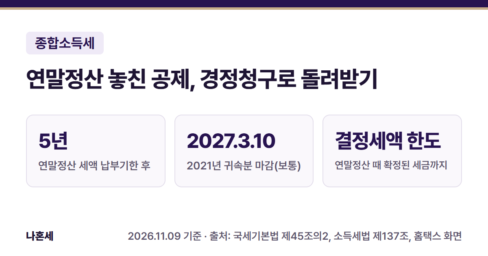{: .summary-card}

> 💡 **핵심 요약**
> - 기한: 연말정산 세액의 **납부기한이 지난 후 5년 이내** [1]. 보통 납부기한이 다음 해 3월 10일이라 **2021년 귀속분은 2027년 3월 10일까지**예요 [1][2]
> - 메뉴: 홈택스 > 세금신고 > 근로소득 신고 > **경정청구** (2026년 11월 기준 화면) [6]
> - 돌려받는 돈은 **연말정산 때 확정된 세금(결정세액)이 한도**예요. 공제를 더해도 세금이 줄지 않으면 신청 자체가 안 돼요 [1][6]

목차

* 목차
{:toc}

## 한눈에 보기

| 항목 | 내용 |
|---|---|
| 대상 | 회사에서 연말정산을 받았는데 공제를 빠뜨린 근로자 |
| 기한 | 연말정산 세액 납부기한 후 **5년** [1] |
| 할 것 | 빠진 공제를 넣어 경정청구서 제출 + 증빙 서류 |
| 메뉴 | 세금신고 > 근로소득 신고 > 경정청구 |
| 결과 | 세무서가 청구일부터 **2개월** 안에 알려 줌 [1] |

## 누가 할 수 있나요?

- 회사가 연말정산을 하고 지급명세서를 기한까지 낸 근로자예요 [1]. 회사가 낸 지급명세서를 홈택스가 불러와서 처음 금액을 미리 채워 줘요 [6].
- **그해 5월에 종합소득세 신고를 따로 했다면 이 메뉴로는 안 돼요.** 운영자가 신고 이력이 있는 해(2025·2024년)를 고르자 "모두채움 신고/단순경비율 신고 또는 일반신고 메뉴의 경정청구를 이용하라"는 안내가 떴어요 [6].

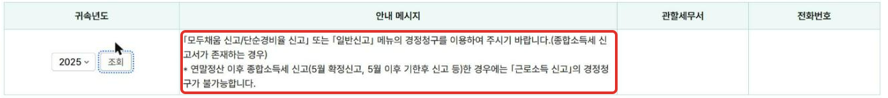

- 사업소득이 생긴 해(창업한 해)는 보통 다음 해 5월에 종합소득세를 신고하게 되니 [10], 그해 공제는 이 메뉴가 아니라 종합소득세 신고나 그 경정청구로 챙겨요.

## 언제까지 하나요?

근로자의 경정청구 기한은 **"연말정산세액의 납부기한이 지난 후 5년 이내"**예요 [1]. 회사는 다음 해 2월 급여를 줄 때 연말정산을 하고 [2], 그 세금을 다음 달 10일까지 내요 [3]. 그래서 보통 기한은 아래와 같아요.

| 귀속 연도 | 납부기한(보통) | 경정청구 마감 |
|---|---|---|
| 2021년 | 2022.3.10 | **2027.3.10** |
| 2022년 | 2023.3.10 | 2028.3.10 |
| 2023년 | 2024.3.11 | 2029.3.12(3.11이 일요일) |
| 2024년 | 2025.3.10 | 2030.3.11(3.10이 일요일) |
| 2025년 | 2026.3.10 | 2031.3.10 |

- **2021년 귀속분은 2027년 3월 10일이 마지막이에요.**{: .red} 운영자 화면에서도 고를 수 있는 연도가 2025~2021년이었어요 [6].
- 2024년 3월 10일은 일요일이라 다음 날로 미뤄져요 [7]. 운영자의 2023년 귀속 경정청구서에도 법정신고일이 **2024-03-11**로 나왔어요 [6]. 마감일이 토요일·일요일·공휴일이면 그다음 날까지 할 수 있어요 [7].
- 회사가 원천세를 반기마다 내는 곳이면 납부기한이 7월 10일이라 마감도 그만큼 늦어요 [3]. 중간에 퇴사해서 퇴사할 때 연말정산을 받았다면 퇴사한 달의 다음 달 10일이 기준이에요 [2][3]. 헷갈리면 회사나 126에 확인하세요.

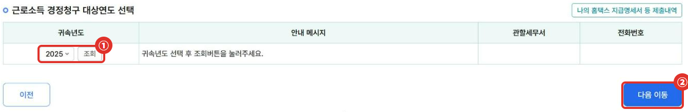

## 홈택스로 경정청구하는 순서

2026년 11월 기준 화면이에요. 개인 로그인(간편인증·인증서)으로 들어가요.

1. ① **세금신고** → 종합소득세 신고의 ② **근로소득 신고** → ③ **경정청구**를 눌러요 [6].

   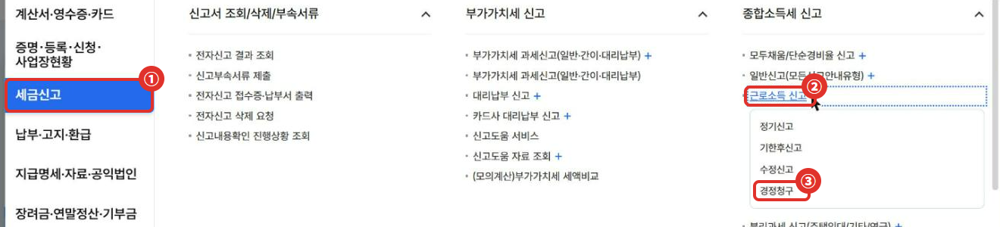

   화면 위에 ① 경정청구 흐름(대상연도 선택 → 원천징수영수증 조회 → 기본정보 입력 → 공제항목 수정 → 제출)이 나와요.

   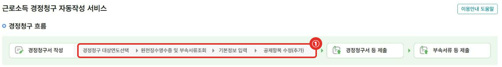

2. ① 귀속년도를 고르고 **조회** → "다음 이동을 눌러 주세요"가 뜨면 ② **다음 이동**을 눌러요.
3. **원천징수영수증 및 부속서류 조회**: 회사가 낸 공제 내역이 나와요. ① 소득·세액공제, 연금·저축, 월세, 의료비, 기부금 탭에서 **무엇이 빠졌는지** 먼저 확인해요.

   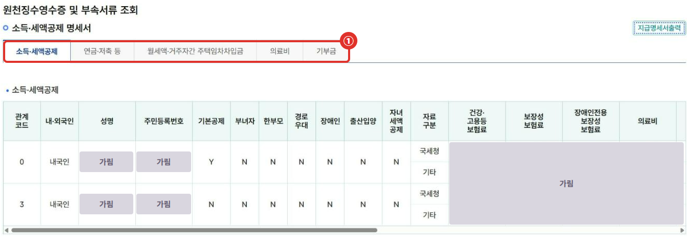

4. **기본정보 입력**: 주민등록번호 옆 ① **조회**를 누르면 주소·연락처가 채워져요. 확인하고 ② **저장 후 다음 이동**.

   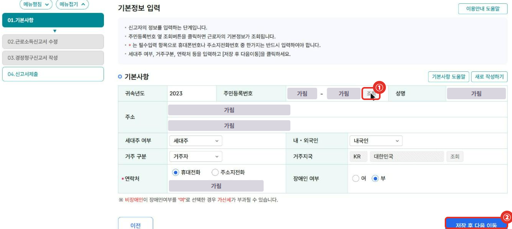

5. **근로소득신고서 수정**: 빠진 공제를 여기서 넣어요. 부양가족을 빠뜨렸다면 인적공제의 ① **입력/수정하기**를 눌러요. 운영자는 화면 확인용으로 배우자를 넣어 봤고, ② 배우자 공제 150만원이 들어갔어요 [4].

   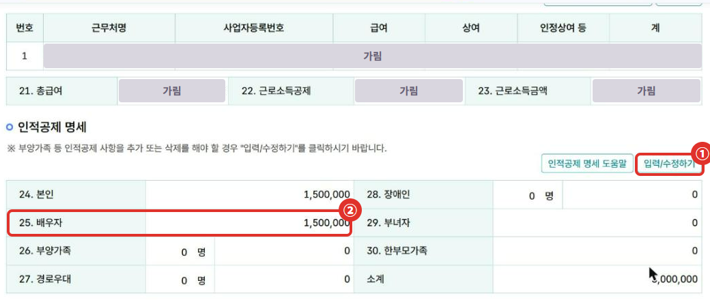

   새 창에서 ① **추가입력** → 주민등록번호·관계·공제 항목을 넣고 ② **등록하기** → ③ **적용하기**를 눌러요.

   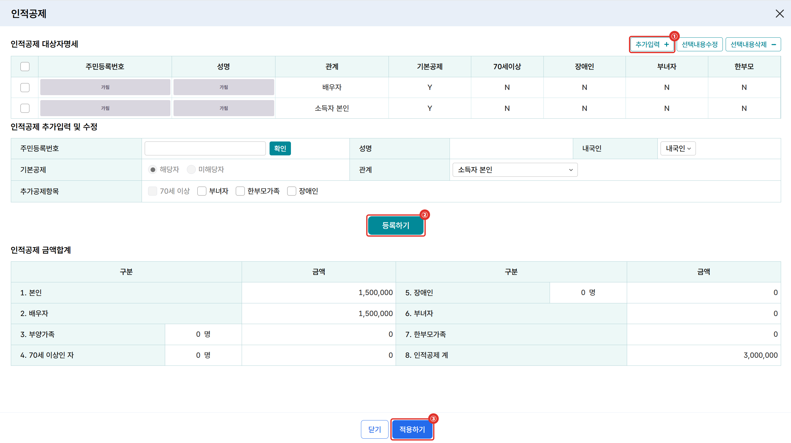

   의료비·기부금처럼 계산이 필요한 항목은 옆의 **계산기** 버튼으로 넣어요(① 의료비, ② 기부금).

   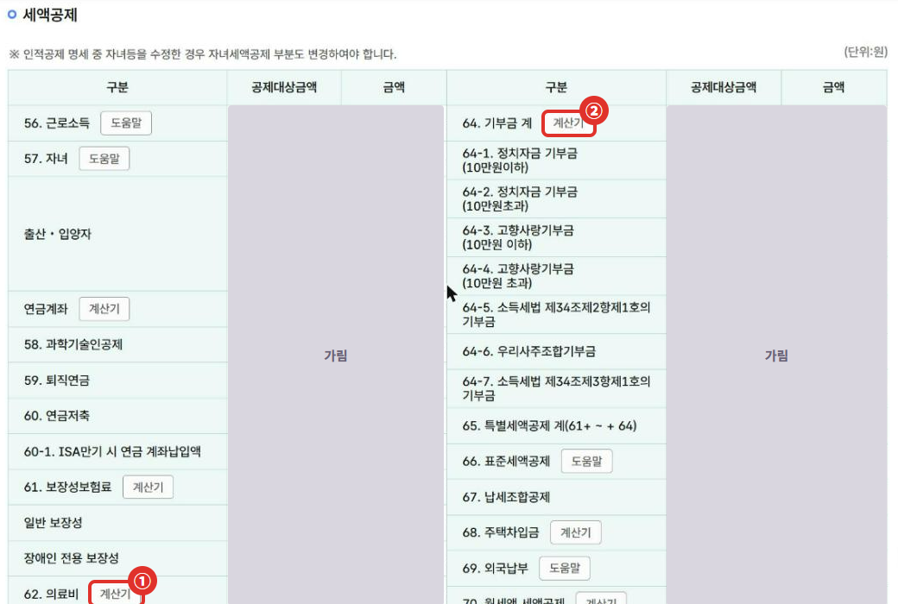

6. 아래로 내려 ① **차감납부할 세액**이 마이너스(환급)로 바뀌었는지 보고, ② **환급받을 계좌**(본인 명의 자유입출금 계좌)를 넣은 뒤 ③ **신고서 작성완료**를 눌러요. 가상계좌·외국계 은행 계좌로는 환급금이 지급되지 않는다고 안내돼요 [6].

   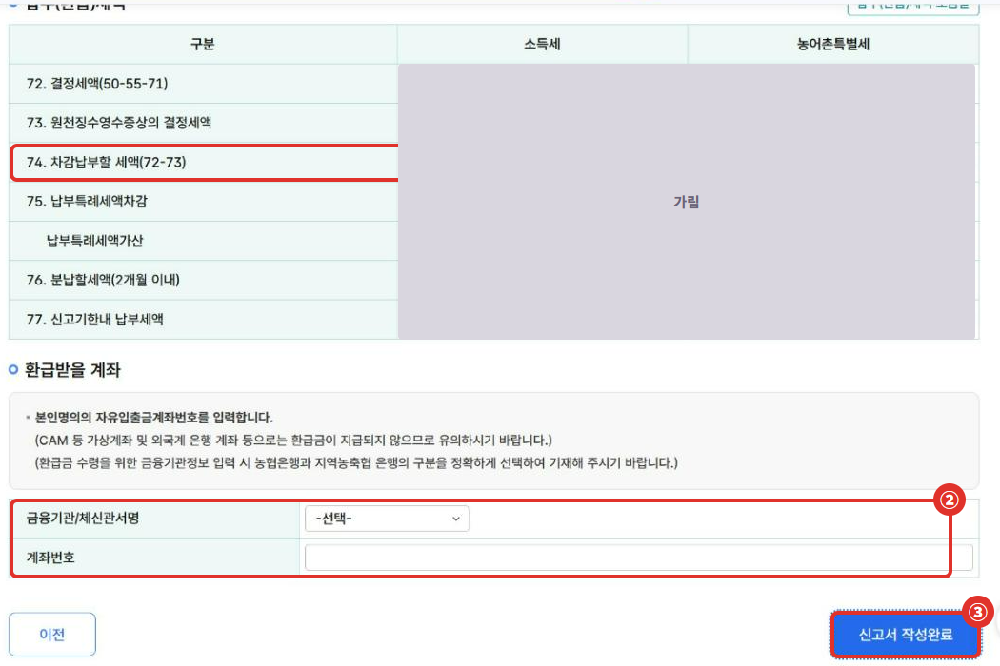

7. **경정청구신고서 작성**: ① 결정(경정)청구이유를 목록에서 골라요(예: 소득공제 - 인적공제_기본공제_배우자공제). 처음 신고와 경정청구 금액이 나란히 보여요. **신고서 작성완료**를 누르면 "경정청구로 인한 예상 환급세액은 ○원(지방소득세 제외)" 알림이 떠요. 원 단위는 잘라서 환급되고, 최종 금액은 세무서가 검토해서 정해요 [6].

   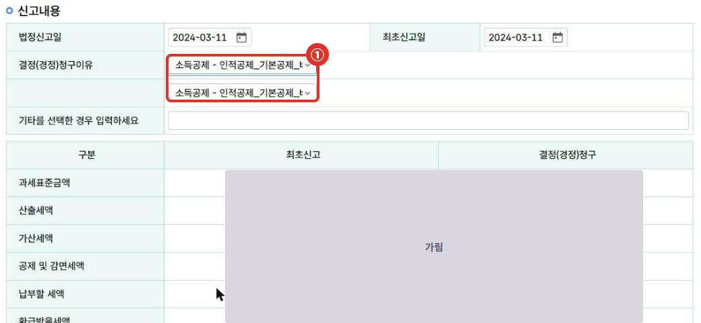

8. **신고서 오류내역 조회**: ① 오류가 있으면 제출할 수 없어요(운영자는 청구이유를 비워서 오류가 났어요). ② 경고는 제출은 되지만 다시 확인하라는 뜻이에요. 운영자 화면에는 "입력하신 부양가족 중 소득금액을 초과한" 사람이 있다는 경고가 떴어요 [6].

   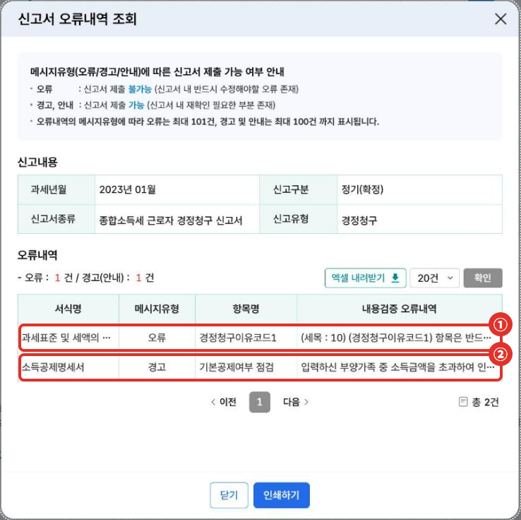

9. **신고서 제출**: 마지막 화면에서 ① **신고서 제출하기**를 누르면 접수돼요. 운영자는 여기서 멈췄어요. 공제 증빙(간소화 자료, 영수증 등)은 **신고 부속·증빙서류 제출** 탭으로 내요 [5][6].

   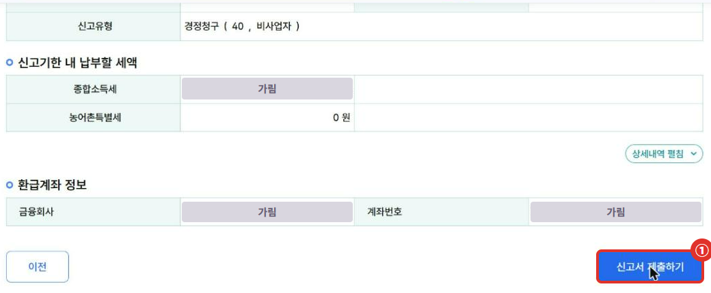

## 얼마나 돌려받나요? (가상의 예시)

공제를 더하면 **과세표준**(세율을 곱하는 금액)이 줄고, 그만큼 세금이 줄어요. 다만 돌려받는 돈은 **연말정산 때 확정된 세금(결정세액)이 한도**예요. 홈택스 화면도 "차감납부할 세액 = 새 결정세액 − 원천징수영수증상의 결정세액"으로 계산해요 [1][6].

| 단계 | 예시 A | 예시 B |
|---|---|---|
| 빠뜨린 공제 | 배우자 기본공제 150만원 | 배우자 기본공제 150만원 |
| 과세표준(처음) | 3,000만원 | 3,000만원 |
| 세율 구간 | 15% 구간(1,400만원 초과 5,000만원 이하, 2022년 귀속까지는 1,200만원 초과 4,600만원 이하) [8] | 같음 |
| 줄어드는 산출세액 | 150만원 × 15% = **225,000원** | 225,000원 |
| 처음 결정세액 | 1,200,000원 | 50,000원 |
| 돌려받는 소득세 | **225,000원** | **50,000원**(낸 세금이 한도) |

- 둘 다 가상의 예시예요. 과세표준 3,000만원은 2022년 귀속까지의 세율표로도 15% 구간이라 결과가 같아요 [8]. 실제로는 다른 공제·세액공제가 함께 바뀔 수 있어서 홈택스가 계산한 금액이 정확해요.
- 공제를 더해도 세금이 그대로면 홈택스가 막아요. 운영자가 아무것도 고치지 않고 작성완료를 눌렀더니 "경정신고세액이 당초세액과 동일하거나 증가하는 경우 경정청구 대상이 아닙니다"라는 알림이 떴어요 [6].

## 자주 하는 실수

- **부양가족 소득을 확인하지 않음**: 배우자·부양가족은 그해 소득금액이 100만원 이하(근로소득만 있으면 총급여 500만원 이하)여야 기본공제를 받아요 [4]. **요건이 안 되는 사람을 넣으면 나중에 세금과 가산세를 다시 낼 수 있어요.**{: .red} [9] 홈택스가 경고를 띄우면 꼭 다시 확인하세요.
- **가족끼리 중복 공제**: 한 사람은 한 명의 공제 대상만 될 수 있어요 [4]. 형제자매가 부모님을 이미 공제받았는지 확인하세요.
- **5월에 종합소득세를 신고한 해를 이 메뉴로 하려 함**: 그해는 종합소득세 신고 쪽 경정청구를 써요 [6].
- **증빙 없이 제출**: 경정청구 내용이 사실과 다르면 환급세액이 달라질 수 있어요 [6]. 간소화 자료나 영수증을 함께 내요 [5].

## 직접 신고가 어려울 수 있는 경우

- 여러 회사를 옮겨 다녀 지급명세서가 여러 장이거나, 회사가 낸 지급명세서 자체가 틀린 경우(회사에 먼저 확인이 필요해요) [6]
- 그해 사업소득·연금소득 등 다른 소득이 함께 있는 경우
- 공제 요건(부양가족 소득, 동거 여부 등)이 애매한 경우

이럴 때는 국세상담센터(126)나 세무서에 먼저 물어보고, 필요하면 세무대리인과 상의하세요.

## 자주 묻는 질문

**Q. 회사에 다시 연말정산을 해 달라고 해야 하나요?**
A. 아니요. 근로자 본인이 홈택스에서 직접 경정청구할 수 있어요 [1].

**Q. 언제 돈이 들어오나요?**
A. 세무서는 청구를 받은 날부터 2개월 안에 결과를 알려 줘야 해요 [1]. 결정이 늦어지면 진행 상황을 알려 줘요 [1].

**Q. 지방소득세도 돌려받나요?**
A. 홈택스 예상 환급세액 알림에는 "지방소득세 제외"라고 나와요 [6]. 지방소득세는 위택스나 지방자치단체에 따로 확인하세요.

**Q. 작성하다 그만두면 어떻게 되나요?**
A. 홈택스 안내로는 경정청구서는 당일에 한해 최종 수정 상태로 저장되고, 제출하기 전까지 고칠 수 있어요 [6].

## 함께 보면 좋은 글

- [홈택스 연말정산 미리보기]()
- [홈택스 소득금액증명 발급 방법]()

## 출처

1. 법령: 국세기본법 제45조의2(경정 등의 청구) ①·③·④·⑤ (2026.10.2. 시행)
2. 법령: 소득세법 제137조(근로소득세액의 연말정산) (2026.7.1. 시행)
3. 법령: 소득세법 제128조(원천징수세액의 납부) (2026.7.1. 시행)
4. 법령: 소득세법 제50조(기본공제) (2026.7.1. 시행)
5. [대한민국 정책브리핑 - 깜빡하고 연말정산 공제서류를 빼놓고 제출했다면?](https://www.korea.kr/news/cardnewsView.do?newsId=148858607) (게시일: 2019-02-22, 확인일: 2026-11-09)
6. 국세청 홈택스 화면 - 세금신고 > 근로소득 신고 > 경정청구, 2026년 11월 운영자 직접 확인
7. 법령: 국세기본법 제5조(기한의 특례)
8. 법령: 소득세법 제55조(세율) (2023.1.1. 이후 귀속 / 2021.7.1.~2022.12.31. 시행판)
9. 법령: 국세기본법 제47조의3(과소신고·초과환급신고 가산세), 제47조의4(납부지연가산세)
10. 법령: 소득세법 제70조(종합소득과세표준 확정신고)

> 이 글은 2026년 11월 9일 기준의 일반적인 안내입니다. 세법과 홈택스 화면은 바뀔 수 있으니 신청 전 국세청 안내를 꼭 확인하세요. 개별 상황은 국세상담센터(126)에 문의하세요.
