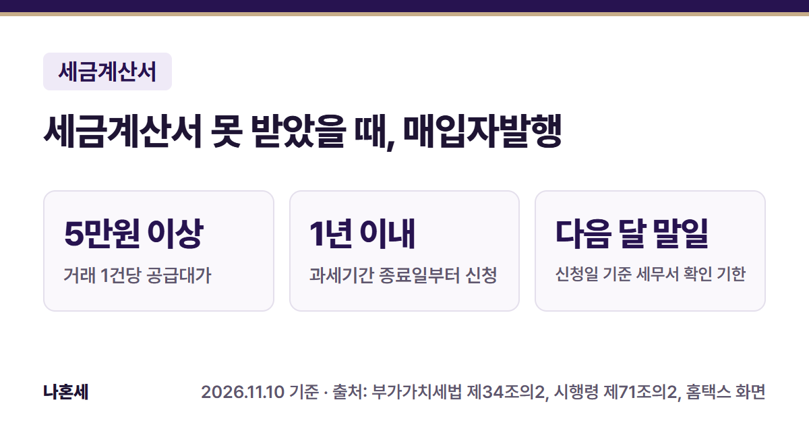
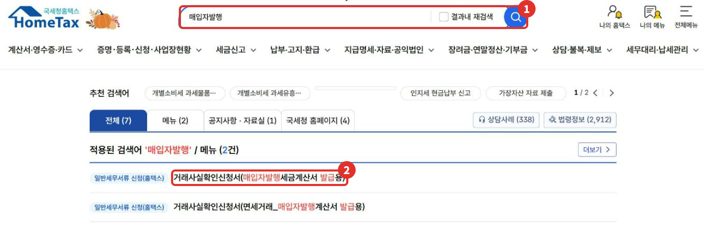
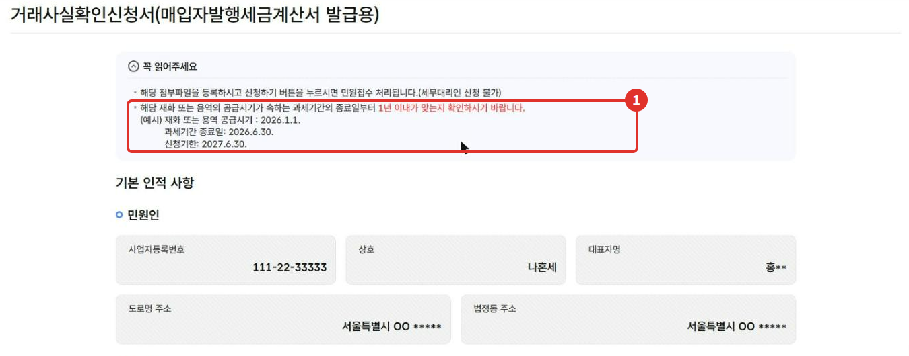
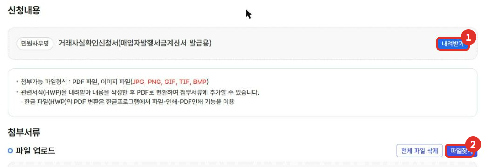

물건이나 서비스를 사고 돈도 냈는데 거래처가 세금계산서를 끝내 발급해 주지 않으면, 산 쪽(매입자)이 세무서 확인을 받아 직접 세금계산서를 발행할 수 있어요. 이것을 **매입자발행세금계산서**라고 해요 [1]. 이 글은 조건과 기한, 세무서 처리 순서, 홈택스 신청 화면(2026년 11월 기준)을 정리했어요.

{: .summary-card}

> 💡 **핵심 요약**
> - 거래 1건당 **공급대가(부가세 포함 금액) 5만원 이상**일 때 신청할 수 있어요 [2]
> - **공급시기가 속하는 과세기간의 종료일부터 1년 이내에 신청해야 해요. 넘긴 것이 명백하면 세무서가 확인을 거부해요**{: .red} [2]
> - 홈택스 검색창에 "매입자발행" → **거래사실확인신청서(매입자발행세금계산서 발급용)**에서 서류를 첨부해 신청해요 (2026년 11월 기준 화면) [3]

목차

* 목차
{:toc}

## 한눈에 보기

| 항목 | 내용 |
|---|---|
| 누가 | 세금계산서를 받지 못한 매입자(공급받은 자) [1] |
| 상대방 | 세금계산서를 발급해야 하는 사업자 [2] |
| 금액 | 거래 1건당 공급대가 5만원 이상 [2] |
| 기한 | 공급시기가 속하는 과세기간 종료일부터 1년 이내 [2] |
| 신청 | 홈택스 거래사실확인신청서(매입자발행세금계산서 발급용) [3] |

## 언제 쓸 수 있나요?

세금계산서를 발급해야 하는 사업자가 재화나 용역을 공급하고도 **발급 시기에 세금계산서를 발급하지 않은 경우**에 쓸 수 있어요 [1][2]. 아래 경우도 포함돼요.

| 경우 | 내용 |
|---|---|
| 처음부터 미발급 | 발급 시기에 세금계산서를 발급하지 않은 경우 [1] |
| 수정 미발급 | 부도·폐업, 계약 해제·변경 [1], 소재불명·연락두절, 휴업 등 국세청장이 인정하는 부득이한 사유 [2]가 생겼는데 수정세금계산서를 발급하지 않은 경우 |

**거래할 때 상대방이 미등록 사업자이거나 휴·폐업 상태였던 것이 신청서 내용으로 명백하면 세무서가 확인을 거부해요**{: .red} [2].

## 언제까지 신청하나요?

**공급시기가 속하는 과세기간의 종료일부터 1년 이내**예요 [2]. 홈택스 신청 화면에도 같은 기준과 예시가 나와 있어요 [3].

| 가상의 예시 | 날짜 |
|---|---|
| 공급시기(물건을 받은 날) | 2026년 10월 15일 |
| 그 날이 속하는 과세기간 | 2026년 2기(7.1.~12.31.) |
| 과세기간 종료일 | 2026년 12월 31일 |
| 신청 기한 | 2027년 12월 31일까지 |

화면 예시는 "공급시기 2026.1.1. → 과세기간 종료일 2026.6.30. → 신청기한 2027.6.30."이에요 [3]. 과세기간이 1년인 간이과세자처럼 상황이 다르면 126에 먼저 확인하세요.

## 얼마짜리 거래부터 되나요? (가상 예시)

신청 대상은 **거래 1건당 공급대가 5만원 이상**이에요 [2]. 공급대가는 공급가액에 부가세를 더한 금액이에요.

| 가상의 예시 | 공급대가 (공급가액 + 부가세) | 대상 |
|---|---|---|
| 사무용품 | 1,000,000원 + 100,000원 = **1,100,000원** | 예 |
| 소모품 | 40,000원 + 4,000원 = **44,000원** | 아니요 (5만원 미만) |

첫 번째 예시에서 거래사실이 확인되고 매입자발행세금계산서합계표를 내면, 일반과세자는 부가세 100,000원을 매입세액으로 공제받을 수 있어요 [1][2]. 다만 사업과 관계없는 지출이나 기업업무추진비처럼 원래 공제되지 않는 매입세액은 매입자발행으로도 공제되지 않아요 [5].

## 세무서는 어떻게 처리하나요?

신청부터 공제까지 시행령에 정해진 순서예요 [2].

1. **신청**: 매입자가 거래사실확인신청서에 거래를 객관적으로 입증할 수 있는 서류를 붙여 **매입자 관할 세무서**에 내요.
2. **보정 요구**: 거래처 인적사항이 부정확하거나 기재에 흠이 있으면 세무서가 신청일부터 7일 안에 보정을 요구할 수 있어요.
3. **송부**: 매입자 관할 세무서가 신청서를 낸 날(보정 요구가 있었으면 보정한 날)부터 7일 안에 신청서와 증빙을 **거래처 관할 세무서**로 보내요.
4. **확인**: 거래처 관할 세무서가 거래사실을 확인해 **신청일의 다음 달 말일까지** 거래처와 매입자 관할 세무서에 결과를 알리고, 매입자 관할 세무서가 바로 매입자에게 알려요. 부도·일시 부재 같은 사유가 있으면 20일 안에서 늘어날 수 있어요.
5. **발행**: 확인 통지를 받으면, 확인된 거래일자를 작성일자로 매입자발행세금계산서를 발행해 거래처에 줘요. 양쪽이 확인 통지를 받으면 준 것으로 봐요.
6. **공제**: 예정신고·확정신고 또는 경정청구 때 **매입자발행세금계산서합계표**를 내면 그 과세기간 매입세액으로 공제받을 수 있어요.

**거래가 있었다는 사실과 그 내용은 매입자가 입증해야 해요. 증빙이 부족하면 "거래사실 확인불가" 통지를 받을 수 있어요**{: .red} [2].

## 홈택스로 신청하는 순서

> 📅 **2026년 11월 기준 화면**이에요(운영자 본인 사업자 계정, 인적사항은 가상값으로 바꿈). 실제 신청하기 버튼은 누르지 않았어요.

1. 홈택스에 로그인하고 위쪽 ① **검색창에 "매입자발행"**을 넣어 검색해요.
2. 메뉴 결과에서 ② **거래사실확인신청서(매입자발행세금계산서 발급용)**를 눌러요. 2026년 11월 화면에서는 전체메뉴에 따로 보이지 않아 검색으로 찾았어요.

   

3. ① **꼭 읽어주세요**에서 신청 기한(과세기간 종료일부터 1년 이내)을 확인해요. 이 신청은 **세무대리인이 대신 할 수 없다**고 안내돼 있어요 [3]. 민원인 인적사항은 로그인한 사업자 정보로 채워져요.

   

4. 신청내용에서 ① **내려받기**로 서식(HWP)을 받아 작성한 뒤, 한글 프로그램의 PDF 인쇄로 PDF 파일을 만들어요 [3].
5. 첨부서류의 ② **파일찾기**로 작성한 신청서와 증빙(대금결제 증명자료는 필수 [4])을 올리고 **신청하기**를 눌러요. 첨부는 PDF와 이미지 파일(JPG·PNG·GIF·TIF·BMP)이 되고, 화면 기준 최대 10개·50MB예요 [3].

   

**신청서 서식에는 공급자가 발행한 영수증이나 무통장입금증 같은 대금결제 증명자료를 반드시 내도록 돼 있어요**{: .red}(필수). 그 밖의 거래사실 증명자료도 함께 낼 수 있어요 [4]. 어떤 자료면 충분한지 헷갈리면 신청 전에 관할 세무서나 126에 물어보세요.

## 자주 하는 실수

- **기한을 넘기기**: 과세기간 종료일부터 1년이 지나면 거부돼요 [2].
- **5만원 미만 거래를 신청하기**: 거래 1건당 공급대가 5만원 이상만 대상이에요 [2].
- **확인 통지만 받고 끝내기**: 공제를 받으려면 신고나 경정청구 때 매입자발행세금계산서합계표를 내야 해요 [2].
- **면세 거래를 이 메뉴로 신청하기**: 면세 거래용은 검색 결과의 **거래사실확인신청서(면세거래_매입자발행계산서 발급용)**가 따로 있어요 [3].

## 직접 하기 어려울 수 있는 경우

- 거래처가 연락두절이고 대금 지급 기록이 현금 위주라 거래를 입증하기 어려울 때
- 이미 신고한 과세기간의 매입세액을 경정청구로 고쳐야 할 때
- 여러 거래처, 여러 과세기간이 얽혀 있을 때

확실하지 않으면 **국세상담센터(126)**나 관할 세무서에 먼저 확인하세요.

## 자주 묻는 질문

**Q. 거래처 동의를 받아야 하나요?**
A. 조문에 거래처 동의를 받으라는 요건은 없어요. 대신 거래처 관할 세무서가 거래사실을 확인하고, 결과를 거래처에도 통지해요 [2].

**Q. 확인되면 언제 매입세액으로 공제되나요?**
A. 그 거래의 공급시기가 속하는 과세기간의 매입세액으로 공제받아요. 예정신고·확정신고나 경정청구 때 합계표를 함께 내요 [2].

**Q. 간이과세자도 신청할 수 있나요?**
A. 조문은 매입자발행세금계산서의 부가세액을 간이과세자의 세금계산서 등 수취 세액공제(제63조 ③) 대상으로도 보고 있어요 [1]. 다만 간이과세자는 매입세액 전액이 아니라 정해진 방식으로 공제되니, 금액은 126에 확인하세요.

## 함께 보면 좋은 글

- [홈택스 전자세금계산서 발급 방법: 건별발급 순서]()
- [홈택스 세금계산서 수정발급 방법]()
- [부가세 수정신고·경정청구·기한후신고 홈택스 방법]()

## 출처

1. 법령: 부가가치세법 제34조의2 (2026.1.2. 시행)
2. 법령: 부가가치세법 시행령 제71조의2 ①~⑬ (2026.4.1. 시행)
3. 홈택스 거래사실확인신청서(매입자발행세금계산서 발급용) 화면 안내 문구·검색 결과 (운영자 직접 확인: 2026-11-10)
4. 법령: 부가가치세법 시행규칙 제52조의2 (거래사실확인신청서 별지 제14호의2서식(2026.3.20. 개정) 첨부·구비서류 안내, 매입자발행세금계산서합계표 별지 제14호의4서식) (2026.4.1. 시행)
5. 법령: 부가가치세법 제39조 ① (공제하지 않는 매입세액) (2026.1.2. 시행)

> 이 글은 2026년 11월 10일 기준의 일반적인 안내입니다. 세법과 홈택스 화면은 바뀔 수 있으니 신고 전 국세청 안내를 꼭 확인하세요. 개별 상황은 국세상담센터(126)에 문의하세요.
