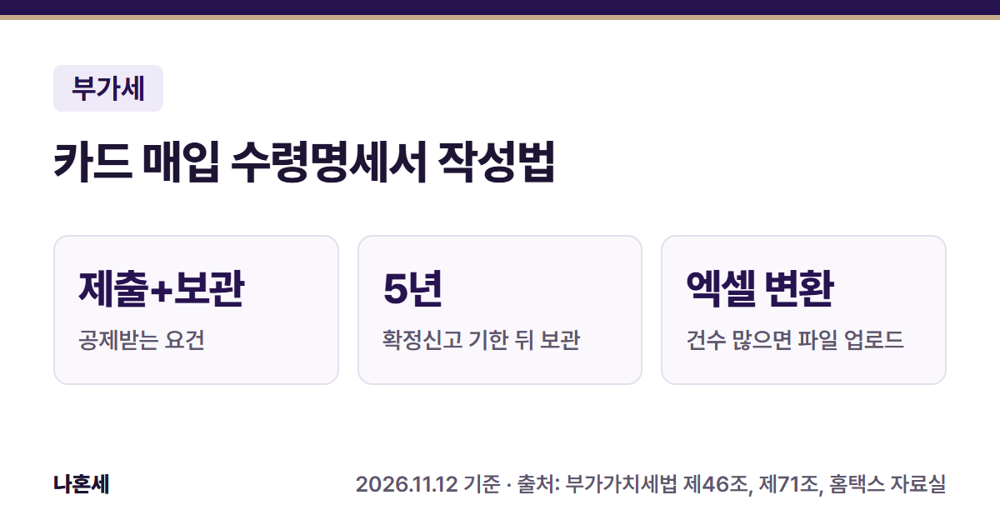
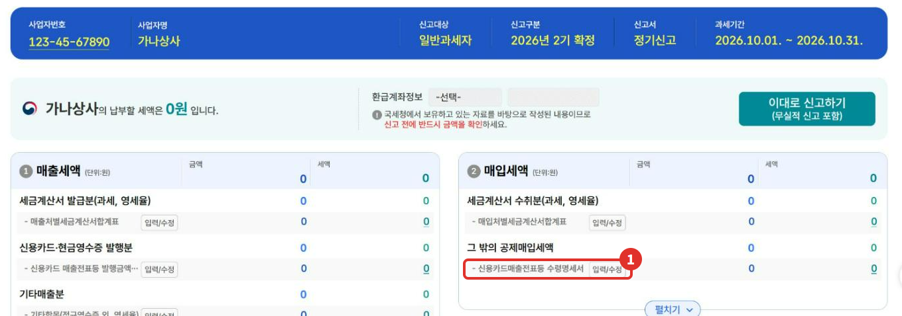
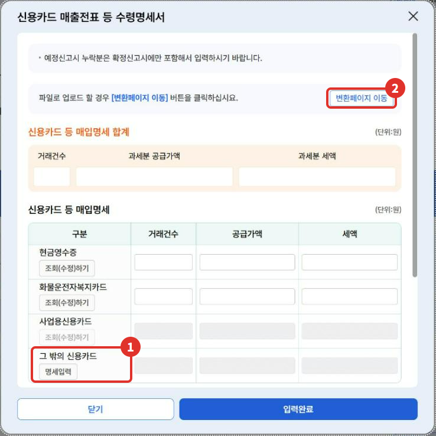
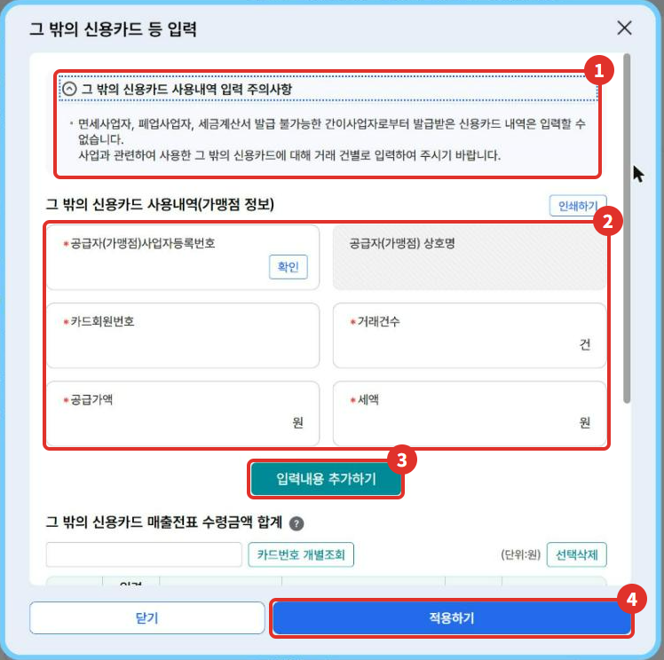
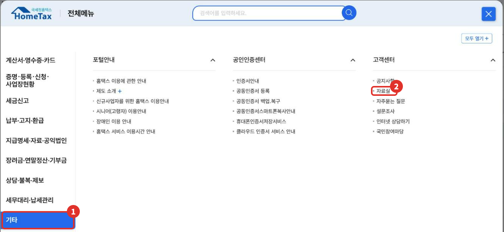
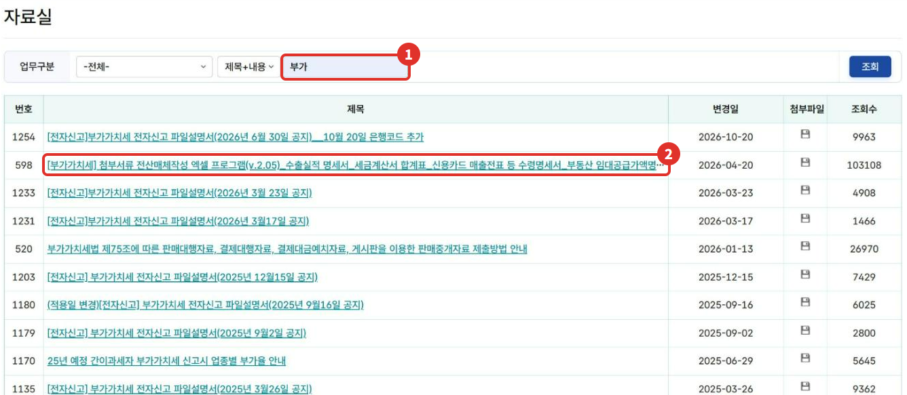
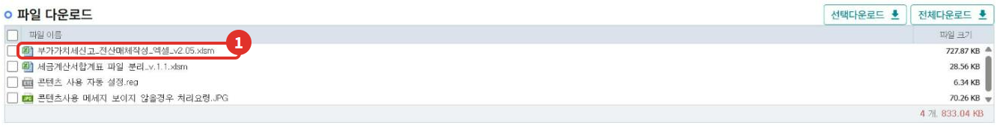
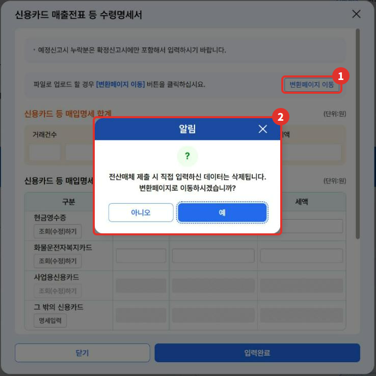
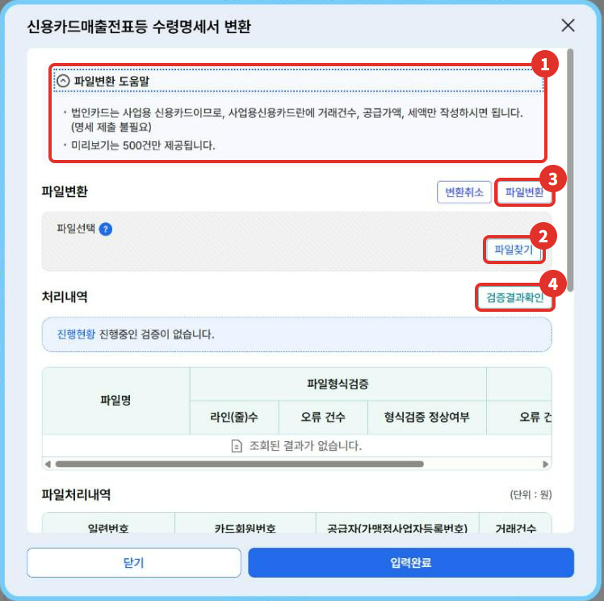

카드나 현금영수증으로 산 사업용 물품의 부가세를 공제받으려면, 부가세 신고 때 **신용카드매출전표등 수령명세서**를 함께 내야 해요 [1][8]. 이 글은 홈택스 신고서 안에서 이 명세서를 여는 곳, 몇 건 안 될 때 직접 입력하는 방법, 건수가 많을 때 **국세청 자료실 엑셀로 파일을 만들어 한 번에 올리는 방법**을 2026년 11월 기준 화면으로 정리했어요.

{: .summary-card}

> 💡 **핵심 요약**
> - 위치: 부가가치세 신고서 요약 화면 > ② 매입세액 > 그 밖의 공제매입세액 > **신용카드매출전표등 수령명세서 [입력/수정]** (2026년 11월 기준 화면)
> - 공제 요건: 부가세가 따로 적힌 카드전표·현금영수증을 받고, **수령명세서를 내고, 전표를 보관**해야 해요 [1][2]
> - 건수가 많으면 홈택스 자료실의 국세청 엑셀 프로그램으로 변환 파일을 만들어 [변환페이지 이동]에서 올릴 수 있어요. **변환 파일을 올리면 직접 입력한 값은 지워져요**{: .red} [5]

목차

* 목차
{:toc}

## 한눈에 보기

| 항목 | 내용 |
|---|---|
| 누가 | 카드·현금영수증 매입세액을 공제받으려는 사업자 [1] |
| 언제 | 부가세 신고 때 신고서와 함께(2026년 2기 확정은 2027년 1월 25일까지) [7][8] |
| 무엇을 | 카드구분, 카드번호, 가맹점 사업자번호, 거래건수, 공급가액, 세액 [6] |
| 메뉴 | 신고서 요약 화면 > 신용카드매출전표등 수령명세서 [입력/수정] |
| 많을 때 | 자료실 엑셀로 변환 파일 → [변환페이지 이동]에서 업로드 [5] |

## 수령명세서는 왜 내나요?

일반과세자는 사업에 쓰려고 산 물건·서비스의 부가세(매입세액)를 매출세액에서 빼요. 세금계산서 대신 **부가세가 따로 적힌 카드전표나 현금영수증**을 받았다면, 다음 요건을 모두 갖춰야 공제할 수 있는 매입세액으로 봐요 [1].

1. **신용카드매출전표등 수령명세서를 제출**할 것 [1]
2. 카드전표 등을 **확정신고 기한 뒤 5년간 보관**할 것(법에서 정한 방법으로 증명자료를 보관하면 보관한 것으로 봐요) [1][3]
3. 간이과세자가 영수증만 발급해야 하는 기간에 발급한 전표가 아닐 것 [1]

또 **목욕·이발·미용업, 여객운송업(전세버스 제외), 입장권을 발행하는 사업**, 과세되는 미용 목적 진료, 동물 진료, 자동차운전학원·무도학원 등에서 받은 전표나, 세금계산서를 발급할 수 없는 간이과세자에게 받은 전표는 이 방법으로 공제받을 수 없어요 [2]. 사업과 관련 없는 지출처럼 원래 공제되지 않는 매입세액은 카드로 냈어도 공제되지 않아요 [1][9].

## 홈택스에서 여는 곳

> 📅 **2026년 11월 기준 화면**이에요(운영자 본인 사업자 계정, 신고서는 제출하지 않았어요). 사업자번호·상호는 예시 값으로 바꿨어요. 화면의 과세기간(10.1.~10.31.)은 신고서를 열어 보려고 넣은 임시 값이라 실제 2기 확정 과세기간과 달라요.

1. 홈택스 > 세금신고 > 부가가치세 신고 > **부가가치세 과세신고(일반·간이·대리납부)**에서 신고서를 열고 기본정보를 저장해요.
2. 요약 화면 ② 매입세액의 **그 밖의 공제매입세액** 아래 ① **신용카드매출전표등 수령명세서 [입력/수정]**을 눌러요.

   

3. 팝업에 **현금영수증, 화물운전자복지카드, 사업용신용카드, 그 밖의 신용카드** 칸이 나와요. 아래쪽에는 면세분을 적는 칸이 있어요.

   

**사업용신용카드** 칸 옆에는 [조회(수정)하기] 버튼이 있어요. 운영자 화면에서는 등록한 카드 사용내역이 없어 버튼이 비활성이라 눌러 보지는 못했어요. 이 칸과 별도로 ① **그 밖의 신용카드 [명세입력]** 칸이 있어서, 거래처별 내역을 직접 적을 수 있어요(사업용 카드 등록 방법은 아래 함께 보면 좋은 글에 있어요).

## 몇 건 안 되면: 직접 입력

1. **그 밖의 신용카드 [명세입력]**을 누르면 입력 창이 열려요.
2. 맨 위 ① **입력 주의사항**을 먼저 읽어요. 면세사업자·폐업사업자·세금계산서를 발급할 수 없는 간이사업자에게 받은 카드 내역은 입력할 수 없다고 나와요 [5].
3. ② 가맹점 사업자등록번호를 넣고 [확인]을 눌러 상호를 확인한 뒤, 카드회원번호·거래건수·공급가액·세액을 적어요.
4. ③ **[입력내용 추가하기]**로 한 줄씩 쌓고, 다 넣었으면 ④ **[적용하기]**를 눌러요.

   

입력 창 주의사항에는 "거래 건별로 입력"하라는 안내와 함께 '거래건수' 칸이 있어요 [5]. 어떻게 묶어 적을지 헷갈리면 126에 확인하세요. 가맹점이 수십 곳이 넘으면 한 줄씩 넣기가 꽤 번거로워요. 그럴 때 아래 엑셀 방법을 써 볼 수 있어요.

## 건수가 많으면: 국세청 엑셀로 변환 파일 만들기

국세청은 홈택스 자료실에 **부가가치세 첨부서류 전산매체작성 엑셀 프로그램**을 올려 두고 있어요. 수령명세서를 엑셀에 적고 버튼을 누르면 홈택스에 올릴 **변환 파일**이 만들어져요 [6].

**국세청 안내대로, 더존 같은 회계프로그램을 쓰는 사업자는 쓰던 프로그램을 그대로 쓰면 돼요**{: .red} [6]. 이 엑셀은 회계프로그램을 쓰지 않는 사업자를 돕는 프로그램이에요. 파일은 이 블로그에 올리지 않고, 내려받는 경로만 안내해요(엑셀 안에 부가세 신고 외 다른 목적으로 쓸 수 없다는 안내가 있어요).

### 1) 자료실에서 내려받기

1. 홈택스 ① **전체메뉴 > 기타** > 고객센터의 ② **자료실**을 눌러요.

   

2. 검색칸에 ① **부가**를 넣고 조회한 뒤, ② **"[부가가치세] 첨부서류 전산매체작성 엑셀 프로그램(v.2.05)…"** 글을 열어요(2026년 11월 기준 598번 글, 변경일 2026-04-20).

   

3. 글 아래 파일 다운로드에서 ① **부가가치세신고_전산매체작성_엑셀_v2.05.xlsm**을 내려받아요. 엑셀을 열었을 때 매크로 경고가 나오면 '콘텐츠 사용'을 눌러야 해요. 안 보이면 같은 글의 처리요령 그림을 참고하라고 안내돼 있어요 [6].

   

> 버전 번호(v2.05)와 글 번호는 국세청이 고치면 바뀌어요. 자료실에서 "부가"로 검색해 제목에 "전산매체작성 엑셀 프로그램"이 들어간 글을 찾으면 돼요.

### 2) 엑셀에 적고 파일 만들기

국세청 자료실 글에 적힌 순서는 이래요 [6].

1. **전산매체 선택** 시트에서 '신용카드매출전표등 수령명세서'를 골라요.
2. 오른쪽 **항목설명**을 보면서 내용을 적어요.
3. **[전산매체 파일 생성 (클릭)]** 버튼을 눌러 변환 파일을 만들어요.
4. 홈택스 부가세 신고 화면의 **[변환페이지 이동]**에서 그 파일을 올려 변환하고 제출해요.

엑셀의 항목설명에서 확인한 주요 칸은 이래요 [6].

| 칸 | 적는 법 |
|---|---|
| 반기구분 | 1~6월은 1기, 7~12월은 2기(간이과세자는 1기만) |
| 카드구분 | 1 신용·직불카드 / 2 현금영수증 / 3 화물운전자복지카드 / 4 사업용신용카드 |
| 카드번호 | 카드구분이 1일 때만 |
| 가맹점번호 | 공급자(가맹점) 사업자등록번호, 카드구분이 1일 때만 |
| 건수·금액 | 같은 카드번호로 같은 공급자와 거래한 건수와 공급가액 합계 |

### 3) 홈택스에 올리기

1. 수령명세서 팝업 위쪽의 ① **[변환페이지 이동]**을 눌러요.
2. ② "전산매체 제출 시 직접 입력하신 데이터는 삭제됩니다" 알림이 떠요. **직접 넣은 값이 지워지니, 직접 입력과 파일 올리기 중 하나로 정해서 하세요**{: .red} [5].

   

3. **신용카드매출전표등 수령명세서 변환** 창에서 ② **[파일찾기]**로 엑셀이 만든 파일을 고르고, ③ **[파일변환]**을 누른 뒤 ④ **[검증결과확인]**으로 오류가 없는지 봐요. 아래 파일처리내역과 합계에서 올라간 내용을 확인할 수 있어요.

   

변환 창의 ① 도움말에는 **법인카드는 사업용신용카드이므로 사업용신용카드란에 거래건수·공급가액·세액만 적으면 된다**(명세 제출 불필요)는 안내와, 미리보기는 500건까지 보여 준다는 안내가 있어요 [5]. 운영자는 실제 파일을 올려 보지는 않았어요. 오류가 나면 검증결과의 오류 내용을 보고 엑셀을 고쳐 다시 만들면 될 것으로 보여요.

## 자주 하는 실수

- **직접 입력한 뒤 파일을 또 올림**: 변환 파일을 올리면 직접 입력한 값이 지워져요 [5].
- **공제 안 되는 곳의 전표를 넣음**: 목욕·이발·미용, 여객운송(전세버스 제외), 입장권 사업, 면세사업자, 세금계산서를 발급할 수 없는 간이과세자 등에게 받은 전표는 넣으면 안 돼요 [2][5].
- **같은 매입을 두 번 넣음**: 같은 매입세액을 세금계산서 합계표와 수령명세서에서 두 번 공제받지 않도록 겹치는 거래가 없는지 봐요. 헷갈리면 126에 확인하세요.
- **전표를 버림**: 확정신고 기한 뒤 5년간 보관해야 해요 [1][3].

## 직접 신고가 어려울 수 있는 경우

- 매입 거래처가 많고 과세·면세 매입이 섞여 공통매입세액을 나눠야 하는 경우
- 카드 사용내역 중 사업 관련 여부를 하나하나 판단하기 어려운 경우
- 이미 신고를 마쳤는데 수령명세서를 빠뜨려 수정신고·경정청구를 해야 하는 경우

이럴 때는 국세상담센터(126)나 홈택스 상담을 이용하거나, 세무대리인과 상의해 보세요.

## 자주 묻는 질문

**Q. 신고 때 수령명세서를 빠뜨렸어요. 공제를 아예 못 받나요?**
A. 수령명세서를 과세표준수정신고서나 경정청구서, 기한후신고서와 함께 내는 경우에도 공제받을 수 있게 정해져 있어요(경정청구·기한후신고는 세무서의 경정·결정을 거쳐요) [4]. 방법은 아래 부가세 수정신고·경정청구 글을 참고하고, 내 경우에 맞는지는 126에 확인하세요.

**Q. 사업용 카드로 등록했으면 따로 할 일이 없나요?**
A. 홈택스 사업용 카드 등록 화면에는 등록하면 수령명세 작성 부담이 줄어든다고 안내돼 있어요 [10]. 다만 법에는 수령명세서 제출 요건이 그대로 있고 [1], 사용내역 중 공제되지 않는 매입이 있는지는 직접 확인해야 해요(사업용 카드 글의 공제 확인/변경 화면 참고).

**Q. 엑셀 파일을 블로그에서 받을 수 있나요?**
A. 아니요. 국세청 자료실에서 직접 내려받아 주세요. 국세청이 프로그램을 고치면 버전이 바뀌므로 자료실에서 받는 것이 가장 정확해요.

## 함께 보면 좋은 글

- [홈택스 사업용 신용카드 등록 방법]()
- [1월 부가세 신고 전 체크리스트]()
- [부가세 수정신고·경정청구·기한후신고]()

## 출처

1. 법령: 부가가치세법 제46조 ③ (2026.1.2. 시행)
2. 법령: 부가가치세법 시행령 제88조 ⑤ (2026.4.1. 시행)
3. 법령: 부가가치세법 제71조 ③ (2026.1.2. 시행)
4. 법령: 부가가치세법 시행령 제74조 제1호~제3호 (2026.4.1. 시행)
5. 홈택스 부가가치세 신고서 > 신용카드매출전표등 수령명세서 팝업·그 밖의 신용카드 등 입력 창·변환 창 안내 문구 (운영자 직접 확인: 2026-11-12)
6. 국세청 홈택스 자료실 - [부가가치세] 첨부서류 전산매체작성 엑셀 프로그램(v.2.05) 글(변경일 2026-04-20)과 첨부 엑셀의 항목설명 (확인일: 2026-11-12)
7. 국세청 세무일정 - 2026년 2기 부가가치세 확정신고 (확인일: 2026-11-12)
8. 법령: 부가가치세법 시행령 제91조 ② 표 5호 (2026.4.1. 시행)
9. 법령: 부가가치세법 제39조 ① 4호~6호 (2026.1.2. 시행)
10. 홈택스 사업용신용카드 등록 화면 안내 문구 (운영자 직접 확인: 2026-11-07)

> 이 글은 2026년 11월 12일 기준의 일반적인 안내입니다. 세법과 홈택스 화면은 바뀔 수 있으니 신고 전 국세청 안내를 꼭 확인하세요. 개별 상황은 국세상담센터(126)에 문의하세요.
