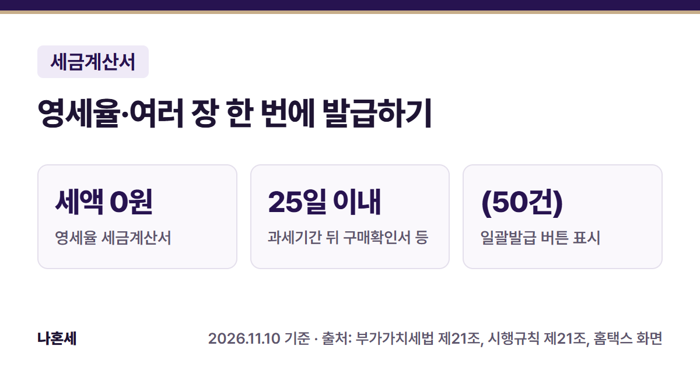
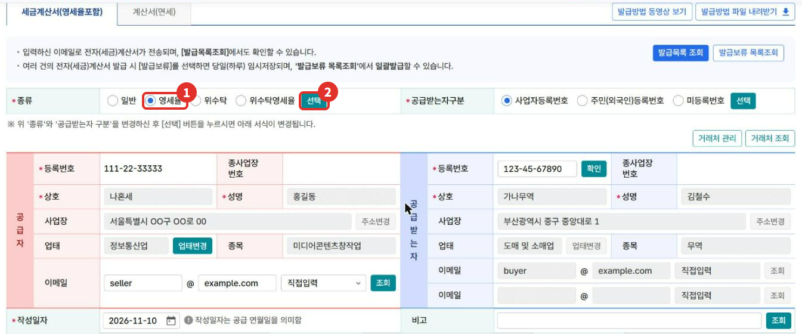
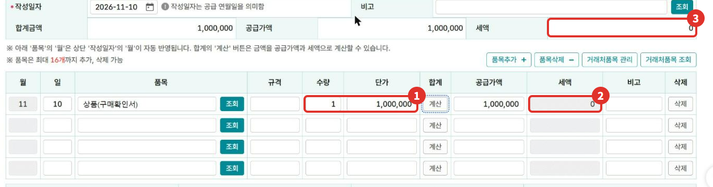
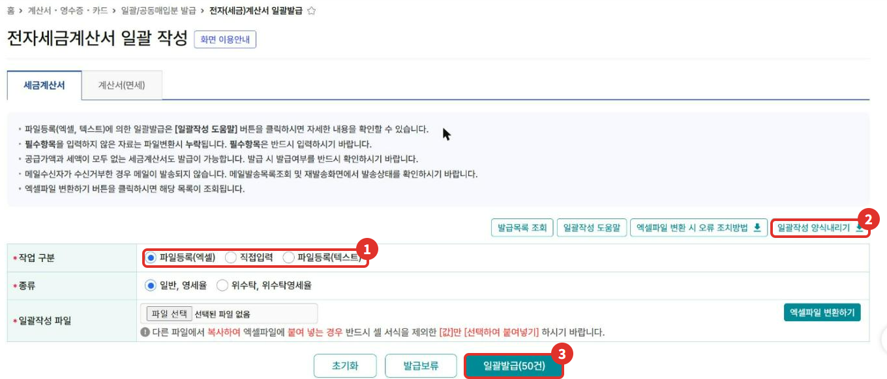
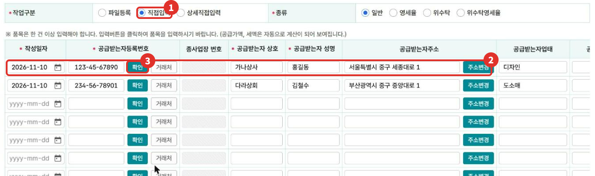
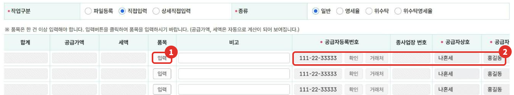

전자세금계산서는 보통 한 장씩 건별발급으로 끊지만, 상황에 따라 다른 방식이 필요할 때가 있어요. 이 글은 **구매확인서·내국신용장으로 공급할 때 끊는 영세율 세금계산서**와, 거래처가 많을 때 쓰는 **일괄발급(여러 장 한 번에)** 화면을 2026년 11월 기준으로 정리했어요.

{: .summary-card}

> 💡 **핵심 요약**
> - 영세율: 건별발급 화면에서 종류를 **영세율**로 고르고 **[선택]**을 누르면 세액 칸이 0으로 고정돼요 (2026년 11월 기준 화면)
> - **내국신용장·구매확인서는 공급시기가 속하는 과세기간이 끝난 뒤 25일 이내에 개설·발급된 것이어야 해요**{: .red} [4]
> - 일괄발급: 계산서·영수증·카드 > 일괄/공동매입분 발급 > **전자(세금)계산서 일괄발급**에서 엑셀 파일 또는 직접입력으로 여러 장을 작성해요 [2]

목차

* 목차
{:toc}

## 한눈에 보기

| 항목 | 영세율 세금계산서 | 일괄발급 |
|---|---|---|
| 언제 | 내국신용장·구매확인서로 재화를 공급할 때 [3][4] | 한 번에 여러 장을 끊을 때 |
| 메뉴 | 전자(세금)계산서 건별발급 | 전자(세금)계산서 일괄발급 |
| 세액 | 0원(세율 0%) [3] | 일반 10% 또는 영세율 |

## 영세율은 어떤 거래에 적용되나요?

부가가치세법은 영세율을 **4가지 종류**로 정해 두었어요. 조세특례제한법에도 방산물자·장애인용 보장구·농축임업용 기자재 등 따로 정한 영세율이 있어요 [10]. 영세율도 아니고 면세도 아니면 일반 세율 10%예요.

| 종류 | 근거 | 대표적인 대상 |
|---|---|---|
| ① 재화의 수출 | 제21조 [3] | 외국으로 물건 반출, 중계무역·위탁판매수출 등, **내국신용장·구매확인서에 의한 국내 공급** |
| ② 용역의 국외공급 | 제22조 [8] | 국외에서 제공하는 용역(예: 해외 현장에서 하는 공사·서비스) |
| ③ 외국항행용역 | 제23조 [8] | 선박·항공기로 여객·화물을 국내↔국외, 국외↔국외로 수송 |
| ④ 외화 획득 재화·용역 | 제24조 [8][9] | 외교공관·국제기구 공급, 국내사업장 없는 비거주자·외국법인에 정해진 용역 공급 등 |

### ① 재화의 수출: 작은 사업자가 가장 많이 만나는 경우

- **직접 수출**: 국내 물건을 외국으로 내보내는 것 [3]
- **중계무역·위탁판매수출·외국인도수출·위탁가공무역** 등 시행령에 정한 방식으로, 국내 사업장에서 계약하고 대가를 받는 것 [3][4]
- **내국신용장·구매확인서에 의한 공급**: 국내 수출업체에 수출용 원자재·완제품을 공급하는 경우예요. **금지금은 빠지고, 내국신용장·구매확인서가 공급시기가 속하는 과세기간이 끝난 뒤 25일 이내에 개설·발급돼야 해요** [3][4]
- 그 밖에 한국국제협력단·한국국제보건의료재단·대한적십자사가 외국에 무상으로 내보내는 재화를 공급하는 경우 등 [4]

### ④ 외화 획득 재화·용역: 비거주자·외국법인과 거래할 때

**국내사업장이 없는 비거주자나 외국법인에게 국내에서 아래 같은 업종의 재화·용역을 공급하고, 대금을 외국환은행에서 원화로 받는 등 정해진 방법으로 받아야 영세율이 적용돼요**{: .red} [9]. 비거주자에서 국내에 거소가 있는 개인, 외교공관 직원, 주한 국제연합군·미군의 군인·군무원은 빠져요 [9].

- 전문·과학·기술 서비스업(수의업 등 제외), 무형재산권 임대업, 통신업
- 정보통신업 중 뉴스 제공업, 영상·오디오 기록물 제작·배급업(영화관 등 제외), 소프트웨어 개발업, 컴퓨터 프로그래밍, 자료처리·호스팅·포털 등
- 상품 중개업·전자상거래 소매 중개업, 사업시설관리·사업지원 서비스업(일부 제외), 교육지원 서비스업 등

**전문서비스업, 사업시설관리·사업지원 서비스업, 투자자문업은 상대 나라에서도 우리나라 사업자에게 똑같이 면세할 때(그 나라에 부가세 같은 세금이 없는 경우 포함)만 영세율이 적용돼요** [9]. 이 밖에 수출업자와 직접 도급계약한 수출재화임가공용역, 내국신용장·구매확인서에 의한 수출재화임가공용역, 외국 항행 선박·항공기·원양어선에 공급하는 재화·용역, 주한 국제연합군·미군에 공급하는 재화·용역, 종합여행업자가 외국인 관광객에게 하는 관광알선용역(대가 받는 방법 조건) 등도 들어가요 [9].

- 수출업자와 직접 도급계약한 수출재화임가공용역과 외국 항행 선박 등에 공급하는 것은 **부가세를 따로 적은 일반 세금계산서를 발급하면 영세율에서 빠져요** [9].
- 국내에서 원격으로 해외 고객에게 서비스를 주는 건 ② 국외공급이 아니라 ④ 조건(업종·대금 받는 방법)을 따져요.
- 업종 분류와 대금 받는 방법에 따라 결과가 갈리니, 내 거래가 해당하는지는 126에 먼저 확인하세요.

## 영세율 세금계산서는 언제 끊나요?

수출에 해당하는 재화의 공급에는 **0%의 세율(영세율)**이 적용돼요 [3]. 외국으로 직접 내보내는 수출뿐 아니라, 국내 사업자에게 공급하더라도 **내국신용장이나 구매확인서에 의해** 재화(금지금은 제외)를 공급하면 수출로 봐요 [3][4]. 이런 서류 없이 국내에 공급하면 일반 세금계산서(10%)예요.

| 구분 | 세금계산서 |
|---|---|
| 외국으로 직접 수출 | 세금계산서 발급의무가 면제돼요 [5] |
| 국내사업장 없는 비거주자·외국법인에 정해진 재화·용역 공급(④) | 세금계산서 발급의무가 면제돼요 [5] |
| 내국신용장·구매확인서로 국내 공급 | 면제에서 빠져 있어 **영세율 세금계산서**를 발급해요 [5] |

내국신용장과 구매확인서는 **공급시기가 속하는 과세기간이 끝난 뒤 25일(공휴일·토요일이면 다음 영업일) 이내**에 개설·발급된 것이어야 해요 [4]. 공급한 뒤에 내국신용장·구매확인서가 나왔고 그날이 과세기간 종료 후 25일 이내라면, 처음 끊은 일반 세금계산서를 수정발급(내국신용장 사후 개설)으로 고쳐요 [6]. 방법은 [세금계산서 수정발급 글]()에 있어요.

**영세율로 신고할 때는 내국신용장·구매확인서 전자발급명세서(전자로 개설·발급되지 않았으면 내국신용장 사본)를 신고서와 함께 내야 해요**{: .red} [7].

영세율 적용 요건이 맞는지는 거래마다 달라요. 확실하지 않으면 발급 전에 126에 먼저 확인하세요.

## 홈택스로 영세율 세금계산서 끊는 순서

> 📅 **2026년 11월 기준 화면**이에요(운영자 본인 사업자 계정, 거래처·인적사항은 가상값). 발급하기 버튼은 누르지 않았어요.

1. **계산서·영수증·카드 > 전자(세금)계산서 발급 > 전자(세금)계산서 건별발급**으로 들어가요.
2. 종류에서 ① **영세율**을 고르고 ② **[선택]**을 눌러요. 화면 안내대로 [선택]을 눌러야 아래 서식이 바뀌어요 [1]. 제목이 "전자세금계산서 영세율(사업자)"로 바뀌면 맞게 된 거예요.

   

3. 공급받는자 등록번호를 넣고 [확인]으로 번호를 확인한 뒤 상호·성명·주소 등을 채워요.
4. 품목 줄에 ① 수량과 단가를 넣으면 공급가액이 계산되고, ② 품목의 세액과 ③ 위쪽 합계의 세액은 **0으로 고정**돼요.

   

5. 내용을 확인하고 **발급하기**를 눌러요.

## 가상 예시로 보는 차이

같은 1,000,000원어치 상품을 공급할 때의 **가상의 예시**예요.

| 구분 | 공급가액 | 세액 | 합계금액 |
|---|---|---|---|
| 일반 세금계산서(10%) | 1,000,000원 | 100,000원 | 1,100,000원 |
| 영세율 세금계산서(0%) | 1,000,000원 | 0원 | 1,000,000원 |

## 여러 장을 한 번에 끊는 일괄발급

거래처가 많으면 **계산서·영수증·카드 > 일괄/공동매입분 발급 > 전자(세금)계산서 일괄발급**에서 여러 장을 한 번에 작성할 수 있어요 [2].

1. ① **작업 구분**에서 방식을 골라요. **파일등록(엑셀)**, **직접입력**, **파일등록(텍스트)** 세 가지가 있어요 [2].
2. 엑셀로 할 때는 ② **일괄작성 양식내리기**로 양식을 받아 채운 뒤 파일을 올리고 **엑셀파일 변환하기**를 눌러요. 자세한 작성법은 화면의 **일괄작성 도움말**에 있어요 [2].
3. 목록을 확인하고 ③ 발급 버튼을 눌러요. 버튼 이름이 **일괄발급(50건)**으로 표시돼요. 정확한 건수 기준은 화면의 [일괄작성 도움말]에서 확인하세요. 메뉴 목록에는 **전자(세금)계산서 일괄발급(100건 초과 시)** 메뉴도 따로 있어요(이 글에서는 들어가 보지 않았어요) [2].

   

화면 안내에 적힌 주의사항이에요 [2].

- **필수항목을 비우면 파일 변환 때 그 자료가 빠져요.** 필수항목은 반드시 채우세요.
- 다른 파일에서 복사해 붙일 때는 셀 서식을 빼고 **값만 붙여넣기**를 하라고 안내돼요.
- **공급가액과 세액이 모두 없는 세금계산서도 발급될 수 있어요. 발급 전에 발급 여부를 꼭 확인하세요**{: .red}.

이 글에서는 엑셀 양식을 내려받거나 파일을 올리는 단계는 직접 해 보지 않았어요.

## 엑셀 없이 화면에서 바로 쓰는 직접입력

파일을 만들기 번거로우면 작업 구분에서 **직접입력**을 골라 화면 표에 바로 적을 수 있어요.

1. ① **직접입력**을 고르면 한 줄에 세금계산서 한 장씩 적는 표가 나와요. 이때 작업 구분은 파일등록·직접입력·상세직접입력으로 바뀌어 보여요. 오른쪽 위 종류에서 일반·영세율도 고를 수 있어요.
2. ② 줄마다 작성일자, 공급받는자 등록번호, 상호, 성명, 주소, 업태 등을 적어요.
3. 공급받는자 등록번호를 적은 뒤 ③ **[확인]**으로 번호를 확인해요. 확인 없이 품목 [입력]을 누르면 공급받는자 번호를 확인하라는 알림이 떴어요. 이 글은 가상 번호로 작성해서 확인을 통과하지 못했고, 그래서 품목 입력 창은 열어 보지 못했어요.

   

4. 표를 오른쪽으로 넘기면 ① 품목 **[입력]** 버튼이 있어요. 품목은 한 건 이상 넣어야 하고, 공급가액과 세액은 자동으로 계산돼요 [2]. ② 공급자 칸은 로그인한 사업자 정보로 채워져요.

   

- 칸 이동 팁: Tab은 다음 칸, Ctrl+Enter는 다음 줄 첫 칸, Shift+Enter는 다음 줄 같은 칸으로 가요 [2].
- 건별발급 화면에도 **발급보류**를 고르면 그날 하루 임시저장되고, **발급보류 목록조회**에서 일괄발급할 수 있다고 안내돼 있어요 [1].

## 자주 하는 실수

- **영세율을 고르고 [선택]을 안 누르기**: 서식이 영세율로 바뀌지 않아요. 제목이 "전자세금계산서 영세율(사업자)"인지 확인하세요 [1].
- **구매확인서가 늦게 나온 거래를 영세율로 끊기**: 과세기간이 끝난 뒤 25일이 지나서 나온 구매확인서는 영세율 요건에 맞지 않아요 [4].
- **엑셀 필수항목을 빠뜨리기**: 빠진 줄은 변환에서 누락돼요 [2].
- **일괄발급 뒤 확인을 안 하기**: 발급한 뒤에는 [전자세금계산서 발급 글]()처럼 발급 목록에서 한 번 더 확인하세요.

## 직접 하기 어려울 수 있는 경우

- 수출 관련 거래가 많아 영세율 요건(내국신용장·구매확인서 기한)을 거래마다 따져야 할 때
- 매달 수십~수백 장을 발급해서 엑셀 양식 오류가 자주 날 때
- 이미 일반 세금계산서로 끊은 거래를 영세율로 고쳐야 할 때

확실하지 않으면 **국세상담센터(126)**나 홈택스 상담으로 먼저 확인하세요.

## 자주 묻는 질문

**Q. 해외 고객에게 직접 수출해도 영세율 세금계산서를 끊어야 하나요?**
A. 외국으로 직접 반출하는 수출은 세금계산서 발급의무 면제 대상이에요. 내국신용장·구매확인서로 국내에서 공급하는 재화는 면제에서 빠져 있어 영세율 세금계산서를 끊어요 [5].

**Q. 일괄발급은 한 번에 몇 장까지 되나요?**
A. 2026년 11월 화면에서 버튼 이름은 **일괄발급(50건)**이고, 메뉴 목록에 "100건 초과 시" 메뉴가 따로 있어요 [2]. 정확한 기준은 화면의 일괄작성 도움말에서 확인하세요.

**Q. 일괄발급에서도 영세율을 끊을 수 있나요?**
A. 네. 엑셀 방식은 종류에 "일반, 영세율", 직접입력은 일반·영세율·위수탁·위수탁영세율 선택지가 있어요 [2].

## 함께 보면 좋은 글

- [홈택스 전자세금계산서 발급 방법: 건별발급 순서]()
- [홈택스 세금계산서 수정발급 방법]()

## 출처

1. 홈택스 전자(세금)계산서 건별발급 화면 안내 문구(종류·선택, 발급보류) (운영자 직접 확인: 2026-11-10)
2. 홈택스 전자(세금)계산서 일괄발급 화면 안내 문구·버튼(파일등록·직접입력, 일괄발급 50건, 100건 초과 시 메뉴) (운영자 직접 확인: 2026-11-10)
3. 법령: 부가가치세법 제21조 ①·② (2026.1.2. 시행)
4. 법령: 부가가치세법 시행령 제31조 ② 1호 (2026.4.1. 시행), 같은 법 시행규칙 제21조 (2026.4.1. 시행)
5. 법령: 부가가치세법 시행령 제71조 ① 4호·5호 (2026.4.1. 시행)
6. 법령: 부가가치세법 시행령 제70조 ① 4호 (내국신용장 사후 개설 수정세금계산서) (2026.4.1. 시행)
7. 법령: 부가가치세법 시행령 제101조 ①·② (영세율 첨부서류) (2026.4.1. 시행)
8. 법령: 부가가치세법 제22조·제23조·제24조 (2026.1.2. 시행)
9. 법령: 부가가치세법 시행령 제33조 ①·② (외화 획득 재화·용역의 범위) (2026.4.1. 시행)
10. 법령: 조세특례제한법 제105조 ① (부가가치세 영세율 적용)

> 이 글은 2026년 11월 10일 기준의 일반적인 안내입니다. 세법과 홈택스 화면은 바뀔 수 있으니 신고 전 국세청 안내를 꼭 확인하세요. 개별 상황은 국세상담센터(126)에 문의하세요.
