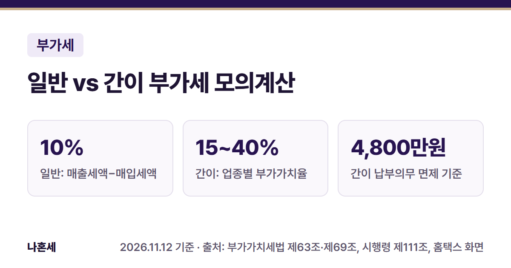
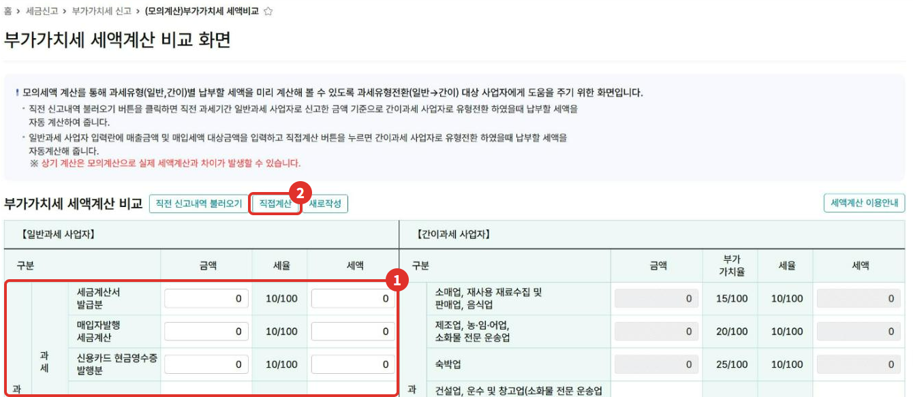
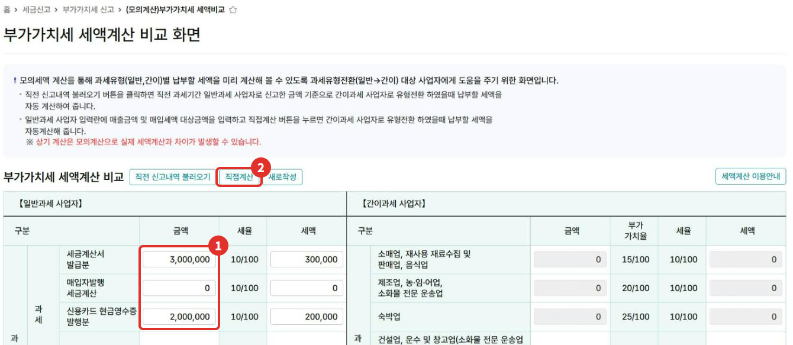
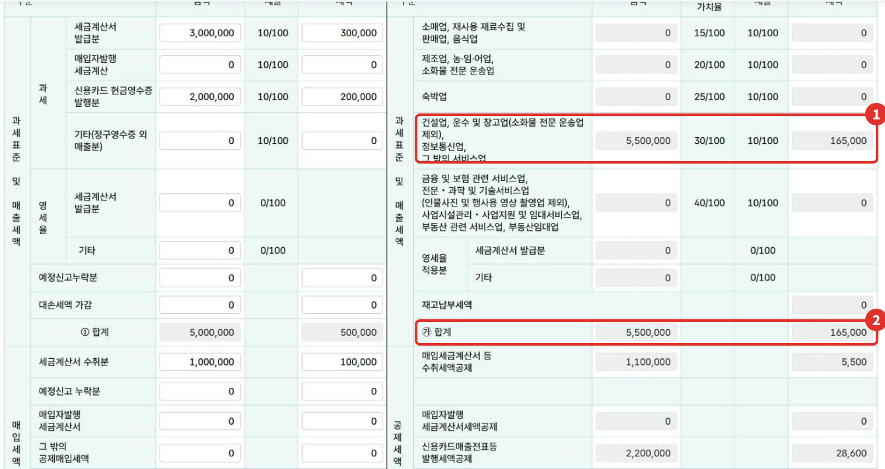
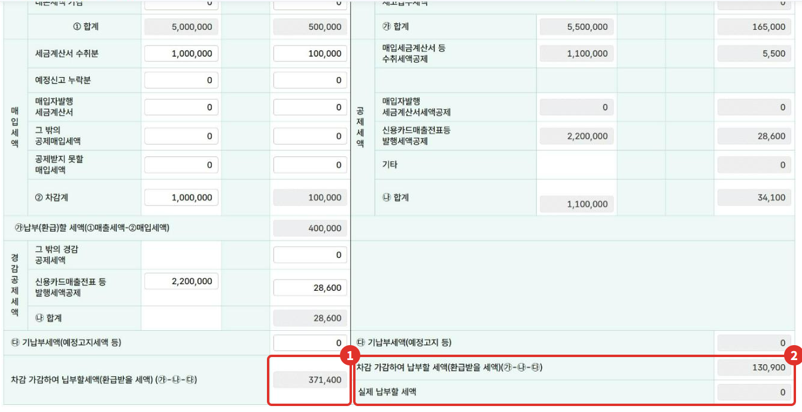

"간이과세자였으면 부가세가 얼마였을까?" 궁금할 때 홈택스의 **(모의계산)부가가치세 세액비교** 화면을 쓰면, 같은 매출·매입으로 일반과세자와 간이과세자 세액을 나란히 계산해 볼 수 있어요. 이 글은 2026년 11월 기준 화면에 가상 금액을 넣어 직접 계산해 본 순서와, 결과를 읽을 때 알아 둘 점을 정리했어요.

{: .summary-card}

> 💡 **핵심 요약**
> - 메뉴: 홈택스 > 세금신고 > 부가가치세 신고 > **(모의계산)부가가치세 세액비교** (2026년 11월 기준 화면)
> - 일반과세자 칸에 매출·매입을 넣고 **[직접계산]**을 누르면 간이과세자 세액이 옆에 나와요
> - **화면에도 적혀 있듯 모의계산이라 실제 세액과 다를 수 있어요. 간이과세자로 바뀔 수 있는지는 따로 요건을 확인해야 해요**{: .red} [1][5]

목차

* 목차
{:toc}

## 한눈에 보기

| 항목 | 내용 |
|---|---|
| 누가 | 화면 안내: 과세유형전환(일반→간이) 대상 사업자 [1] |
| 무엇을 | 같은 매출·매입으로 일반·간이 세액 비교 [1] |
| 메뉴 | 세금신고 > 부가가치세 신고 > (모의계산)부가가치세 세액비교 |
| 버튼 | 직전 신고내역 불러오기 / 직접계산 / 새로작성 [1] |
| 주의 | 모의계산, 실제 세액과 차이 가능 [1] |

## 두 과세유형은 세금 계산이 달라요

| 구분 | 계산 방식 |
|---|---|
| 일반과세자 | 매출세액(공급가액의 10%) − 매입세액 [2] |
| 간이과세자 | 공급대가 × 업종별 부가가치율 × 10% − 공제세액 [3][4] |

간이과세자의 **부가가치율**은 업종마다 달라요 [4].

| 업종 | 부가가치율 |
|---|---|
| 소매업, 재생용 재료수집·판매업, 음식점업 | 15% |
| 제조업, 농업·임업·어업, 소화물 전문 운송업 | 20% |
| 숙박업 | 25% |
| 건설업, 운수·창고업(소화물 전문 운송업 제외), 정보통신업, 그 밖의 서비스업 | 30% |
| 금융·보험 관련 서비스업, 전문·과학·기술서비스업(인물사진·행사용 영상 촬영업 제외), 사업시설관리·사업지원·임대서비스업, 부동산 관련 서비스업, 부동산임대업 | 40% |

간이과세자는 세금계산서 등을 받은 매입의 **공급대가 × 0.5%**를 납부세액에서 빼요 [3]. 그리고 **한 해 공급대가가 4,800만원 미만이면 납부의무가 면제**돼요(신규 개업 등은 12개월로 환산). 다만 일반과세자에서 간이과세자로 바뀔 때 더하는 재고납부세액은 면제되지 않아요 [6].

## 홈택스에서 비교하는 순서

> 📅 **2026년 11월 기준 화면**이에요(운영자 본인 사업자 계정, 사업자번호·상호는 가렸어요). 아래 금액은 모두 **가상의 예시**예요.

1. 홈택스 > 세금신고 > 부가가치세 신고 > **(모의계산)부가가치세 세액비교**로 들어가요.
2. 화면 위 안내에 "직전 신고내역 불러오기"는 직전 과세기간 신고 금액으로, "직접계산"은 입력한 금액으로 간이과세 세액을 계산해 준다고 나와요 [1]. 이 글은 ① **일반과세 사업자** 칸에 직접 넣고 ② **[직접계산]**을 누르는 방법으로 해 봤어요.

   

3. ① 매출 칸에 금액을 넣어요. 예시로 **세금계산서 발급분 300만원, 신용카드·현금영수증 발행분 200만원**을 넣었더니 세액(10%)이 자동으로 채워졌어요. 아래쪽 매입 칸에는 **세금계산서 수취분 100만원**을 넣었어요.

   

4. ② **[직접계산]**을 누르면 오른쪽 간이과세 칸이 채워져요. 운영자 계정에서는 업종이 **30% 칸(건설업·운수·창고업·정보통신업·그 밖의 서비스업)**에 자동으로 들어갔어요. 등록된 업종에 따라 다른 칸에 들어갈 수 있어요.

   

5. 맨 아래에서 두 세액을 비교해요. 예시에서는 ① 일반과세자 **371,400원**, ② 간이과세자 차감 세액 **130,900원**, **실제 납부할 세액 0원**으로 나왔어요.

   

## 예시 결과 읽어 보기

**가상의 예시**(세금계산서 매출 300만원, 카드 매출 200만원, 세금계산서 매입 100만원)를 화면 값 그대로 풀면 이래요.

| 단계 | 일반과세자 | 간이과세자 |
|---|---|---|
| 매출 쪽 | 500만원 × 10% = **500,000원** | 공급대가 550만원 × 30% × 10% = **165,000원** |
| 매입 쪽 | 100만원 × 10% = −100,000원 | 110만원 × 0.5% = −5,500원 |
| 카드 발행 공제 | 220만원 × 1.3% = −28,600원 | 220만원 × 1.3% = −28,600원 |
| 결과 | **371,400원** | **130,900원** (실제 납부할 세액 0원) |

- 간이과세 칸의 공급대가 550만원은 일반과세 칸 공급가액 500만원에 부가세 50만원을 더한 금액이에요(간이과세자는 부가세를 포함한 공급대가로 계산해요) [3].
- 카드 발행 공제 1.3%는 **2026년 12월 31일까지** 적용되는 비율이에요(연간 1천만원 한도). 현행 법대로면 2027년부터 1%, 연간 500만원 한도예요(2026년 11월 기준, 연말 세법 개정으로 달라질 수 있어요) [7].
- 이 공제는 대상이 정해져 있어요. 일반과세자와 직전 연도 공급대가 4,800만원 이상인 간이과세자는 소매·음식·숙박처럼 주로 소비자를 상대하는 업종이어야 하고, 일반과세 개인사업자는 직전 연도 공급가액이 사업장 기준 10억원 이하여야 해요 [7]. 모의계산 화면은 업종을 따지지 않고 넣어 준 값으로 보이니, 내게 해당하는지 확인하세요.
- 간이과세 **"실제 납부할 세액 0원"**은 공급대가가 4,800만원 미만이면 납부의무가 면제되는 규정 때문으로 보여요 [6]. 화면이 어떤 기준으로 0원을 냈는지는 안내가 없어서, 운영자가 확인하지는 못했어요. 실제 면제 여부는 1년(1.1.~12.31.) 공급대가 합계(신규 개업은 12개월 환산)로 정해져요 [6].

## 간이과세자로 바꿀 수 있나요?

모의계산 결과만 보고 과세유형을 바꿀 수 있는 건 아니에요.

- 간이과세는 **직전 연도 공급대가가 1억400만원 미만**인 개인사업자가 대상이에요 [5]. 부동산임대업·과세유흥장소는 해당 업종 공급대가가 4,800만원 이상이면 간이과세자가 될 수 없어요 [5].
- 도매업, 제조업(일부 제외), 전문직 사업서비스업 등 **간이과세를 적용받을 수 없는 업종**이 정해져 있고, 업종 말고도 간이과세가 안 되는 다른 사업장이 있는 경우, 지역 기준 등 제외 사유가 더 있어요 [5].
- 간이과세자 중 직전 연도 공급대가가 4,800만원 미만이거나, 신규 개업해 간이과세자로 첫 과세기간 중인 경우에는 **세금계산서를 발급할 수 없어요** [8]. 거래처가 세금계산서를 요구하는 사업이면 이 점도 따져 봐야 해요.

내 사업이 간이과세 대상인지는 국세상담센터(126)나 관할 세무서에 확인하세요.

## 자주 하는 실수

- **모의계산 결과를 실제 신고 세액으로 생각함**: 화면에 "실제 세액계산과 차이가 발생할 수 있다"고 적혀 있어요 [1].
- **카드 발행 공제를 무조건 넣음**: 대상 업종·규모가 정해져 있고, 현행 법대로면 2027년부터 공제율이 1%예요 [7].
- **부가가치율 칸을 잘못 봄**: 내 업종이 어느 칸(15~40%)인지 먼저 확인해요 [4].

## 직접 신고가 어려울 수 있는 경우

- 업종이 여러 개라 부가가치율을 업종별로 나눠 계산해야 하는 경우 [3]
- 과세유형 전환(일반 → 간이, 간이 → 일반)을 앞두고 있어 전환 시점의 재고·감가상각자산 처리가 필요한 경우
- 과세·면세 사업을 함께 하는 경우 [3]

이럴 때는 국세상담센터(126)나 홈택스 상담을 이용하거나, 세무대리인과 상의해 보세요.

## 자주 묻는 질문

**Q. 모의계산에 넣은 값이 저장되나요?**
A. 운영자는 [직접계산]만 눌렀고 저장·신고 버튼은 없었어요. [새로작성]으로 입력값을 지울 수 있어요.

**Q. 직전 신고내역 불러오기는 누구나 되나요?**
A. 화면 안내로는 직전 과세기간에 일반과세자로 신고한 금액을 불러와요 [1]. 운영자 계정은 신고 이력이 없어 눌러 보지 않았어요.

## 함께 보면 좋은 글

- [부가세 신고 전 내 세액 미리 계산하기]()
- [1월 부가세 신고 전 체크리스트]()

## 출처

1. 홈택스 (모의계산)부가가치세 세액비교 화면 안내 문구·계산 결과 (운영자 직접 확인: 2026-11-12)
2. 법령: 부가가치세법 제37조, 제30조 (2026.1.2. 시행)
3. 법령: 부가가치세법 제63조 ①~③ (2026.1.2. 시행)
4. 법령: 부가가치세법 시행령 제111조 ② (2026.4.1. 시행)
5. 법령: 부가가치세법 제61조 ① (2026.1.2. 시행), 시행령 제109조 ①② (2026.4.1. 시행)
6. 법령: 부가가치세법 제69조 ①③ (2026.1.2. 시행)
7. 법령: 부가가치세법 제46조 ① (2026.1.2. 시행), 시행령 제88조 ②③·제73조 ①② (2026.4.1. 시행)
8. 법령: 부가가치세법 제36조 ① 2호 (2026.1.2. 시행), 시행령 제73조 ⑩ (2026.4.1. 시행)

> 이 글은 2026년 11월 12일 기준의 일반적인 안내입니다. 세법과 홈택스 화면은 바뀔 수 있으니 신고 전 국세청 안내를 꼭 확인하세요. 개별 상황은 국세상담센터(126)에 문의하세요.
