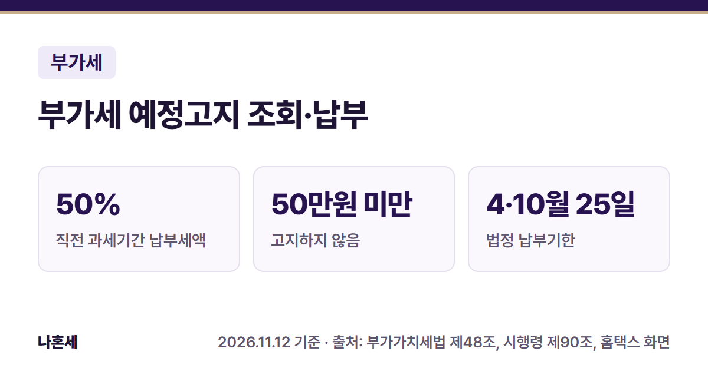
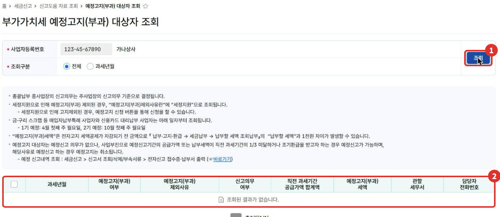
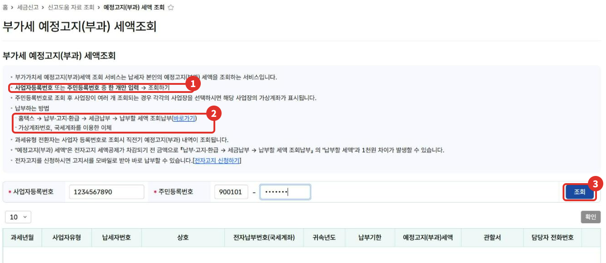
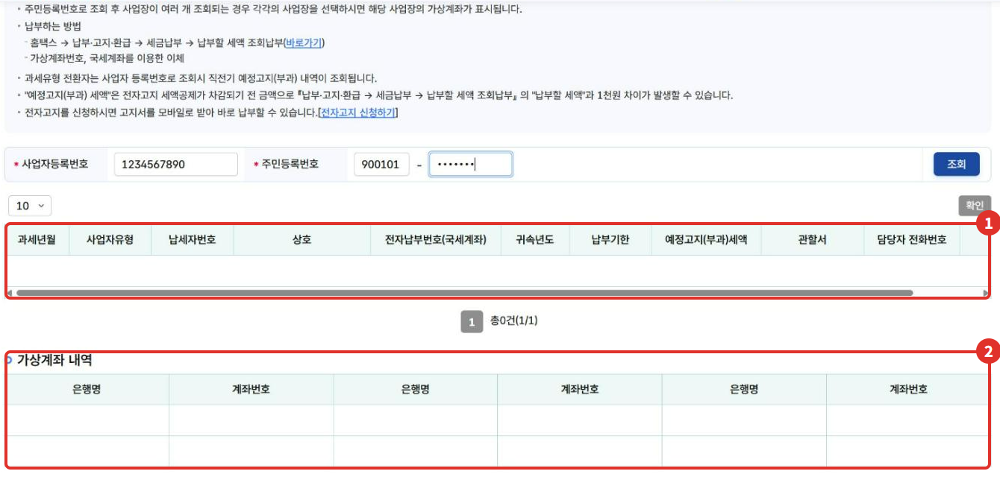

개인 일반과세자는 4월과 10월에 부가세를 따로 신고하지 않아도 세무서가 **예정고지서**를 보내요. 직전 과세기간에 낸 부가세의 절반을 미리 내는 거예요 [1]. 이 글은 내가 예정고지 대상인지, 얼마가 고지됐는지 홈택스에서 조회하는 화면과 납부 경로를 2026년 11월 기준으로 정리했어요.

{: .summary-card}

> 💡 **핵심 요약**
> - 고지 금액: **직전 과세기간 납부세액의 50%**(1천원 미만 버림) [1]
> - **고지할 금액이 50만원 미만이면 고지하지 않아요** [1]
> - 납부기한: 예정신고기간이 끝난 뒤 **25일까지(법정 기한 4월 25일, 10월 25일, 토·일요일·공휴일이면 다음 날)** [9]. **예정고지서를 받았다면 기한 안에 내야 해요**{: .red} [1][2]

목차

* 목차
{:toc}

## 한눈에 보기

| 항목 | 내용 |
|---|---|
| 누가 | 개인 일반과세자(직전 과세기간 공급가액 1억5천만원 미만 법인 포함) [1][2] |
| 얼마 | 직전 과세기간 납부세액의 50%, 50만원 미만은 고지 안 함 [1] |
| 언제 | 고지서 4월 1~10일·10월 1~10일 발부, 4월·10월 25일까지 납부 [1][2] |
| 조회 | 세금신고 > 신고도움 자료 조회 > 예정고지(부과) 대상자 조회·세액 조회 [3] |
| 납부 | 납부·고지·환급 > 세금납부 > 납부할 세액 조회납부, 가상계좌 이체 [3] |

## 누가 예정고지를 받나요?

부가세 과세기간은 1~6월(1기), 7~12월(2기)이고 [6], 각 기의 앞 3개월(1~3월, 7~9월)이 **예정신고기간**이에요 [1]. 법인은 이 기간에 예정신고를 하지만, **개인사업자는 세무서가 금액을 정해 고지**해요 [1].

- 대상: 개인사업자와 직전 과세기간 공급가액이 1억5천만원 미만인 법인사업자 [1][2]
- 고지하지 않는 경우: 고지할 금액이 **50만원 미만**, 해당 과세기간 시작일에 간이과세자에서 일반과세자로 바뀐 경우, 재난 등으로 낼 수 없다고 세무서가 인정한 경우 [1]
- 간이과세자는 예정고지가 아니라 직전 과세기간 납부세액의 50%를 7월 25일까지 내는 **예정부과**를 받아요(50만원 미만은 고지 안 함, 세금계산서를 발급한 간이과세자는 1~6월분 신고 의무) [4]

## 얼마가 고지되나요?

**직전 과세기간 납부세액의 50%**예요. 1천원 미만은 버려요 [1]. 직전 과세기간 세액은 신용카드 발행 공제·전자신고 공제 등을 뺀 금액이고, 수정신고·경정이 있었다면 반영한 금액이에요 [1].

**가상의 예시**로 계산해 보면 이래요.

| 직전 납부세액 | × 50%(1천원 미만 버림) | 고지 여부 |
|---|---|---|
| 1,300,000원 | 650,000원 | 고지 [1] |
| 1,000,000원 | 500,000원 | 고지(50만원 이상) [1] |
| 999,999원 | 499,999.5원 → 499,000원 | **고지 안 함(50만원 미만)** [1] |

## 홈택스로 조회하는 순서

> 📅 **2026년 11월 기준 화면**이에요(운영자 본인 사업자 계정, 사업자번호·주민번호·상호는 예시 값으로 바꿨어요). 운영자는 2026년 11월 개업이라 고지 대상이 아니어서 **조회 결과가 0건**으로 나왔어요.

### 1) 예정고지 대상자 조회

1. 홈택스 > 세금신고 > 신고도움 자료 조회 > **예정고지(부과) 대상자 조회**로 들어가요.
2. 조회구분(전체·과세년월)을 고르고 ① **[조회]**를 눌러요.
3. ② 결과 표에 과세년월별 **예정고지(부과) 여부, 제외사유, 신고의무 여부, 직전 과세기간 공급가액 합계액, 예정고지 세액, 관할 세무서**가 나와요.

   

화면 안내에는 세정지원으로 고지에서 빠진 경우 제외사유에 "세정지원"으로 나오고, 사업부진으로 공급가액이나 납부세액이 직전 과세기간의 3분의 1에 못 미치거나 조기환급을 받으려는 경우 예정신고를 할 수 있으며 그러면 예정고지는 취소된다고 적혀 있어요 [3][5].

### 2) 예정고지 세액 조회

1. 같은 메뉴의 **예정고지(부과) 세액 조회**로 들어가요.
2. ① **사업자등록번호 또는 주민등록번호 중 하나만** 넣고 ③ **[조회]**를 눌러요(캡처에는 예시 값이 두 칸에 다 들어가 있지만 한 칸만 넣으면 돼요).
3. ② 안내에 납부 방법이 나와요: **납부·고지·환급 > 세금납부 > 납부할 세액 조회납부**, 또는 가상계좌·국세계좌 이체 [3].

   

4. 아래 ① 결과 표에 과세년월, 전자납부번호, 납부기한, 예정고지(부과) 세액이 나오고, ② **가상계좌 내역**에 은행별 계좌번호가 나와요.

   

화면 안내에 따르면 조회되는 예정고지 세액은 **전자고지 세액공제를 빼기 전 금액**이라, 납부할 세액 조회납부 화면의 금액과 **1천원 차이**가 날 수 있어요. 전자고지를 신청하면 고지서를 모바일로 받아 바로 낼 수 있다는 안내도 있어요 [3].

## 고지 대신 예정신고를 할 수도 있어요

예정고지 대상이라도 다음에 해당하면 예정신고를 하고 실제 세액을 낼 수 있어요. 이때 예정고지 결정은 없었던 것으로 봐요 [1][5].

- 휴업·사업 부진 등으로 예정신고기간의 **공급가액이나 납부세액이 직전 과세기간의 3분의 1에 못 미치는** 경우 [5]
- 예정신고기간분에 대해 **조기환급**을 받으려는 경우 [5]

## 자주 하는 실수

- **확정신고 때 예정고지 세액을 빼지 않음**: 예정고지로 낸 금액은 확정신고 납부세액에서 빼요. 확정신고서의 "예정고지세액" 칸에 이미 낸 금액을 넣어야 두 번 내지 않아요 [7]. 이 블로그의 부가세 예상 세액 계산기에는 아직 이 칸이 없으니, 계산기 결과에서 직접 빼 주세요.
- **조회 금액과 납부 금액이 1천원 다르다고 놀람**: 전자고지 세액공제 때문일 수 있어요 [3].
- **고지서를 받고도 기한을 넘김**: 고지된 세액을 납부기한까지 내지 않으면 납부지연에 따른 가산세 등이 붙을 수 있어요 [8]. 기한 전에 조회해 두세요.

## 직접 하기 어려울 수 있는 경우

- 매출이 크게 줄어 예정신고로 바꿀지 판단해야 하는 경우
- 사업장이 여러 곳이거나 사업자 단위 과세를 하는 경우
- 고지 금액이 직전 신고와 맞지 않아 보이는 경우(수정신고·경정 반영 여부 확인)

이럴 때는 국세상담센터(126)나 관할 세무서 부가가치세과에 문의하거나, 세무대리인과 상의해 보세요.

## 자주 묻는 질문

**Q. 2027년 1기 예정고지는 언제 오나요?**
A. 1기분 고지서는 4월 1일~10일에 발부되고, 4월 25일까지 내요 [1][2]. 2027년 4월 25일은 일요일이라 다음 날인 4월 26일(월)이 기한이 될 것으로 보여요 [9]. 실제 날짜는 국세청 공지로 확인하세요. 금액은 2026년 2기(2027년 1월 확정신고) 납부세액의 50%예요 [1].

**Q. 신규 사업자도 예정고지를 받나요?**
A. 예정고지는 직전 과세기간 납부세액을 기준으로 해요 [1]. 운영자처럼 2026년 11월에 개업한 경우 2026년 11월 조회 결과는 0건이었어요. 내 경우는 위 조회 화면으로 확인하세요.

## 함께 보면 좋은 글

- [부가세 신고 전 내 세액 미리 계산하기]()
- [1월 부가세 신고 전 체크리스트]()
- [사장님 세무 일정 달력]()

## 출처

1. 법령: 부가가치세법 제48조 ①③④ (2026.1.2. 시행)
2. 법령: 부가가치세법 시행령 제90조 ④⑤ (2026.4.1. 시행)
3. 홈택스 예정고지(부과) 대상자 조회·세액조회 화면 안내 문구 (운영자 직접 확인: 2026-11-12)
4. 법령: 부가가치세법 제66조 ①③ (2026.1.2. 시행)
5. 법령: 부가가치세법 시행령 제90조 ⑥ (2026.4.1. 시행)
6. 법령: 부가가치세법 제5조 ① (2026.1.2. 시행)
7. 법령: 부가가치세법 제49조 ② 2호 (2026.1.2. 시행), 시행규칙 별지 제21호서식 (24) 예정고지세액
8. 법령: 국세기본법 제47조의4 (2026.10.2. 시행)
9. 법령: 국세기본법 제5조 ① (2026.10.2. 시행)

> 이 글은 2026년 11월 12일 기준의 일반적인 안내입니다. 세법과 홈택스 화면은 바뀔 수 있으니 납부 전 국세청 안내를 꼭 확인하세요. 개별 상황은 국세상담센터(126)에 문의하세요.
