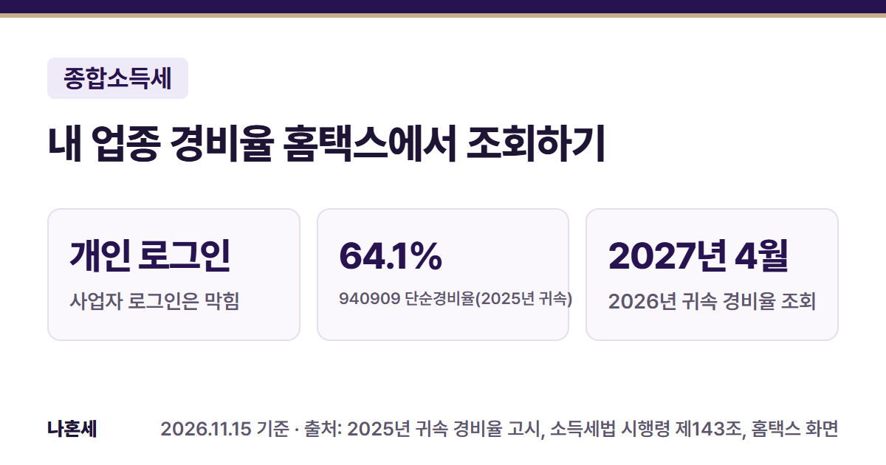
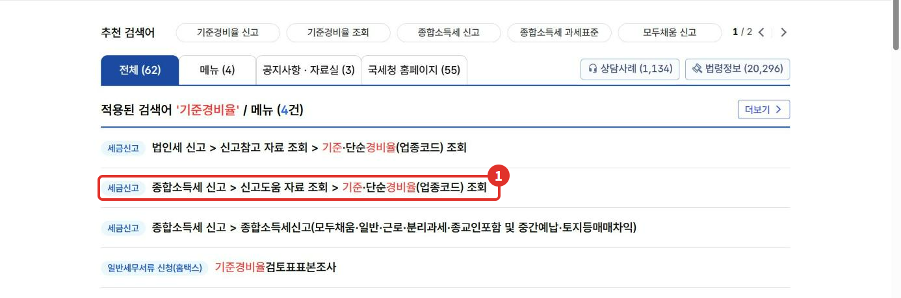
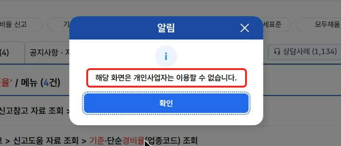
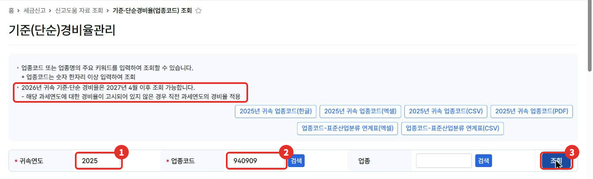
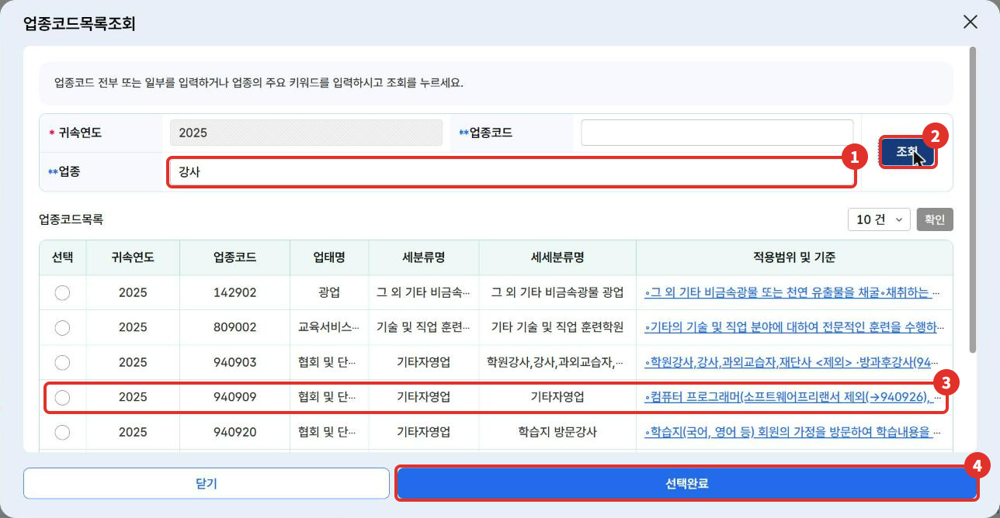
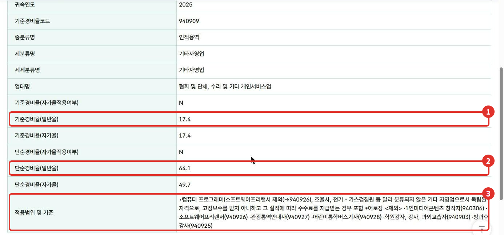

장부 없이 종합소득세를 신고하는 프리랜서·작은 개인사업자는 **업종별 경비율**로 소득금액을 계산해요. 홈택스에서 내 업종코드의 경비율을 미리 찾아볼 수 있는데, **사업자로 로그인하면 이 화면이 열리지 않아요**. 2026년 11월 기준 화면으로, 막히는 지점부터 조회 결과 읽는 법까지 따라가 봤어요.

{: .summary-card}

> 💡 **핵심 요약**
> - 메뉴: 홈택스 > 세금신고 > 신고도움 자료 조회 > **기준·단순경비율(업종코드) 조회**(2026년 11월 기준 화면) [1]
> - **사업자 로그인으로 들어가면 "해당 화면은 개인사업자는 이용할 수 없습니다"가 떠요. 개인으로 로그인하면 열려요**{: .red} [1]
> - 지금 조회되는 건 **2025년 귀속** 경비율이에요. 2026년 귀속(2027년 5월 신고분)은 **2027년 4월 이후** 조회할 수 있다고 화면에 적혀 있어요 [1]

목차

* 목차
{:toc}

## 한눈에 보기

| 항목 | 내용 |
|---|---|
| 누가 | 장부 대신 경비율로 소득을 계산하려는 사업자·프리랜서 [2] |
| 로그인 | 개인 로그인(사업자 로그인은 막힘) [1] |
| 메뉴 | 세금신고 > 신고도움 자료 조회 > 기준·단순경비율(업종코드) 조회 |
| 넣을 것 | 귀속연도, 업종코드(모르면 업종 키워드로 검색) [1] |
| 지금 조회 | 2025년 귀속 경비율(국세청 고시, 2026.3.30.) [3] |

## 경비율이 뭐예요?

장부를 쓰지 않으면 실제 쓴 경비를 하나하나 증명하기 어려워요. 이때 국세청이 업종마다 정해 둔 비율을 **수입금액(번 돈)**에 곱해서 경비를 계산하는데, 이 비율이 **경비율**이에요 [2][3].

| 구분 | 소득금액 계산 |
|---|---|
| 단순경비율 | 수입금액 − 수입금액 × 단순경비율 [2] |
| 기준경비율 | 수입금액 − 주요경비(매입비용·임차료·인건비, 증빙 있는 것) − 수입금액 × 기준경비율 [2] |

**단순경비율은 아무나 쓸 수 있는 게 아니에요.** 그해 새로 사업을 시작했거나, 직전 연도 수입금액이 업종별 기준에 못 미치는 사업자만 쓸 수 있어요(그해 수입금액도 간편장부대상자 기준 미만이어야 해요) [2][4].

| 구분 | 업종(요약) | 직전 연도 수입 |
|---|---|---|
| 가 | 농업·도소매업 등 | 6천만원 미만 [2] |
| 나 | 제조업·음식점업·정보통신업, 수리·기타 개인서비스업 중 인적용역(부가세법 시행령 제42조 제1호) 등 | 3,600만원 미만 [2] |
| 다 | 부동산임대업·전문서비스업·교육서비스업, 협회 및 단체, 수리·기타 개인서비스업(인적용역 제외) 등 | 2,400만원 미만 [2] |

내 업종이 어느 줄에 들어가는지는 업종코드마다 달라요. **확실하지 않으면 국세상담센터(126)에 업종코드를 말하고 확인하세요.**{: .red}

## 홈택스에서 조회하는 순서

> 📅 **2026년 11월 기준 화면**이에요(운영자 계정, 이름은 가렸어요).

1. 홈택스 위쪽 검색창에 **"기준경비율"**을 넣으면 메뉴가 여러 개 나와요. ① **종합소득세 신고 > 신고도움 자료 조회 > 기준·단순경비율(업종코드) 조회**를 눌러요(위의 "법인세 신고" 줄은 법인용이에요). 검색 결과에는 "종합소득세 신고" 아래로 보이지만, 들어가면 화면 위 경로는 "세금신고 > 신고도움 자료 조회"로 나와요.

   

2. **사업자로 로그인한 상태**라면 여기서 막혀요. "해당 화면은 개인사업자는 이용할 수 없습니다"라는 알림이 떠요 [1].

   

   → 로그아웃한 뒤 **개인**으로 다시 로그인하면 같은 메뉴가 열려요. 운영자는 개인 로그인으로 들어가서 이후 화면을 찍었어요.
   <!-- 로그인 방법 글(hometax-login-types)을 먼저 게시하면 여기에 post_url 링크 추가 -->

3. 조회 화면 위 안내를 먼저 봐요. **2026년 귀속 경비율은 2027년 4월 이후 조회할 수 있고, 그해 경비율이 고시되지 않았으면 직전 과세연도 경비율을 적용**한다고 적혀 있어요 [1]. 처음에는 귀속연도 칸에 2026이 들어 있어서, 운영자는 ① **귀속연도**를 지금 조회되는 **2025**로 바꿨어요.

   

4. ② **업종코드**를 알면 바로 넣고 ③ **[조회]**를 눌러요. 코드를 모르면 다음 단계처럼 키워드로 찾으면 돼요.

5. 코드를 모르면 오른쪽 **업종** 칸 옆 [검색]을 눌러요. 팝업에서 ① 업종 칸에 키워드를 넣고 ② **[조회]** → ③ 맞는 줄을 고르고 → ④ **[선택완료]**를 누르면 업종코드가 채워져요. 예시로 "강사"를 넣었더니 학원강사·강사·과외교습자(940903), 기타자영업(940909), 학습지 방문강사(940920) 등이 나왔고, 화면 예시로 ③ 940909 줄을 골랐어요.

   

   **오른쪽 "적용범위 및 기준" 칸까지 꼭 읽어요.** 이름이 비슷해도 학원강사·강사·과외교습자(940903), 1인 미디어 콘텐츠 창작자(940306)처럼 코드가 따로 있어요 [1][3].

6. 조회 결과에 경비율이 나와요. 예시로 **940909(기타자영업, 2025년 귀속)**를 조회했더니 ① 기준경비율(일반율) **17.4**, ② 단순경비율(일반율) **64.1**로 나왔어요. ③ 적용범위 및 기준에는 이 코드에 들어가는 사람과 빠지는 사람이 적혀 있어요 [1].

   

화면 위쪽의 [2025년 귀속 업종코드(엑셀·PDF 등)] 버튼으로 전체 목록 파일도 받을 수 있어요 [1].

## 가상 예시로 계산해 보기

**가상의 예시**예요. 940909 업종, 2025년 귀속 수입금액 **2,000만원**, 장부 없음, 증빙 있는 주요경비 0원이라고 가정했어요.

| 단계 | 단순경비율 | 기준경비율 |
|---|---|---|
| 수입금액 | 2,000만원 | 2,000만원 |
| 경비 | 1,282만원 (×64.1%) | 348만원 (×17.4%) |
| 소득금액 | **718만원** | **1,652만원** |

같은 수입인데 소득금액이 두 배 넘게 차이 나요. 그래서 **내가 단순경비율 대상인지가 가장 중요해요.**{: .red} 단순경비율 대상이 아니면 기준경비율 방식으로 계산해요 [2].

- 기준경비율 방식에는 상한이 있어요. 기준경비율로 계산한 소득금액이 "단순경비율 소득금액 × 배율(간편장부대상자 2.8, 그 밖에는 3.4)" 이상이면, 2027년 12월 31일이 속하는 과세기간까지는 그 배율 금액으로 할 수 있어요 [2][5]. 위 예시는 7,180,000원 × 2.8 = 20,104,000원보다 16,520,000원이 적어서 그대로예요.
- 복식부기의무자는 기준경비율의 2분의 1만 적용해요 [2].

**인적용역(업종코드 940으로 시작)은 수입금액 4천만원까지 단순경비율 기본율, 4천만원 초과분은 초과율을 적용해요**{: .red} [3]. 화면에는 "일반율·자가율"로 두 숫자가 나와서(940909는 64.1·49.7), 4천만원이 넘으면 위 예시처럼 한 비율로 곱하면 안 돼요. 초과분에 어느 숫자가 쓰이는지는 고시 표에서 확인하거나 126에 물어보세요. 그해 새로 시작해 1년이 안 된 경우에 4천만원을 어떻게 따지는지도 126에 확인하세요.

## 자주 하는 실수와 가산세

- **장부 없이 신고하면 가산세가 없다고 생각함**: 소규모사업자가 아니면 장부를 쓰지 않았을 때 가산세가 붙을 수 있어요. 산출세액 × (기장하지 않은 소득금액 ÷ 종합소득금액) × **20%**예요 [6]. 내가 소규모사업자에 해당하는지는 126에 확인하세요.
- **사업자 로그인으로 들어가서 "메뉴가 없다"고 생각함**: 개인 로그인으로 들어가면 열렸어요 [1].
- **비슷한 업종 이름만 보고 코드를 고름**: "적용범위 및 기준"에 제외 업종이 따로 적혀 있어요 [1].
- **지금 보이는 경비율을 내년 신고에 그대로 씀**: 경비율은 귀속연도마다 고시돼요. 2026년 귀속은 2027년 4월 이후 다시 확인해요 [1][3].
- **누구나 단순경비율을 쓸 수 있다고 생각함**: 직전 연도 수입금액 기준이 있고, 현금영수증 가맹 의무를 어긴 경우처럼 빠지는 사업자도 있어요 [2].

## 직접 신고가 어려울 수 있는 경우

- 업종이 둘 이상이거나 사업장이 여러 곳이라 수입금액을 환산해야 하는 경우 [2][4]
- 인적용역 수입금액이 4천만원을 넘어 기본율·초과율을 나눠 계산해야 하는 경우 [3]
- 복식부기의무자이거나, 경비율 대신 장부로 신고하는 게 나은지 따져 봐야 하는 경우 [2][4]

이럴 때는 국세상담센터(126)나 홈택스 상담을 이용하거나, 세무대리인과 상의해 보세요.

## 자주 묻는 질문

**Q. 사업자등록이 있는데 개인으로 로그인해도 되나요?**
A. 운영자도 사업자등록이 있지만 개인 로그인으로 조회가 됐어요. 사업자 로그인에서는 "개인사업자는 이용할 수 없습니다"가 떴어요 [1].

**Q. 2026년에 번 돈은 어느 경비율로 신고하나요?**
A. 2026년 귀속 종합소득세는 보통 2027년 5월에 신고하고(성실신고확인 대상은 6월까지) [7], 2026년 귀속 경비율로 계산해요. 화면 안내로는 2027년 4월 이후 조회할 수 있어요 [1]. 그 전에는 2025년 귀속 경비율로 대략 가늠만 해 보세요.

**Q. 경비율을 조회하면 신고까지 되나요?**
A. 아니요. 이 화면은 조회만 해요. 신고는 종합소득세 신고 메뉴에서 따로 해요.

## 함께 보면 좋은 글

- [종합소득세 중간예납 홈택스 조회]()

## 출처

1. 홈택스 기준·단순경비율(업종코드) 조회 화면 안내 문구·조회 결과, 사업자 로그인 알림창 (운영자 직접 확인: 2026-11-15)
2. 법령: 소득세법 시행령 제143조 ③·④·⑦ (2026.10.1. 시행, 2025년 귀속에 적용되는 판도 금액·업종 구분 같음)
3. [국세청 - 2025년 귀속 경비율 고시(국세청고시 제2026-14호, 2026.3.30.) 제2조~제4조](https://www.law.go.kr/LSW/admRulInfoP.do?admRulSeq=2100000276582) (확인일: 2026-11-15)
4. 법령: 소득세법 시행령 제208조 ⑤·⑦ (2026.10.1. 시행)
5. 법령: 소득세법 시행규칙 제67조 (2026.7.1. 시행, 2025년 귀속 판도 3.4·2.8로 같음)
6. 법령: 소득세법 제81조의5 (2026.7.1. 시행)
7. 법령: 소득세법 제70조 ①, 제70조의2 ② (2026.7.1. 시행)

> 이 글은 2026년 11월 15일 기준의 일반적인 안내입니다. 세법과 홈택스 화면은 바뀔 수 있으니 신고 전 국세청 안내를 꼭 확인하세요. 개별 상황은 국세상담센터(126)에 문의하세요.
