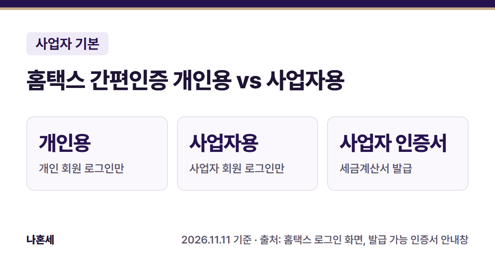
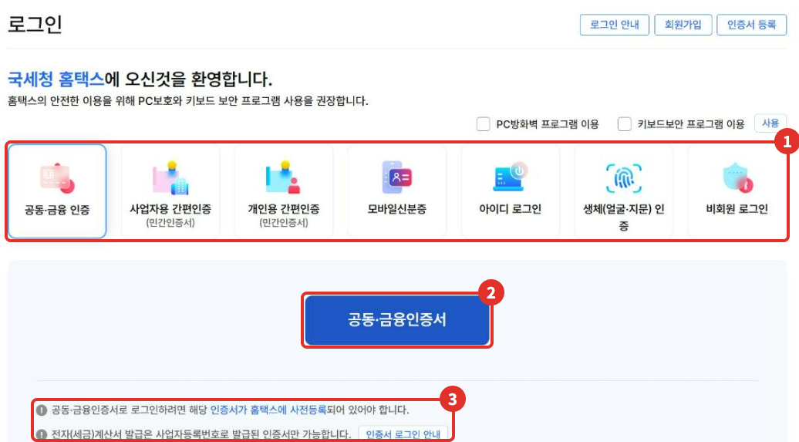
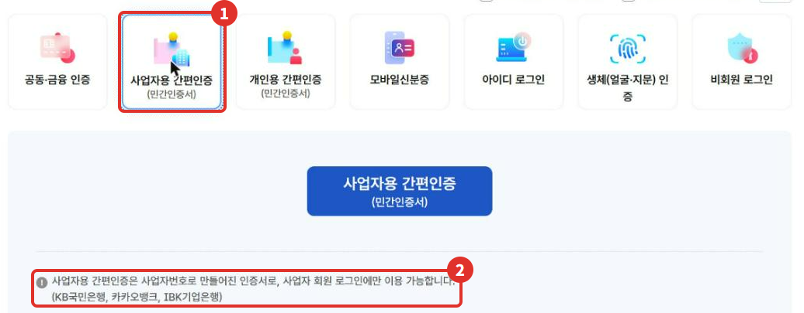
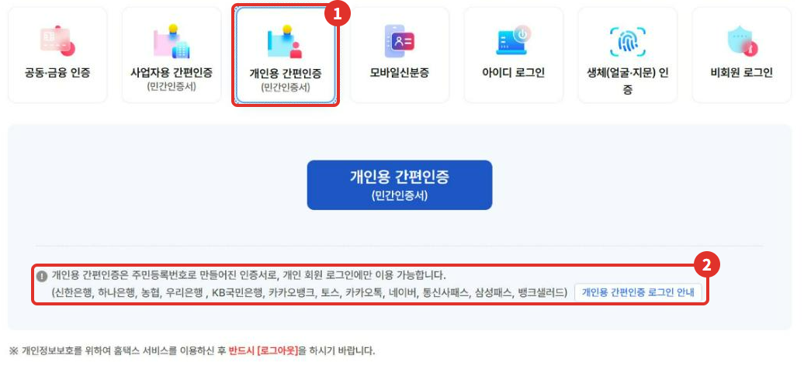
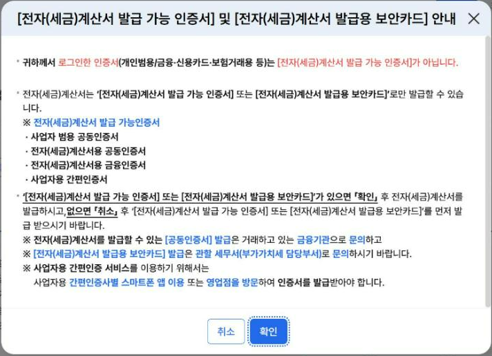

홈택스는 로그인 방법이 7가지나 돼서 처음엔 무엇을 눌러야 할지 헷갈려요. 특히 **개인용 간편인증은 개인 회원 로그인용**이고, 전자세금계산서는 사업자등록번호로 발급된 인증서로만 발급돼요 [1][2]. 이 글은 2026년 11월 홈택스 로그인 화면에 적힌 안내를 바탕으로, 어떤 일을 할 때 어떤 방법으로 들어가면 되는지 정리했어요.

{: .summary-card}

> 💡 **핵심 요약**
> - 개인용 간편인증 = 주민등록번호로 만든 인증서, **개인 회원 로그인에만** 써요 [1]
> - 사업자용 간편인증 = 사업자등록번호로 만든 인증서, **사업자 회원 로그인에만** 써요 [1]
> - **전자세금계산서는 사업자용 인증서(사업자 범용 공동인증서, 세금계산서용 공동·금융인증서, 사업자용 간편인증서)나 발급용 보안카드로만 발급돼요**{: .red} [2]

목차

* 목차
{:toc}

## 한눈에 보기

| 항목 | 내용 |
|---|---|
| 누가 | 홈택스를 처음 쓰는 개인사업자·프리랜서 |
| 로그인 방법 | 공동·금융 인증, 사업자용 간편인증, 개인용 간편인증, 모바일신분증, 아이디, 생체 인증, 비회원 [1] |
| 기억할 것 | 개인 일은 개인 로그인, 세금계산서 발급은 사업자용 인증서 [1][2] |
| 홈택스 메뉴 | 홈택스 맨 위 **로그인** (2026년 11월 기준 화면) |

## 로그인 방법 7가지

> 📅 **2026년 11월 11일 홈택스 로그인 화면**이에요.

홈택스 맨 위 **로그인**을 누르면 방법 7가지가 카드처럼 나란히 나와요 [1].

| 방법 | 화면 안내 |
|---|---|
| 공동·금융 | 인증서를 홈택스에 **미리 등록**해야 로그인돼요 [1] |
| 사업자용 간편 | 사업자번호로 만든 인증서, 사업자 회원 로그인 전용 [1] |
| 개인용 간편 | 주민번호로 만든 인증서, 개인 회원 로그인 전용 [1] |
| 아이디 | 홈택스에 회원가입한 아이디로 로그인 |

모바일신분증, 생체(얼굴·지문) 인증, 비회원 로그인도 있어요 [1]. 이 글에서는 사장님이 가장 많이 쓰는 간편인증과 공동·금융 인증을 중심으로 봐요.

## 개인용과 사업자용 간편인증, 뭐가 달라요?

**사업자용 간편인증**은 사업자등록번호로 만든 인증서예요. 화면에 안내된 발급처는 KB국민은행, 카카오뱅크, IBK기업은행이에요 [1].

**개인용 간편인증**은 주민등록번호로 만든 인증서예요. 은행·카카오톡·네이버·토스·통신사 패스 등 여러 곳의 인증서를 쓸 수 있어요 [1].

**전자세금계산서 발급은 사업자등록번호로 발급된 인증서로만 할 수 있어요**{: .red} [1][2]. 다만 모든 사업자 메뉴가 막히는 건 아니에요. 운영자는 부가세 수정신고 화면을 개인 인증서로 로그인한 뒤 사업자 화면으로 바꿔 들어갔어요(2026년 11월).

## 어떤 일에 어떤 로그인을 쓰나요?

이 블로그에서 실제로 따라가 본 결과예요(2026년 11월).

| 할 일 | 들어간 방법 |
|---|---|
| 소득금액증명·연말정산·장려금 | 개인 로그인 |
| 전자세금계산서 발급 | 사업자용 인증서 [2] |
| 부가세 수정신고 | 개인 로그인 뒤 사업자 화면으로 전환 |

- 개인 로그인으로 사업자등록을 신청했더니, 나중에 사업자 로그인으로 들어간 **처리결과 조회에는 0건**으로 나왔어요. 처리결과는 신청한 로그인으로 찾는 게 헷갈리지 않아요.
- 개인용 인증서로 로그인한 상태에서 전자세금계산서 **일괄 작성**을 누르면 "로그인한 인증서는 발급 가능 인증서가 아니다"라는 안내창이 떴어요 [2].

## 세금계산서용 인증서는 어디서 받나요?

안내창에 따르면 전자세금계산서는 아래 인증서나 보안카드로만 발급할 수 있어요 [2].

- 사업자 범용 공동인증서
- 전자(세금)계산서용 공동인증서
- 전자(세금)계산서용 금융인증서
- 사업자용 간편인증서
- 전자(세금)계산서 발급용 보안카드

받는 곳도 안내창에 적혀 있어요. 공동인증서는 **거래하는 금융기관**, 보안카드는 **관할 세무서(부가가치세 담당부서)**, 사업자용 간편인증서는 해당 **스마트폰 앱이나 영업점**에서 받아요 [2]. 공동·금융인증서는 받은 뒤 홈택스 로그인 화면의 **인증서 등록**을 먼저 해야 로그인돼요 [1].

## 자주 하는 실수

- **개인 로그인 상태로 세금계산서 일괄 작성을 누르기**: 발급 가능 인증서가 아니라는 안내가 떴어요 [2]. 사업자용 인증서로 다시 로그인해요.
- **신청한 로그인과 다른 로그인으로 처리결과를 찾기**: 개인으로 신청한 건이 사업자 로그인 조회에서는 0건으로 나왔어요(이 블로그 경험).
- **공동·금융인증서를 등록하지 않고 로그인하기**: 홈택스에 사전등록이 필요해요 [1].
- 다 쓴 뒤에는 반드시 **로그아웃**해요 [1].

## 직접 하기 어려울 수 있는 경우

- 인증서 발급·등록이 계속 안 될 때: 홈택스 원격지원이나 국세상담센터(**126**)에 물어보세요.
- 세무대리인이 대신 신고하는 사업장이라면, 대리인과 내가 각각 어떤 메뉴를 쓰는지 먼저 정하세요.

## 자주 묻는 질문

**Q. 간편인증 하나로 개인·사업자 일을 다 할 수 없나요?**
A. 화면 안내로는 개인용은 개인 회원, 사업자용은 사업자 회원 로그인에만 쓸 수 있어요 [1]. 개인 로그인 뒤 사업자 화면으로 바꿔 쓸 수 있는 메뉴도 있지만, 전자세금계산서 발급은 사업자용 인증서가 필요해요 [2].

**Q. 프리랜서(사업자등록 없음)는요?**
A. 사업자용 간편인증은 사업자번호로 만든 인증서라 쓸 수 없고, 개인 회원으로 로그인해요 [1].

## 함께 보면 좋은 글

- [홈택스 사업자등록 신청 방법]()
- [홈택스 전자세금계산서 발급 방법: 건별발급 순서]()
- [홈택스 소득금액증명 발급 방법]()

## 출처

1. 홈택스 로그인 화면 안내 문구(공동·금융 인증 사전등록, 사업자용·개인용 간편인증 대상과 발급처, 로그아웃 안내) (운영자 직접 확인: 2026-11-11)
2. 홈택스 [전자(세금)계산서 발급 가능 인증서] 및 [전자(세금)계산서 발급용 보안카드] 안내창 (전자세금계산서 일괄 작성 화면, 운영자 직접 확인: 2026-11-10)

> 이 글은 2026년 11월 11일 기준의 일반적인 안내입니다. 홈택스 화면은 바뀔 수 있으니 이용 전 국세청 안내를 꼭 확인하세요. 개별 상황은 국세상담센터(126)에 문의하세요.
