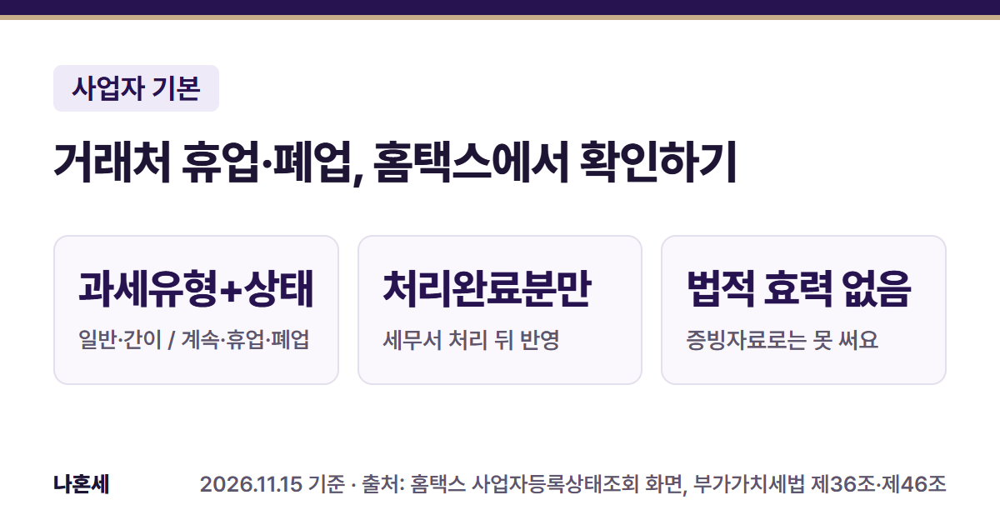
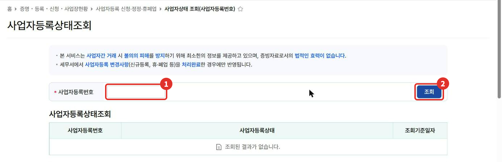
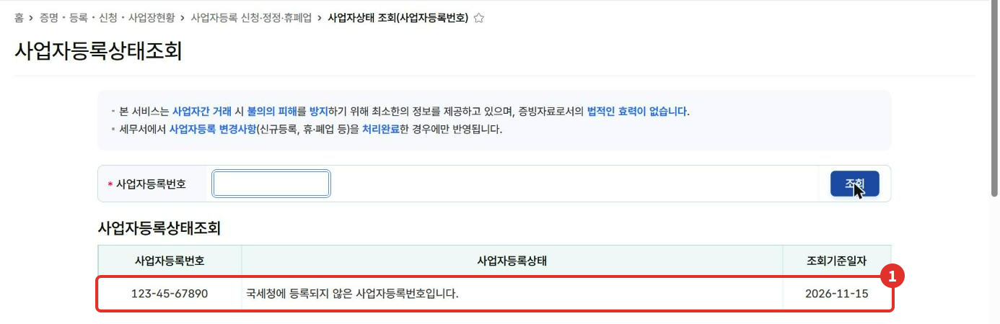
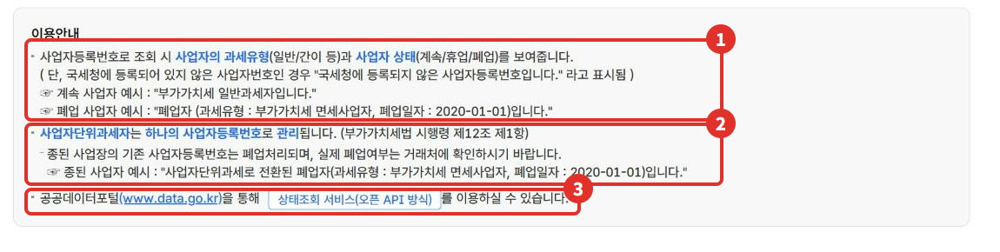

처음 거래하는 곳에서 세금계산서를 받거나 큰돈을 보내기 전에, 그 사업자번호가 **지금도 영업 중인지(계속·휴업·폐업)**와 **일반·간이과세자 중 무엇인지** 확인하고 싶을 때가 있어요. 홈택스에서 사업자등록번호만 넣으면 바로 볼 수 있어요. 2026년 11월 기준 화면으로 따라가 봤어요.

{: .summary-card}

> 💡 **핵심 요약**
> - 메뉴: 홈택스 > 증명·등록·신청·사업장현황 > 사업자등록 신청·정정·휴폐업 > **사업자상태 조회(사업자등록번호)**(2026년 11월 기준 화면) [1]
> - 결과에는 **과세유형(일반·간이 등)과 사업자 상태(계속·휴업·폐업)**가 나와요 [1]
> - **조회 결과는 증빙자료로서 법적 효력이 없고, 세무서에서 처리완료한 변경사항만 반영돼요**{: .red} [1]

목차

* 목차
{:toc}

## 한눈에 보기

| 항목 | 내용 |
|---|---|
| 누가 | 거래처의 휴·폐업, 과세유형을 확인하려는 사업자 |
| 넣을 것 | 상대방 사업자등록번호(숫자 10자리) [8] |
| 메뉴 | 증명·등록·신청·사업장현황 > 사업자등록 신청·정정·휴폐업 > 사업자상태 조회 |
| 보이는 것 | 과세유형, 휴업·폐업 여부, 조회기준일자 [1] |
| 주의 | 법적 효력 없음, 처리완료분만 반영 [1] |

## 왜 확인하나요?

거래처가 어떤 사업자인지에 따라 **받을 수 있는 증빙이 달라져요.** 사업자상태 조회는 그 첫 단추예요.

| 결과 | 알아 둘 점 |
|---|---|
| 일반과세자 | 원칙적으로 세금계산서를 발급해요(소매·음식점처럼 주로 소비자를 상대하는 업종은 영수증을 주기도 해요) [2][3] |
| 간이과세자 | 영수증만 발급하는 기간에 있으면 세금계산서를 받을 수 없어요(아래) [3] |
| 면세사업자 | 부가세가 면제되는 공급이라 세금계산서가 아니라 계산서(또는 영수증)를 발급해요 [2][7] |
| 폐업자 | 폐업 뒤에 발급된 세금계산서는 조심해야 해요(아래) [4] |

**간이과세자가 세금계산서 대신 영수증만 발급하는 경우**는 법에 정해져 있어요 [3].

- 1년 공급대가(새로 시작한 해는 1년 치로 환산)가 **4,800만원 미만**이면, 그다음 해 7월 1일부터 그다음 해 6월 30일까지
- 새로 사업을 시작한 간이과세자는 사업 개시일부터 그다음 해 6월 30일까지

예를 들어 2025년 공급대가가 4,800만원 미만이면 영수증만 발급하는 기간은 2026년 7월 1일~2027년 6월 30일이에요 [3]. 그래서 같은 간이과세자라도 언제 거래하느냐에 따라 달라져요.

**간이과세자가 영수증만 발급해야 하는 기간에 발급한 카드전표·현금영수증으로는 부가세 매입세액공제를 받을 수 없어요**{: .red} [5]. 목욕·이발·미용업처럼 업종 때문에 공제가 안 되는 경우도 따로 있어요 [5]. 카드 매입 공제의 다른 요건은 [수령명세서 글]()에 정리해 두었어요.

국세청 상태조회 오픈 API 명세에는 과세유형이 "부가가치세 간이과세자"와 **"부가가치세 간이과세자(세금계산서 발급사업자)"**로 따로 나뉘어 있어요 [8]. 다만 홈택스 화면에서 같은 문구로 나오는지는 운영자가 직접 보지 못했어요(운영자가 본 결과는 일반과세자와 미등록 번호뿐이에요). 세금계산서를 받을 수 있는지 헷갈리면 거래처에 직접 물어보는 게 확실해요.

폐업으로 등록이 말소된 뒤에 받은 세금계산서는 매입세액을 공제하지 않는다는 국세청 해석들이 있어요 [4]. 다만 폐업일은 실제로 사업을 그만둔 날이 기준이라 사실관계에 따라 달라질 수 있어요 [4]. 받은 세금계산서가 여기에 해당하는지 헷갈리면 국세상담센터(126)에 확인하세요.

## 홈택스에서 조회하는 순서

> 📅 **2026년 11월 기준 화면**이에요(운영자 계정으로 로그인한 상태, 화면 예시 번호는 가상의 123-45-67890으로 바꿨어요).

1. 홈택스 위 메뉴에서 **증명·등록·신청·사업장현황 > 사업자등록 신청·정정·휴폐업 > 사업자상태 조회(사업자등록번호)**로 들어가요. 화면 제목은 "사업자등록상태조회"예요 [1].

2. ① **사업자등록번호** 칸에 상대방 번호를 넣고 ② **[조회]**를 눌러요.

   

   화면 맨 위 안내에 **"증빙자료로서의 법적인 효력이 없습니다"**, **"세무서에서 사업자등록 변경사항(신규등록, 휴·폐업 등)을 처리완료한 경우에만 반영됩니다"**라고 적혀 있어요 [1].

3. 아래 표에 결과가 나와요. 계속 사업 중인 일반과세자는 ① **"부가가치세 일반과세자 입니다."**처럼 과세유형만 나왔어요. 오른쪽 **조회기준일자**는 이 결과가 언제 기준인지 알려 줘요 [1].

   

4. 국세청에 없는 번호를 넣으면 ① **"국세청에 등록되지 않은 사업자등록번호입니다."**가 나와요 [1]. 번호를 잘못 넣었는지 먼저 확인하고, 맞게 넣었는데도 이렇게 나오면 거래처에 사업자등록증을 다시 받아 보세요.

   

5. 화면 아래 **이용안내**에 결과 읽는 법이 있어요 [1].

   

   - ① 폐업자는 **"폐업자 (과세유형 : 부가가치세 면세사업자, 폐업일자 : 2020-01-01)입니다."**처럼 폐업일자까지 나와요(화면 예시 문구).
   - ② 사업자단위과세로 바뀐 사업자는 하나의 등록번호로 관리되고, 종된 사업장의 옛 번호는 폐업처리돼요. 그래서 **"사업자단위과세로 전환된 폐업자"로 나오면 실제로 문을 닫았는지는 거래처에 확인**하라고 안내해요 [1][6].
   - ③ 번호가 많으면 공공데이터포털(data.go.kr)의 상태조회 오픈 API로도 조회할 수 있다고 적혀 있어요 [1].

## 자주 하는 실수

- **조회 결과를 증빙으로 냄**: 이 화면은 법적 효력이 없어요 [1]. 공식 증명이 필요하면 사업자 본인이 발급하는 사업자등록증명 같은 민원증명을 받아요.
- **오늘 폐업했는데 폐업자 표시가 없어서 안심함**: 세무서에서 처리를 끝내야 반영돼요 [1]. 결과 옆 조회기준일자를 같이 봐요.
- **간이과세자면 무조건 세금계산서를 못 받는다고 생각함**: 영수증만 발급하는 기간이 아닌 간이과세자는 세금계산서를 발급할 수 있어요. 다만 주로 소비자를 상대하는 업종은 영수증을 발급하는 경우가 있어요 [3].
- **처음 한 번만 확인함**: 과세유형과 휴·폐업은 바뀔 수 있어요. 오래 거래한 곳도 큰 거래 전에는 다시 조회해 보세요.

## 직접 판단이 어려울 수 있는 경우

- 이미 받은 세금계산서의 발행자가 그 뒤 폐업자로 나오는 경우(공급 시기와 폐업일 앞뒤에 따라 달라질 수 있어요) [4]
- 거래처가 "사업자단위과세로 전환된 폐업자"로 나오는 경우 [1]
- 간이과세자에게 받은 카드전표·세금계산서를 공제받을 수 있는지 헷갈리는 경우 [3][5]

이럴 때는 국세상담센터(126)나 홈택스 상담을 이용하거나, 세무대리인과 상의해 보세요.

## 자주 묻는 질문

**Q. 상대방 이름이나 주소도 나오나요?**
A. 운영자가 본 화면에는 사업자등록번호, 상태 문구, 조회기준일자만 나왔어요 [1].

**Q. 내 사업자번호도 조회할 수 있나요?**
A. 네, 번호만 넣으면 돼요. 사업자등록이 처리됐는지, 과세유형이 맞게 들어갔는지 볼 때 쓸 수 있어요.

**Q. 조회하면 상대방이 알 수 있나요?**
A. 화면 안내에는 그런 내용이 없었어요. 이 서비스는 사업자 간 거래에서 피해를 막으려고 최소한의 정보만 보여 준다고 적혀 있어요 [1].

## 함께 보면 좋은 글

- [홈택스 전자세금계산서 발급 방법]()
- [홈택스 사업자등록증명 발급]()

## 출처

1. 홈택스 사업자등록상태조회 화면 안내 문구·이용안내·조회 결과 (운영자 직접 확인: 2026-11-15)
2. 법령: 부가가치세법 제32조 ① (2026.1.2. 시행)
3. 법령: 부가가치세법 제36조 ①·③, 제36조의2 ①·② (2026.1.2. 시행)
4. 국세청 해석(모두 옛 부가가치세법 제17조 기준): [부가22601-1731(1988.10.4.)](https://taxlaw.nts.go.kr/qt/USEQTA002P.do?ntstDcmId=010000000000120471), [서삼46015-10682(2001.11.16.)](https://taxlaw.nts.go.kr/qt/USEQTA002P.do?ntstDcmId=010000000000050636), [서면인터넷방문상담3팀-1810(2004.8.31.)](https://taxlaw.nts.go.kr/qt/USEQTA002P.do?ntstDcmId=010000000000038054) (확인일: 2026-11-17)
5. 법령: 부가가치세법 제46조 ③ (2026.1.2. 시행), 부가가치세법 시행령 제88조 ⑤ (2026.4.1. 시행)
6. 법령: 부가가치세법 시행령 제12조 ① (2026.4.1. 시행)
7. 법령: 소득세법 제163조 ① (2026.7.1. 시행)
8. [공공데이터포털 - 국세청 사업자등록정보 진위확인 및 상태조회 서비스(API 명세 v1.1.0)](https://www.data.go.kr/data/15081808/openapi.do) (확인일: 2026-11-17)

> 이 글은 2026년 11월 17일 기준의 일반적인 안내입니다. 세법과 홈택스 화면은 바뀔 수 있으니 거래 전 국세청 안내를 꼭 확인하세요. 개별 상황은 국세상담센터(126)에 문의하세요.
