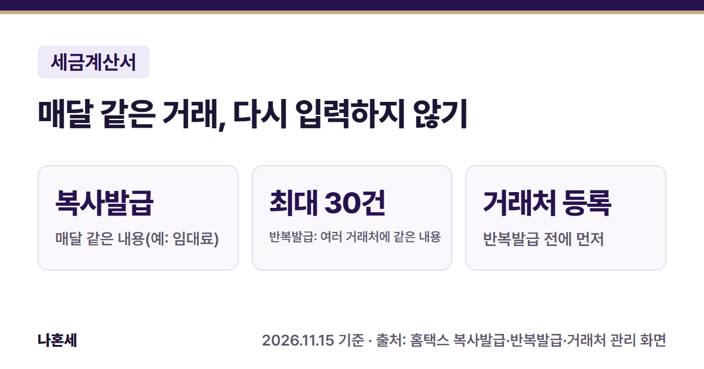
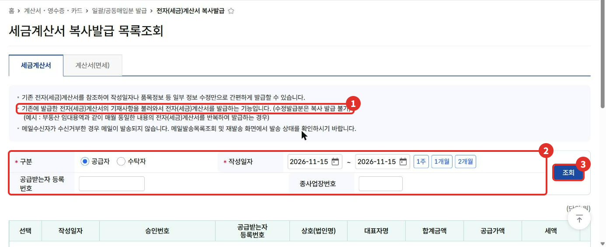
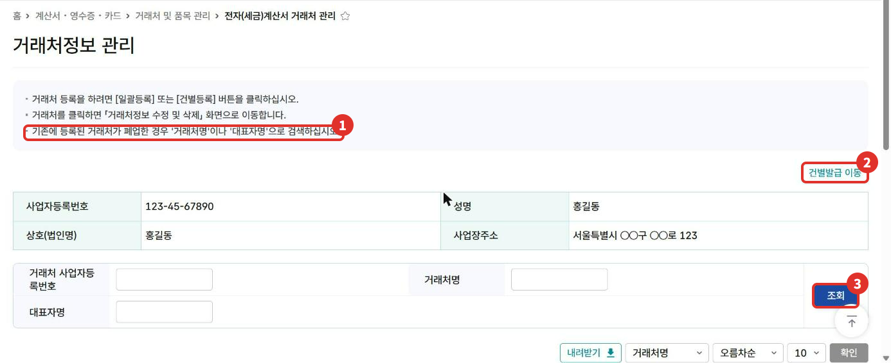
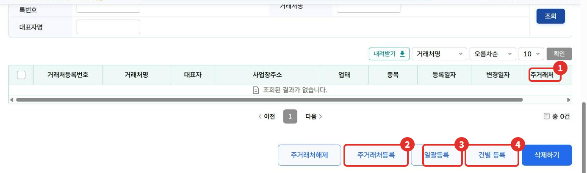
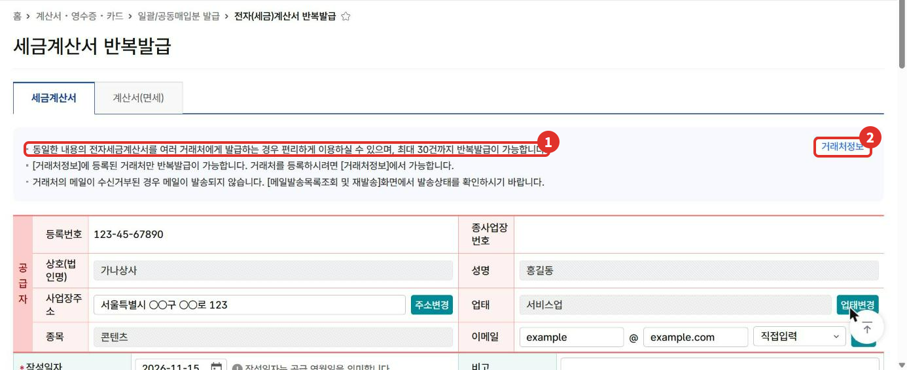
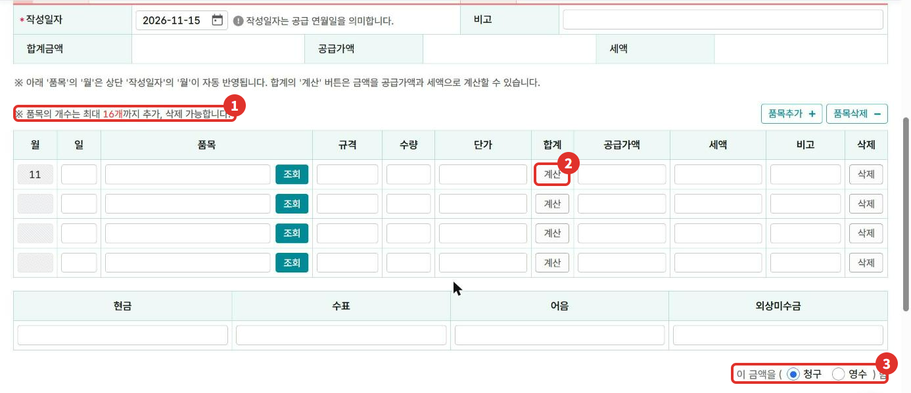
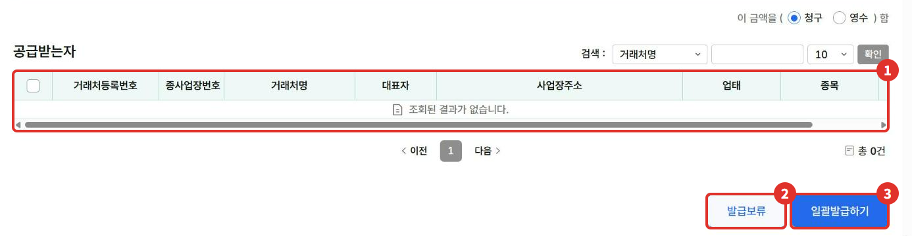

매달 같은 거래처에 같은 금액으로 세금계산서를 끊거나, 여러 거래처에 똑같은 내용으로 끊어야 할 때가 있어요. 그때마다 건별발급 화면에서 처음부터 다 입력할 필요는 없어요. 홈택스에는 **복사발급**과 **반복발급**, 그리고 둘을 편하게 해 주는 **거래처 관리** 메뉴가 있어요. 2026년 11월 기준 화면으로 정리했어요.

{: .summary-card}

> 💡 **핵심 요약**
> - **복사발급**: 전에 발급한 세금계산서를 불러와 작성일자·품목 등 일부만 고쳐 다시 발급해요. 매달 같은 내용(예: 임대료)에 맞아요. **수정발급분은 복사할 수 없어요** [1]
> - **반복발급**: 같은 내용을 여러 거래처에 한 번에, **최대 30건**까지 발급해요. **거래처정보에 등록된 거래처만 돼요**{: .red} [2]
> - 한 달 거래를 모아 끊는 월합계라면 **다음 달 10일까지** 발급해야 해요(공휴일·토요일이면 다음 영업일) [4]

목차

* 목차
{:toc}

## 한눈에 보기

| 항목 | 내용 |
|---|---|
| 복사발급 | 지난 세금계산서를 불러와 고쳐서 발급 [1] |
| 반복발급 | 같은 내용을 여러 거래처에, 최대 30건 [2] |
| 거래처 관리 | 반복발급 전에 거래처를 등록하는 곳 [3] |
| 누가 | 전자세금계산서를 발급하는 사업자(사업자 로그인) |

## 복사발급과 반복발급, 뭐가 달라요?

이름이 비슷해서 헷갈리는데, 화면 안내를 보면 쓰임이 달라요.

| 구분 | 복사발급 | 반복발급 |
|---|---|---|
| 언제 | 지난번과 같은 내용을 다시 | 여러 거래처에 같은 내용 |
| 시작 | 지난 발급 목록에서 고르기 [1] | 내용 입력 → 거래처 고르기 [2] |
| 조건 | 수정발급분은 복사 불가 [1] | 등록된 거래처만, 최대 30건 [2] |

복사발급 화면에는 예시로 **"부동산 임대용역과 같이 매월 동일한 내용의 전자(세금)계산서를 반복하여 발급하는 경우"**가 적혀 있어요 [1]. 반대로 반복발급은 **"동일한 내용의 전자세금계산서를 여러 거래처에게 발급하는 경우"**에 쓰라고 안내돼 있어요 [2].

**이름은 '반복'이지만 매달 반복되는 거래는 복사발급, 한 번에 여러 거래처로 보내는 건 반복발급이에요**{: .red}.

## 언제까지 발급해야 하나요?

메뉴가 달라도 발급 기한은 건별발급과 같아요.

| 경우 | 기한 |
|---|---|
| 원칙 | 재화·용역을 공급한 때 [4] |
| 월합계 등 | 공급한 달의 **다음 달 10일**(공휴일·토요일이면 다음 영업일) [4] |

월합계는 거래처별로 한 달(1일~말일) 공급가액을 합해 **그달 말일을 작성일자로** 적는 방식이에요 [4]. 한 달 안에서 사업자가 정한 기간을 합해 그 기간 마지막 날로 적거나, 증명서류로 실제 거래일이 확인되면 그날로 적는 방법도 있어요 [4].

복사발급으로 지난달 세금계산서를 불러오면 **작성일자를 이번 거래에 맞게 꼭 바꿔야 해요**. 반복발급 화면에는 "작성일자는 공급 연월일을 의미합니다"라고 적혀 있어요 [2].

## 복사발급 순서 (매달 같은 내용)

> 📅 **2026년 11월 기준 화면**이에요(운영자 본인 사업자 계정, 사업자 정보는 가상값). 이 계정은 발급한 세금계산서가 없어서 목록이 비어 있고, 발급 버튼은 누르지 않았어요. 아래 메뉴 경로는 화면 위쪽에 보인 경로라서, 전체메뉴에서의 위치는 조금 다를 수 있어요.

1. 홈택스에 **사업자로 로그인**하고 **전자(세금)계산서 복사발급**으로 들어가요. 화면 위쪽 경로는 계산서·영수증·카드 > 일괄/공동매입분 발급 > 전자(세금)계산서 복사발급으로 보였어요. 메뉴가 안 보이면 위쪽 검색창에 "복사발급"을 넣어도 돼요.
2. ① 안내 문구를 확인해요. **기존에 발급한 세금계산서의 기재사항을 불러와 발급하는 기능이고, 수정발급분은 복사할 수 없어요** [1].
3. ② **구분**(공급자·수탁자)과 **작성일자** 기간을 고르고, 필요하면 공급받는자 등록번호를 넣은 뒤 ③ **[조회]**를 눌러요. 기간은 1주·1개월·2개월 버튼으로도 고를 수 있어요.

   

4. 아래 목록에서 다시 발급할 세금계산서를 골라요. 목록에는 작성일자·승인번호·공급받는자·합계금액·공급가액·세액이 나와요.
5. 불러온 내용에서 **작성일자**와 품목·금액 등 바뀐 부분만 고치고 발급해요. 목록에서 고른 뒤의 화면은 발급 내역이 없어 이 글에서는 직접 보지 못했어요.

## 반복발급 순서 (여러 거래처에 같은 내용)

반복발급은 **거래처 등록이 먼저**예요. 등록된 거래처가 없으면 아래 공급받는자 목록이 비어 있어 고를 수 없어요 [2].

### 1) 거래처부터 등록하기

1. **전자(세금)계산서 거래처 관리**(화면 제목: 거래처정보 관리)로 들어가요. 화면 위쪽 경로는 계산서·영수증·카드 > 거래처 및 품목 관리 > 전자(세금)계산서 거래처 관리로 보였어요. 반복발급 화면 오른쪽 위 **[거래처정보]** 버튼으로도 갈 수 있어요 [2].
2. 안내 문구를 읽어요. 거래처는 **[일괄등록]**이나 **[건별등록]**으로 등록하고, 등록한 거래처를 누르면 수정·삭제 화면으로 가요 [3]. ① **등록한 거래처가 폐업하면 '거래처명'이나 '대표자명'으로 검색**하라고 안내돼 있어요 [3]. ② **[건별발급 이동]** 버튼으로 바로 건별발급 화면으로 넘어갈 수도 있어요. ③ 등록번호·거래처명·대표자명으로 **[조회]**해요.

   

3. 아래쪽 ③ **[일괄등록]**이나 ④ **[건별 등록]** 버튼으로 거래처를 등록해요 [3]. 목록에는 ① **주거래처** 칸이 있고, 아래에 ② **[주거래처등록]**·[주거래처해제] 버튼도 있어요. 운영자 계정은 등록된 거래처가 없어 목록이 0건이고, 이 버튼들은 눌러 보지 않았어요.

   

### 2) 반복발급 화면에서 한 번에 발급하기

1. **전자(세금)계산서 반복발급**(화면 제목: 세금계산서 반복발급)으로 들어가요. 화면 위쪽 경로는 계산서·영수증·카드 > 일괄/공동매입분 발급 > 전자(세금)계산서 반복발급으로 보였어요. 옆에 **계산서(면세)** 탭이 따로 있어요.
2. ① 안내 문구대로 **같은 내용을 여러 거래처에, 최대 30건까지** 발급할 수 있어요 [2]. 거래처가 없으면 ② **[거래처정보]**로 먼저 등록해요. 공급자(내 정보) 칸은 로그인한 사업자 정보로 채워져 있어요.

   

3. **작성일자**를 넣고 품목 줄에 일·품목·수량·단가를 넣어요. ① **품목은 최대 16개**까지 추가할 수 있어요 [2]. 품목의 '월'은 작성일자의 달로 자동으로 들어가요 [2]. ② 화면 안내로는 합계 칸의 **[계산]** 버튼으로 금액을 공급가액과 세액으로 계산할 수 있어요 [2]. ③ **청구/영수**도 골라요.

   

4. 아래 ① **공급받는자** 목록에서 보낼 거래처를 체크해요. 거래처정보에 등록된 곳만 여기 나와요 [2].
5. 내용을 확인하고 ③ **[일괄발급하기]**를 눌러요. 옆에 ② **[발급보류]** 버튼도 있어요(이 글에서는 눌러 보지 않았어요).

   

반복발급 화면에는 **거래처가 메일 수신을 거부했으면 메일이 가지 않으니 [메일발송목록조회 및 재발송] 화면에서 발송 상태를 확인하라**는 안내도 있어요 [2]. 발급한 뒤에는 [전자세금계산서 목록 조회]()에서 한 번 더 확인하세요.

## 가상 예시: 매달 임대료 세금계산서

상가 일부를 매달 1,100,000원(부가세 포함)에 빌려주는 **가상의 예시**예요. 임대료를 매달 말일에 받기로 한 계약이라고 가정하고, 지난달 세금계산서를 복사발급으로 불러와 작성일자만 이번 달로 바꾼다고 해 볼게요.

| 항목 | 지난달 | 이번 달(복사발급) |
|---|---|---|
| 작성일자 | 10월 말일 | **11월 말일**로 수정 |
| 공급가액 | 1,000,000원 | 1,000,000원 |
| 세액(10%) [7] | 100,000원 | 100,000원 |
| 합계금액 | 1,100,000원 | 1,100,000원 |

합계 1,100,000원을 공급가액과 세액으로 나누면 공급가액 1,000,000원(1,100,000 ÷ 1.1), 세액 100,000원이에요. 금액이 딱 나눠지지 않을 때 끝수가 어떻게 처리되는지는 화면에서 꼭 확인하세요.

임대료를 언제 공급한 것으로 보는지(공급시기)는 계약 조건에 따라 따져야 해서 이 글에서는 다루지 않았어요. 내 경우 작성일자를 언제로 해야 할지 헷갈리면 126에 먼저 확인하세요.

## 자주 하는 실수

- **복사한 뒤 작성일자를 안 바꾸기**: 지난달 날짜 그대로 발급될 수 있어요. 작성일자는 공급 연월일이에요 [2]. **착오나 과실로 필요적 기재사항(작성 연월일 등)이 사실과 다르게 적히면 공급가액의 1% 가산세가 붙을 수 있어요**{: .red}(나머지 기재사항으로 거래사실이 확인되면 제외) [5][6][8]. 틀린 것을 알았으면 수정발급으로 바로잡아요.
- **수정발급한 세금계산서를 복사하려고 하기**: 수정발급분은 복사발급이 안 돼요 [1]. 원래 세금계산서를 고쳐야 하면 [세금계산서 수정발급 글]()을 보세요.
- **거래처 등록 없이 반복발급 들어가기**: 공급받는자 목록이 비어 있어요. 거래처정보에 먼저 등록해요 [2].
- **월합계 기한 넘기기**: 모아서 끊을 때도 다음 달 10일을 넘기면 늦은 발급이에요. **그 거래가 속한 과세기간의 확정신고 기한까지 발급하면 공급가액의 1%, 그때까지도 발급하지 않으면 2% 가산세**예요(전자 발급 의무자가 종이로 발급한 경우 등 일부는 1%) [4][5].

## 직접 하기 어려울 수 있는 경우

- 거래처마다 금액·품목이 조금씩 달라 같은 내용으로 묶기 어려울 때(이때는 [일괄발급]()의 엑셀 방식이 맞을 수 있어요)
- 임대료·관리비처럼 공급시기 판단이 계약마다 다를 때
- 이미 발급한 세금계산서의 금액·거래처가 틀려 고쳐야 할 때

확실하지 않으면 **국세상담센터(126)**나 홈택스 상담으로 먼저 확인하세요.

## 자주 묻는 질문

**Q. 반복발급하면 매달 자동으로 발급되나요?**
A. 2026년 11월 화면 안내에는 예약·자동 발급 기능이 나와 있지 않아요. 안내된 용도는 같은 내용을 여러 거래처에 한 번에 발급하는 것이에요 [2]. 매달 같은 내용은 복사발급 화면에 예시로 나와 있어요 [1].

**Q. 반복발급은 몇 곳까지 한 번에 되나요?**
A. 화면 안내로는 최대 30건이에요 [2]. 그보다 많으면 일괄발급 메뉴를 확인하세요.

**Q. 면세사업자도 쓸 수 있나요?**
A. 복사발급·반복발급 화면 모두 **계산서(면세)** 탭이 따로 있어요 [1][2]. 이 글에서는 세금계산서 탭만 봤어요.

## 함께 보면 좋은 글

- [홈택스 전자세금계산서 발급 방법: 건별발급 순서]()
- [홈택스 영세율 세금계산서·일괄발급 방법]()
- [홈택스 세금계산서 수정발급 방법]()

## 출처

1. 홈택스 전자(세금)계산서 복사발급(세금계산서 복사발급 목록조회) 화면 안내 문구 (운영자 직접 확인: 2026-11-15)
2. 홈택스 전자(세금)계산서 반복발급(세금계산서 반복발급) 화면 안내 문구(최대 30건, 등록된 거래처만, 품목 최대 16개, 계산 버튼, 작성일자, 메일 수신거부) (운영자 직접 확인: 2026-11-15)
3. 홈택스 전자(세금)계산서 거래처 관리(거래처정보 관리) 화면 안내 문구·버튼 (운영자 직접 확인: 2026-11-15)
4. 법령: 부가가치세법 제34조 ①·③ (2026.1.2. 시행)
5. 법령: 부가가치세법 제60조 ② 1호·2호·5호 (2026.1.2. 시행)
6. 법령: 부가가치세법 제32조 ① 4호(작성 연월일) (2026.1.2. 시행)
7. 법령: 부가가치세법 제30조 (2026.1.2. 시행)
8. 법령: 부가가치세법 시행령 제108조 ③ (2026.4.1. 시행)

> 이 글은 2026년 11월 18일 기준의 일반적인 안내입니다. 세법과 홈택스 화면은 바뀔 수 있으니 신고 전 국세청 안내를 꼭 확인하세요. 개별 상황은 국세상담센터(126)에 문의하세요.
