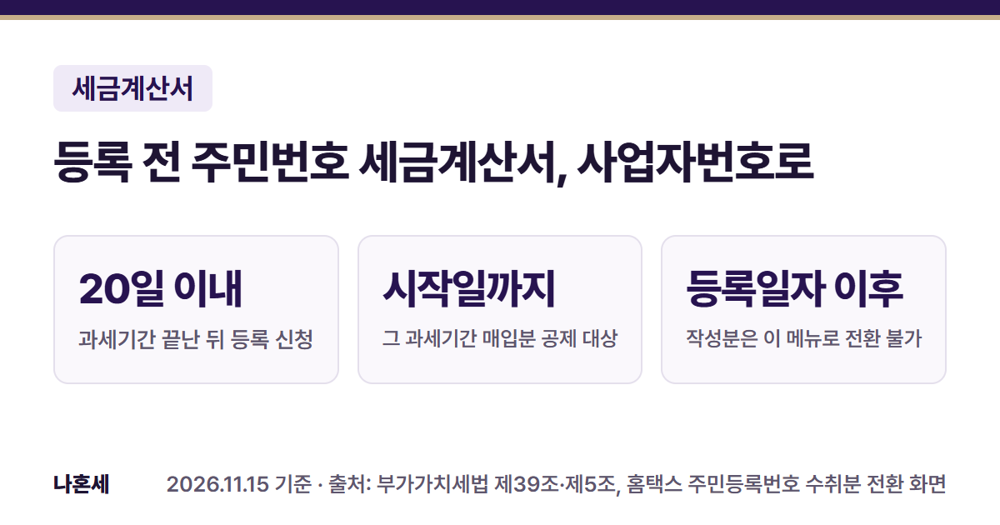
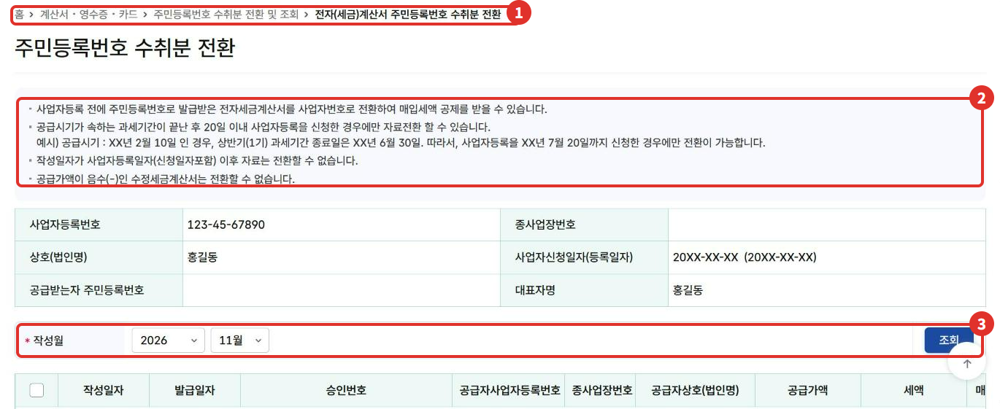
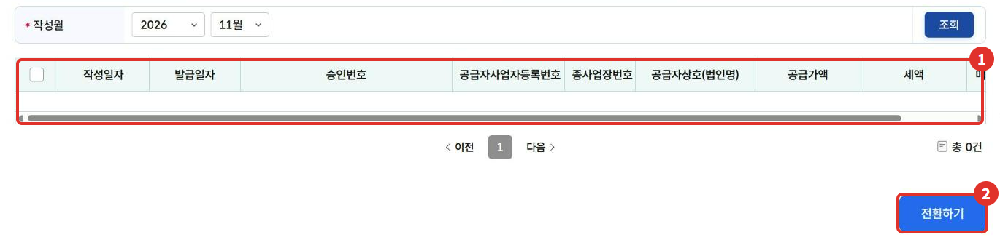

사업을 준비하면서 사업자등록 전에 인테리어·장비 같은 걸 사면, 아직 사업자번호가 없어 **주민등록번호로 세금계산서**를 받기도 해요. 이렇게 받은 전자세금계산서는 홈택스의 **주민등록번호 수취분 전환** 메뉴에서 사업자번호로 바꿀 수 있어요. 다만 등록을 언제 신청했느냐에 따라 전환도, 매입세액 공제도 안 될 수 있어요. 2026년 11월 기준 화면으로 정리했어요.

{: .summary-card}

> 💡 **핵심 요약**
> - 사업자등록 신청 전의 매입세액은 원래 공제되지 않아요. 다만 **공급시기가 속한 과세기간이 끝난 뒤 20일 안에 등록을 신청하면** 그 과세기간 시작일까지 거슬러 올라간 매입분은 공제 대상이 될 수 있어요(사업과 관련 없는 지출 등 원래 공제되지 않는 매입세액은 제외) [1][2]
> - 홈택스 안내도 같아요. **과세기간이 끝난 뒤 20일 안에 등록을 신청한 경우에만 전환할 수 있어요**{: .red} [3]
> - 화면 안내로는 **"작성일자가 사업자등록일자(신청일자포함) 이후 자료"와 공급가액이 음수(-)인 수정세금계산서는 전환할 수 없어요** [3]

목차

* 목차
{:toc}

## 한눈에 보기

| 항목 | 내용 |
|---|---|
| 대상 | 등록 전에 주민번호로 전자세금계산서를 받은 사업자 [3] |
| 기한 | 과세기간이 끝난 뒤 20일 안에 등록 신청 [1][3] |
| 할 일 | 작성월 조회 → 고르기 → [전환하기] [3] |
| 메뉴 | 계산서·영수증·카드 > 주민등록번호 수취분 전환 및 조회 [3] |

## 누가 쓰는 메뉴인가요?

사업자등록을 하기 전에 사업용으로 물건이나 서비스를 사면서, 공급자에게 **내 주민등록번호를 적어** 전자세금계산서를 받은 사람이 써요. 화면 안내 첫 줄이 "사업자등록 전에 주민등록번호로 발급받은 전자세금계산서를 사업자번호로 전환하여 매입세액 공제를 받을 수 있습니다"예요 [3].

전환은 등록이 끝난 뒤 **사업자로 로그인**해서 해요. 운영자도 사업자 계정으로 이 화면을 열었어요.

간이과세자는 세금계산서를 받고 매입처별 세금계산서합계표 등을 제출하면 공급대가의 0.5%를 납부세액에서 빼 줘요. 다만 **제39조에서 공제하지 않는 매입세액은 여기서도 빠진다**고 정해져 있어서, 조문상 등록 전 매입 규정도 같이 따라와요 [4]. 간이과세자의 과세기간은 1월 1일~12월 31일이에요 [2]. 화면 예시는 일반과세자 1기 기준뿐이라, 간이과세자 날짜로 전환되는지는 이 화면에서 확인하지 못했어요.

## 언제까지 등록을 신청해야 하나요?

법은 **사업자등록을 신청하기 전의 매입세액은 공제하지 않는다**고 정하고, 단서로 예외를 둬요 [1].

| 구분 | 내용 |
|---|---|
| 원칙 | 등록 신청 전 매입세액은 공제 안 됨 [1] |
| 예외 | 공급시기가 속한 과세기간이 끝난 뒤 **20일 이내** 등록 신청 [1] |
| 공제 범위 | 등록신청일부터 그 과세기간 시작일까지 거슬러 올라간 기간 [1] |

일반과세자의 과세기간은 1기 1월 1일~6월 30일, 2기 7월 1일~12월 31일이에요 [2]. 홈택스 화면에도 예시가 있어요. **공급시기가 2월 10일이면 1기 종료일이 6월 30일이니, 7월 20일까지 등록을 신청한 경우에만 전환할 수 있다**는 내용이에요 [3].

**과세기간이 끝난 뒤 20일을 넘겨 등록을 신청하면 그 과세기간의 등록 전 매입세액은 공제받을 수 없어요**{: .red} [1]. 사업 준비를 시작했으면 등록 신청을 미루지 않는 게 좋아요. 등록 신청 방법은 [홈택스 사업자등록 신청 글]()에 있어요.

## 홈택스에서 전환하는 순서

> 📅 **2026년 11월 기준 화면**이에요(운영자 본인 사업자 계정, 사업자 정보는 가상값). 운영자는 주민번호로 받은 세금계산서가 없어서 목록이 0건이었고, [전환하기]는 누르지 않았어요.

1. 홈택스에 **사업자로 로그인**하고 **전자(세금)계산서 주민등록번호 수취분 전환**으로 들어가요. ① 화면 위쪽 경로는 계산서·영수증·카드 > 주민등록번호 수취분 전환 및 조회 > 전자(세금)계산서 주민등록번호 수취분 전환으로 보였어요. 메뉴가 안 보이면 위쪽 검색창에 "주민등록번호 수취분"을 넣어 보세요.
2. ② 안내 문구 4가지를 먼저 읽어요. 20일 조건과 예시, **"작성일자가 사업자등록일자(신청일자포함) 이후 자료는 전환할 수 없습니다"**, 음수 수정세금계산서 불가가 적혀 있어요 [3].
3. 가운데 표에 사업자등록번호·상호·대표자명, **사업자신청일자(등록일자)**와 **공급받는자 주민등록번호** 칸이 있어요. 신청일자를 보면 어느 날짜 전 작성분까지 전환되는지 가늠할 수 있어요.
4. ③ **작성월**(연도·월)을 고르고 **[조회]**를 눌러요. 세금계산서 작성일자가 있는 달을 골라야 해요.

   

5. ① 아래 목록에 조회된 세금계산서가 나와요. 칸은 작성일자·발급일자·승인번호·공급자 사업자등록번호·공급자 상호·공급가액·세액 등이에요. 전환할 것의 왼쪽 칸을 체크해요.
6. ② **[전환하기]**를 눌러요. 운영자 계정은 0건이라 누르지 않았고, 누른 뒤의 화면은 이 글에서 보지 못했어요.

   

전환한 뒤에는 [전자세금계산서 목록 조회]()에서 매입 쪽에 잡혔는지 한 번 확인해 보세요. 이 글에서는 전환한 뒤 목록에 어떻게 나오는지 직접 확인하지 못했어요.

## 가상 예시: 개업 준비 중 산 장비

아래는 **가상의 예시**예요. 일반과세자로 등록할 사람이 개업 준비 중에 장비를 사고, 주민번호로 세금계산서를 받았다고 해 볼게요.

| 항목 | 내용 |
|---|---|
| 공급시기 | 2026년 5월 15일 (1기) |
| 금액 | 공급가액 2,000,000원 · 세액 200,000원 |
| 1기 끝 | 2026년 6월 30일 [2] |
| 등록 신청 | 2026년 7월 20일까지 해야 함 [1] |

- **7월 10일에 등록 신청**: 6월 30일 뒤 20일 안이에요. 신청일부터 1기 시작일(1월 1일)까지 거슬러 올라간 기간에 5월 15일이 들어가니 세액 200,000원은 공제 대상이 될 수 있어요 [1].
- **7월 21일에 등록 신청**: 20일을 넘겼어요. 이 세금계산서의 세액은 등록 전 매입세액으로 공제받을 수 없어요 [1].

사업과 관련 없는 지출처럼 원래 공제되지 않는 매입세액은 등록 시기와 상관없이 공제되지 않아요 [1].

## 자주 하는 실수

- **등록 신청을 미루기**: **20일 조건은 등록 '신청일' 기준이에요**{: .red}. 사업자등록증이 나온 날이 아니에요 [1][3].
- **등록 신청한 뒤에 받은 주민번호 세금계산서를 이 메뉴에서 찾기**: 화면 안내로는 **"작성일자가 사업자등록일자(신청일자포함) 이후 자료는 전환할 수 없습니다"** [3]. 시행령에는 등록을 신청한 사업자가 사업자등록증 발급일까지의 거래에 사업자나 대표자의 주민번호를 적어 받은 세금계산서는, 기재사항이 다르다는 이유로 공제를 막지 않는다는 규정이 있어요(다른 공제 요건은 따로 봐요) [5]. 이런 세금계산서를 신고 때 어떻게 넣는지는 이 글에서 확인하지 못했으니 126에 물어보세요.
- **음수(-) 수정세금계산서까지 고르기**: 공급가액이 음수인 수정세금계산서는 전환할 수 없어요 [3].
- **종이 세금계산서도 여기서 찾기**: 화면 안내는 **전자세금계산서**를 전환한다고 적혀 있어요 [3]. 종이로 받은 것은 이 메뉴에서 나오지 않을 수 있어요.

## 직접 하기 어려울 수 있는 경우

- 등록 신청이 과세기간 끝난 뒤 20일 근처라 날짜 계산이 애매할 때
- 사업 개시일 전에 등록을 신청해 첫 과세기간이 신청일부터 시작하는 경우 [2]
- 등록 전 매입이 많고 공급시기가 여러 과세기간에 걸쳐 있을 때
- 과세사업과 면세사업을 함께 하거나, 사업과 개인 용도가 섞인 매입이 있을 때

확실하지 않으면 **국세상담센터(126)**나 홈택스 상담으로 먼저 확인하세요.

## 자주 묻는 질문

**Q. 사업자등록증이 나오기 전에는 전환할 수 없나요?**
A. 화면 표에 사업자등록번호와 등록일자가 나오고, 사업자로 로그인해서 쓰는 메뉴라 등록이 된 뒤에 할 수 있어요. 등록증 발급까지는 보통 신청일부터 2일 이내예요(확인이 필요하면 연장될 수 있어요) [6].

**Q. 전환하면 매입세액이 무조건 공제되나요?**
A. 아니에요. 전환은 사업자번호로 바꾸는 절차이고, 공제는 20일 조건과 그 밖의 공제 요건을 따로 갖춰야 해요 [1][3].

**Q. 간이과세자도 쓸 수 있나요?**
A. 화면에 과세유형 제한은 적혀 있지 않았어요. 간이과세자는 받은 세금계산서의 합계표 등을 내면 공급대가 0.5%를 빼 주는 방식이고, 조문상 등록 전 매입 규정도 같이 적용돼요 [4]. 다만 화면 예시는 일반과세자 1기 기준만 있어서, 간이과세자 날짜로 전환되는지는 확인하지 못했어요.

## 함께 보면 좋은 글

- [홈택스 사업자등록 신청 방법]()
- [홈택스 전자세금계산서 목록 조회·합계표 확인]()
- [1월 부가세 신고 전 체크리스트]()

## 출처

1. 법령: 부가가치세법 제39조 ① 8호 (2026.1.2. 시행)
2. 법령: 부가가치세법 제5조 ①·② (2026.1.2. 시행)
3. 홈택스 전자(세금)계산서 주민등록번호 수취분 전환 화면 안내 문구 (운영자 직접 확인: 2026-11-15)
4. 법령: 부가가치세법 제63조 ③ (2026.1.2. 시행)
5. 법령: 부가가치세법 시행령 제75조 1호 (2026.4.1. 시행)
6. 법령: 부가가치세법 시행령 제11조 ⑤ (2026.4.1. 시행)

> 이 글은 2026년 11월 19일 기준의 일반적인 안내입니다. 세법과 홈택스 화면은 바뀔 수 있으니 신고 전 국세청 안내를 꼭 확인하세요. 개별 상황은 국세상담센터(126)에 문의하세요.
