11월에 받은 **2026년 귀속 종합소득세 중간예납** 고지서는 **작년(2025년 귀속) 세금을 기준으로** 정해져요. 그런데 올해 상반기 매출이 크게 줄었다면, 고지된 금액 대신 **올해 상반기 실적으로 계산한 세액을 직접 신고**할 수 있어요. 이것을 **중간예납 추계액 신고**라고 해요. 2026년 11월 기준 홈택스 화면으로 순서를 정리했어요.

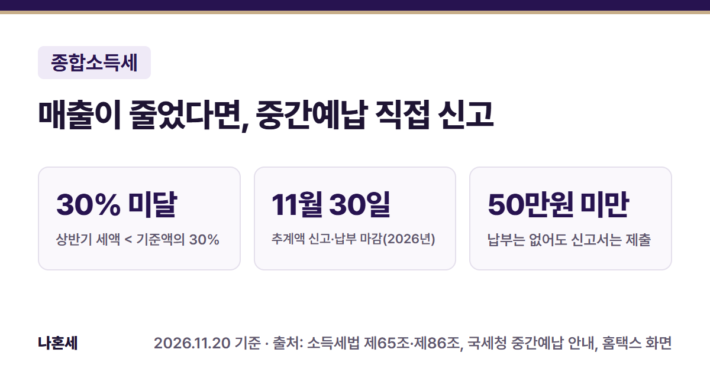{: .summary-card}

> 💡 **핵심 요약**
> - 올해 상반기 실적으로 계산한 세액(중간예납추계액)이 **중간예납기준액의 30%에 못 미치면** 고지 금액 대신 직접 신고할 수 있어요 [1][4]
> - **2026년 신고·납부 마감은 11월 30일(월)이에요**{: .red} [1][4]
> - 신고하면 고지된 세액은 없었던 것으로 봐요 [1]. 계산한 세액이 50만원 미만이면 낼 세금은 없지만 **신고서는 꼭 제출해야 고지세액이 취소돼요** [3][4]

목차

* 목차
{:toc}

## 한눈에 보기

| 항목 | 내용 |
|---|---|
| 누가 | 상반기 세액이 기준액의 30%에 못 미치는 사람(선택) / 기준액이 없는 복식부기의무자 중 상반기 사업소득이 있는 사람(의무) [1] |
| 기준 | 2026년 1월 1일~6월 30일 실적 [1] |
| 기한 | 2026년 11월 1일~30일(월) 신고·납부 [1][4] |
| 로그인 | **개인**으로 로그인(사업자 로그인은 안 열림) [6] |
| 메뉴 | 세금신고 > 종합소득세 신고 > 종합소득세신고 > 중간예납 추계액 신고 |

## 누가 신고하나요?

중간예납은 원래 세무서가 금액을 정해 고지하는 제도예요. 고지 금액은 **작년 세금(중간예납기준액)의 절반**이에요 [1][5]. 고지 금액을 조회하는 방법은 [중간예납 홈택스 조회 글]()에 정리해 두었어요.

추계액 신고는 아래 두 경우에 해요.

| 경우 | 내용 |
|---|---|
| 할 수 있어요 | 상반기 실적으로 계산한 세액이 **중간예납기준액의 30%에 못 미칠 때** [1][4] |
| 해야 해요 | 중간예납기준액이 없는 **복식부기의무자**가 상반기에 사업소득이 있을 때 [1][4] |

- **비교 대상은 고지된 금액이 아니라 "기준액"이에요**{: .red}. 고지 금액은 기준액의 절반이라, 고지 금액과 비교하면 판단이 틀려져요 [1].
- 복식부기의무자는 직전 연도(2026년 신고라면 2025년) 수입금액이 업종별 기준 이상인 사업자예요. 예를 들어 도소매업 3억원, 제조·음식점·정보통신업 등 1억5천만원, 부동산임대·교육·보건·전문서비스업 등 7,500만원이에요 [10]. 그해 새로 시작한 사업자는 빠지고, 의사·변호사·세무사 같은 전문직은 수입금액과 관계없이 해당하는 등 예외가 있어요 [10]. 내가 해당하는지 헷갈리면 126에 확인하세요.
- 고지 대상이 아닌 사람이 "30% 미달" 사유로 신고하려고 하면 홈택스가 막아요. 운영자 계정으로 해 보니 "중간예납 기준액이 없어 중간예납 고지 대상이 아니므로 신고사유 1로 신고하시기 바랍니다"라는 알림이 떴고, 사유 2로는 다음 화면으로 넘어가지 않았어요(2026년 11월) [6]. 아래 화면은 순서를 보여 드리려고 신고사유 1로 바꿔 진행한 것이에요.

## 언제까지 하나요?

- **신고·납부 기간: 11월 1일~30일**이에요 [1]. 2026년은 11월 30일이 월요일이라 그대로 **11월 30일(월)**까지예요 [4].
- 추계액 신고 기간은 법으로 **11월 1일~30일**이에요 [1]. 홈택스 도움말에도 **"정기신고만 가능합니다"**라고 적혀 있어요 [6]. 기간 안에 신고하지 않으면 **고지서를 받은 사람은 고지된 세액을 내야 하고**, 늦게 내면 납부지연가산세가 붙을 수 있어요 [12]. 신고 의무가 있는 복식부기의무자가 신고하지 않으면 세무서가 세액을 결정할 수 있어요 [1].

## 얼마인지 먼저 계산해 보기

추계액은 아래 순서로 계산해요 [1][4]. 홈택스 신고서도 같은 순서로 칸이 나와요.

| 순서 | 계산 |
|---|---|
| ① 과세표준 | (상반기 종합소득금액 × 2) − 이월결손금 − 종합소득공제 |
| ② 산출세액 | ① × 기본세율(6~45%) [7] |
| ③ 추계액 | ② ÷ 2 − (6월 30일까지의 감면·공제세액, 원천징수세액 등) |

상반기 소득을 두 배로 늘려 1년치로 보고 세금을 계산한 뒤, 다시 절반으로 나누는 구조예요.

### 가상의 예시로 보면

> 아래 숫자는 이해를 돕기 위한 **가상의 예시**예요. 종합소득공제는 본인 기본공제 150만원만 있다고 가정했어요 [8]. 실제 공제는 사람마다 달라요.

**예시 1. 신고할 수 있는 경우** (작년 기준액 600만원, 고지 300만원)

| 항목 | 금액 |
|---|---|
| 상반기 사업소득금액(수입 5,000만원 − 경비 3,525만원) | 14,750,000원 |
| × 2 | 29,500,000원 |
| − 종합소득공제(본인 기본공제) | 1,500,000원 |
| ① 과세표준 | 28,000,000원 |
| ② 산출세액: 84만원 + (2,800만원 − 1,400만원) × 15% [7] | 2,940,000원 |
| ③ 추계액: ② ÷ 2 (원천징수세액 등 없음) | **1,470,000원** |
| 비교: 기준액 600만원 × 30% | 1,800,000원 |

추계액 147만원이 180만원보다 적으니 신고할 수 있어요. 신고하면 고지된 300만원 대신 **147만원을 11월 30일까지** 내요 [1].

**예시 2. 신고할 수 없는 경우** (상반기는 같고, 작년 기준액 400만원, 고지 200만원)

기준액의 30%는 120만원이에요. 추계액 147만원이 120만원보다 많으니 **신고할 수 없고, 고지된 200만원을 내야 해요** [1].

**예시 3. 계산한 세액이 50만원 미만인 경우** (아래 홈택스 화면에 넣은 값)

상반기 소득금액 600만원이면 과세표준 1,050만원(600만원 × 2 − 150만원), 산출세액 63만원(× 6%), 추계액은 **31만5천원**이에요. 작년 기준액이 300만원(고지 150만원)이었다면 30% 선인 90만원보다 적으니 신고할 수 있어요.

이렇게 **추계액이 50만원 미만이면 낼 세금은 없어요** [3]. 하지만 **추계액 신고서를 내야 고지된 150만원이 취소돼요**{: .red} [4]. 홈택스도 작성완료를 누르면 "중간예납세액이 50만원 미만인 경우에는 소득세를 징수하지 않으니 납부서 출력을 제공하지 않습니다. 단, 신고서는 제출하셔야 됩니다"라고 안내해요 [6].

## 홈택스로 신고하는 순서

> 📅 **2026년 11월 기준 화면**이에요. 메뉴 이름과 위치는 바뀔 수 있어요. 아래 화면의 금액은 모두 가상의 값이고, 운영자는 **제출 버튼을 누르지 않았어요**.

### 1. 개인으로 로그인하고 메뉴 열기

1. 홈택스에 **개인으로 로그인**해요. 사업자로 로그인한 상태에서 메뉴를 누르면 "해당 화면은 개인사업자는 이용할 수 없습니다"가 떠요(2026년 11월 확인) [6].

   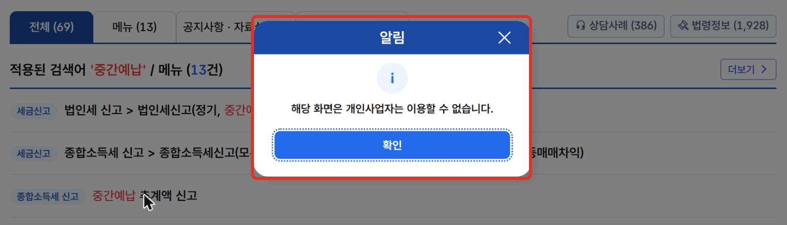

2. 위쪽 메뉴에서 ① **세금신고** → ② **종합소득세 신고** → ③ **종합소득세신고(모두채움·일반·근로·분리과세·종교인포함 및 중간예납·토지등매매차익)**를 눌러요.

   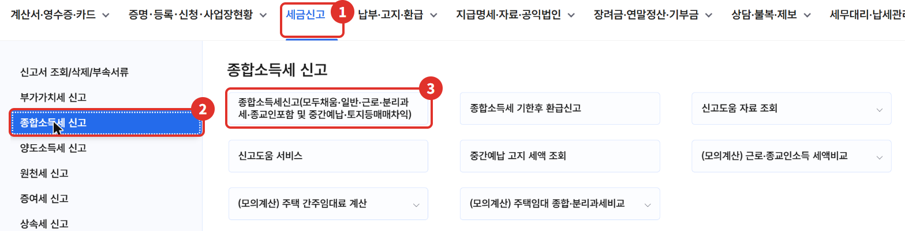

3. 화면을 맨 아래로 내리면 **종합소득세 예정신고** 칸이 있어요. ① **중간예납 추계액 신고 > [추계액 신고]**를 눌러요.

   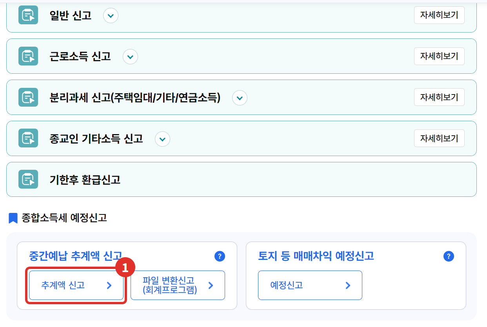

   옆의 **?** 도움말에는 신고 대상 두 가지와 기간(11.1.~11.30.), "정기신고만 가능합니다"가 적혀 있어요 [6].

   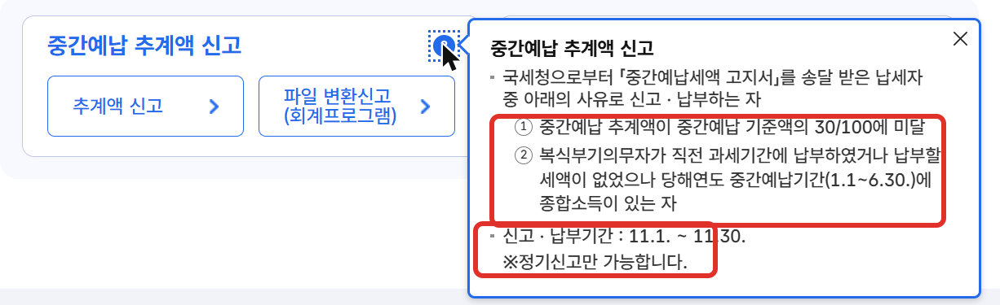

### 2. 기본사항과 신고사유 (01.중간예납신고)

신고서(법정 서식: 중간예납추계액신고서 [2])는 홈택스에서 **01.중간예납신고 → 02.종합소득금액 산출근거 → 03.중간예납 추계액신고서 → 05.신고서 제출** 순서예요(2026년 11월 화면).

1. ① 주민등록번호 옆 **[조회]**를 눌러 이름·주소를 불러와요. 누르지 않고 넘어가려고 하면 조회부터 하라는 알림이 떠요.
2. 사업자등록번호가 "있음"이면 번호를 넣고 ② **[확인]**을 눌러요. 상호·사업장 주소가 채워져요.
3. 주소지 전화·휴대전화·사업장 전화 중 **하나는 꼭** 넣어야 다음으로 넘어가요.
4. ③ **신고사유**를 골라요. 30% 미달이면 **신고사유 2**, 기준액이 없는 복식부기의무자는 **신고사유 1**이에요.

   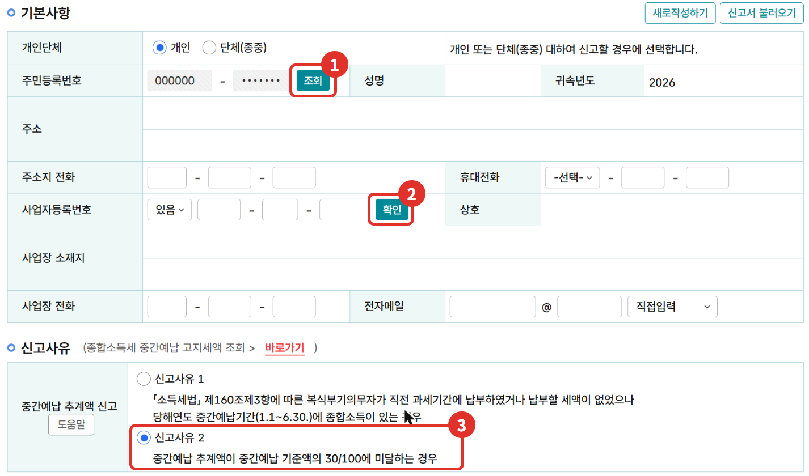

5. 화면 아래 ④ **[저장 후 다음 이동]**을 눌러요.

   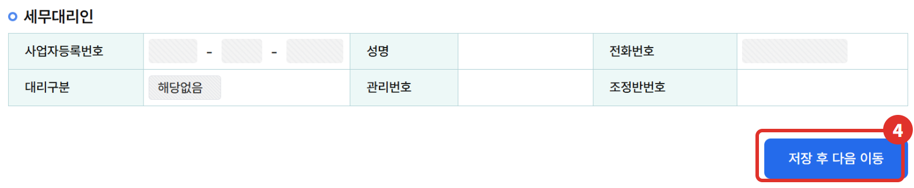

### 3. 상반기 소득금액 넣기 (02.종합소득금액 산출근거)

1. ① 사업소득 줄에 **1~6월 총수입금액과 필요경비**를 넣어요. 일반 사업자는 대부분 "부동산임대업외의 사업소득" 줄이에요.
2. 오른쪽 끝 **소득금액**(빨간 상자)이 자동으로 계산돼요. 예시는 수입 3,000만원 − 경비 2,400만원 = 600만원이에요.

   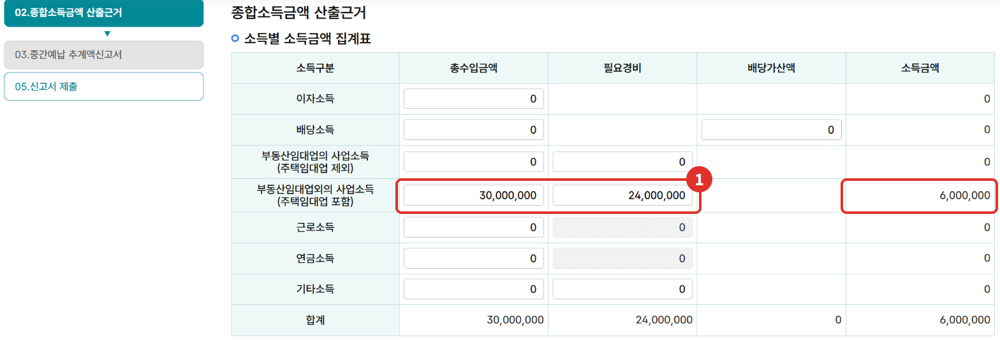

3. 아래 결손금 공제 칸까지 확인하고 **[저장 후 다음 이동]**을 눌러요.

### 4. 세액 계산 확인 (03.중간예납 추계액신고서)

1. 위쪽 **7~10번(작년 중간예납·확정신고 세액, 중간예납기준액)**은 이미 채워진 칸이에요. 운영자 계정은 고지 대상이 아니라 0으로 나왔어요.
2. 11번(상반기 소득금액)과 12번(× 2)은 앞 화면에서 넘어와요. ① **13번 이월결손금, 14번 종합소득공제**는 직접 넣어요. 예시는 본인 기본공제 150만원만 넣었어요 [8].
3. 과세표준·세율·산출세액이 자동으로 계산되고, ② **17번 중간예납 산출세액(산출세액 ÷ 2)**이 나와요.

   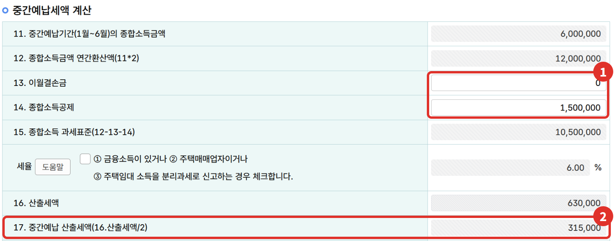

4. ① **18~22번(감면세액, 세액공제액, 원천징수세액 등)**은 6월 30일까지의 해당 금액을 넣어요 [1]. 예를 들어 상반기에 3.3%로 떼인 세금이 있으면 그중 **소득세분(3%)**을 22번에 넣어요. 0.3%는 지방소득세라서 소득세 원천징수세액이 아니에요(조문 기준이고, 22번 칸에 이 안내 문구가 따로 있는지는 확인하지 못했어요).
5. ② **26번 신고기한 내 납부세액**이 11월 30일까지 낼 금액이에요. 다만 **24번 금액이 50만원 미만이면 화면에 금액이 보여도 납부하지 않아요**(예시 화면의 315,000원이 그런 경우예요) [3][6]. 납부할 세액이 1천만원을 넘으면 일부를 2개월 안에 나눠 낼 수 있고, 25번 분납할세액 칸이 그 금액이에요 [9][4].
6. ③ 화면 아래 안내 두 줄을 확인해요. **24번 금액이 50만원 미만이면 납부하지 않고 납부서도 나오지 않아요.** 중간예납 때 **지방소득세·농어촌특별세는 따로 신고·납부하지 않는다**고 적혀 있어요 [6].
7. ④ **[신고서 작성완료]**를 눌러요.

   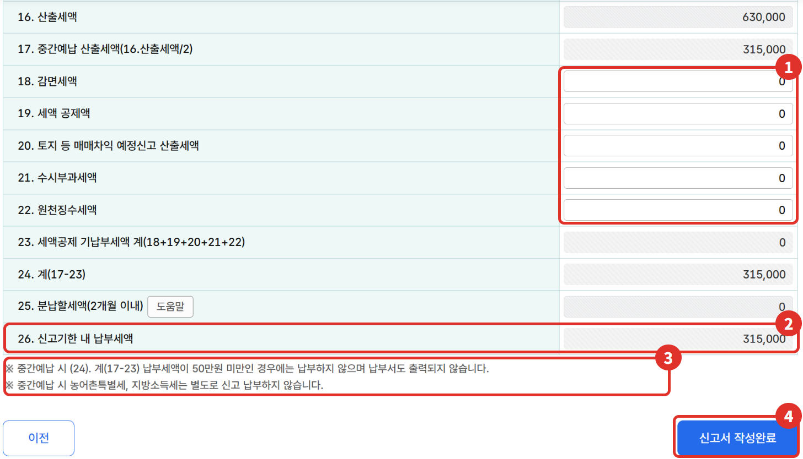

### 5. 요약 확인 후 제출 (05.신고서 제출)

1. **신고내용 요약**에서 종합소득금액·과세표준·**신고기한내 납부할 세액**(빨간 상자)을 확인해요. 50만원 미만이면 여기 금액이 나와도 납부서는 나오지 않아요 [3][6].
2. 맞으면 오른쪽 아래 **[신고서 제출하기]**를 눌러 제출해요. 운영자는 예시 값이라 이 버튼을 누르지 않았어요.

   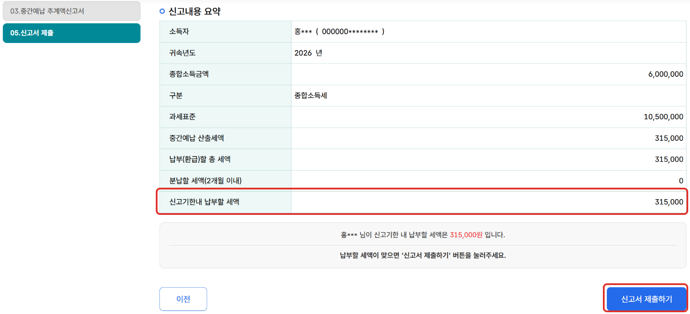

3. 낼 세액(50만원 이상)이 있으면 **11월 30일까지** 납부해요 [1][3]. 같은 화면 위쪽에 **신고내역 조회(접수증·납부서)** 탭이 있어요(운영자는 제출하지 않아 제출 뒤 화면은 확인하지 못했어요).

"저장 후 다음 이동"을 누르면 신고서가 **작성중**으로 저장돼요. 제출하기 전까지는 신고한 것이 아니에요(2026년 11월 화면).

## 자주 하는 실수

| 실수 | 이렇게 하세요 |
|---|---|
| 고지 금액과 비교 | 30%는 **기준액**(보통 고지 금액의 두 배)과 비교해요 [1] |
| 50만원 미만이라 신고 안 함 | 신고서를 내야 고지세액이 취소돼요 [4] |
| 사업자로 로그인 | **개인**으로 로그인해요 [6] |
| 원천징수세액 빠뜨림 | 상반기에 떼인 3.3% 중 소득세분(3%)은 22번에 넣어요 [1] |
| 12월로 미룸 | 신고 기간은 11월 30일까지예요 [1][6] |

**추계액을 사실과 다르게 낮춰 신고하면 세무서가 다시 계산해 결정할 수 있어요**{: .red} [1]. 상반기 장부를 바탕으로 정확히 계산하세요.

## 직접 신고가 어려울 수 있는 경우

- 상반기 수입·경비를 정리한 **장부가 없어** 소득금액을 계산하기 어려운 경우
- 이월결손금, 세액감면·공제가 있거나 금융소득·주택임대소득처럼 **세율 칸 체크 항목**에 해당하는 경우(신고서 세율 칸 안내) [6]
- 내가 복식부기의무자인지, 기준액이 얼마인지 헷갈리는 경우
- 이런 경우에는 **국세상담센터(126)**나 세무대리인에게 먼저 확인하는 게 안전해요.

## 자주 묻는 질문

**Q. 추계액으로 신고하면 고지된 세액은 안 내도 되나요?**
A. 네, 신고하면 고지된 중간예납세액은 없었던 것으로 봐요 [1]. 대신 신고한 추계액을 11월 30일까지 내요 [1].

**Q. 이렇게 덜 낸 세금은 나중에 어떻게 되나요?**
A. 중간예납은 1년 세금을 미리 일부 내는 거예요. 다음 해 5월 종합소득세 확정신고 때 1년 전체 세금을 계산하고, 11월에 낸 중간예납세액을 빼서 정산해요 [11].

**Q. 5월 확정신고에도 50만원 미만이면 안 내도 되나요?**
A. 아니에요. 50만원 미만을 징수하지 않는 규정은 **중간예납세액**에만 있어요 [3]. 홈택스도 "다음해 종합소득세 확정신고 시에는 소액 부징수 규정이 적용되지 아니하므로" 50만원 미만이라도 내야 한다고 안내해요 [6].

**Q. 고지서가 안 왔는데 이 신고를 해야 하나요?**
A. 고지가 없으면 보통 할 필요가 없어요. 다만 **중간예납기준액(2025년 귀속 소득세)이 없는 복식부기의무자가 올해 상반기 사업소득이 있으면 고지가 없어도 신고·납부해야 해요**{: .red} [1][4].

## 함께 보면 좋은 글

- [종합소득세 중간예납 홈택스 조회 방법: 11월 고지서, 내가 낼 금액 확인하기]()
- [사장님 세무 일정 달력: 매달·매년 홈택스로 직접 챙길 신고 한눈에]()

## 출처

1. 법령: 소득세법 제65조 ①③④⑤⑥⑧⑨ (2026.7.1. 시행)
2. 법령: 소득세법 시행령 제125조, 시행규칙 제100조 제13호(별지 제14호서식 중간예납추계액신고서)
3. 법령: 소득세법 제86조 제4호 (2026.7.1. 시행)
4. [국세청 - 중간예납추계액 신고 안내](https://www.nts.go.kr/nts/cm/cntnts/cntntsView.do?mi=2237&cntntsId=7675) (대상·계산식·50만원 미만 신고서 제출·분납·기한 2026.11.30.(월), 확인일: 2026-11-20)
5. [국세청 - 중간예납세액의 고지](https://www.nts.go.kr/nts/cm/cntnts/cntntsView.do?mi=2237&cntntsId=7674) (확인일: 2026-11-20)
6. 홈택스 - 중간예납 추계액 신고 화면의 도움말·안내 문구·알림창 (2026년 11월 화면, 확인일: 2026-11-20)
7. 법령: 소득세법 제55조 ① (2026.7.1. 시행)
8. 법령: 소득세법 제50조 ① (2026.7.1. 시행)
9. 법령: 소득세법 제77조 (2026.7.1. 시행)
10. 법령: 소득세법 제160조 ③, 시행령 제208조 ⑤ (2026.10.1. 시행)
11. 법령: 소득세법 제76조 ③ (2026.7.1. 시행)
12. 법령: 국세기본법 제47조의4 ① (2026.10.2. 시행)

> 이 글은 2026년 11월 20일 기준의 일반적인 안내입니다. 세법과 홈택스 화면은 바뀔 수 있으니 신고 전 국세청 안내를 꼭 확인하세요. 개별 상황은 국세상담센터(126)에 문의하세요.
