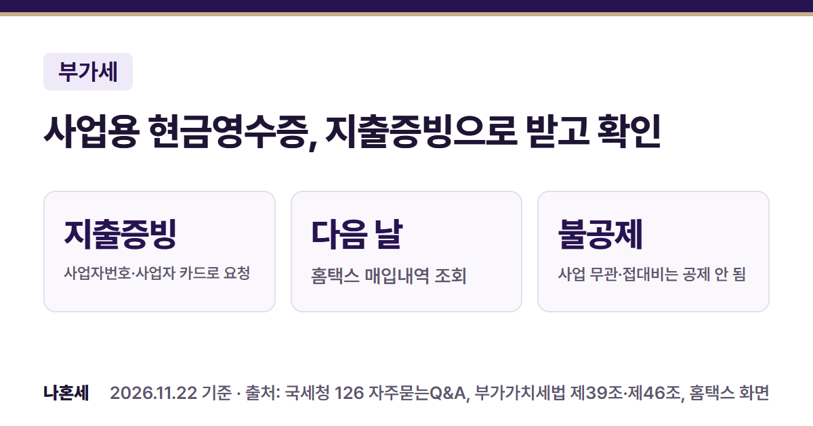
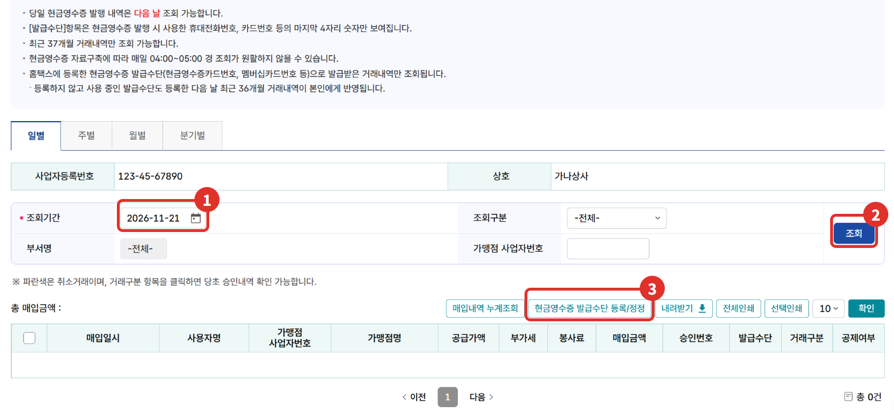
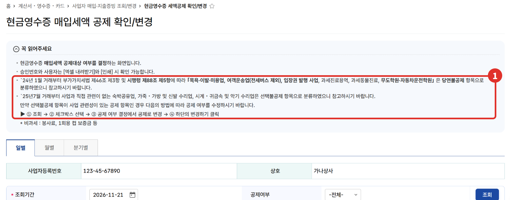
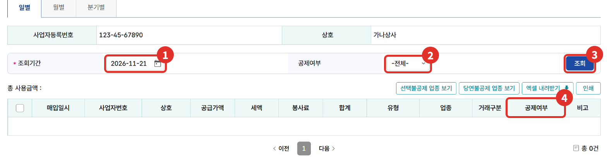
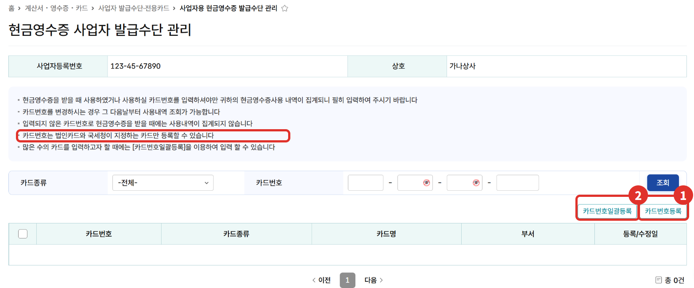
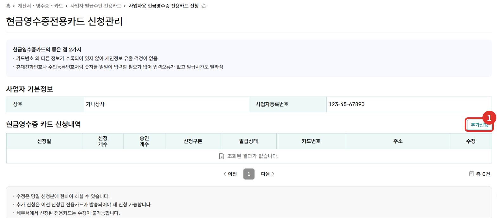
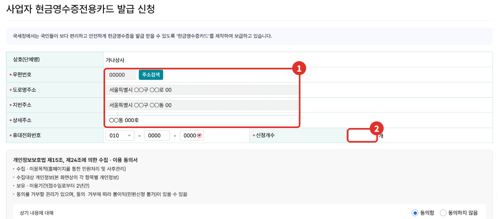
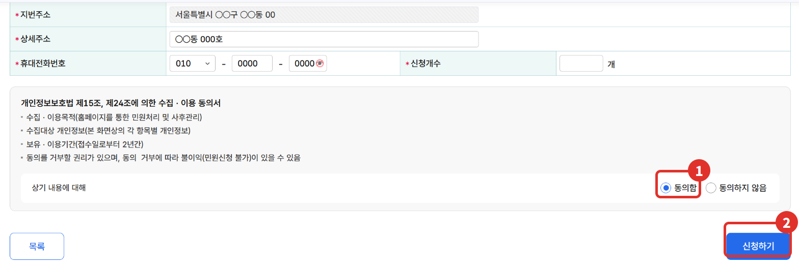

사업에 쓰는 물건을 현금(계좌이체 포함)으로 샀다면, 현금영수증을 **"지출증빙"**으로 받아 두어야 부가세 신고 때 매입세액 공제를 챙길 수 있어요. 이 글은 지출증빙 현금영수증을 받는 방법과, 받은 내역을 홈택스에서 조회하고 공제·불공제를 확인하는 화면을 2026년 11월 기준으로 정리했어요.

{: .summary-card}

> 💡 **핵심 요약**
> - 가게에서 **사업자등록번호나 사업자용 현금영수증카드**를 내고 "지출증빙으로 해 주세요"라고 하면 돼요 [1][2]
> - 받은 내역은 **다음 날** 홈택스 > 계산서·영수증·카드 > 사업자 매입·지출증빙 조회/변경에서 봐요 [3]
> - **공제로 분류돼 있어도 사업과 관계없는 지출, 기업업무추진비(접대비) 등은 공제받을 수 없어요**{: .red} [8]

목차

* 목차
{:toc}

## 한눈에 보기

| 항목 | 내용 |
|---|---|
| 누가 | 현금으로 사업용 지출을 하는 개인사업자 |
| 받는 법 | 사업자등록번호·사업자용 현금영수증카드 제시 [1] |
| 조회 | 발급 다음 날부터, 최근 37개월 [3] |
| 메뉴 | 계산서·영수증·카드 > 사업자 매입·지출증빙 조회/변경 |
| 공제 | 요건을 갖춘 매입분만 매입세액 공제 [6][7] |

## 지출증빙 현금영수증은 무엇인가요?

현금영수증에는 **"현금(소득공제)"**과 **"현금(지출증빙)"** 두 가지 용도가 있어요. 사업상 지출을 증빙하려고 받는 것이 지출증빙이에요 [2].

일반과세자는 사업에 쓰려고 산 물건·서비스의 부가세(매입세액)를 매출세액에서 뺄 수 있어요. 세금계산서 대신 **부가세가 따로 적힌 현금영수증**을 받았다면, 다음 요건을 모두 갖춰야 공제할 수 있는 매입세액으로 봐요 [6].

- 공제 대상 업종의 일반과세자(또는 세금계산서를 발급할 수 있는 간이과세자)에게서 샀을 것 [6][7]
- 부가세 신고 때 **신용카드매출전표등 수령명세서**를 낼 것 [6]
- 현금영수증을 보관할 것 [6]

## 가게에서 받는 방법

국세청 126 상담센터 안내를 보면, **사업자 인증수단(사업자등록번호, 사업자용 현금영수증카드 등)을 제시하면서** 사업자용 또는 현금(지출증빙) 영수증으로 달라고 하면 돼요 [1].

| 발급수단 | 알아 둘 점 |
|---|---|
| 사업자등록번호 | 홈택스 회원가입이 없어도 쓸 수 있어요 [1] |
| 사업자용 현금영수증카드 | 자동으로 등록돼 따로 등록할 필요가 없어요 [1] |
| 사업장에서 쓰는 카드 | 홈택스에서 카드번호를 직접 등록해야 해요. 등록할 수 있는 카드는 아래 발급수단 관리 화면 안내를 보세요 [1][3] |
| 개인 휴대폰번호 | 소비자로 가입해 지출증빙 귀속 사업장을 입력해야 해요 [1] |

- **개인 휴대폰번호로 지출증빙을 받았다면, 소비자로 가입해 "지출증빙 귀속 사업장"을 입력해야 사업자 내역으로 귀속돼요**{: .red} [1]. 경로는 계산서·영수증·카드 > 현금영수증(근로자·소비자) > 소비자 발급수단·전용카드 > 현금영수증 발급용 휴대전화번호/카드관리 > 지출증빙 귀속 사업장 입력이에요. 사업장이 여러 개라면 소비자 로그인 > 계산서·영수증·카드 > 근로자·소비자 조회/변경 > 현금영수증 지출증빙거래지정에서 거래별로 사업장을 지정해요(둘 다 126 안내 기준, 이 글에서 직접 열어 보지는 않았어요).
- 가게가 손님 정보 없이 국세청 번호(010-000-1234)로 발급했다면, 같은 묶음의 **현금영수증 자진발급분 사업자등록** 메뉴에서 승인번호·거래일자·금액을 넣어 내 것으로 등록하는 화면이 있어요. 발급일 다음 날부터 조회·등록할 수 있고, 당일 등록한 건만 취소할 수 있다고 안내돼요 [5].

## 홈택스에서 매입내역 조회하기

> 📅 **2026년 11월 기준 화면**이에요(운영자 본인 사업자 계정, 아직 받은 내역이 없어 0건). 사업자 정보는 가상값으로 바꿨어요.

1. 홈택스에 **사업자로 로그인**하고 전체메뉴에서 **계산서·영수증·카드 > 사업자 매입·지출증빙 조회/변경 > 현금영수증 매입내역(지출증빙) 조회**로 들어가요.
2. ① 조회기간을 고르고 ② **조회**를 누르면 받은 현금영수증이 건별로 나와요. 일별·주별·월별·분기별 탭으로 기간을 바꿀 수 있어요.
3. 발급수단(사업장 카드 등)을 등록하거나 고치려면 ③ **현금영수증 발급수단 등록/정정**을 눌러요.

   

화면 위쪽 안내에서 꼭 볼 것 [3]:

- **당일 발행한 현금영수증은 다음 날 조회돼요.**
- 최근 37개월 거래내역만 조회돼요.
- **홈택스에 등록한 발급수단으로 받은 거래만 조회돼요.** 등록하지 않고 쓰던 수단도 등록하면 다음 날 최근 36개월 내역이 반영돼요.

사업자등록번호로 받은 건이 따로 등록하지 않아도 이 목록에 나오는지는 운영자 계정에 내역이 없어 확인하지 못했어요. 목록에 없으면 126에 확인하세요.

## 공제·불공제 확인하고 바꾸기

같은 묶음의 **현금영수증 세액공제 확인/변경** 메뉴(화면 제목: 현금영수증 매입세액 공제 확인/변경)에서 홈택스가 분류한 공제·불공제를 보고 바꿀 수 있어요.

1. 화면 위 **꼭 읽어주세요**를 펼치면 ① 분류 기준과 바꾸는 순서가 나와요 [4].

   

2. ① 조회기간, ② 공제여부(선택지: 전체·공제대상·불공제대상, 2026년 11월 화면에서 확인)를 고르고 ③ **조회**를 눌러요. 목록 오른쪽 ④ **공제여부** 칸에 분류가 표시돼요.

   

3. 선택불공제 항목이 사업과 관련 있다면, 그 거래의 체크박스를 고르고 공제여부 결정에서 **공제로 바꾼 뒤 아래 변경하기**를 눌러요 [4]. 당연불공제 항목도 바꿀 수 있는지는 확인하지 못했어요. 운영자 계정은 내역이 0건이라 이 단계의 버튼은 화면에 나오지 않았어요. 사용내역이 있는 화면은 [사업용 신용카드 글]()의 같은 구조 화면을 참고하세요.

화면 안내의 분류는 이래요 [4].

| 구분 | 내용 |
|---|---|
| 당연불공제 | 목욕·이발·미용업, 여객운송업(전세버스 제외), 입장권 발행 사업, 과세진료용역, 과세동물진료, 무도학원·자동차운전학원. 법령상 매입세액 공제 대상에서 빠지는 업종이에요 [7]. 홈택스는 2024년 1월 거래부터 이 업종을 당연불공제로 분류한다고 안내해요 [4] |
| 선택불공제 | 숙박공유업, 가죽·가방·신발 수리업, 시계·귀금속·악기 수리업. 홈택스가 2025년 7월 거래부터 불공제로 분류하지만, 사업 관련이면 공제로 바꿀 수 있어요 [4] |

- **목록에 "공제"로 나와도 사업과 관계없는 지출, 기업업무추진비(접대비), 비영업용 승용차의 구입·임차·유지 관련 지출은 공제되지 않으니 불공제로 바꾸거나 신고 때 빼야 해요**{: .red} [8].

## 사업자용 현금영수증카드·발급수단 등록

**계산서·영수증·카드 > 사업자 발급수단·전용카드** 묶음에 두 메뉴가 있어요.

### 발급수단 관리(사업장 카드 등록)

**사업자용 현금영수증 발급수단 관리** 화면이에요. ① **카드번호등록**으로 한 장씩, 많으면 ② **카드번호일괄등록**으로 넣어요. 화면 안내로는 **법인카드와 국세청이 지정하는 카드만** 등록할 수 있고, 바꾸면 그다음 날부터 사용내역이 조회돼요 [3].

### 사업자용 현금영수증 전용카드 신청

번호를 매번 불러 주기 번거롭다면 국세청이 만든 **사업자용 현금영수증카드**를 신청할 수 있어요. 화면 안내로는 카드번호 말고 다른 정보가 들어 있지 않고, 번호를 입력하지 않아도 돼서 발급이 빨라요 [3].

1. **사업자용 현금영수증 전용카드 신청** 화면에서 신청내역을 보고 ① **추가신청**을 눌러요.

   

2. ① 카드를 받을 주소(바로 아래 휴대전화번호도)를 확인하고 ② **신청개수**를 넣어요. 운영자 화면에는 사업장 주소와 연락처가 미리 채워져 있었어요.

   

3. 개인정보 수집·이용에 ① **동의함**을 고르고 ② **신청하기**를 눌러요. 운영자는 신청하지 않고 화면만 확인했어요.

   

신청내역 화면 아래 안내 [3]:

- 수정은 **당일 신청분만** 할 수 있어요.
- 추가 신청은 이전에 신청한 카드가 **발송된 뒤**에 할 수 있어요.
- 세무서에서 신청한 카드는 홈택스에서 고칠 수 없어요.

## 얼마나 공제되나요? (가상 예시)

**산 사람이 일반과세자**이고, 사무용품을 일반과세자 가게에서 현금 33,000원에 사고 지출증빙 현금영수증을 받은 가상의 예시예요 [6].

| 가상의 예시 | 금액 |
|---|---|
| 현금영수증 금액(부가세 포함) | 33,000원 |
| 공급가액 | 30,000원 |
| 부가세(매입세액) | **3,000원** → 요건을 갖추면 공제 대상 |
| 같은 금액을 **영수증만 발급해야 하는 간이과세자** 가게에서 산 경우 | 공제 대상 아님 [6][7][10] |
| 같은 금액을 목욕·이발·미용업 등 당연불공제 업종에서 쓴 경우 | 공제 대상 아님 [7] |

**산 사람이 간이과세자**라면, 위와 같은 요건(공제 대상 사업자에게서 받음·수령명세서 제출)을 갖춘 경우 매입세액 대신 공급대가(부가세 포함 금액)의 0.5%를 납부세액에서 빼요. 같은 33,000원이면 165원이에요. 사업과 무관한 지출 등은 빠지고, 납부세액보다 많이 빼지는 못해요 [6][9].

## 자주 하는 실수

- **계산할 때 사업자 인증수단을 내고 "지출증빙"으로 요청하세요.** 매입내역 화면에는 홈택스에 등록한 발급수단으로 받은 거래만 조회된다고 안내돼요 [1][3].
- 개인 휴대폰번호로 지출증빙을 받고 귀속 사업장을 입력하지 않으면 사업자에게 정상 귀속되지 않아요 [1].
- **받은 날 바로 조회되지 않아요.** 다음 날 확인하세요 [3].
- 공제·불공제를 바꾼 뒤 **변경하기**를 누르지 않으면 반영되지 않아요 [4].

## 직접 하기 어려울 수 있는 경우

- 현금 지출이 많아 건마다 공제·불공제를 판단하기 어려울 때
- 사업용과 개인용 지출이 섞여 있을 때
- 이미 신고한 기간의 공제를 고쳐야 할 때

확실하지 않으면 **국세상담센터(126)**나 홈택스 상담으로 먼저 확인하세요.

## 자주 묻는 질문

**Q. 계좌이체로 낸 것도 현금영수증을 받을 수 있나요?**
A. 국세청은 대가를 계좌이체로 받은 경우도 현금영수증을 발급할 수 있는 현금으로 본 해석이 있어요 [11]. 자세한 내용은 [현금영수증 발급 글]()에 정리해 두었어요.

**Q. 홈택스 내역이 있으면 수령명세서는 안 내도 되나요?**
A. 법에는 수령명세서 제출이 공제 요건으로 적혀 있어요 [6]. 신고서에서 여는 곳과 작성 방법은 [수령명세서 글]()을 보세요.

**Q. 사업자용 현금영수증카드는 꼭 있어야 하나요?**
A. 아니요. 사업자등록번호를 불러 줘도 지출증빙으로 받을 수 있어요 [1]. 카드는 번호 입력을 줄이는 편의 수단이에요 [3].

## 함께 보면 좋은 글

- [홈택스 사업용 신용카드 등록 방법: 부가세 카드 매입세액 공제 준비]()
- [신용카드매출전표등 수령명세서 홈택스 작성법: 직접 입력부터 엑셀 변환 업로드까지]()
- [1월 부가세 신고 전 체크리스트: 12월~1월에 홈택스에서 미리 할 일 6가지]()

## 출처

1. [국세청 국세상담센터 - 자주묻는Q&A: 현금영수증 > 지출증빙용 현금영수증](https://call.nts.go.kr/call/qna/selectHomeQnaInfo.do?mi=12943&ctgId=CTG11726) (확인일: 2026-11-22)
2. 국세청고시 제2026-20호 「현금영수증사업자가 지켜야 할 사항 고시」 제2조 ② (2026.7.1. 시행)
3. 홈택스 현금영수증 매입내역(지출증빙) 조회·사업자용 현금영수증 발급수단 관리·전용카드 신청 화면 안내 문구 (운영자 직접 확인: 2026-11-22)
4. 홈택스 현금영수증 매입세액 공제 확인/변경 화면 "꼭 읽어주세요" 안내 문구 (운영자 직접 확인: 2026-11-22)
5. 홈택스 현금영수증 자진발급분 사업자 등록 화면 안내 문구 (운영자 직접 확인: 2026-11-22)
6. 법령: 부가가치세법 제46조 ③ (2026.1.2. 시행)
7. 법령: 부가가치세법 시행령 제88조 ⑤ (2026.4.1. 시행)
8. 법령: 부가가치세법 제39조 ① 4호~6호 (2026.1.2. 시행)
9. 법령: 부가가치세법 제63조 ③ 1호 (2026.1.2. 시행)
10. 법령: 부가가치세법 제36조 ① 2호 (2026.1.2. 시행)
11. [국세청 해석 서면인터넷방문상담3팀-2366](https://taxlaw.nts.go.kr/qt/USEQTA002P.do?ntstDcmId=010000000000031021) (2006.10.9., 대가를 현금(계좌이체 포함)으로 받으면 현금영수증 발급 가능)

> 이 글은 2026년 11월 22일 기준의 일반적인 안내입니다. 세법과 홈택스 화면은 바뀔 수 있으니 신고 전 국세청 안내를 꼭 확인하세요. 개별 상황은 국세상담센터(126)에 문의하세요.
