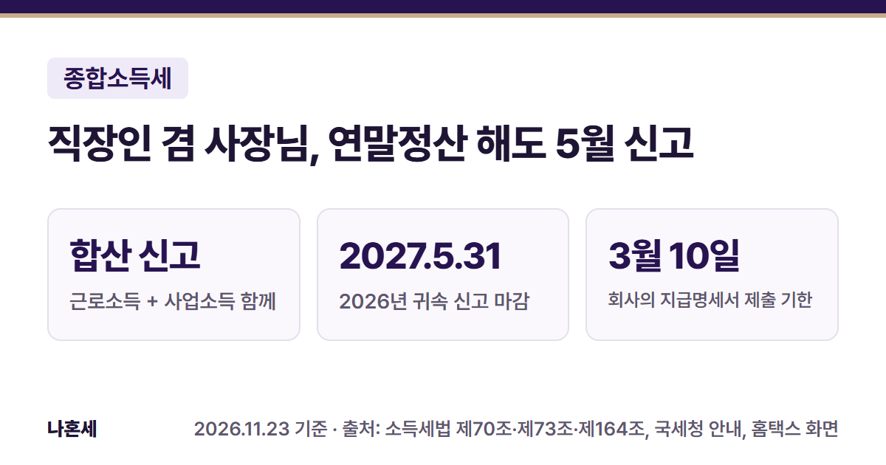
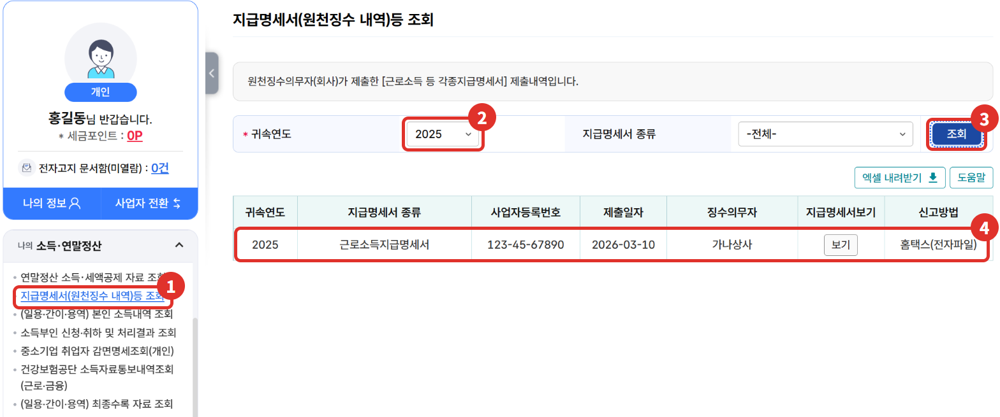
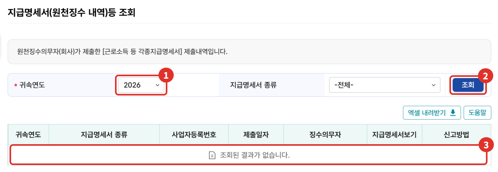
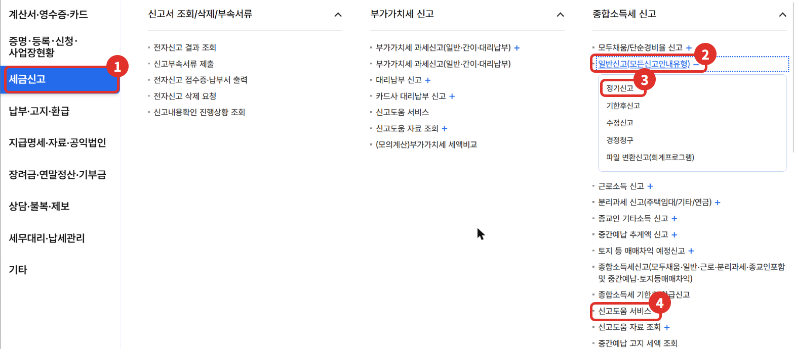
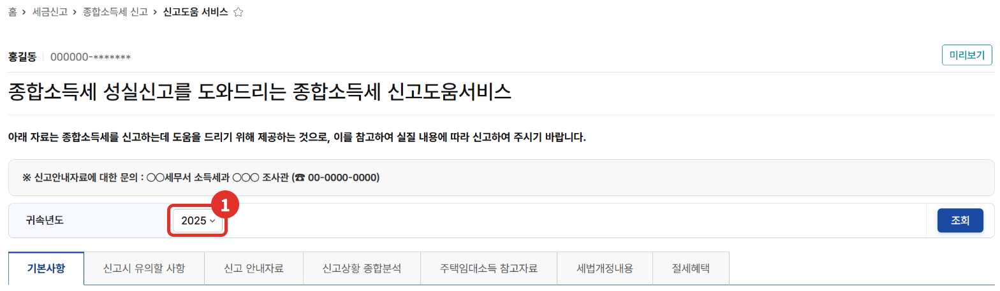
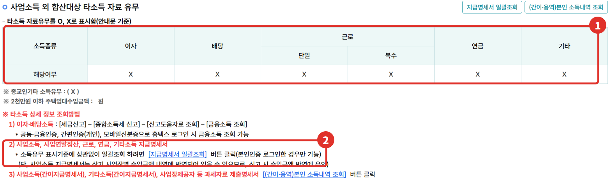

회사에 다니면서 사업자등록을 하고 부업을 하는 **N잡 사장님**이라면, 회사 연말정산으로 끝나지 않아요. **2026년 귀속 종합소득세는 2027년 5월에 근로소득과 사업소득을 합쳐서 직접 신고**해야 해요. 왜 그런지, 5월 전에 홈택스에서 무엇을 확인해 두면 되는지 2026년 11월 기준으로 정리했어요.

{: .summary-card}

> 💡 **핵심 요약**
> - 근로소득**만** 있으면 연말정산으로 끝나지만, **사업소득이 같이 있으면 5월 신고를 해야 해요** [1][2][9]
> - **2026년 귀속은 2027년 5월 1일~31일(월)에 신고·납부해요**{: .red} [1][3]
> - 연말정산 때 이미 낸 세금은 5월에 빼고 계산해요 [3]. 회사 자료(근로소득 지급명세서)는 **다음 해 3월 10일까지** 국세청에 들어와요 [4]

목차

* 목차
{:toc}

## 한눈에 보기

| 항목 | 내용 |
|---|---|
| 누가 | 근로소득과 사업소득이 함께 있는 사람 [1][2] |
| 기한 | 2027년 5월 1일~31일(월), 2026년 귀속 [1] |
| 신고할 것 | 근로소득 + 사업소득을 합친 종합소득세, 같은 기한에 개인지방소득세 [1][8] |
| 미리 볼 곳 | 나의 홈택스 > 나의 소득·연말정산 > 지급명세서(원천징수 내역)등 조회 |
| 신고 메뉴 | 세금신고 > 종합소득세 신고 |

## 누가 신고하나요?

소득세법은 **신고를 안 해도 되는 사람**을 따로 정해 두었어요 [2]. 대표적으로 근로소득만 있는 사람, 퇴직소득만 있는 사람, 근로소득과 퇴직소득만 있는 사람이에요 [2].

**근로소득과 사업소득이 함께 있는 경우는 이 목록에 없어요.** 그래서 원칙대로 5월에 종합소득세를 신고해야 해요 [1][2]. 국세청도 "근로소득 연말정산을 하였더라도 신고대상 다른 소득(사업소득, 연금소득, 기타소득)이 있는 경우" 합산해서 신고해야 한다고 안내해요 [9].

| 경우 | 5월 신고 |
|---|---|
| 회사 1곳, 근로소득만, 연말정산 함 | 안 해도 돼요 [2] |
| 회사 근로소득 + 내 사업소득 | **해야 해요** [1][2][9] |
| 회사 근로소득 + 3.3% 떼인 프리랜서 수입 | 해야 해요 [9] |
| 회사 2곳 이상, 합쳐서 연말정산 안 함 | 해야 해요 [2][9] |

- 사업에서 손해(결손)가 나도 신고 대상이에요. 법은 결손금이 있는 사람도 신고하라고 정하고 있어요 [1].
- 이 글은 **2026년에 사업을 시작해 2027년 5월에 처음 합산 신고하는 경우**를 기준으로 썼어요.

## 언제까지 하나요?

- 법정 기한은 **다음 해 5월 1일~31일**이에요 [1]. 2027년 5월 31일은 월요일이라 그대로예요. 실제 기한은 2027년 국세청 공지로 한 번 더 확인하세요.
- 성실신고확인서를 내는 사업자는 6월 30일까지예요 [10].
- **기한까지 신고하지 않으면 무신고가산세(일반적으로 낼 세금의 20%)가 붙을 수 있어요**{: .red} [7]. 복식부기의무자는 수입금액의 1만분의 7과 비교해 큰 금액이에요 [7]. 늦게 내면 납부지연가산세도 따로 붙어요 [16].
- 종합소득세를 신고하면 **같은 기한까지 개인지방소득세도 신고·납부**해야 해요 [8].

## 5월에 무엇을 합쳐 계산하나요?

회사 연말정산은 **월급만 보고** 세금을 정산한 거예요. 5월에는 **월급(근로소득금액)과 사업소득금액을 더한 뒤** 세율을 다시 적용하고, 연말정산 때 이미 낸 세금(기납부세액)을 빼요 [3][5].

소득이 합쳐지면 과세표준이 커져 더 높은 세율 구간에 걸릴 수 있어요 [5]. 그래서 **연말정산에서 환급을 받았더라도 5월에 세금을 더 낼 수 있어요.**

### 가상의 예시로 보면

> 아래 숫자는 이해를 돕기 위한 **가상의 예시**예요. 계산을 단순하게 하려고 종합소득공제는 500만원, **세액공제·감면은 0원**으로 가정했어요. 실제로는 근로소득세액공제 등이 있어 금액이 달라요.

**예시 1. 사업에서 이익이 난 경우** (근로소득금액 2,500만원, 사업소득금액 1,000만원)

| 단계 | 연말정산 때(월급만) | 5월 합산 |
|---|---|---|
| 소득금액 | 25,000,000원 | 35,000,000원 |
| − 종합소득공제 | 5,000,000원 | 5,000,000원 |
| 과세표준 | 20,000,000원 | 30,000,000원 |
| 산출세액 [5] | 1,740,000원 | 3,240,000원 |

- 연말정산 때: 84만원 + (2,000만원 − 1,400만원) × 15% = 174만원
- 5월 합산: 84만원 + (3,000만원 − 1,400만원) × 15% = 324만원
- 5월에 낼 세금(위 가정대로면): 324만원 − 이미 낸 174만원 = **150만원**(지방소득세 별도) [3]

**예시 2. 사업에서 손해가 난 경우** (근로소득금액 2,500만원, 사업 결손금 300만원)

| 단계 | 금액 |
|---|---|
| 근로소득금액 − 사업 결손금 | 22,000,000원 |
| − 종합소득공제 | 5,000,000원 |
| 과세표준 | 17,000,000원 |
| 산출세액: 84만원 + (1,700만원 − 1,400만원) × 15% [5] | 1,290,000원 |
| 이미 낸 세금 174만원과 차이(위 가정대로면) | **450,000원 환급** |

그해 사업 결손금을 근로소득금액에서 빼는 규정은 **장부를 써서 계산한 결손금**이 대상이에요 [6]. 장부 없이 경비율로 추계 신고하는 경우는 이 계산이 달라질 수 있으니 126에 확인하세요. 또 **부동산임대업(주거용 건물 임대업 제외)에서 난 결손금은 다른 소득에서 빼지 않아요** [6].

## 5월 전에 홈택스에서 미리 볼 것

> 📅 **2026년 11월 기준 화면**이에요. 운영자 본인 개인 로그인으로 찍었고, 이름·회사·사업자등록번호는 예시 값으로 가렸어요. 조회만 했고 신청·제출 버튼은 누르지 않았어요.

### 1. 회사가 낸 근로소득 지급명세서 확인

5월 신고서의 근로소득 숫자는 회사가 국세청에 낸 **근로소득 지급명세서**(연말정산 내역)를 바탕으로 해요. 회사는 이 자료를 **다음 해 3월 10일까지** 내요 [4].

1. 홈택스에 **개인으로 로그인**하고 오른쪽 위 **나의 홈택스**를 눌러요.
2. 왼쪽 **나의 소득·연말정산**에서 ① **지급명세서(원천징수 내역)등 조회**를 눌러요.
3. ② **귀속연도**를 고르고 ③ **[조회]**를 눌러요.
4. ④ 회사가 낸 **근로소득지급명세서**와 제출일자가 나와요. 운영자의 2025년 귀속 자료는 제출일자가 **2026-03-10**이었어요.

   

**지금(2026년 11월) 2026년 귀속을 조회하면 "조회된 결과가 없습니다"가 나와요.** 회사의 제출 기한이 다음 해 3월 10일이라서, 2026년 귀속 자료는 그 뒤에 조회해 보세요 [4]. 화면에 언제 반영되는지는 조문에 없어서 조회해 보며 확인해야 해요.

   

화면 안내 문구 그대로 이 목록은 "원천징수의무자(회사)가 제출한 [근로소득 등 각종지급명세서] 제출내역"이에요. 3.3%로 떼인 사업소득이 있으면 같은 화면에서 지급명세서 종류를 바꿔 볼 수 있어요.

### 2. 5월에 쓸 메뉴 위치

전체메뉴에서 ① **세금신고**를 누르면 **종합소득세 신고** 칸이 있어요. ② **일반신고(모든신고안내유형)** 아래 ③ **정기신고**, 그리고 ④ **신고도움 서비스**가 있어요(2026년 11월 화면).

   

- 내가 어떤 신고서 유형으로 안내받는지는 5월에 **신고도움 서비스의 "신고안내유형"** 칸과 국세청 안내문에서 확인하세요.
- 2026년 귀속 신고서 안쪽 화면은 **2027년 5월에 열려요.** 운영자도 그때 실제 첫 합산 신고를 따라 하며 정리할 예정이에요.

### 3. 신고도움 서비스에서 합산할 소득 확인

**신고도움 서비스**(세금신고 > 종합소득세 신고 > 신고도움 서비스)는 국세청이 모은 내 소득 자료를 보여 줘요. 지금은 ① **귀속년도가 2025년까지만** 고를 수 있어서, 2026년 귀속은 2027년 신고 기간에 확인할 수 있어요.

   

메뉴를 열면 "신고도움 자료가 제공되지 않더라도 실제 종합소득금액이 있는 경우 신고대상 여부를 판단하여 자진 신고하여야 합니다"라는 알림이 떠요(2026년 11월 화면). **자료가 안 보인다고 신고 대상이 아닌 건 아니에요**{: .red}.

**신고 안내자료** 탭에는 ① **사업소득 외 합산대상 타소득 자료 유무**(이자·배당·근로(단일·복수)·연금·기타를 O/X로 표시) 표가 있어요. ② 근로소득 지급명세서를 한 번에 보려면 같은 칸의 **[지급명세서 일괄조회]**를 눌러요(본인인증 로그인한 경우만, 화면 안내).

   

운영자의 2025년 귀속은 사업을 시작하기 전이라 모두 X로 나왔어요. 화면 안내문에는 이 자료가 "2026년 3월말까지 수집된 자료로서 실제 내용과 다를 수 있"다고 적혀 있어요.

## 연말정산 때 미리 챙길 것

5월 신고와 별개로, 회사 연말정산(다음 해 2월분 급여를 줄 때 [15])에서 N잡 사장님이 헷갈리기 쉬운 부분이에요.

- **사업에 쓴 카드 사용액은 연말정산 신용카드 소득공제에 넣지 않아요**{: .red} [11]. 법은 "사업소득과 관련된 비용"을 공제 대상 금액에서 빼라고 정하고 있어요 [11]. 사업용 카드를 따로 쓰면 나누기 쉬워요([사업용 신용카드 등록 글]()).
- 연말정산 간소화 자료에서 사업용으로 쓴 금액이 자동으로 빠지는지는 공식 자료로 확인하지 못했어요. **본인이 사업 지출을 나눠서 확인**하세요.
- **부양가족은 한 사람만 공제받을 수 있어요** [12]. 배우자와 둘 다 같은 가족을 넣으면 법령이 정한 기준대로 한 사람에게만 인정돼요 [12].

## 자주 하는 실수

| 실수 | 이렇게 하세요 |
|---|---|
| 연말정산 했으니 끝 | 사업소득이 있으면 5월에 합산 신고 [1][2] |
| 사업이 적자라 신고 안 함 | 결손이어도 신고 대상이에요 [1] |
| 3월 전에 근로소득 숫자 찾기 | 회사 제출 기한은 3월 10일 [4] |
| 사업 카드도 연말정산 공제 | 사업 관련 비용은 빼요 [11] |
| 지방소득세 잊음 | 같은 기한에 따로 신고·납부 [8] |

## 직접 신고가 어려울 수 있는 경우

- 매출이 커서 **복식부기의무자**인 경우: 재무상태표·손익계산서 등을 내지 않으면 신고하지 않은 것으로 봐요 [1]
- 성실신고확인 대상인 경우: 성실신고확인서는 세무사 등이 확인해서 작성해요 [10]
- 사업 결손금을 근로소득에서 빼야 하는데 장부가 정리되지 않은 경우 [6]
- 회사를 옮겨 근로소득이 두 곳 이상이고 합산 연말정산을 하지 않은 경우 [2]
- 감면·공제 항목이 많아 어떤 칸에 넣을지 헷갈리는 경우
- 이런 경우에는 **국세상담센터(126)**나 세무대리인에게 먼저 확인하는 게 안전해요.

## 자주 묻는 질문

**Q. 회사에 부업 사업소득을 알려야 연말정산이 되나요?**
A. 회사 연말정산은 근로소득금액을 기준으로 정산해요 [15]. 사업소득은 5월 종합소득세 신고 때 본인이 합쳐서 신고해요 [1][9].

**Q. 연말정산에서 환급받았는데 5월에 또 내야 하나요?**
A. 그럴 수 있어요. 합산하면 과세표준이 커져 산출세액이 늘 수 있고, 연말정산 때 낸 세금을 뺀 차액을 내요 [3][5]. 위 예시 1을 참고하세요.

**Q. 11월에 중간예납 고지서가 오나요?**
A. 그해 새로 사업을 시작한 사람은 중간예납 대상에서 빠져요 [13]. 다음 해부터는 고지될 수 있어요. 조회 방법은 [중간예납 조회 글]()에 있어요.

**Q. 연말정산 공제를 빠뜨렸으면 5월에 넣어도 되나요?**
A. 네. 제주세무서 보도자료(2026년 5월)도 "근로자가 연말정산할 때 놓친 공제 및 감면이 있다면 종합소득세 신고기간 동안 종합소득세 신고를 통해 반영하면 된다"고 안내했어요 [17]. 신고 기간도 지난 연도라면 [근로소득 경정청구 글]()을 참고하세요.

## 함께 보면 좋은 글

- [연말정산 미리보기 홈택스에서 하는 법]()
- [사업용 신용카드 홈택스 등록]()
- [사장님 세무 일정 달력]()

## 출처

1. 법령: 소득세법 제70조 ①④ (2026.7.1. 시행)
2. 법령: 소득세법 제73조 ①② (2026.7.1. 시행)
3. 법령: 소득세법 제76조 ①③ (2026.7.1. 시행)
4. 법령: 소득세법 제164조 ① (2026.7.1. 시행)
5. 법령: 소득세법 제55조 ① (2026.7.1. 시행)
6. 법령: 소득세법 제45조 ①② (2026.7.1. 시행)
7. 법령: 국세기본법 제47조의2 ①② (2026.10.2. 시행)
8. 법령: 지방세법 제95조 ① (2026.7.1. 시행)
9. [국세청 - 모두채움 신고 안내(납부)](https://www.nts.go.kr/nts/cm/cntnts/cntntsView.do?mi=40483&cntntsId=238978) (2025년 귀속 안내, 확인일: 2026-11-23)
10. 법령: 소득세법 제70조의2 ①② (2026.7.1. 시행)
11. 법령: 조세특례제한법 제126조의2 ④ 제1호 (2026.9.18. 시행)
12. 법령: 소득세법 시행령 제106조 ①② (2026.10.1. 시행)
13. 법령: 소득세법 제65조 ① (2026.7.1. 시행)
14. 홈택스 - 나의 홈택스 지급명세서(원천징수 내역)등 조회, 종합소득세 신고도움 서비스 화면·알림창 (2026년 11월 화면, 확인일: 2026-11-23)
15. 법령: 소득세법 제137조 ① (2026.7.1. 시행)
16. 법령: 국세기본법 제47조의4 ① (2026.10.2. 시행)
17. [제주세무서 보도자료 - 연말정산 공제 실수, 종합소득세 신고로 해결하세요](https://s.nts.go.kr/jeju/na/ntt/selectNttInfo.do?mi=2201&bbsId=1028&nttSn=1351098) (2026-05-14, 2025년 귀속 신고 안내, 확인일: 2026-11-23)

> 이 글은 2026년 11월 23일 기준의 일반적인 안내입니다. 세법과 홈택스 화면은 바뀔 수 있으니 신고 전 국세청 안내를 꼭 확인하세요. 개별 상황은 국세상담센터(126)에 문의하세요.
