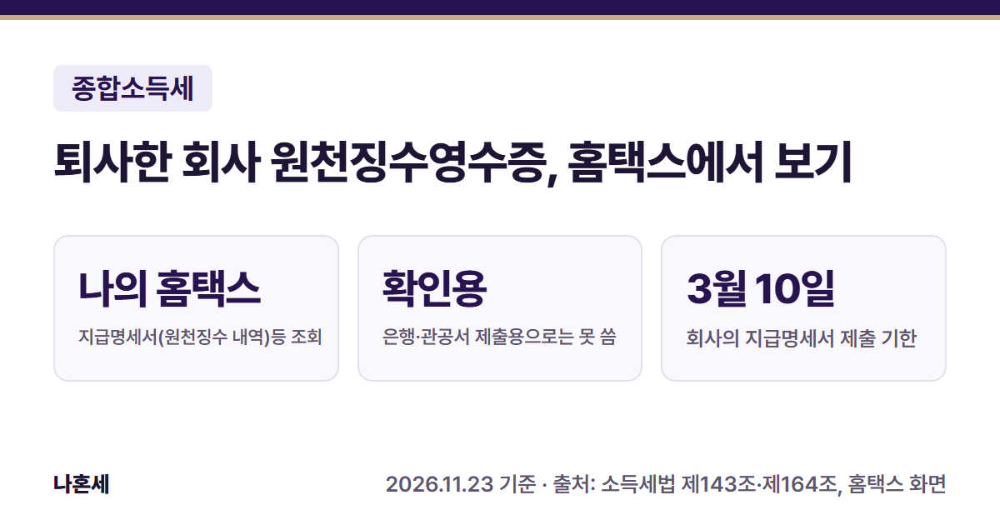
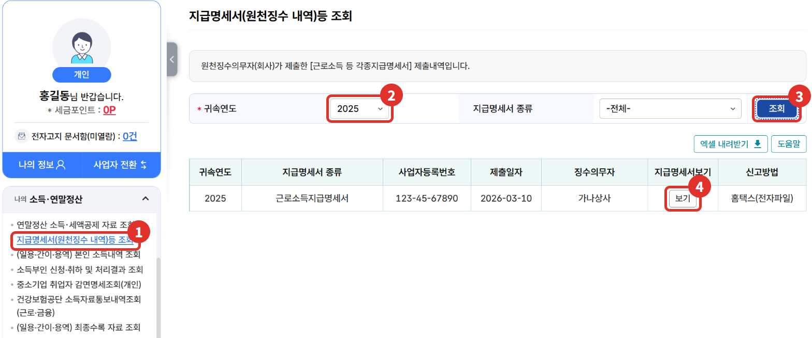
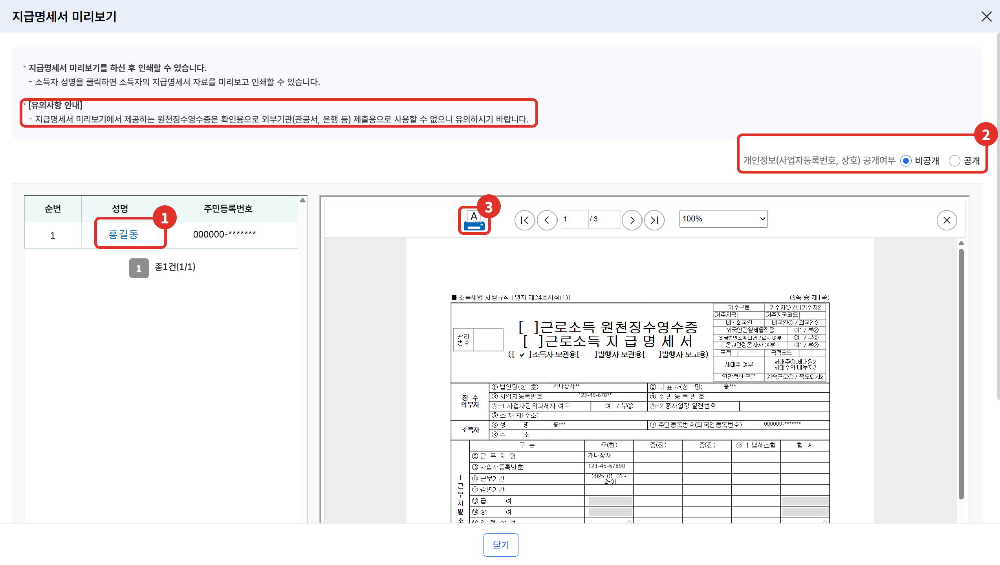
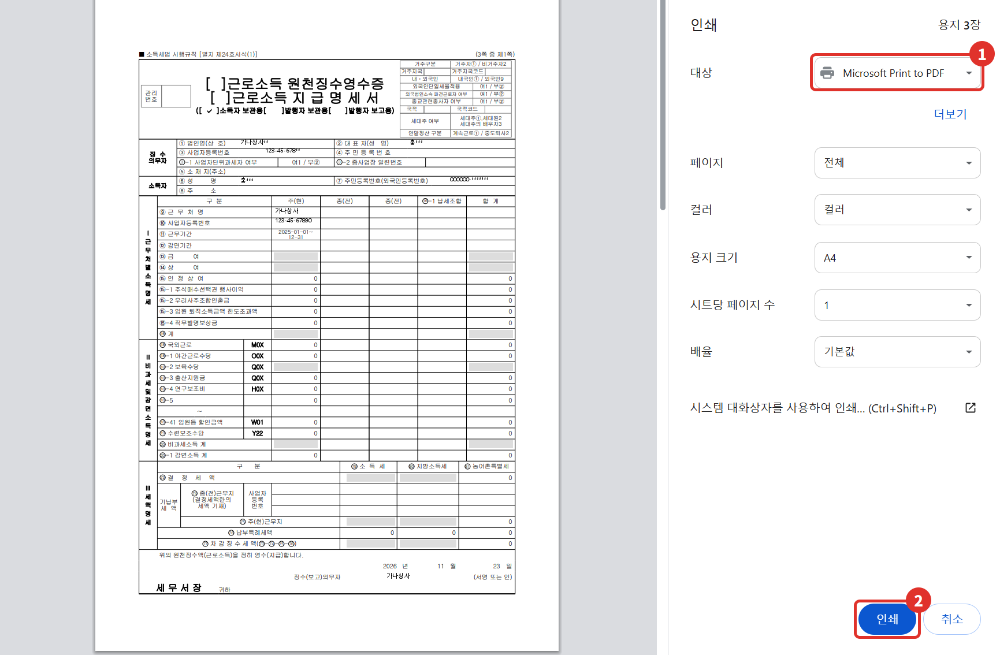

퇴사한 회사에 연말정산 내역(근로소득 원천징수영수증)을 다시 달라고 하기 난감할 때가 있어요. 회사가 국세청에 낸 **근로소득 지급명세서**는 홈택스 **나의 홈택스**에서 본인이 직접 열어 보고 인쇄할 수 있어요. 다만 이렇게 본 영수증은 **확인용**이라 은행·관공서 제출용으로는 쓸 수 없어요. 2026년 11월 기준 화면으로 정리했어요.

{: .summary-card}

> 💡 **핵심 요약**
> - 경로: **나의 홈택스 > 나의 소득·연말정산 > 지급명세서(원천징수 내역)등 조회 > [보기]** [5]
> - **홈택스 미리보기 영수증은 확인용이에요. 외부기관(관공서, 은행 등) 제출용으로는 사용할 수 없어요**{: .red} [5]
> - 회사는 근로소득 지급명세서를 **다음 해 3월 10일까지** 국세청에 내요 [2]. 그 전에는 조회되지 않을 수 있어요

목차

* 목차
{:toc}

## 한눈에 보기

| 항목 | 내용 |
|---|---|
| 누가 | 회사에서 근로소득을 받은 사람(퇴사자 포함), **개인 로그인** |
| 볼 수 있는 것 | 회사가 국세청에 낸 근로소득 지급명세서(원천징수영수증 양식) [5] |
| 언제부터 | 회사가 제출한 뒤. 제출 기한은 다음 해 3월 10일 [2] |
| 용도 | **확인용**(외부기관 제출용 아님) [5] |
| 메뉴 | 나의 홈택스 > 나의 소득·연말정산 > 지급명세서(원천징수 내역)등 조회 |

## 회사는 언제까지 주고, 언제 들어오나요?

- 회사는 원천징수영수증을 근로자에게 **다음 해 2월 말일까지** 줘야 해요. **중도에 퇴사한 사람에게는** 퇴사한 달 급여를 준 달의 **다음 달 말일까지** 줘야 해요 [1].
- 국세청에 내는 근로소득 지급명세서는 **다음 해 3월 10일까지**예요 [2]. 홈택스에서 보이는 것은 이 제출 내역이에요 [5].
- 그래서 **회사의 제출 기한(다음 해 3월 10일) 전에는 올해 귀속분이 홈택스에 없을 수 있어요**{: .red} [2]. 제출 뒤 실제로 조회되기까지 시간이 더 걸릴 수도 있어요. 기다려도 안 보이면 126에 확인하세요. 예를 들어 운영자 계정에서 2026년 11월에 2026년 귀속을 조회하면 "조회된 결과가 없습니다"가 나왔어요.

## 홈택스에서 보는 순서

> 📅 **2026년 11월 기준 화면**이에요. 운영자 본인 개인 로그인 화면이고, 이름·주민등록번호·회사·사업자등록번호·금액은 예시 값이나 회색 상자로 가렸어요.

### 1. 지급명세서 목록 조회

1. 홈택스에 **개인으로 로그인**하고 오른쪽 위 **나의 홈택스**를 눌러요.
2. 왼쪽 **나의 소득·연말정산**에서 ① **지급명세서(원천징수 내역)등 조회**를 눌러요.
3. ② **귀속연도**(급여를 받은 해)를 고르고 ③ **[조회]**를 눌러요. 2026년 11월 화면에서는 2020~2026년을 고를 수 있었어요.
4. 회사가 낸 **근로소득지급명세서** 줄에서 ④ **[보기]**를 눌러요.

   

화면 안내 그대로 이 목록은 "원천징수의무자(회사)가 제출한 [근로소득 등 각종지급명세서] 제출내역"이에요. 회사를 옮겼다면 귀속연도마다 회사별로 줄이 나올 수 있어요.

### 2. 미리보기와 인쇄

[보기]를 누르면 **지급명세서 미리보기** 창이 따로 떠요.

1. 왼쪽 목록에서 ① **본인 이름**을 눌러요. 오른쪽에 원천징수영수증 양식이 나와요(운영자 자료는 3쪽).
2. ② **개인정보(사업자등록번호, 상호) 공개여부**가 기본으로 **비공개**예요. 비공개면 영수증 위쪽 회사 상호·사업자등록번호 일부가 *로 가려져 나와요(운영자 화면 기준).
3. ③ **프린터 아이콘**을 누르면 인쇄 창이 열려요.
4. 위쪽 **[유의사항 안내]**(빨간 상자)에 확인용이라는 문구가 있어요.

   

5. 인쇄 창에서 ① **대상**을 프린터나 **PDF로 저장**(운영자 PC는 Microsoft Print to PDF)으로 고르고 ② **[인쇄]**를 눌러요. PDF로 고르면 파일로 저장돼요.

   

## 영수증에서 볼 곳

원천징수영수증 1쪽에서 주로 보는 칸이에요(2026년 11월 화면의 서식 기준).

| 칸 | 무엇인지 |
|---|---|
| ⑪ 근무기간 | 그 회사에서 일한 기간 |
| ⑬ 급여·⑭ 상여 | 그해 받은 급여와 상여 |
| 결정세액 | 연말정산으로 확정된 그해 세금 |
| 기납부세액 | 매달 월급에서 미리 뗀 세금 |
| 차감징수세액 | 결정세액 − 기납부세액(− 납부특례세액). 마이너스면 돌려받은 금액이에요 |

연말정산 계산 순서(산출세액에서 미리 뗀 세금과 공제를 빼고, 더 뗐으면 돌려줌)는 소득세법에 정해져 있어요 [3].

## 퇴사자가 알아 둘 것

- 회사는 **퇴사하는 달 급여를 줄 때 연말정산**을 해요 [3]. 이때 공제 신고서를 내지 않았다면 인적공제·세액공제 가운데 **본인 기본공제와 표준세액공제만** 적용돼요{: .red} [3].
- 그래서 퇴사 후 그해 다른 회사에 들어가지 않았다면, 영수증에서 결정세액을 확인하고 **다음 해 5월 종합소득세 신고 때 빠진 공제를 넣어 정산**할 수 있어요 [4]. 근로소득만 있으면 신고를 안 해도 되지만, 하는 것도 가능해요 [4]. 다만 공제 항목마다 요건이 달라서(예: 일한 기간에 쓴 금액만 되는 항목이 있을 수 있음) 넣기 전에 홈택스 안내나 126에 확인하세요.
- 5월도 지났다면 **경정청구**를 할 수 있어요(기간·요건 포함). 순서는 [근로소득 경정청구 글]()에 정리했어요.
- 그해 다른 회사에 다시 들어갔다면, 전 회사 소득을 포함해 공제신고서를 내면 **새 회사가 두 회사 소득을 합쳐서 연말정산**해요 [6]. 합치지 않았다면 다음 해 5월에 직접 신고해야 해요 [4]. 새 회사가 어떤 서류를 받는지는 회사에 확인하세요.

## 은행·관공서에 낼 서류가 필요하면

- **홈택스 미리보기 영수증은 제출용이 아니에요**{: .red} [5]. 제출용 원천징수영수증은 영수증을 발급하는 회사에 요청해요 [1].
- 소득을 증명하는 서류가 필요하다면 홈택스 민원증명 **소득금액증명**을 발급받는 방법도 있어요. 순서는 [소득금액증명 발급 글]()에 있어요. 제출처가 어떤 서류를 받는지 먼저 확인하세요.

## 자주 하는 실수

| 실수 | 이렇게 하세요 |
|---|---|
| 퇴사 직후 홈택스에서 찾기 | 회사 제출(다음 해 3월 10일) 뒤에 확인 [2] |
| 미리보기 출력본을 은행에 냄 | 확인용이에요. 제출용은 회사에 요청 [5] |
| 사업자로 로그인 | **개인**으로 로그인해요 |
| 귀속연도를 퇴사한 해로 안 고름 | 급여를 받은 해를 골라요 |

## 직접 처리가 어려울 수 있는 경우

- 홈택스에 지급명세서가 없거나 금액이 실제와 다른 경우: 회사가 제출을 안 했거나 틀렸을 수 있어요. 먼저 회사에, 해결이 안 되면 **국세상담센터(126)**에 문의하세요.
- 한 해에 회사를 여러 곳 다녔는데 합산 연말정산을 하지 않은 경우는 5월 신고 대상이에요 [4]. 계산이 헷갈리면 126이나 세무대리인에게 확인하세요.

## 자주 묻는 질문

**Q. 회사가 폐업했어요. 그래도 볼 수 있나요?**
A. 회사가 지급명세서를 냈다면 같은 화면에서 조회될 수 있어요(폐업한 회사 사례는 직접 확인하지 못했어요). 폐업한 회사는 폐업일이 속하는 달의 다음다음 달 말일까지 내도록 되어 있어요 [2]. 목록에 없으면 126에 문의하세요.

**Q. 홈택스 출력본에 회사 이름이 * 로 나와요.**
A. 미리보기 창의 **개인정보(사업자등록번호, 상호) 공개여부**가 비공개라서 그래요. 공개로 바꾸면 보여요(운영자 화면 기준). 본인 확인 용도라면 비공개로 둬도 돼요.

**Q. 손택스(모바일)에서도 되나요?**
A. 이 글은 PC 홈택스 화면만 확인했어요. 모바일 화면은 확인하지 못했어요.

## 함께 보면 좋은 글

- [연말정산 놓친 공제 경정청구]()
- [소득금액증명 홈택스 발급]()
- [연말정산 미리보기 홈택스에서 하는 법]()

## 출처

1. 법령: 소득세법 제143조 ① (2026.7.1. 시행)
2. 법령: 소득세법 제164조 ① (2026.7.1. 시행)
3. 법령: 소득세법 제137조 ①②③ (2026.7.1. 시행)
4. 법령: 소득세법 제70조 ①, 제73조 ①② (2026.7.1. 시행)
5. 홈택스 - 나의 홈택스 > 지급명세서(원천징수 내역)등 조회, 지급명세서 미리보기 창 안내 문구 (2026년 11월 화면, 확인일: 2026-11-23)
6. 법령: 소득세법 제138조 ① (2026.7.1. 시행)

> 이 글은 2026년 11월 23일 기준의 일반적인 안내입니다. 세법과 홈택스 화면은 바뀔 수 있으니 국세청 안내를 꼭 확인하세요. 개별 상황은 국세상담센터(126)에 문의하세요.
