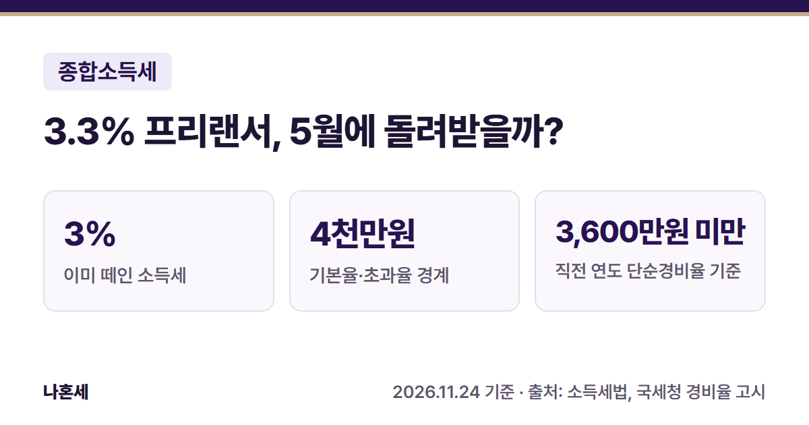
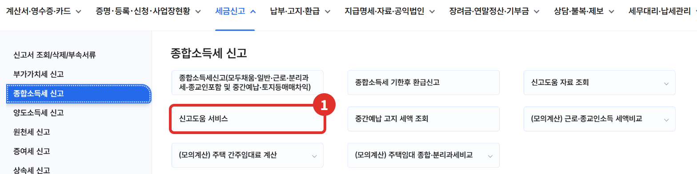
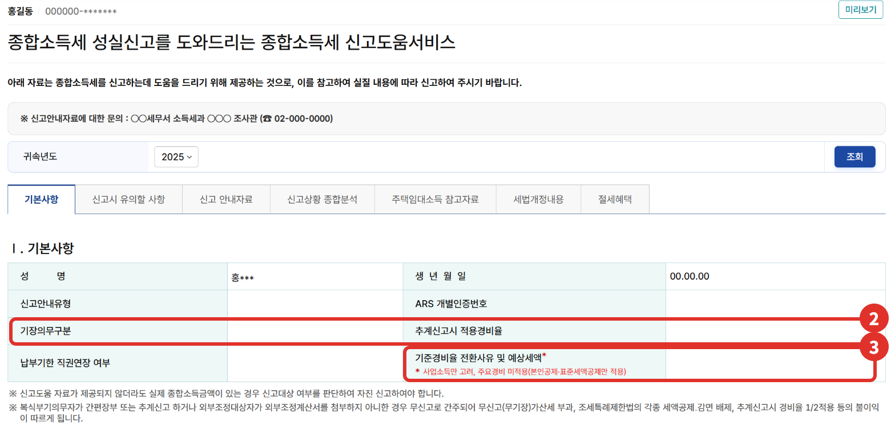
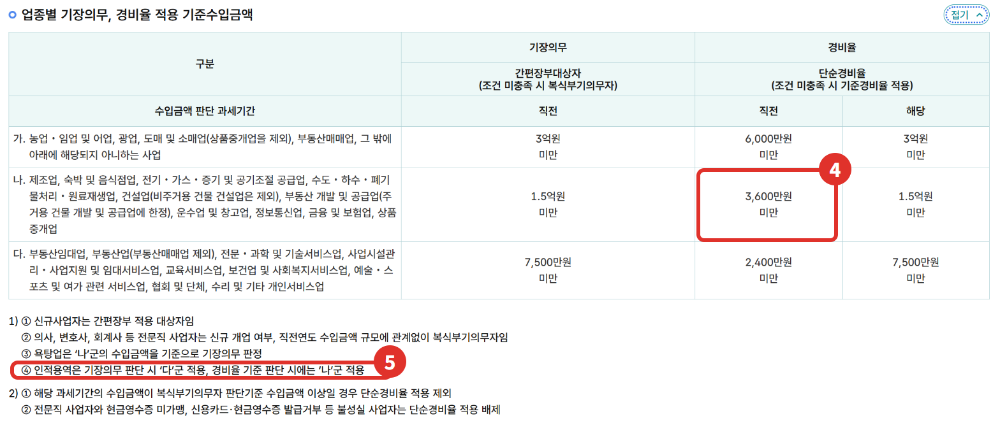

3.3%를 떼고 돈을 받은 프리랜서는 다음 해 5월 종합소득세 신고 때 떼인 세금을 일부 돌려받기도 하고, 더 내기도 해요. 나혼세 [프리랜서 종합소득세 예상 세액 계산기](/calculators/freelancer-income-tax/)에 1년 동안 받은 금액과 업종을 넣으면 2026년 귀속(2027년 5월 신고) 결과를 미리 볼 수 있어요. 이 글은 계산기에 넣을 숫자를 찾는 법과, 홈택스 신고도움 서비스로 내 경비율을 먼저 확인하는 순서를 정리했어요.

{: .summary-card}

> 💡 **핵심 요약**
> - 3.3% 중 **3%는 소득세, 0.3%는 지방소득세**로 미리 떼인 세금이에요. 2027년 5월 1~31일(법정 기한) 신고 때 실제 세금과 비교해 남으면 돌려받고 모자라면 더 내요 [1][6][10]
> - 직전 연도 수입이 **3,600만원 미만**(또는 그해 처음 시작)이고 그해 수입이 **7,500만원 미만**이면 단순경비율로 계산할 수 있어요 [2][3]
> - 인적용역은 수입 **4천만원**까지 기본율, 넘는 부분은 초과율로 경비를 계산해요 [4]
> - **계산기의 경비율은 2025년 귀속 값이라, 2026년 귀속 경비율이 나오는 2027년 봄에는 결과가 달라질 수 있어요**{: .red} [4]

목차

* 목차
{:toc}

## 한눈에 보기

| 항목 | 내용 |
|---|---|
| 누가 | 3.3% 떼고 받은 인적용역 사업소득만 있는 사람 |
| 언제 | 2026년 귀속 → 2027년 5월 1일~31일(법정 기한) 신고 [10] |
| 넣을 것 | 업종코드, 1년 받은 금액(세전), 떼인 소득세, 공제 인원 |
| 먼저 볼 곳 | 홈택스 > 세금신고 > 종합소득세 신고 > 신고도움 서비스 |
| 계산기 | [/calculators/freelancer-income-tax/](/calculators/freelancer-income-tax/) |

## 3.3%를 떼였는데 왜 5월에 또 계산하나요?

돈을 주는 곳은 지급액의 3%를 소득세로, 그 10%(지급액의 0.3%)를 개인지방소득세로 떼서 대신 내요 [1][6]. 이건 1년 세금을 **미리 낸 것**이고, 확정은 다음 해 5월 종합소득세 신고에서 해요.

5월에는 1년 수입에서 경비와 공제를 빼고 세율을 곱해 실제 세금(결정세액)을 계산해요. 결정세액이 미리 낸 3%보다 적으면 그 차이를 돌려받고, 많으면 더 내요 [10].

## 계산은 이렇게 해요

수입이 적고 장부를 쓰지 않는 프리랜서는 보통 **단순경비율**로 경비를 계산해요. 단순경비율은 국세청이 업종마다 정한 "수입 중 경비로 보는 비율"이에요 [2][4].

| 단계 | 계산 | 근거 |
|---|---|---|
| ① 소득금액 | 수입 − 수입 × 단순경비율 | 시행령 제143조③ [2] |
| ② 과세표준 | 소득금액 − 기본공제(1명당 150만원) | 소득세법 제50조 [5] |
| ③ 산출세액 | 과세표준 × 세율(6~45%) | 소득세법 제55조 [5] |
| ④ 결정세액 | 산출세액 − 표준세액공제 7만원 | 제59조의4⑨ [5] |
| ⑤ 결과 | 결정세액 − 이미 떼인 3% | 제76조③·제85조④ [10] |

인적용역(업종코드 940으로 시작) 사업자는 **수입 4천만원까지는 기본율, 4천만원을 넘는 부분은 초과율**을 적용해요 [4]. 초과율이 기본율보다 낮아서, 수입이 많을수록 경비로 인정되는 비율이 줄어요.

### 가상의 예시로 계산해 보면

업종 940909(기타자영업, 2025년 귀속 기본율 64.1%·초과율 49.7%), 다른 소득은 없다고 가정한 **가상의 예시**예요 [4].

| 단계 | 2천만원·본인만 | 5천만원·2명 |
|---|---|---|
| 받은 금액 | 20,000,000원 | 50,000,000원 |
| 경비 | 12,820,000원 | 30,610,000원 |
| 소득금액 | 7,180,000원 | 19,390,000원 |
| 기본공제 | 1,500,000원 | 3,000,000원 |
| 과세표준 | 5,680,000원 | 16,390,000원 |
| 산출세액 | 340,800원 | 1,198,500원 |
| 표준세액공제 | 70,000원 | 70,000원 |
| 결정세액 | 270,800원 | 1,128,500원 |
| 떼인 소득세(3%) | 600,000원 | 1,500,000원 |
| **결과** | **329,200원 환급** | **371,500원 환급** |

- 5천만원 예시의 경비는 4천만원 × 64.1% = 25,640,000원과 1천만원 × 49.7% = 4,970,000원을 더한 값이에요.
- 산출세액: 5,680,000원 × 6% = 340,800원, 1,400만원 × 6% + (16,390,000원 − 1,400만원) × 15% = 1,198,500원이에요 [5].
- 경계 예시: 수입이 300만원이면 과세표준이 0원이라 결정세액도 0원이고, 떼인 9만원을 모두 돌려받는 계산이 나와요.
- 실제 돌려받거나 내는 금액은 10원 미만을 버려요 [7].

## 홈택스에서 내 경비율 먼저 확인하기

계산기에 넣기 전에, 국세청이 나에게 안내한 경비율 유형부터 확인하는 게 좋아요. 2026년 11월 기준 화면이에요 [9]. **지금 화면에는 2025년 귀속 안내가 나와요. 2026년 귀속 안내는 2027년 신고 기간에 다시 확인하세요.**{: .red}

1. 홈택스에 개인으로 로그인하고 **세금신고 > 종합소득세 신고 > ①신고도움 서비스**를 눌러요.

2. 기본사항 표에서 **②기장의무구분**과 **추계신고시 적용경비율**을 봐요. 단순경비율로 안내됐으면 이 계산기와 같은 방식이에요.
3. **③기준경비율 전환사유 및 예상세액** 칸도 함께 봐요. 화면 주석은 "사업소득만 고려, 주요경비 미적용(본인공제·표준세액공제만 적용)"이에요. 이 칸에 내용이 나오면 홈택스 안내나 126으로 확인하세요.

- 위 화면은 신고 안내 자료가 없는 계정이라 칸이 비어 있어요. 화면 아래에는 "신고도움 자료가 제공되지 않더라도 실제 종합소득금액이 있는 경우 신고대상 여부를 판단하여 자진 신고하여야 합니다"라고 적혀 있어요 [9].

4. 같은 화면 아래 **업종별 기장의무, 경비율 적용 기준수입금액**을 펼치면 기준 금액 표가 나와요. 인적용역은 빨간 상자 **④나군 직전 3,600만원 미만**이 단순경비율 기준이에요. 빨간 상자 **⑤**의 주석에는 "인적용역은 기장의무 판단 시 '다'군 적용, 경비율 기준 판단 시에는 '나'군 적용"이라고 적혀 있어요 [9].

- 그해 수입 기준: 표의 '해당' 칸은 나군이 1.5억원으로 적혀 있지만, 표 아래 주석 2)①은 그해 수입이 복식부기 기준 이상이면 단순경비율에서 빠진다고 하고, 인적용역의 복식부기 기준은 주석 1)④에 따라 '다'군 **7,500만원**이에요 [2][3][9]. 그해 수입이 7,500만원에 가까우면 126에 확인하세요.

## 계산기에 숫자 넣는 법

| 칸 | 어디서 찾나 |
|---|---|
| 업종 | 지급처가 준 원천징수영수증·지급명세서의 업종코드(940…) |
| 받은 금액 | 3.3% 떼기 **전** 금액의 1년 합계 |
| 떼인 소득세 | 원천징수영수증의 소득세(3%) 합계, 비우면 자동 계산 |
| 공제 인원 | 본인 + 소득 요건을 갖춘 배우자·부양가족(부양가족은 나이 요건도) |
| 체크 | 2025년 수입 3,600만원 미만이거나 2026년 신규 |

- 3%가 아닌 세율로 떼였다면(예: 봉사료 5%) 영수증의 금액을 그대로 넣으세요 [1].

## 자주 하는 실수

- **세후 금액을 넣는 것**: 통장에 들어온 금액(96.7%)이 아니라 떼기 전 금액을 넣어야 해요.
- **지방소득세까지 떼인 세금에 넣는 것**: 3.3% 중 소득세는 3%예요. 0.3%는 개인지방소득세로 따로 계산돼요 [6].
- **다른 소득을 빼먹는 것**: 근로소득 등 다른 소득이 있으면 합쳐서 세율을 적용해요. 이 계산기는 3.3% 소득만 있는 경우만 계산해요.
- **5월 신고를 안 하는 것**: 미리 낸 세금이 결정세액보다 많으면 그 차이를 돌려받는 구조라 신고로 세액을 확정해야 해요 [10]. **낼 세금이 있는데 기한까지 신고하지 않으면 무신고가산세(낼 세액의 20%)가 붙을 수 있어요.**{: .red} [11]

## 직접 신고가 어려울 수 있는 경우

- 직전 연도 수입이 3,600만원 이상이면 기준경비율이나 장부로 신고해야 해서 계산이 복잡해져요 [2].
- 현금영수증 가맹 의무가 있는데 가입하지 않은 경우 등은 수입이 적어도 단순경비율을 쓸 수 없어요 [2].
- 근로·사업·금융소득이 함께 있거나, 추가공제·감면을 받아야 하면 홈택스 도움말과 국세상담센터(126)로 확인하고, 필요하면 세무대리인과 상담하세요.

## 자주 묻는 질문

**Q. 보험설계사도 이 계산기를 쓰면 되나요?**
A. 간편장부대상자인 보험설계사는 지급처가 사업소득 연말정산을 해 줘요. 방문판매원·음료품배달원은 지급처가 연말정산을 한 경우만 해당해요. 한 곳에서만 받았다면 5월 신고를 따로 안 해도 되고 계산 방법도 달라요. 두 곳 이상에서 받았으면 신고해야 해요 [8]. 계산기에서 그 업종을 고르면 안내가 함께 나와요.

**Q. 2026년 귀속 경비율은 언제 나오나요?**
A. 2025년 귀속 경비율 고시는 2026년 3월 30일에 나왔어요 [4]. 2026년 귀속도 2027년 봄에 나오면 계산기 값을 바꿀게요.

**Q. 계산기 결과대로 신고하면 되나요?**
A. 아니에요. 참고용 예상이에요. 실제 신고는 홈택스 신고서 화면에서 국세청 자료로 계산돼요.

## 함께 보면 좋은 글

- [홈택스 경비율 조회 방법]()
- [직장인 겸 사장님, 연말정산 해도 5월 합산신고]()
- [사장님 세무 일정 달력]()

## 출처

1. 법령: 소득세법 제129조①3호·8호 원천징수세율 (2026.7.1. 시행) (확인일: 2026-11-24)
2. 법령: 소득세법 시행령 제143조③·④·⑦ 추계결정 및 경정 (2026.10.1. 시행) (확인일: 2026-11-24)
3. 법령: 소득세법 시행령 제208조⑤ 장부의 비치·기록 (2026.10.1. 시행) (확인일: 2026-11-24)
4. [국세청 - 2025년 귀속 경비율 고시(국세청고시 제2026-14호, 2026.3.30.)](https://www.law.go.kr/행정규칙/2100000276582) (확인일: 2026-11-24)
5. 법령: 소득세법 제50조①·제55조①·제59조의4⑨ (2026.7.1. 시행) (확인일: 2026-11-24)
6. 법령: 지방세법 제92조①·제103조의13① (2026.7.1. 시행) (확인일: 2026-11-24)
7. 법령: 국고금 관리법 제47조① 끝수 계산 (확인일: 2026-11-05, 부가세 계산기와 같은 근거)
8. 법령: 소득세법 제73조①4호·②·제144조의2 (2026.7.1. 시행), 시행령 제137조①·제143조③1의3 (2026.10.1. 시행) (확인일: 2026-11-24)
9. 홈택스 - 종합소득세 신고도움 서비스 화면 (2026년 11월 확인)
10. 법령: 소득세법 제70조①·제76조③·제85조④ (2026.7.1. 시행) (확인일: 2026-11-24)
11. 법령: 국세기본법 제47조의2① 무신고가산세 (확인일: 2026-11-24)

> 이 글은 2026년 11월 24일 기준의 일반적인 안내입니다. 세법과 홈택스 화면은 바뀔 수 있으니 신고 전 국세청 안내를 꼭 확인하세요. 개별 상황은 국세상담센터(126)에 문의하세요.
