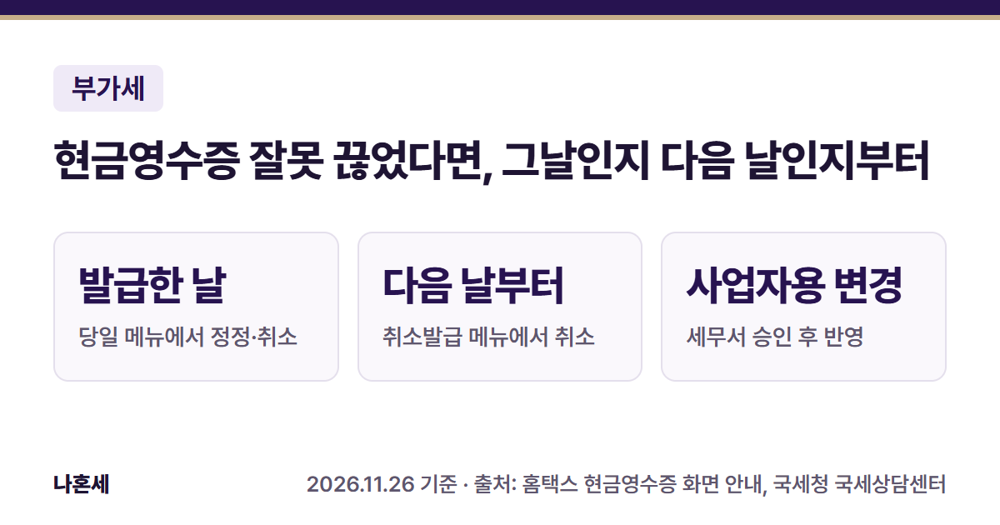
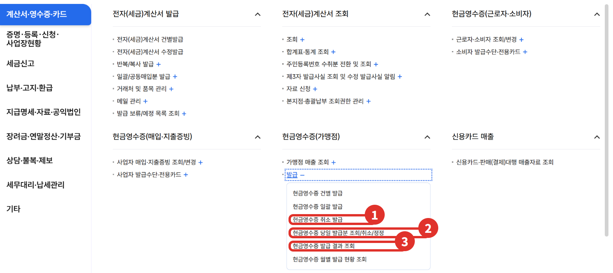
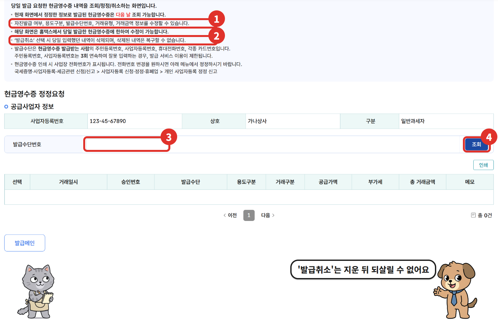
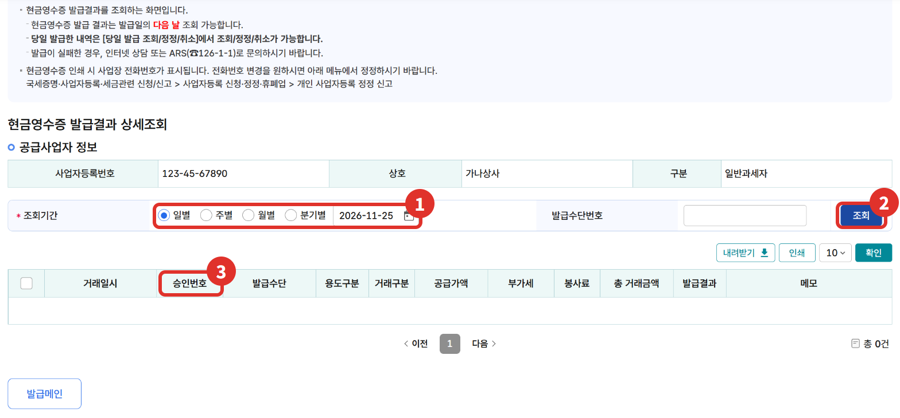
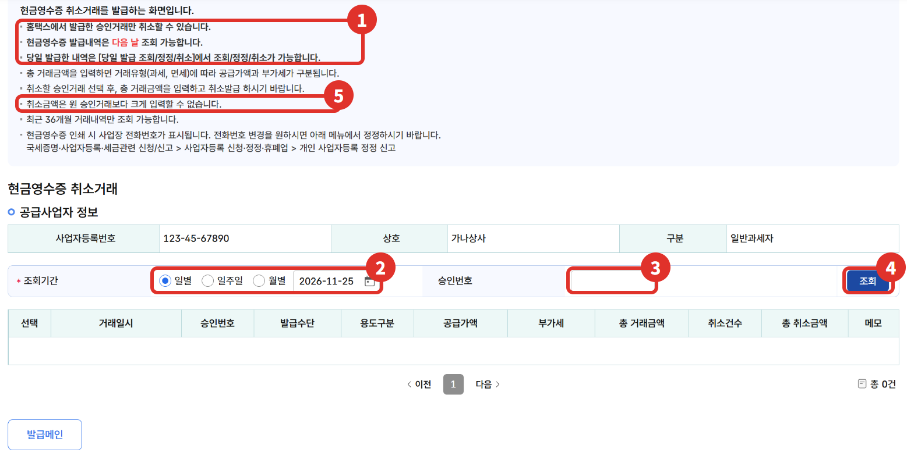
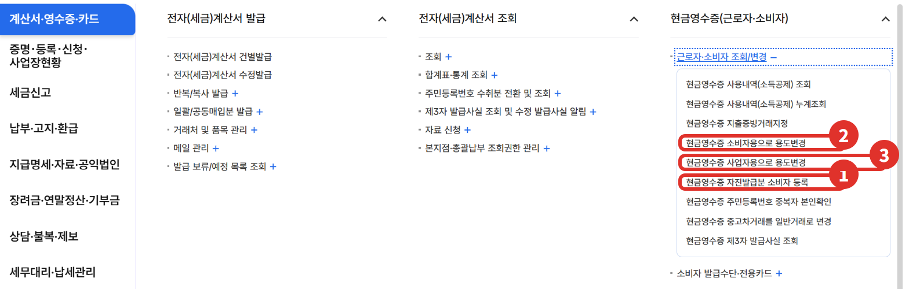
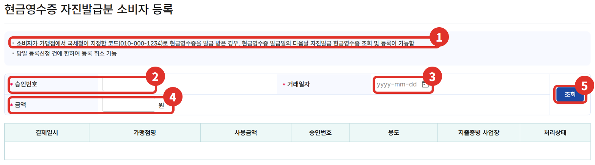
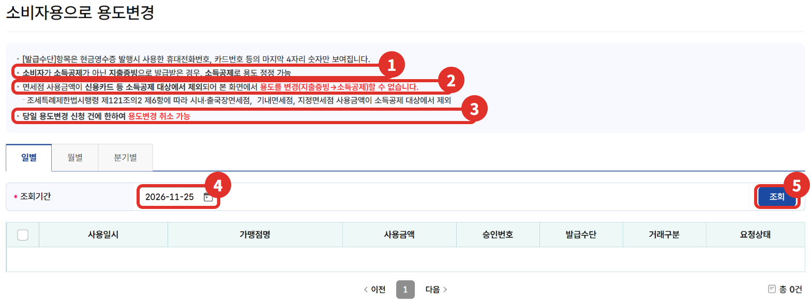
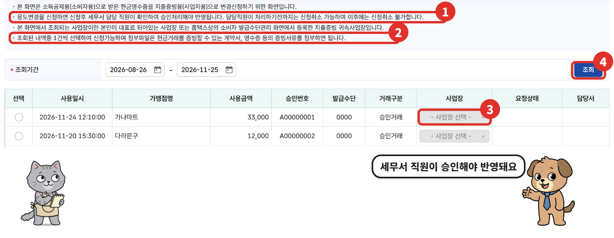

현금영수증을 금액이나 번호를 잘못 넣어 발급했다면, **같은 날인지 다음 날 이후인지**에 따라 홈택스에서 고치는 메뉴가 달라요. 받은 쪽(손님)도 무기명으로 받은 영수증을 내 것으로 등록하거나, 소득공제용·지출증빙용을 바꾸는 메뉴가 따로 있어요. 2026년 11월 기준 홈택스 화면으로 정리했어요.

{: .summary-card}

> 💡 **핵심 요약**
> - **발급한 그날**에는 "당일 발급 조회/정정/취소"에서 자진발급 여부·용도·발급수단번호·거래유형·금액을 고칠 수 있어요 [2]
> - **다음 날부터**는 "취소발급"으로 원래 거래를 취소해요. **취소금액은 원래 승인거래보다 크게 넣을 수 없어요** [1]
> - 받은 쪽은 무기명(010-000-1234) 영수증을 **발급 다음 날부터** 내 것으로 등록할 수 있고 [6], 소득공제용을 사업자용으로 바꾸면 **세무서 담당 직원이 승인해야 반영돼요** [8]

목차

* 목차
{:toc}

## 한눈에 보기

| 상황 | 쓰는 메뉴 |
|---|---|
| 그날 고치기 | 현금영수증 당일 발급분 조회/취소/정정(사업자 로그인) [2] |
| 다음 날부터 취소 | 현금영수증 취소 발급(사업자 로그인) [1] |
| 승인번호 찾기 | 현금영수증 발급 결과 조회(사업자 로그인) [3] |
| 무기명 영수증 내 것으로 | 현금영수증 자진발급분 소비자 등록(개인 로그인) [6] |
| 용도 바꾸기 | 소비자용으로 / 사업자용으로 용도변경(개인 로그인) [7][8] |

메뉴 경로는 모두 **계산서·영수증·카드** 아래예요(전체메뉴 기준). 가게 쪽은 **현금영수증(가맹점) > 발급**, 손님 쪽은 **현금영수증(근로자·소비자) > 근로자·소비자 조회/변경**에 있어요.

## 언제 고칠 수 있나요?

**발급한 날과 다음 날 이후가 갈려요.** 취소발급 화면 안내에 "현금영수증 발급내역은 다음 날 조회 가능", "당일 발급한 내역은 [당일 발급 조회/정정/취소]에서 조회/정정/취소가 가능"이라고 적혀 있어요 [1].

| 언제 알았나 | 하는 일 |
|---|---|
| 발급한 그날 | 당일 화면에서 정정하거나 발급취소 [2] |
| 다음 날부터 | 취소발급으로 원래 거래 취소 [1] |

취소발급 화면에서는 **최근 36개월 거래내역만 조회**된다고 안내돼요 [1]. 국세상담센터 안내로는 환불하거나 물건을 취소할 때 발급단말기·홈택스·ARS로 취소할 수 있고, 취소할 때는 원래 거래의 승인번호·거래일자·취소사유를 넣어요 [4]. 국세청 고시에도 취소할 때 당초 승인거래의 승인번호·승인일자·취소사유를 확인하라고 적혀 있어요 [5].

**현금영수증을 발급한 뒤 정당한 사유나 손님 동의 없이 취소하는 것은 국세청 고시에서 금지하는 행위예요**{: .red} [5]. 받은 돈보다 큰 금액으로 발급하는 것도 같은 고시의 금지 행위라서, 금액을 크게 잘못 넣었다면 고쳐야 해요 [5].

## 가게: 발급한 날 고치기 (당일 정정·취소)

> 📅 **2026년 11월 기준 화면**이에요(운영자 본인 사업자 계정). 발급한 현금영수증이 없어서 목록은 0건이고, 정정·취소 버튼은 누르지 않았어요. 사업자 정보는 가상 값으로 바꿨어요.

1. 홈택스에 **사업자로 로그인**하고 전체메뉴 **계산서·영수증·카드 > 현금영수증(가맹점) > 발급**을 펼쳐요. ① **현금영수증 취소 발급**, ② **현금영수증 당일 발급분 조회/취소/정정**, ③ **현금영수증 발급 결과 조회**가 여기 모여 있어요.

   

2. 메뉴 그림의 ② 당일 발급분 메뉴로 들어가요(화면 제목: 현금영수증 당일 발급 조회/정정/취소). ① 고칠 수 있는 건 **자진발급 여부, 용도구분, 발급수단번호, 거래유형, 거래금액**이에요 [2]. 정정한 내용으로 발급된 현금영수증은 다음 날 조회돼요 [2].
3. ② **'발급취소'를 고르면 그날 입력한 내역이 삭제되고, 삭제한 내역은 되살릴 수 없어요**{: .red} [2]. 금액만 틀렸다면 취소보다 정정이 맞는지 먼저 보세요.
4. ③ **발급수단번호**(손님 휴대폰·주민등록·사업자등록·카드번호)를 넣고 ④ **[조회]**를 눌러 그날 발급한 건을 찾아요 [2].

   

- **주민등록번호나 사업자등록번호를 3회 연속 잘못 넣으면 발급 서비스 이용이 제한된다**고 안내돼요 [2]. 번호는 손님에게 다시 확인하고 넣으세요.
- 이 화면은 **홈택스에서 그날 발급한 현금영수증만** 고칠 수 있어요 [2]. 카드단말기 같은 다른 발급 장치로 끊은 건은 그 장치에서 처리하는지 먼저 확인하세요.

## 가게: 다음 날부터 취소하기 (취소발급)

1. 취소할 거래의 승인번호를 모르면 메뉴 그림의 ③ **현금영수증 발급 결과 조회**에서 먼저 찾아요(화면 제목: 현금영수증 발급결과 상세조회). ① 조회기간(일별·주별·월별·분기별)을 고르고 ② **[조회]**를 누르면 목록에 ③ **승인번호**가 나와요 [3]. 발급 결과도 발급일 다음 날 조회돼요 [3].

   

2. 메뉴 그림의 ① **현금영수증 취소 발급**으로 들어가요(화면 제목: 현금영수증 취소발급). ① 안내 문구에서 **홈택스에서 발급한 승인거래만 취소**할 수 있다는 걸 확인해요 [1].
3. ② 조회기간(일별·일주일·월별)과 날짜를 고르고, ③ 아는 경우 **승인번호**를 넣은 뒤 ④ **[조회]**를 눌러요.
4. 목록에서 취소할 승인거래를 고르고 **총 거래금액**을 넣은 뒤 취소발급해요 [1]. 거래유형(과세·면세)에 따라 공급가액과 부가세는 자동으로 나뉘어요 [1]. ⑤ **취소금액은 원래 승인거래보다 크게 넣을 수 없어요**{: .red} [1].

   

5. 화면에는 취소한 뒤 다시 발급하는 절차 안내가 없어요. 다만 환불이 아니라 잘못 끊어서 취소한 거라면 실제 거래는 남아 있어요. 현금영수증가맹점은 손님이 현금영수증을 요청하면 발급을 거부하거나 사실과 다르게 발급하면 안 되고, 의무발행업종은 건당 10만원(부가세 포함) 이상 현금거래에 손님이 요청하지 않아도 발급해야 해요(사업자에게 계산서·세금계산서를 발급한 경우 등은 예외) [12]. **홈택스 건별 발급은 당일 거래일자로만 발급돼서**, 지난 거래를 다시 발급하는 방법은 국세상담센터(126)에서 확인하세요([현금영수증 발급 글]() 참고). 기명으로 발급한 현금영수증을 정당한 사유 없이 취소하고 거래 상대방이 아닌 다른 사람에게 다시 발급하는 것도 고시의 금지 행위예요 [5].

목록 칸에 **취소건수·총 취소금액**이 따로 있어서 한 거래를 나눠 취소하는 경우도 있어 보이지만, 이 글에서는 실제로 해 보지 않아 단정하지 않을게요.

## 손님: 무기명으로 받은 영수증 내 것으로 등록하기

> 📅 **2026년 11월 기준 화면**이에요(운영자 본인 개인 계정). 등록·변경 버튼은 누르지 않았고, 사업자용 용도변경 화면의 목록은 가상 값(가나마트 등)으로 바꿨어요.

손님이 현금영수증 발급을 요청하지 않으면 가게는 현금을 받은 날부터 5일 안에 국세청 지정 번호(010-000-1234)로 무기명 발급할 수 있어요 [9]. 이렇게 받은 영수증은 손님이 홈택스에서 직접 내 것으로 등록할 수 있어요.

1. 홈택스에 **개인으로 로그인**해요. 운영자가 사업자 로그인으로 자진발급분 소비자 등록 메뉴를 열어 보니 "해당 화면은 개인사업자는 이용할 수 없습니다"라는 안내가 떴어요(2026년 11월 확인). 전체메뉴 **계산서·영수증·카드 > 현금영수증(근로자·소비자) > 근로자·소비자 조회/변경**을 펼치면 ① **자진발급분 소비자 등록**, ② **소비자용으로 용도변경**, ③ **사업자용으로 용도변경**이 있어요.

   

2. 메뉴 그림의 ① 자진발급분 소비자 등록으로 들어가요. 화면의 ① **발급일 다음 날부터** 조회·등록할 수 있어요 [6]. 그날 받은 영수증은 다음 날 다시 들어오세요.
3. 받은 현금영수증의 ② **승인번호**, ③ **거래일자**, ④ **금액**을 넣고 ⑤ **[조회]**를 누른 뒤 등록해요 [6]. 등록 취소는 **당일 등록신청한 건만** 돼요 [6].

   

사업자가 사업용으로 산 걸 무기명으로 받았다면, 사업자 로그인의 **현금영수증(매입·지출증빙)** 쪽에 '현금영수증 자진발급분 사업자등록' 화면이 따로 있어요. [지출증빙 현금영수증 글]()을 보세요.

## 손님: 소득공제용 ↔ 지출증빙용 바꾸기

### 지출증빙으로 받았는데 소득공제로 바꾸기

1. 메뉴 그림의 ② **현금영수증 소비자용으로 용도변경**으로 들어가요(화면 제목: 소비자용으로 용도변경). 화면의 ① 소비자가 소득공제가 아닌 **지출증빙**으로 받은 경우 **소득공제로 용도 정정**이 가능하다고 안내돼요 [7].
2. ② **면세점 사용금액은 소득공제 대상이 아니라서 이 화면에서 바꿀 수 없어요** [7][10]. ③ 용도변경 취소는 **당일 신청한 건만** 돼요 [7].
3. 일별·월별·분기별 탭을 고르고 ④ 조회기간을 넣은 뒤 ⑤ **[조회]**를 눌러 바꿀 건을 골라요.

   

### 소득공제로 받았는데 사업용(지출증빙)으로 바꾸기

회사에 다니면서 사업도 하는 사장님이 개인 휴대폰번호로 사업용 물건값 현금영수증을 받은 경우에 쓰는 화면이에요.

1. 메뉴 그림의 ③ **현금영수증 사업자용으로 용도변경**으로 들어가요(화면 제목: 사업자용으로 용도변경). 화면의 ① **신청하면 세무서 담당 직원이 확인하고 승인해야 반영돼요**{: .red}. 담당 직원이 처리하기 전까지만 신청을 취소할 수 있고, 그 뒤에는 취소가 안 돼요 [8].
2. ② 조회된 내역 중 **1건씩** 골라 신청하고, 현금거래를 증명할 수 있는 **계약서·영수증 같은 증빙서류를 첨부**해요 [8].
3. 조회기간을 넣고 ④ **[조회]**를 눌러요. 목록에서 고른 건의 ③ **사업장**을 선택해요. 여기서 고를 수 있는 사업장은 **본인이 대표로 된 사업장**이나 홈택스 소비자 발급수단관리 화면에서 등록한 **지출증빙 귀속 사업장**이에요 [8].

   

앞으로 개인 휴대폰번호로 지출증빙을 받을 거라면, 처음부터 지출증빙 귀속 사업장을 입력해 두는 방법도 국세상담센터에 안내돼 있어요 [11]. 경로는 [지출증빙 현금영수증 글]()에 정리했어요.

## 가상 예시: 33,000원을 330,000원으로 잘못 발급했을 때

과세 물품 33,000원을 현금으로 받고, 금액을 330,000원으로 잘못 넣어 발급한 **가상의 예시**예요.

| 언제 알았나 | 고치는 법 | 결과 |
|---|---|---|
| 발급한 그날 | 당일 화면에서 거래금액 정정 [2] | 33,000원으로 다시 발급, 다음 날 조회 [2] |
| 다음 날 | 취소발급에서 330,000원 취소 [1] | 원래 거래는 취소, 33,000원 다시 발급하는 방법은 126에서 확인 |

**경계 예시**: 원래 승인거래가 330,000원이면 취소발급에서 330,001원은 넣을 수 없어요. 취소금액은 원래 승인거래보다 크게 입력할 수 없어서예요 [1].

총 거래금액을 넣으면 공급가액과 부가세는 화면이 자동으로 나눠요 [1]. 끝수 처리는 화면 계산을 그대로 확인하세요.

## 자주 하는 실수

- **다음 날 당일 메뉴에서 찾기**: 당일 메뉴는 그날 발급한 건만 고칠 수 있어요 [2]. 다음 날부터는 취소발급 메뉴로 가요 [1].
- **정정하면 될 걸 발급취소하기**: 발급취소한 내역은 되살릴 수 없어요 [2].
- **취소만 하고 끝내기**: 환불이 아니라 잘못 끊어서 취소했다면 실제 거래의 발급 의무는 남아 있어요 [12]. 지난 거래를 다시 발급하는 방법은 126에서 확인하세요. 가산세 기준은 [현금영수증 발급 글]()에 정리했어요.
- **손님이 그날 바로 등록하려 하기**: 무기명 영수증은 발급일 다음 날부터 등록돼요 [6].
- **사업자 로그인으로 손님 메뉴 열기**: 자진발급분 소비자 등록·용도변경은 개인(근로자·소비자) 메뉴라 개인 로그인으로 들어가요.

## 직접 하기 어려울 수 있는 경우

- 카드단말기나 결제대행(PG) 서비스로 발급한 현금영수증이라 홈택스에서 보이지 않을 때
- 사업자용 용도변경 신청에 붙일 증빙이 없거나, 세무서가 승인하지 않았을 때
- 손님과 환불·취소 여부를 두고 다툼이 있을 때
- 지난 날짜 거래를 다시 발급해야 할 때

확실하지 않으면 **국세상담센터(126)**나 홈택스 상담으로 먼저 확인하세요.

## 자주 묻는 질문

**Q. 손님이 번호를 잘못 불러 줬어요. 다음 날 알았는데 어떻게 하나요?**
A. 다음 날부터는 당일 메뉴로 고칠 수 없으니 취소발급으로 원래 거래를 취소해요 [1]. 맞는 번호로 다시 발급하는 방법은 홈택스 건별 발급이 당일 거래일자로만 되니 126에서 확인하세요.

**Q. 홈택스에서 발급하지 않은 현금영수증도 홈택스에서 취소되나요?**
A. 취소발급 화면은 **홈택스에서 발급한 승인거래만** 취소할 수 있다고 안내돼요 [1]. 국세상담센터 안내로는 발급단말기·ARS로도 취소할 수 있어요 [4].

**Q. 무기명 영수증 승인번호는 어디 있나요?**
A. 가게에서 받은 현금영수증에 적힌 승인번호를 넣어요. 등록 화면에서는 승인번호·거래일자·금액 세 가지를 모두 넣어요 [6].

**Q. 사업자용 용도변경은 언제 반영되나요?**
A. 세무서 담당 직원이 확인하고 승인해야 반영돼요 [8]. 걸리는 기간은 화면에 나와 있지 않아요.

## 함께 보면 좋은 글

- [홈택스 현금영수증 발급 방법]()
- [사업용 현금영수증 지출증빙 받는 법]()
- [홈택스 연말정산 미리보기 사용법]()

## 출처

1. 홈택스 - 현금영수증 취소발급 화면 안내 문구 (운영자 직접 확인: 2026-11-26)
2. 홈택스 - 현금영수증 당일 발급 조회/정정/취소 화면 안내 문구 (운영자 직접 확인: 2026-11-26)
3. 홈택스 - 현금영수증 발급결과 상세조회 화면 안내 문구 (운영자 직접 확인: 2026-11-26)
4. [국세청 국세상담센터 - 자주묻는Q&A: 현금영수증 > 발급, 내역조회 "현금영수증 발급 취소"](https://call.nts.go.kr/call/qna/selectHomeQnaInfo.do?mi=12943&ctgId=CTG11729) (확인일: 2026-11-26)
5. 국세청고시 제2024-13호 「현금영수증가맹점이 지켜야 할 사항」 제1조 ②, 제4조 ②·⑤·⑦ (2024.5.14. 시행, 고시 번호는 국가법령정보센터 행정규칙 정보, 문구는 홈택스 현금영수증 발급 사업자 신청 화면에 실린 고시 문구로 확인, 확인일: 2026-11-07·2026-11-26)
6. 홈택스 - 현금영수증 자진발급분 소비자 등록 화면 안내 문구 (운영자 직접 확인: 2026-11-26)
7. 홈택스 - 현금영수증 소비자용으로 용도변경 화면 안내 문구 (운영자 직접 확인: 2026-11-26)
8. 홈택스 - 현금영수증 사업자용으로 용도변경 화면 안내 문구 (운영자 직접 확인: 2026-11-26)
9. 법령: 소득세법 시행령 제210조의3 ⑬ (2026.10.1. 시행), [국세청 국세상담센터 - 자주묻는Q&A: 현금영수증 > 가맹점](https://call.nts.go.kr/call/qna/selectHomeQnaInfo.do?mi=12943&ctgId=CTG11727) (확인일: 2026-11-26)
10. 법령: 조세특례제한법 시행령 제121조의2 ⑥ 12호 (2026.9.18. 시행)
11. [국세청 국세상담센터 - 자주묻는Q&A: 현금영수증 > 지출증빙용 현금영수증](https://call.nts.go.kr/call/qna/selectHomeQnaInfo.do?mi=12943&ctgId=CTG11726) (확인일: 2026-11-26)
12. 법령: 소득세법 제162조의3 ③·④, 제81조의9 ② (2026.7.1. 시행)

> 이 글은 2026년 11월 26일 기준의 일반적인 안내입니다. 세법과 홈택스 화면은 바뀔 수 있으니 고치기 전 국세청 안내를 꼭 확인하세요. 개별 상황은 국세상담센터(126)에 문의하세요.
