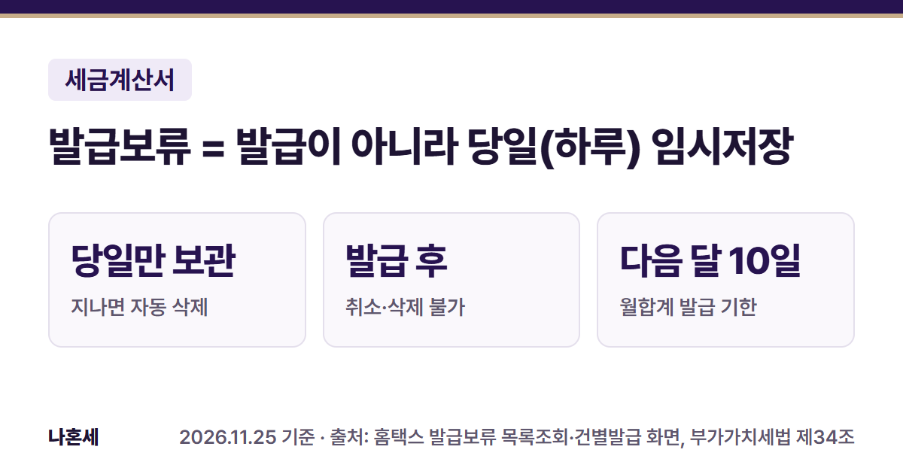
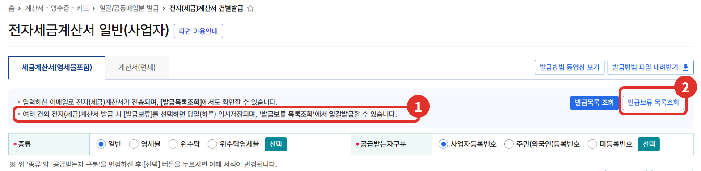
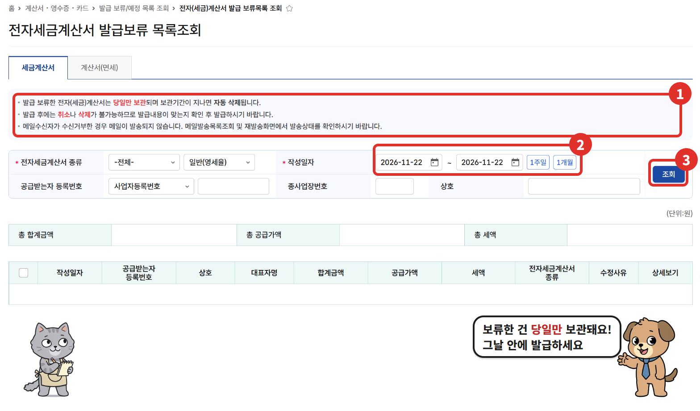
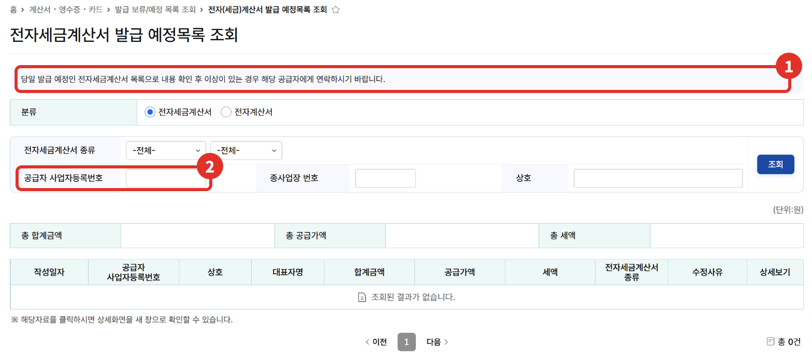

하루에 세금계산서를 여러 장 끊어야 할 때, 한 장씩 입력하고 바로 발급하는 대신 **[발급보류]**로 모아 뒀다가 한 번에 발급할 수 있어요. 다만 보류는 **발급이 아니라 그날 하루 임시저장**이라, 그날 안에 발급하지 않으면 지워져요. 2026년 11월 기준 홈택스 화면으로 정리했어요.

{: .summary-card}

> 💡 **핵심 요약**
> - 건별발급 화면에서 **[발급보류]**를 누르면 **당일(하루) 임시저장**되고, **발급보류 목록조회**에서 일괄발급할 수 있어요 [2]
> - **발급 보류한 세금계산서는 당일만 보관되고, 지나면 자동 삭제돼요**{: .red} [1]. 보류는 발급이 아니라서 발급 기한도 그대로예요 [4]
> - 발급한 뒤에는 **취소나 삭제가 안 되니** 보류 목록에서 내용을 확인하고 발급하라고 안내돼 있어요 [1]

목차

* 목차
{:toc}

## 한눈에 보기

| 항목 | 내용 |
|---|---|
| 누가 | 전자세금계산서를 발급하는 사업자(사업자 로그인) |
| 보류하는 곳 | 건별발급 화면 아래 [발급보류] 버튼 [2] |
| 모아 발급 | 발급 보류목록 조회 → 일괄발급 [2] |
| 보관 기간 | **당일만**, 지나면 자동 삭제 [1] |
| 홈택스 메뉴 | 계산서·영수증·카드 > 전자(세금)계산서 발급 > 발급 보류/예정 목록 조회 > 전자(세금)계산서 발급 보류목록 조회(전체메뉴 기준) |

## 발급보류는 언제 쓰나요?

건별발급 화면 안내 문구에 쓰임이 적혀 있어요. **"여러 건의 전자(세금)계산서 발급 시 [발급보류]를 선택하면 당일(하루) 임시저장되며, '발급보류 목록조회'에서 일괄발급할 수 있습니다"** [2].

예를 들어 오전·오후에 거래가 몇 건 있을 때, 거래가 끝날 때마다 입력해서 보류해 두고 하루 일을 마친 뒤 목록에서 한 번 더 확인하고 발급하는 식이에요. **보류해 둔 것은 아직 발급된 세금계산서가 아니에요**{: .red}. 화면 안내로는 발급하면 입력한 이메일로 전송되고 [발급목록조회]에서 확인할 수 있어요 [2]. 보류 단계에서 어떻게 되는지는 화면에 따로 나와 있지 않아요.

세금계산서를 발급하는 사업자라면 간이과세자도 같은 화면을 써요. 간이과세자 중에는 세금계산서 대신 영수증을 발급하는 경우가 있으니, 대상인지는 [건별발급 글]()에서 먼저 확인하세요 [7].

## 보류해 두면 언제까지 남아 있나요?

**당일만이에요.** 발급보류 목록조회 화면 맨 위에 **"발급 보류한 전자(세금)계산서는 당일만 보관되며 보관기간이 지나면 자동 삭제됩니다"**라고 적혀 있어요 [1].

그래서 보류는 "내일 발급하려고 저장해 두기"에는 맞지 않아요. 화면 안내대로라면 그날 안에 발급하지 못하면 다시 입력해야 해요. 정확히 몇 시에 지워지는지는 화면에 나와 있지 않아요.

보류와 상관없이 **세금계산서 발급 기한은 그대로 지켜야 해요** [4].

| 경우 | 발급 기한 |
|---|---|
| 원칙 | 재화·용역을 공급한 때 [4] |
| 월합계 등 | 공급한 달의 **다음 달 10일**(공휴일·토요일이면 다음 영업일) [4] |

## 홈택스에서 발급보류 쓰는 순서

> 📅 **2026년 11월 기준 화면**이에요(운영자 본인 사업자 계정). 보류해 둔 세금계산서가 없어서 목록은 비어 있고, [발급보류]·[발급하기] 버튼은 누르지 않았어요. 보류 목록에 실제로 들어간 모습과 일괄발급 버튼은 직접 보지 못해 화면 안내 문구로만 적었어요. 아래 메뉴 경로는 전체메뉴 기준이고, 캡처 위쪽에 보이는 경로 표시는 조금 다르게 보일 수 있어요.

### 1) 건별발급 화면에서 보류하기

1. 홈택스에 **사업자로 로그인**하고 **계산서·영수증·카드 > 전자(세금)계산서 발급 > 전자(세금)계산서 건별발급**으로 들어가요(화면 제목: 전자세금계산서 일반(사업자)). 입력하는 방법은 [건별발급 글]()과 같아요.
2. ① 화면 위 안내 문구에서 **[발급보류]를 누르면 당일(하루) 임시저장**되고, 발급보류 목록조회에서 일괄발급한다는 걸 확인해요 [2]. ② 오른쪽 **[발급보류 목록조회]** 버튼으로 보류 목록에 바로 갈 수 있어요.

   

3. 공급받는자·품목·금액을 평소처럼 입력해요.
4. 화면 맨 아래에서 ① **[발급보류]**를 눌러요. 바로 발급하려면 옆의 ② **[발급하기]**를 누르는 거예요. 둘을 헷갈리지 않게 버튼 이름을 꼭 확인하세요.

   ![건별발급 화면 아래 버튼: 초기화, 발급미리보기, ① 발급보류, ② 발급하기, 강아지 말풍선 "[발급보류]와 [발급하기]가 나란히 있어요, 이름 확인!"](/assets/images/posts/hometax-tax-invoice-hold/04-issue-buttons.png)

5. 다음 거래도 같은 방법으로 입력하고 보류해요.

### 2) 보류 목록에서 확인하고 한 번에 발급하기

1. **계산서·영수증·카드 > 전자(세금)계산서 발급 > 발급 보류/예정 목록 조회 > 전자(세금)계산서 발급 보류목록 조회**로 들어가요(화면 제목: 전자세금계산서 발급보류 목록조회). 위쪽에 **세금계산서**와 **계산서(면세)** 탭이 따로 있어요.
2. ① 안내 문구 세 줄을 읽어요. **당일만 보관, 발급 후 취소·삭제 불가**, 그리고 거래처가 메일 수신을 거부했으면 메일이 가지 않으니 **메일발송목록조회 및 재발송** 화면에서 발송 상태를 확인하라는 내용이에요 [1].
3. ② **작성일자**를 고르고(1주일·1개월 버튼도 있어요) ③ **[조회]**를 눌러요. 종류, 공급받는자 등록번호, 종사업장번호, 상호로도 찾을 수 있어요.

   

4. 아래쪽에 **총 합계금액·총 공급가액·총 세액**과 목록(작성일자, 공급받는자 등록번호, 상호, 대표자명, 합계금액, 공급가액, 세액, 종류, 수정사유, 상세보기)이 나와요. 거래처와 금액이 맞는지 한 줄씩 확인해요.
5. 화면 안내로는 이 목록에서 일괄발급할 수 있어요 [2](버튼 위치는 직접 확인하지 못했어요). 발급한 뒤에는 [전자세금계산서 목록 조회]()에서 한 번 더 확인하세요.

## '발급 예정목록 조회'는 다른 메뉴예요

같은 메뉴 묶음에 **전자(세금)계산서 발급 예정목록 조회**가 있는데, 보류 목록과는 다른 화면이에요.

① 화면 안내는 **"당일 발급 예정인 전자세금계산서 목록으로 내용 확인 후 이상이 있는 경우 해당 공급자에게 연락하시기 바랍니다"**예요 [3]. ② 찾는 칸도 **공급자 사업자등록번호**라서, 세금계산서를 **받는 쪽**에서 보는 화면으로 보여요 [3]. 어떤 세금계산서가 이 목록에 잡히는지는 화면 안내에 더 나와 있지 않아 이 글에서는 단정하지 않을게요.

## 가상 예시: 하루 3건을 모아서 발급

하루에 거래처 세 곳에 납품한 **가상의 예시**예요. 거래가 끝날 때마다 건별발급 화면에서 입력하고 [발급보류]를 눌러 둔 뒤, 저녁에 보류 목록에서 한 번에 확인한다고 해 볼게요.

| 거래처 | 공급가액 | 세액(10%) [6] | 합계금액 |
|---|---|---|---|
| 가나상사 | 300,000원 | 30,000원 | 330,000원 |
| 다라상회 | 500,000원 | 50,000원 | 550,000원 |
| 마바공방 | 120,000원 | 12,000원 | 132,000원 |
| **합계** | **920,000원** | **92,000원** | **1,012,000원** |

보류 목록 위쪽의 총 공급가액·총 세액·총 합계금액이 이 합계와 같은지 보면 빠진 건이나 두 번 넣은 건을 찾기 쉬워요. 세액이 원 단위로 딱 떨어지지 않을 때 끝수가 어떻게 처리되는지는 화면 계산을 꼭 확인하세요.

**기한이 밀리는 예시**: 한 달 거래를 모아 끊는 월합계라면, 보류를 잊고 날이 바뀌어 지워졌을 때 기한이 얼마 안 남았을 수 있어요.

| 거래한 달 | 월합계 발급 기한 [4] |
|---|---|
| 2026년 11월 | 2026년 12월 10일(목) |
| 2026년 12월 | 2027년 1월 11일(월) — 10일이 일요일이라 다음 영업일 |

## 자주 하는 실수와 가산세

- **보류해 놓고 발급한 줄 알기**: 보류는 임시저장이에요 [2]. 그날 안에 일괄발급하지 않으면 자동 삭제돼요 [1]. **발급 기한이 지나 그 과세기간 확정신고 기한까지 발급하면 공급가액의 1%, 그때까지도 발급하지 않으면 2% 가산세**예요(전자 발급 의무자가 발급 기한 안에 종이로 발급한 경우 등은 1%) [4][5]. 간이과세자에게도 같은 가산세가 적용돼요 [8].
- **[발급보류] 대신 [발급하기]를 누르기**: 두 버튼이 나란히 있어요. **발급한 뒤에는 취소나 삭제가 안 돼요**{: .red} [1]. 잘못 발급했다면 [수정발급 글]()을 보세요.
- **거래처 번호를 확인 없이 넣기**: 운영자가 공급받는자 칸에 실제로 없는 가상의 번호를 넣고 [확인]을 눌렀더니 "유효한 사업자등록번호가 아닙니다"라는 안내가 떴어요(2026년 11월 확인). 다만 다른 거래처의 진짜 번호를 넣으면 이 안내로 걸러지지 않을 수 있으니, 거래처 사업자등록증으로 번호를 꼭 확인하세요.
- **예정목록을 보류 목록으로 착각하기**: 발급 예정목록은 공급자 사업자등록번호로 찾는 화면이에요 [3]. 내가 보류한 건은 **발급 보류목록 조회**에서 봐요.

## 직접 하기 어려울 수 있는 경우

- 거래가 하루 수십 건이라 한 장씩 입력하기 어려울 때(이때는 [엑셀 일괄발급]()이 맞을 수 있어요)
- 거래마다 공급시기(언제 공급한 것으로 보는지)가 헷갈릴 때
- 이미 발급한 세금계산서의 금액·거래처가 틀려 고쳐야 할 때

확실하지 않으면 **국세상담센터(126)**나 홈택스 상담으로 먼저 확인하세요.

## 자주 묻는 질문

**Q. 오늘 보류한 걸 내일 발급할 수 있나요?**
A. 화면 안내로는 안 돼요. 보류한 세금계산서는 당일만 보관되고 지나면 자동 삭제돼요 [1]. 다음 날 다시 입력해야 해요.

**Q. 보류하면 거래처에 메일이 가나요?**
A. 건별발급 화면 안내로는 입력한 이메일로 전자(세금)계산서가 전송되는 건 발급할 때예요 [2]. 보류 단계에서 메일이 가는지는 화면에 따로 나와 있지 않아요.

**Q. 계산서(면세)도 보류할 수 있나요?**
A. 발급보류 목록조회 화면에 **계산서(면세)** 탭이 따로 있어요 [1]. 이 글에서는 세금계산서 탭만 봤어요.

**Q. 반복발급 화면에도 보류가 있나요?**
A. 반복발급 화면 아래에도 [발급보류] 버튼이 있어요 [9]. 버튼 위치는 [반복발급·복사발급 글]()에서 볼 수 있어요.

## 함께 보면 좋은 글

- [홈택스 전자세금계산서 발급 방법: 건별발급 순서]()
- [홈택스 세금계산서 반복발급·복사발급 방법]()
- [홈택스 전자세금계산서 목록 조회 방법]()

## 출처

1. 홈택스 전자(세금)계산서 발급 보류목록 조회(전자세금계산서 발급보류 목록조회) 화면 안내 문구·조회 항목 (운영자 직접 확인: 2026-11-22)
2. 홈택스 전자(세금)계산서 건별발급(전자세금계산서 일반(사업자)) 화면 안내 문구·버튼 (운영자 직접 확인: 2026-11-22, 2026-11-25)
3. 홈택스 전자(세금)계산서 발급 예정목록 조회 화면 안내 문구·조회 항목 (운영자 직접 확인: 2026-11-22)
4. 법령: 부가가치세법 제34조 ①·③ (2026.1.2. 시행)
5. 법령: 부가가치세법 제60조 ② 1호·2호 (2026.1.2. 시행)
6. 법령: 부가가치세법 제30조 (2026.1.2. 시행)
7. 법령: 부가가치세법 제36조 ① (2026.1.2. 시행)
8. 법령: 부가가치세법 제68조의2 ① (2026.1.2. 시행)
9. 홈택스 전자(세금)계산서 반복발급 화면 아래 버튼(발급보류·일괄발급하기) (운영자 직접 확인: 2026-11-15)

> 이 글은 2026년 11월 25일 기준의 일반적인 안내입니다. 세법과 홈택스 화면은 바뀔 수 있으니 신고 전 국세청 안내를 꼭 확인하세요. 개별 상황은 국세상담센터(126)에 문의하세요.
